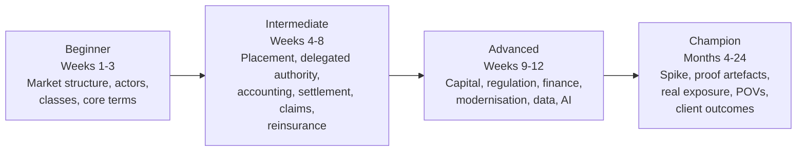

# London Market & Lloyd's – Learning Guide (Beginner → Intermediate → Advanced)

**Purpose:** Build enough depth in the London insurance market and Lloyd's to (1) hold your ground in client conversations, (2) diagnose business problems, and (3) design and deliver functional and technical consulting work.

**Status of information:** Researched and written in November 2026. Market facts that change (results, programme status, regulation) are dated and tagged. Check the [Sources](13-Sources-and-Further-Reading.md) page before quoting a number to a client.

---

## 1. How to read the confidence tags

| Tag | Meaning |
|---|---|
| **[certain]** | Backed by a primary source (Lloyd's, PRA, FCA, legislation) or long-standing, stable market practice. |
| **[likely]** | Strong inference, secondary source (trade press, law firm notes), or a number that may have moved. |
| **[guessing]** | My professional judgement where no hard evidence exists. Treat as a hypothesis to test. |

Definitions and process descriptions that are standard market practice are **[certain]** unless tagged otherwise. Tags are applied wherever a claim is numeric, time-sensitive, or a judgement.

---

## 2. The strategy behind this guide

### 2.1 What a "champion" in this domain actually needs

Most people who struggle in London market consulting do not lack definitions. They fail on three things:

1. **They do not understand money flow and risk flow together.** In London, the risk is shared across many insurers (subscription), the premium passes through a broker, and the capital sits in a layered structure. If you cannot trace one pound of premium and one pound of claim from end to end, you will be found out in the first workshop.
2. **They describe the market as it was in a vendor slide, not as it works today.** Example: in March 2026 Lloyd's retired the name and original vision of Blueprint Two **[certain]**. A consultant still pitching "Blueprint Two readiness" in late 2026 loses credibility immediately.
3. **They cannot link an operational problem to a financial outcome.** Clients buy outcomes: lower expense ratio, faster premium collection, better loss ratio, less capital. Your recommendations must land on one of those.

So the guide is built around three threads that run through every level:

| Thread | Question it answers |
|---|---|
| **Risk & contract** | Who carries the risk, on what terms, and how is that agreed? |
| **Money & capital** | How does premium, claim, commission, tax and capital move, and who holds it? |
| **Data & control** | What data moves between whom, what can go wrong, and who is accountable? |

### 2.2 The learning path

The knowledge levels (Beginner → Advanced) take about 12 weeks. Becoming a world-class consultant takes about 24 months of deliberate practice and real exposure – see [Module 18](18-World-Class-Consultant-Path.md).

### 2.3 Guide map

| # | Module | Level | Read time |
|---|---|---|---|
| 01 | [Foundations: insurance basics and how London is different](01-Beginner-Foundations.md) | Beginner | 60 min |
| 02 | [Actors, entities and players](02-Beginner-Actors-Entities-Players.md) | Beginner | 60 min |
| 03 | [Lines of business and products](03-Beginner-Lines-of-Business.md) | Beginner | 45 min |
| 04 | [Placement and underwriting: open market lifecycle](04-Intermediate-Placement-and-Underwriting.md) | Intermediate | 90 min |
| 05 | [Delegated authority: coverholders, MGAs, bordereaux](05-Intermediate-Delegated-Authority.md) | Intermediate | 75 min |
| 06 | [Accounting, settlement, claims and reinsurance](06-Intermediate-Accounting-Settlement-Claims-Reinsurance.md) | Intermediate | 90 min |
| 07 | [Capital, finance and regulation](07-Advanced-Capital-Finance-Regulation.md) | Advanced | 90 min |
| 08 | [Modernisation, data standards and technology](08-Advanced-Modernisation-Data-Technology.md) | Advanced | 75 min |
| 09 | [AI in the London market](09-Advanced-AI-in-London-Market.md) | Advanced | 75 min |
| 10 | [Business scenarios and case studies](10-Business-Scenarios-and-Case-Studies.md) | All | 120 min |
| 11 | [Consulting playbook and client conversation defence](11-Consulting-Playbook.md) | Champion | 90 min |
| 12 | [Glossary A–Z](12-Glossary.md) | Reference | — |
| 13 | [Self-assessment, 12-week plan, sources](13-Sources-and-Further-Reading.md) | All | — |
| **18** | **[The path to world-class London market consultant (24 months)](18-World-Class-Consultant-Path.md)** | **Champion – start here for the plan** | 45 min |
| **19** | **[Practice toolkit and templates](19-Practice-Toolkit-and-Templates.md)** | **Champion – use weekly** | — |
| 14 | [CII LM1–LM3 structure (optional reference)](14-CII-LM-Certificate-Overview.md) | Reference | 30 min |
| 15 | [LM1 topic notes – principles, regulation, market basics](15-CII-LM1-Study-Notes.md) | Reference (Beginner) | 3–4 hrs |
| 16 | [LM2 topic notes – placement law, intermediaries, reinsurance maths, claims](16-CII-LM2-Study-Notes.md) | Reference (Intermediate) | 4–5 hrs |
| 17 | [LM3 topic notes – wordings, business planning, pricing, distribution](17-CII-LM3-Study-Notes.md) | Reference (Advanced) | 5–6 hrs |

**How the pieces fit:** Module 18 is the spine – a 24-month path built on practice, proof and exposure, not exams. Modules 01–13 are the knowledge it draws on. Module 19 holds the weekly drills and templates. Modules 14–17 follow the CII syllabus structure and are kept as a precise reference for law, rules and calculations – useful, but not the goal.

### 2.4 How to study (do not skip this)

Reading alone will not get you there. For each module:

1. **Read** the module once.
2. **Draw** the flow from memory on one page (the diagrams are your answer key).
3. **Explain** it out loud in 3 minutes as if to a CFO who has no time.
4. **Answer** the module questions in [module 13](13-Sources-and-Further-Reading.md) without looking.
5. **Apply** it: pick one scenario in [module 10](10-Business-Scenarios-and-Case-Studies.md) and write a one-page recommendation.

---

## 3. The London market in late 2026 – one-page snapshot

| Topic | Position (Nov 2026) | Tag |
|---|---|---|
| Size of London market | About **$187bn** gross written premium in 2024 (London Matters 2025, London Market Group); about 8.7% of global re/insurance premium | [likely] – press coverage of the report |
| Lloyd's 2025 results | GWP **£57.9bn**, combined ratio **87.6%**, profit before tax **£10.6bn**, return on capital 22.0%, central solvency ratio 496% | [certain] – Lloyd's FY2025 release, 19 Mar 2026 |
| Lloyd's H1 2026 results | GWP **£34.7bn**, combined ratio **90.8%**, profit before tax **£3.5bn**, risk-adjusted rates **down 6.7%** | [certain] – Lloyd's HY2026 release |
| Market cycle | Softening. PRA's 2026 priorities letter warns that softening in parts of the London market may lead internal models to overstate profit and understate capital | [likely] – law firm summaries of PRA letter |
| Lloyd's leadership | CEO **Patrick Tiernan**; Chair **Sir Charles Roxburgh** | [likely] |
| Lloyd's strategy | 2026–2030 strategy launched 19 Mar 2026. Four drivers: leading underwriting performance; efficient and flexible marketplace; maximised capital advantage; a Lloyd's to be proud of. 2031 ambition: most capital-efficient marketplace for complex risk; return on capital above 12% across the cycle | [certain] for drivers; [likely] for detailed targets |
| Blueprint Two | Name and original vision retired in March 2026. Shift to incremental modernisation, common data standards (the Core Data Record survives), and refocusing Velonetic. Re-platforming not expected before 2028 | [likely] – trade press and law firm notes |
| Conduct regulation | FCA PS25/21 (9 Dec 2025) removed larger commercial customers from ICOBS, PROD and Consumer Duty, and allows co-manufacturers to nominate a lead insurer for PROD 4 duties | [certain] |
| AI | LMA AI Adoption Toolkit launched April 2026. LMA survey: 93% of responding firms have an AI governance framework in place or in development | [likely] |
| Delegated authority | About 45% of Lloyd's premium comes through delegated authority | [likely] |

---

## 4. Ten sentences you must be able to say with confidence

1. "Lloyd's is not an insurance company. It is a regulated marketplace where members provide capital to syndicates, and managing agents run those syndicates."
2. "The London market is Lloyd's plus the company market plus the brokers who place business into both."
3. "Most London risks are placed by subscription: a lead underwriter sets terms and price, and followers take shares until the risk is 100% covered."
4. "The Market Reform Contract (MRC) is the standard contract format. Contract certainty means the terms are agreed and documented before inception."
5. "Around half of Lloyd's premium comes through delegated authority, so data quality and oversight of coverholders is a core risk, not an admin problem."
6. "At Lloyd's, each year of account is kept open for three years and then closed by reinsurance to close (RITC)."
7. "Lloyd's capital sits in a chain of security: syndicate assets, members' Funds at Lloyd's, then central assets including the Central Fund."
8. "Capital at Lloyd's is set on the syndicate's ultimate SCR plus a 35% uplift, called the Economic Capital Assessment."
9. "Blueprint Two was retired in March 2026; the market now focuses on common data standards like the Core Data Record and incremental change."
10. "AI value in London is highest today in submission intake, wording review, bordereaux processing and claims triage, and the constraint is data quality and governance, not models."

If you cannot explain each sentence for two minutes, go back to the relevant module.
