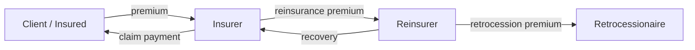

# Module 01 – Foundations: Insurance Basics and How London Is Different

**Level:** Beginner | **Goal:** Understand what insurance is economically, what makes the London market unique, and the basic vocabulary you will hear in every meeting.

---

## 1. Insurance in five ideas

| Idea | Plain meaning | Why it matters in London |
|---|---|---|
| **Risk transfer** | A client pays a known amount (premium) to move an uncertain loss to an insurer. | London takes the risks that local markets cannot or will not take: large, complex, unusual. |
| **Pooling** | Many premiums pay for the few losses. | London pools risk across the world, not just one country. |
| **Underwriting** | Deciding whether to accept a risk, on what terms and at what price. | Underwriting in London is judgement-heavy and often done face to face or on a platform with a broker. |
| **Capital** | Money held to pay claims if losses are worse than expected. | London has a unique capital structure (Lloyd's chain of security). |
| **Claims** | Paying for covered losses under the contract. | Claims are often large, complex and shared by many insurers. |

### 1.1 The insurance profit equation

```
Underwriting result = Earned premium − Claims incurred − Expenses
Total result       = Underwriting result + Investment return
```

**Combined ratio** = (Claims incurred + Expenses) ÷ Earned premium.

- Below 100% = underwriting profit. Above 100% = underwriting loss.
- Lloyd's combined ratio was **87.6% in 2025** and **90.8% in H1 2026** **[certain]**.

The combined ratio splits into parts you must know:

| Component | Meaning |
|---|---|
| **Attritional loss ratio** | Normal, frequent, smaller claims. |
| **Large loss ratio** | Individual big losses (e.g., a refinery fire). |
| **Major / catastrophe loss ratio** | Events affecting many policies (hurricane, earthquake, big cyber event). |
| **Prior-year development** | Releases (good) or strengthening (bad) of reserves for older years. |
| **Acquisition cost ratio** | Brokerage and commission paid to get the business. |
| **Administrative / operating expense ratio** | Cost to run the insurer. |

> **Consulting angle:** In London, acquisition costs (brokerage, coverholder commission) are high, often 25–35% of premium for delegated business **[likely]**. That is why "distribution cost" and "cost of doing business at Lloyd's" are recurring client themes.

---

## 2. Key contract basics

| Term | Meaning |
|---|---|
| **Insured / Assured / Reassured** | The client protected by the contract. "Assured" is common in marine. "Reassured" is the insurer buying reinsurance. |
| **Insurer / Underwriter / Reinsurer** | The party taking the risk. |
| **Policy / Contract** | The legal agreement. In London the placing document is the **MRC (Market Reform Contract)**. |
| **Sum insured / Limit** | Maximum the insurer will pay. |
| **Deductible / Excess / Retention** | The part of the loss the insured keeps. |
| **Layer** | A band of cover, e.g., "$50m excess of $25m" means cover for loss between $25m and $75m. |
| **Primary vs Excess** | Primary pays first; excess layers pay after lower layers are used up. |
| **Period** | Start (inception) and end (expiry) dates. Most London contracts are 12 months. |
| **Endorsement** | A change to the contract during the period. |
| **Wording / Clauses** | The detailed terms. London uses many standard clauses (e.g., LMA, IUA, Institute clauses). |
| **Exclusion** | What is not covered (e.g., war, sanctions, communicable disease, cyber in property). |
| **Warranty / Condition** | Obligations on the insured. The Insurance Act 2015 changed how breaches work. |

### 2.1 Direct insurance vs reinsurance



- **Direct (or "insurance")**: insurer covers a client.
- **Reinsurance**: insurer covers another insurer.
- **Retrocession**: reinsurer covers another reinsurer.
- London writes all three. Lloyd's has a large reinsurance book (property treaty, casualty treaty, specialty) **[certain]**.

### 2.2 Admitted vs non-admitted (surplus lines)

- **Admitted**: insurer licensed in the client's country/state and files rates and forms with the regulator.
- **Non-admitted / Surplus lines / Excess & Surplus (E&S)** (US term): cover placed with an insurer not licensed in that state, allowed because local insurers will not take the risk.
- Lloyd's is one of the largest surplus lines markets in the US **[certain]**. The US and Canada provide roughly half of Lloyd's premium **[likely]**.

---

## 3. What makes the London market different

### 3.1 Definition

The **London market** is the wholesale and specialty insurance and reinsurance market based mainly in the City of London. It consists of:

1. **Lloyd's** – a marketplace of syndicates backed by members' capital.
2. **The company market** – insurance and reinsurance companies writing London business, many of them members of the **International Underwriting Association (IUA)**.
3. **Brokers** – mainly wholesale and specialty brokers who bring global business into London, many represented by **LIIBA**.
4. **Support services** – lawyers, loss adjusters, actuaries, technology firms, bureau services (Velonetic), rating agencies.

### 3.2 Seven features that make London unique

| Feature | Explanation | Typical client conversation |
|---|---|---|
| **1. Subscription** | Large risks are shared among many insurers. One **lead** sets terms; **followers** take shares. | "Why does it take so long to get a change agreed?" – because many carriers must agree. |
| **2. Broker-centred** | Almost all business comes through brokers. The broker is the **agent of the insured**, not of the insurer (with exceptions in delegated authority). | "Who owns the data?" – the broker often does at the start. |
| **3. Specialty and complex risk** | Marine, energy, aviation, political risk, cyber, terrorism, large property, reinsurance. | "Our models do not work for this class." |
| **4. Global reach** | Lloyd's holds licences in 200+ countries and territories; business comes from everywhere. | Tax, regulatory and sanctions complexity. |
| **5. Delegated authority** | Lloyd's and companies give authority to coverholders and MGAs across the world to write business locally. | "We cannot see our own exposure because bordereaux arrive late." |
| **6. Unique capital structure** | Lloyd's mutualised Central Fund and members' capital; capital providers include large insurance groups and private Names. | "How much capital will this new syndicate need?" |
| **7. Shared market infrastructure** | Central bureau for accounting, settlement and claims at Lloyd's and for many company market carriers (Velonetic). | "Why can't we just change our own process?" – because it touches market-wide systems. |

### 3.3 London vs a domestic retail insurer

| Dimension | Domestic retail (e.g., UK motor) | London market (specialty) |
|---|---|---|
| Volume | Millions of small policies | Thousands of large or complex risks |
| Pricing | Statistical, automated | Judgement plus models, negotiated |
| Distribution | Direct, aggregators, brokers | Wholesale brokers, coverholders |
| Risk-sharing | One insurer per policy | Many insurers per risk (subscription) |
| Claims | High volume, standard | Low volume, high value, often litigated |
| Data | Structured, clean | Often unstructured: PDFs, spreadsheets, emails |
| Regulation focus | Consumer protection | Prudential strength, market conduct, sanctions |

---

## 4. A short history – why the market looks the way it does

| Year | Event | What it explains today |
|---|---|---|
| 1688 | Edward Lloyd's coffee house in London becomes the place where ship owners and merchants meet underwriters. | Marine heritage, face-to-face culture. |
| 1871 | Lloyd's Act gives Lloyd's legal status. | Lloyd's is a society governed by Act of Parliament. |
| 1906 | Marine Insurance Act. | Still the core of marine insurance law worldwide. |
| 1982 | Lloyd's Act 1982 creates the Council of Lloyd's and separates brokers from managing agents. | Today's governance and conflict-of-interest rules. |
| Late 1980s–1990s | Asbestos, pollution and catastrophe losses; many individual Names lose heavily. | Why most capital is now corporate; why limited liability was introduced. |
| 1996 | Reconstruction and Renewal; Equitas set up to reinsure 1992-and-prior liabilities. | Origin of modern run-off and RITC practices. |
| 2001 | 9/11 – major loss for Lloyd's. | Terrorism market, Pool Re in UK (formed 1993), aggregation focus. |
| 2007 | Market Reform Contract and contract certainty become standard. | The MRC you see on every placement. |
| 2016 | Placing Platform Limited (PPL) launched for electronic placing. | Electronic placement at Lloyd's. |
| 2018 | Lloyd's "Decile 10" review to fix worst-performing business. | Performance management culture; tight business planning. |
| 2019 | Lloyd's Insurance Company S.A. (Lloyd's Europe) in Brussels after Brexit. | EEA business written through Lloyd's Europe. |
| 2020 | Blueprint Two launched as Lloyd's digital transformation plan. | Core Data Record, digital processing ambitions. |
| 2023 | Lloyd's requires state-backed cyber attack exclusions in cyber policies. | Cyber wording discipline. |
| 2025 | High Court rules for aircraft lessors against war-risk insurers over jets stranded in Russia (insurers later granted permission to appeal in 2026). | Wording precision; war vs all-risks. |
| Mar 2026 | Lloyd's launches 2026–2030 strategy; Blueprint Two name and original vision retired. | Current modernisation landscape. |
| Dec 2025 | FCA PS25/21 simplifies rules for commercial insurance. | Conduct regime for London business. |

---

## 5. The simplest possible end-to-end picture


Modules 04–06 explain each box in detail.

---

## 6. Beginner checklist

You are ready for Module 02 when you can:

- [ ] Explain combined ratio and its components.
- [ ] Explain the difference between insurance, reinsurance and retrocession.
- [ ] Name the four parts of the London market.
- [ ] Explain subscription, lead and follow in one minute.
- [ ] Explain why the broker is agent of the insured.
- [ ] Explain surplus lines in one sentence.
