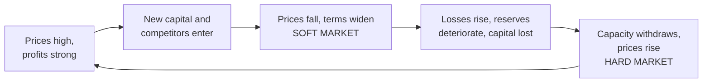
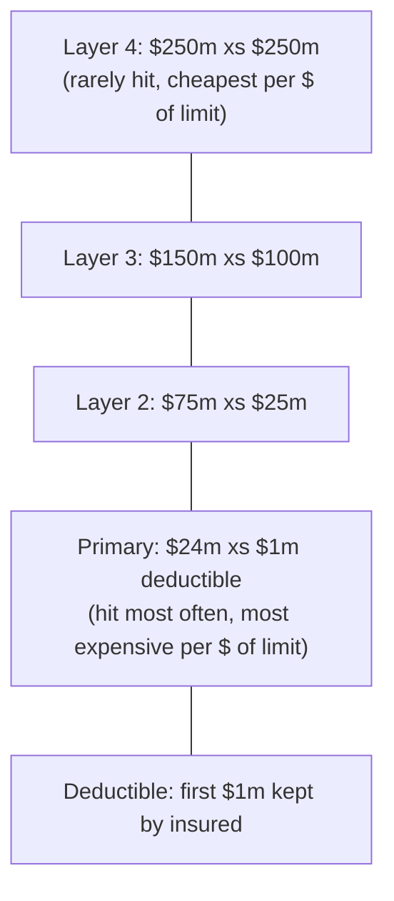
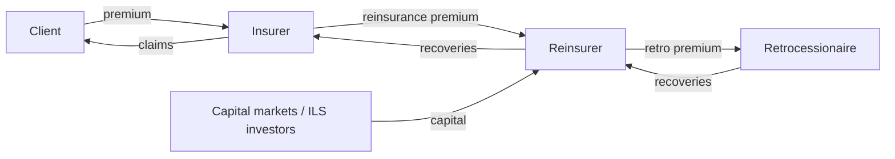

# Module 01 – Foundations: Insurance Economics and How London Is Different

| | |
|---|---|
| **Level** | Beginner |
| **Path phase** | Phase 1 – Foundation, week 1 ([Module 18](18-World-Class-Consultant-Path.md)) |
| **Time** | 3–4 hours reading, 2 hours exercises |
| **Prerequisites** | None |
| **You will be able to** | Explain why insurance exists and how insurers make money; read a combined ratio; describe the basic contract; explain why the London market exists and what makes it different; walk a risk end to end through the market |

---

## How to use this chapter

Each section follows the same pattern: **the idea** in plain English, **a worked example**, **how it works in practice**, and **the consulting angle** – what this means when you sit with a client. Read once fully. Then close the file and explain each section out loud in two minutes. If you cannot, read that section again.

---

## 1. Why insurance exists – the economics

### 1.1 The idea

Businesses face uncertain losses: a fire, a ship sinking, a lawsuit, a cyber attack. Uncertainty is expensive. A company that might lose £50m next year must either hold £50m of spare cash (which earns little and cannot be invested in the business) or accept that one bad event could ruin it.

Insurance solves this by **turning an uncertain large loss into a certain small cost** – the premium. The client pays, say, £500,000 a year and in return the insurer promises to pay the loss if it happens.

The insurer can do this because of **pooling**. It collects premiums from many clients with similar risks. In any year only a few will have losses. The premiums of the many pay the losses of the few.

### 1.2 Worked example – why pooling works

Suppose 1,000 warehouses each have a 1% chance per year of a £2m fire.

| | One warehouse alone | Pool of 1,000 warehouses |
|---|---|---|
| Expected loss per year | 1% × £2m = £20,000 | 10 fires × £2m = £20m in total = £20,000 each |
| Range of outcomes | £0 (99% of years) or £2m (1% of years) | Usually 6–14 fires a year → £12m–£28m total |
| Predictability | Very poor | Good |

The individual owner cannot predict whether they will lose £0 or £2m. The pool can predict, within a reasonable range, that it will pay about £20m. This is the **law of large numbers**: the more similar, independent exposures you pool, the closer actual losses come to expected losses.

The insurer then charges each warehouse the expected loss (£20,000) plus amounts for expenses, the cost of holding capital for bad years, and profit.

### 1.3 Where pooling breaks down – and why London exists

Pooling works best when risks are **many, similar and independent**. Many of the risks London insures are none of these:

| Feature | Example | Problem for pooling |
|---|---|---|
| **Few exposures** | There are only a few hundred offshore oil platforms or satellites | Not enough similar risks to make losses predictable |
| **Very large values** | A refinery worth $3bn; a large airline fleet | One loss can exceed one insurer's appetite or capital |
| **Correlated losses** | A hurricane damages thousands of buildings at once; a cyber attack hits many companies | Losses arrive together, so the pool does not average out |
| **Unusual or new risks** | Political risk in an unstable country; AI liability; space launches | Little or no loss history to price from |

When pooling alone does not work, insurance needs two other things:

1. **Large amounts of capital** to absorb bad years.
2. **Ways to share one large risk among many insurers**, so that no single insurer is exposed to too much.

The London market – and Lloyd's especially – is built to provide both: deep capital and **subscription** (one risk shared by many insurers). This is the single most important idea in the chapter.

### 1.4 Consulting angle

When a client says "this class is volatile", translate it: they have few, large or correlated exposures, so results depend more on capital, reinsurance and underwriting judgement than on statistics. Projects in such classes focus on **exposure management, reinsurance and underwriting discipline**, not on volume automation.

---

## 2. How an insurer makes money

### 2.1 The idea

An insurer earns money in two ways:

1. **Underwriting result** – premiums earned minus claims and expenses.
2. **Investment return** – income from investing premiums and capital until claims are paid. The money held between receiving premium and paying claims is called the **float**.

```
Underwriting result = Earned premium − Claims incurred − Expenses
Total result       = Underwriting result + Investment return − Tax
```

### 2.2 Written vs earned premium

- **Written premium**: the premium for contracts that started in the period.
- **Earned premium**: the part of written premium that relates to the time that has passed.

If a £120,000 annual policy starts on 1 October, by 31 December the insurer has **written** £120,000 but **earned** only £30,000 (3 months of 12). The other £90,000 is **unearned premium** – held as a liability because the insurer still owes 9 months of cover.

This matters because results are measured on **earned** premium. A fast-growing insurer can look like it has lots of premium (written) while its earned premium, and therefore its profit, lags behind.

### 2.3 The combined ratio – your most-used number

**Combined ratio = (Claims incurred + Expenses) ÷ Earned premium**

- Below 100% = underwriting profit.
- Above 100% = underwriting loss (investment income may still produce an overall profit).

**Worked example – Syndicate X, one year**

| Item | £m | Ratio to earned premium |
|---|---|---|
| Earned premium (net of reinsurance) | 1,000 | |
| Attritional claims (normal, smaller losses) | 480 | 48.0% |
| Large individual losses | 70 | 7.0% |
| Catastrophe / major losses | 60 | 6.0% |
| Prior-year reserve releases (older years developing better than expected) | (30) | (3.0%) |
| **Claims ratio** | **580** | **58.0%** |
| Acquisition costs (brokerage, commission) | 250 | 25.0% |
| Operating / administrative expenses | 90 | 9.0% |
| **Expense ratio** | **340** | **34.0%** |
| **Combined ratio** | **920** | **92.0%** |
| Underwriting profit | 80 | |
| Investment return | 45 | |
| **Profit before tax** | **125** | |

**How to read it like an expert:**

| Question | Answer from the example |
|---|---|
| Is the core business profitable? | Look at the **underlying** ratio: excluding cat losses and reserve releases → 48 + 7 + 25 + 9 = **89%**. Yes, but with limited margin. |
| How much did luck help? | Reserve releases gave 3 points. A heavier cat year (say 12 points instead of 6) would push the combined ratio to 98%. |
| Where can a consultant help? | Expense ratio (34%) – acquisition costs of 25% are high and typical of delegated business; operating expenses of 9% can often be reduced through automation and simplification. |

### 2.4 Applying it to Lloyd's today

| Metric | 2025 | H1 2026 |
|---|---|---|
| Gross written premium | £57.9bn | £34.7bn |
| Combined ratio | 87.6% | 90.8% |
| Underlying combined ratio (excluding major claims) | about 81.8% | about 84% |
| Risk-adjusted rate change | — | −6.7% |

Source: Lloyd's results releases **[certain]** for headline figures; underlying split **[likely]**.

**What an advisor sees [likely]:** headline results look strong because 2025 and early 2026 had moderate catastrophe losses and reserve releases. But the underlying ratio is rising period after period because prices are falling. That is the classic early stage of a **soft market**. Clients who keep growing at falling prices are building future losses.

### 2.5 The insurance cycle



Drivers: supply of capital, major catastrophes, investment returns, reserve surprises (especially US liability), and competition. In 2026 new capital is still entering Lloyd's – approved capital for 2026 rose to about £36.2bn and 13 new syndicates started on 1 January 2026 **[likely]** – which adds to price pressure.

### 2.6 Consulting angle

Every recommendation you make must land on one of four numbers: **loss ratio, expense ratio, capital, or growth**. In a soft market, clients care most about the expense ratio (they control it) and loss selection (they partly control it). Learn to say: "This change takes about 1.5 points off your expense ratio," not "This improves efficiency."

---

## 3. The insurance contract – the basics you must know

### 3.1 Parties and roles

| Term | Meaning |
|---|---|
| **Insured / Assured** | The client protected. "Assured" is used in marine. |
| **Insurer / Underwriter** | The party accepting the risk. "Underwriter" is also the person who decides. |
| **Reinsured / Cedant** | An insurer buying reinsurance. |
| **Reinsurer** | Insurer of insurers. |
| **Broker** | Intermediary arranging the contract, normally acting for the client. |
| **Coverholder / MGA** | Firm authorised to bind contracts on behalf of insurers. |

### 3.2 Key financial terms in a contract

| Term | Meaning | Example |
|---|---|---|
| **Sum insured / Limit** | Maximum the insurer pays | $100m limit |
| **Deductible / Excess / Retention** | Part of each loss the insured keeps | First $1m of each loss |
| **Sub-limit** | Lower limit for a specific cover inside the main limit | Flood limited to $10m |
| **Aggregate limit** | Maximum for all losses in the period | $200m in the annual aggregate |
| **Premium** | Price of the cover | $1.2m |
| **Rate** | Premium per unit of exposure | 0.15% of property value |
| **Reinstatement** | Restoring a limit after it is used, often for extra premium (common in reinsurance) | One reinstatement at 100% |

### 3.3 Layers and towers

Large limits are often split into **layers**, each insured by different insurers at different prices. Together they form a **tower**.



"$75m xs $25m" means the layer pays losses above $25m, up to a further $75m (so it covers losses between $25m and $100m).

**Worked example:** a $60m loss is paid as follows. The insured pays the first $1m (deductible). The primary layer ($24m xs $1m) pays the loss from $1m up to $25m – that is $24m. Layer 2 pays from $25m to $60m = $35m. Layers 3 and 4 pay nothing. Total: $1m + $24m + $35m = $60m.

**Why it matters:** each layer often has its own lead underwriter, followers, price and sometimes wording. Gaps or differences between layers cause disputes – a classic contract certainty risk.

### 3.4 When is a claim covered? Three triggers you must not confuse

| Trigger | Covered if… | Common in |
|---|---|---|
| **Losses occurring (occurrence)** | The loss happens during the policy period | Property, most general liability |
| **Claims made** | The claim is first made against the insured (and notified) during the policy period, usually for acts after a retroactive date | Professional indemnity, D&O, cyber, medical malpractice |
| **Risks attaching** | (Reinsurance) The underlying policy started during the reinsurance period | Proportional reinsurance treaties |

A reinsurance treaty can be **losses occurring during (LOD)** or **risks attaching during (RAD)**. Mixing them up in a reinsurance programme creates gaps in cover.

### 3.5 What a policy wording contains

| Part | Purpose |
|---|---|
| Schedule / Risk details | Who, what, where, when, how much |
| Insuring (operative) clause | What is covered |
| Definitions | Meaning of key words (e.g., "occurrence", "damage") |
| Exclusions | What is not covered (war, sanctions, nuclear, cyber in property, communicable disease) |
| Conditions | Obligations of the insured (notify claims, protect property) and of the insurer |
| Endorsements | Changes to the standard wording |

London relies heavily on **standard market clauses** published by the LMA, IUA and the Institute clauses (marine). Each has a reference number (e.g., LMA5564 for one state-backed cyber exclusion). Knowing these numbers lets you – and AI tools – compare wordings systematically.

### 3.6 Key legal principles (introduction)

| Principle | Short meaning |
|---|---|
| **Insurable interest** | The insured must stand to lose financially. |
| **Fair presentation / good faith** | Business clients must disclose material information before cover starts (Insurance Act 2015). |
| **Indemnity** | Put the insured back where they were – no profit from a loss. |
| **Subrogation** | After paying, the insurer can recover from whoever caused the loss. |
| **Contribution** | Insurers covering the same loss share it. |
| **Proximate cause** | The dominant cause of the loss decides whether it is covered. |

Detail in [Module 15](15-CII-LM1-Study-Notes.md).

### 3.7 Consulting angle

Most disputes, leakage and "data problems" in London start with the contract: unclear wording, missing exclusions, layers that do not match, or data captured differently from what was agreed. When you diagnose a claims or data problem, always ask: **"Show me the contract."**

---

## 4. Direct insurance, reinsurance and retrocession

### 4.1 The idea



- **Direct insurance**: insurer covers a client.
- **Reinsurance**: an insurer transfers part of its risk to a reinsurer.
- **Retrocession**: a reinsurer transfers part of its risk to another reinsurer.
- **Insurance-linked securities (ILS)**: investors (pension funds, specialist funds) provide capital for catastrophe risk through cat bonds, collateralised reinsurance and sidecars.

### 4.2 Why insurers buy reinsurance

| Reason | Example |
|---|---|
| **Capacity** | Write a $100m line while keeping only $20m net. |
| **Catastrophe protection** | Limit the net loss from one hurricane. |
| **Stability** | Smooth results from year to year. |
| **Capital relief** | Reinsurance reduces required capital. |
| **Expertise** | Reinsurer supports entry into a new class. |
| **Exit** | Transfer old liabilities (run-off, RITC, loss portfolio transfer). |

### 4.3 In practice

London is one of the world's main reinsurance centres. Lloyd's reinsurance segment (property, casualty and specialty treaty) is one of its largest **[certain]**. Main renewal dates are 1 January (Europe and global), 1 April (Japan), 1 June (Florida) and 1 July (US, Australia) **[certain]**. In 2026, reinsurance prices are falling as capital is plentiful **[likely]**, which makes reinsurance cheaper for buyers and less profitable for sellers.

### 4.4 Consulting angle

Reinsurance programmes are where underwriting, capital and finance meet. Typical client problems: claims not linked to the correct treaty (missed recoveries), programmes bought without clear capital analysis, and reinsurance costs not allocated to the classes that use them.

---

## 5. Admitted, non-admitted and licensing

### 5.1 The idea

Every country regulates insurance on its residents and risks. An insurer can usually write a risk in a country only if:

1. it is **licensed (admitted)** there, or
2. local law allows the risk to be placed with an **unlicensed (non-admitted)** insurer – for example, because local insurers will not take it, or because it is reinsurance or a large commercial risk.

### 5.2 The US surplus lines market

- In the US, non-admitted insurance is called **surplus lines** or **excess and surplus (E&S)**.
- A licensed US **surplus lines broker** places the risk and pays state surplus lines tax.
- E&S covers risks that standard (admitted) US insurers decline: coastal property, hazardous liability, unusual risks.
- Lloyd's is one of the largest surplus lines markets in the US, and the US and Canada provide roughly half of Lloyd's premium **[likely]**.
- US policyholders are protected by Lloyd's US dollar trust funds **[certain]**.

### 5.3 Europe after Brexit

UK insurers lost the right to "passport" into the EU in 2021. Lloyd's created **Lloyd's Insurance Company S.A. (Lloyd's Europe)** in Brussels to write EEA risks; the policies are reinsured back to the syndicates **[certain]**.

### 5.4 Fronting

Where a licence is needed and the London insurer does not have one, a **local licensed insurer** issues the policy and reinsures the risk to London. This is called **fronting**. It adds cost (fronting fee) and credit risk for the fronting insurer.

### 5.5 Consulting angle

Licensing and tax are checked on every risk. Mistakes create regulatory breaches, wrong tax payments and, in extreme cases, invalid cover. For delegated authority business with thousands of risks, licensing and tax checks must be automated and driven by clean location data.

---

## 6. Where London sits in the global market

### 6.1 Four market segments

| Segment | Typical clients | Typical channels | London's role |
|---|---|---|---|
| **Personal lines** | Individuals (motor, home) | Direct, aggregators, retail brokers | Small – mainly through delegated authority (e.g., US homeowners in E&S) |
| **SME commercial** | Small businesses | Retail brokers, MGAs | Through coverholders and MGAs |
| **Large commercial and specialty** | Corporations, complex assets | Global and wholesale brokers | **Core** |
| **Reinsurance** | Insurers | Reinsurance brokers | **Core** |

### 6.2 Global specialty hubs

| Hub | Strength |
|---|---|
| **London** | Breadth of specialty classes, subscription market, Lloyd's licences and rating, broker concentration |
| **Bermuda** | Property catastrophe reinsurance, ILS, large casualty excess |
| **US E&S hubs** | Domestic specialty and surplus lines carriers competing with London |
| **Zurich / Munich / Paris** | Global reinsurers' headquarters |
| **Singapore / Dubai** | Regional hubs for Asia and Middle East; Lloyd's has platforms in both **[certain]** |

**Why London competes:** breadth and depth in one place. **Why it loses business:** higher cost of doing business, slower processes, and growth of US domestic E&S carriers **[likely]**.

### 6.3 Size of London in 2026

| Measure | Value | Tag |
|---|---|---|
| London market total GWP (2024) | about $187bn; about 8.7% of global re/insurance premium | [likely] – LMG London Matters 2025 |
| Lloyd's GWP (2025) | £57.9bn | [certain] |
| Company market premium (2024) | £49.3bn including £5.5bn written elsewhere but controlled from London | [likely] – IUA |
| Lloyd's stamp capacity (2026) | about £58bn | [likely] – Insurance Insider survey |
| Lloyd's approved capital (2026) | about £36.2bn | [likely] |

---

## 7. What makes the London market different – seven features in depth

### 7.1 Subscription

**How it works:** one risk is shared among several insurers. A **lead underwriter** sets the terms and price; **followers** accept the same terms for their own share. Each insurer is liable only for its own share (**several liability**).

**Why it exists:** the risks are too large or too volatile for one insurer.

**What it costs:** every change (endorsement, claim) may need agreement from several insurers; data is duplicated across all of them; processing is complex.

**Consulting implication:** standards that let one agreed change flow to all insurers (the General Underwriters' Agreement, claims lead arrangements, common data records) are the main levers for reducing cost.

### 7.2 A broker-centred market

**How it works:** almost all business arrives through brokers. In the open market the broker is the **agent of the client**. The broker prepares the submission, negotiates, documents the contract, collects premium and presents claims.

**Why it exists:** clients need expert help to access many specialist insurers; insurers rely on brokers for distribution.

**What it costs:** brokerage typically 10–25% of premium **[likely]**; data is created first in broker systems, in broker formats.

**Consulting implication:** a carrier cannot fix data quality alone. Data standards must work for brokers as well, or the carrier will keep re-keying.

### 7.3 Specialty and complex risk

**How it works:** London writes marine, energy, aviation, political risk, terrorism, cyber, large property, US E&S, specialty liability and reinsurance.

**Why it exists:** 330+ years of expertise, concentration of specialist underwriters, and capital willing to take volatile risks.

**What it costs:** pricing relies on judgement; models are imperfect; results are volatile.

**Consulting implication:** automation must support underwriters' judgement, not replace it. Lloyd's 2026 strategy explicitly says AI should strengthen human decisions **[likely]**.

### 7.4 Global reach

**How it works:** Lloyd's holds licences or eligibility in 200+ countries and territories **[certain]**; business comes from every continent.

**What it costs:** licensing, tax, regulatory reporting and sanctions screening across many jurisdictions.

**Consulting implication:** compliance and tax rules must be data-driven and automated; manual checking does not scale.

### 7.5 Delegated authority

**How it works:** insurers authorise coverholders and MGAs around the world to bind risks locally. About 45% of Lloyd's premium comes this way **[likely]**.

**What it costs:** loss of direct control, late and poor-quality data (bordereaux), conduct risk.

**Consulting implication:** DA oversight and bordereaux processing are among the largest and most persistent operational problems in the market – and one of the best areas for data and AI work. See [Module 05](05-Intermediate-Delegated-Authority.md).

### 7.6 A unique capital structure

**How it works:** Lloyd's syndicates are backed by members' capital, with a mutual **Central Fund** behind all of them (the **chain of security**). Capital comes from insurance groups, investors and private individuals (Names).

**Why it matters:** every Lloyd's policy carries the same financial strength rating, and capital can enter or leave each year relatively easily.

**Consulting implication:** at Lloyd's, business plans and capital are approved annually by the Corporation. Many strategic decisions (growth, new classes, new syndicates) go through that process. See [Module 07](07-Advanced-Capital-Finance-Regulation.md).

### 7.7 Shared market infrastructure

**How it works:** premium and claims processing, accounting and settlement for Lloyd's and much of the company market go through a central bureau (**Velonetic**). Placement increasingly runs on electronic platforms (PPL, Whitespace).

**What it costs:** change is slow because many firms depend on the same systems. Lloyd's retired Blueprint Two – its flagship modernisation plan – in March 2026 after repeated delays **[likely]**.

**Consulting implication:** design client solutions that deliver value inside the firm while staying compatible with market standards. See [Module 08](08-Advanced-Modernisation-Data-Technology.md).

---

## 8. London vs a domestic retail insurer

| Dimension | Domestic retail insurer (e.g., UK motor) | London specialty market |
|---|---|---|
| Number of policies | Millions | Thousands to tens of thousands per carrier |
| Average premium | Hundreds of pounds | Tens of thousands to millions |
| Pricing | Statistical, automated, real-time | Judgement plus models, negotiated |
| Distribution | Direct, price comparison sites, brokers | Wholesale brokers, coverholders |
| Insurers per policy | One | Often several (subscription) |
| Claims | High volume, standard | Low volume, high value, complex, often legal |
| Data | Structured, captured digitally | Often unstructured: PDFs, spreadsheets, emails |
| Main regulation focus | Consumer protection (Consumer Duty) | Prudential strength, conduct in the distribution chain, sanctions; larger commercial clients now outside Consumer Duty (FCA PS25/21) **[certain]** |
| Technology priorities | Digital customer journeys, pricing engines | Data ingestion, workflow, standards, exposure management |

**Consulting implication:** do not bring retail insurance solutions into London without adapting them. A real-time pricing engine is valuable in UK motor; in London marine hull the bottleneck is reading a 60-page submission and agreeing terms among six insurers.

---

## 9. A short history – and what each event explains today

| Period | What happened | What it explains today |
|---|---|---|
| **1688** | Edward Lloyd's coffee house becomes the meeting place for ship owners, merchants and individual underwriters. | Marine heritage; face-to-face culture; the idea of individuals "writing under" a risk – the origin of "underwriter". |
| **1771** | Underwriters form the Society of Lloyd's. | Lloyd's as a society of members, not a company. |
| **1871** | Lloyd's Act gives the Society legal status. | Lloyd's is governed by Acts of Parliament. |
| **1906** | Marine Insurance Act. | Still the basis of marine insurance law in many countries. |
| **1906** | San Francisco earthquake – Lloyd's underwriters pay claims in full. | London's reputation for paying claims, used in marketing to this day. |
| **1982** | Lloyd's Act 1982 creates the Council and forces brokers to separate from managing agents. | Today's governance and conflict-of-interest rules. |
| **1980s–1990s** | Asbestos, pollution and catastrophe losses; many Names (individual members with unlimited liability) lose heavily. | Why most capital is now corporate and limited liability; why Lloyd's is strict about business planning. |
| **1996** | Reconstruction and Renewal; **Equitas** created to reinsure 1992-and-prior liabilities. | Origin of modern legacy and run-off solutions. |
| **2001** | 9/11 – the largest loss in Lloyd's history at that time. | Terrorism market development; focus on aggregation and realistic disaster scenarios. |
| **2005** | Hurricanes Katrina, Rita and Wilma. | Catastrophe modelling and exposure management become central. |
| **2007** | Market Reform Contract and contract certainty become standard. | The MRC used on almost every placement. |
| **2016** | Placing Platform Limited (PPL) launched. | Electronic placement at Lloyd's. |
| **2018** | Lloyd's "Decile 10" review targets worst-performing business. | Performance management culture; tougher plan approvals. |
| **2019** | Lloyd's Europe set up in Brussels after Brexit. | EEA business written through Lloyd's Europe. |
| **2020** | COVID-19 losses (event cancellation, business interruption disputes); Blueprint Two launched. | Wording precision; modernisation ambitions. |
| **2022–2023** | Russia's invasion of Ukraine; aircraft stuck in Russia; Lloyd's requires state-backed cyber attack exclusions from March 2023 **[certain]**. | Sanctions burden; war and cyber wording discipline. |
| **2024** | Baltimore bridge collapse; global IT outage (CrowdStrike). | Large marine liability losses; non-malicious cyber aggregation. |
| **2025** | High Court finds for aircraft lessors under war-risk covers (appeal permitted in 2026) **[likely]**; new Lloyd's Chair (Sir Charles Roxburgh, May 2025) and CEO (Patrick Tiernan, June 2025) **[likely]**; FCA PS25/21 simplifies commercial conduct rules (Dec 2025) **[certain]**. | Litigation risk on wording; new leadership agenda; lighter conduct rules for large clients. |
| **2026** | Lloyd's 2026–2030 strategy; Blueprint Two retired; LMA AI Adoption Toolkit; prices softening **[likely]**. | The environment you are working in now. |

---

## 10. End-to-end story: insuring a shipping fleet through London

This story connects every concept in the chapter. Follow it slowly.

**The client.** Pacific Carriers, a shipping company in Singapore, owns 25 bulk carriers worth $900m in total. It needs hull and machinery insurance (damage to the ships).

**Step 1 – Local broker.** Pacific Carriers' broker in Singapore cannot place $900m of hull risk locally at a good price, so it instructs a **London wholesale broker**.

**Step 2 – Submission.** The London broker gathers the fleet list (vessel names, IMO numbers, ages, flags, classification societies), the trading areas, 5 years of claims history and the current policy. It drafts a **Market Reform Contract (MRC)** and creates a **Unique Market Reference (UMR)**.

**Step 3 – Choosing a lead.** The broker approaches a Lloyd's syndicate known as a leading marine hull underwriter. The underwriter reviews the fleet, checks **sanctions** (owners, vessels, trading areas), considers the claims history, and quotes a rate and deductible. It agrees to **lead** with a 20% line.

**Step 4 – Following.** The broker shows the led MRC to other syndicates and company market insurers. They write lines totalling 110%. The broker **signs down** each line proportionally so the total is 100%. Every insurer is liable only for its own **signed line**.

**Step 5 – Contract certainty.** All terms are agreed before the policy starts on 1 January. The broker issues documentation to the client.

**Step 6 – Premium.** Pacific Carriers pays the premium to its Singapore broker, who pays the London broker. The London broker deducts its **brokerage** and submits the premium to the **bureau**, which processes it and settles each insurer's share through **central settlement**.

**Step 7 – Reinsurance.** Each syndicate has its own reinsurance. The lead syndicate's marine excess of loss treaty will pay above $10m per loss.

**Step 8 – The loss.** In July, one ship runs aground and suffers $40m of damage. The ship's master informs the owner; the owner's broker notifies the **lead underwriter** through the market claims system. The leader appoints a **surveyor and loss adjuster**, agrees the claim with the other agreement parties under the market claims rules, and followers are bound by that agreement.

**Step 9 – Payment and recovery.** Each insurer pays its share of $40m through central settlement; the broker passes the money to the client. The lead syndicate's share (20%) is $8m. Its excess of loss treaty only pays above $10m per loss, so **nothing is recovered** on this claim – the syndicate keeps the whole $8m net. (Always check the retention before assuming a recovery.) If the grounding was caused by a faulty pilot service, insurers may pursue **subrogation**.

**Step 10 – Results.** At year end, the claim affects each syndicate's **loss ratio** for the 2026 **year of account**. The underwriter reviews the fleet's rate at renewal.

**Consulting questions this story raises:**
- How many times was the fleet data re-keyed between broker, lead, followers and the bureau?
- How long did it take to agree the claim among insurers?
- Did each insurer's systems record the same signed line, premium and claim?
- Were sanctions checks repeated at claim payment?

These are exactly the kinds of questions that lead to consulting work.

---

## 11. Common misconceptions

| Misconception | Reality |
|---|---|
| "Lloyd's is an insurance company." | Lloyd's is a marketplace and regulator of that market. Syndicates take the risk. |
| "London is just Lloyd's." | The company market is of similar size to Lloyd's in premium terms. |
| "The broker works for the insurer." | In the open market, the broker acts for the client. |
| "Premium written is the same as revenue." | Results are based on earned premium. |
| "A low combined ratio means a healthy business." | Check the underlying ratio, catastrophe luck and reserve releases. |
| "Reinsurance is just insurance for insurers – a back-office topic." | It drives capital, results and strategy. |
| "Technology from retail insurance will fix London." | London's bottlenecks are unstructured data, subscription and judgement-based underwriting. |

---

## 11A. Partner's lens – how a top-tier strategy consultant would use this chapter

*This section is written in the working style of senior partners at McKinsey, Bain and BCG – hypothesis-driven, numbers-first, answer-first. It is a description of widely documented methods, not insider material from any firm.*

**1. Lead with the answer, then the numbers.** A partner never opens a London market discussion with "Lloyd's is a marketplace of syndicates…". They open with the client's economics: "Your combined ratio is 92%, but 6 points of that is luck – lighter cats and reserve releases. Your underlying business is at 98% and moving the wrong way as rates fall 6–7% a year." Everything in this chapter exists so you can say that sentence with confidence.

**2. Always size the value at stake.** For a syndicate with £1bn earned premium:

| Lever | Typical move | Value per year |
|---|---|---|
| 1 point of loss ratio (selection, pricing discipline) | 1% × £1bn | £10m |
| 1 point of operating expense ratio (automation, simplification) | 1% × £1bn | £10m |
| 1 point of acquisition cost (distribution mix, facility terms) | 1% × £1bn | £10m |
| 10% reduction in required capital (reinsurance, mix, model) | e.g., 10% × £600m capital × 12% cost of capital | about £7m |

The point a partner makes: **one point of combined ratio on £1bn is £10m a year, every year.** That is how you justify a £2–3m programme in one sentence. Memorise this conversion.

**3. Use the "three questions" filter on every client fact.** For any fact in this chapter, ask: (a) *So what* for this client's P&L or capital? (b) *Is it structural or cyclical?* (c) *What would the CEO do differently on Monday?* Example: "London uses subscription" → so what: every change and claim needs multi-party agreement → structural → the CEO should push standards (GUA, claims lead arrangements, data records) and not expect a single-firm system to remove the cost.

**4. Know the industry's "physics" before the client's problems.** Top-tier partners build an industry model first: what drives value (underwriting margin, cost, capital, float), what the cycle is doing, where profit pools sit (lead vs follow, open market vs delegated, classes). Sections 1, 2 and 7 of this chapter are that model in simple form. Keep it on one page and update it every quarter.

**5. Day-one hypothesis.** Before the first client meeting at a London carrier in late 2026, a partner would already have a hypothesis such as: *"Margins are being held up by benign cat years and reserve releases; the real issue is expense ratio and selection discipline as rates soften; the client has under-invested in data foundations and over-invested in AI pilots."* The first two weeks of work exist to prove or disprove it – not to "understand the business".

**6. Talk like an owner, not like a vendor.** Avoid "efficiency", "digital transformation", "synergies" without numbers. Say "1.5 points of expense ratio", "£12m run-rate", "£40m of capital released", "12 days faster premium collection".

---

## 12. Key takeaways

1. Insurance turns uncertain large losses into certain small costs through pooling.
2. Pooling fails for few, large, correlated or new risks – these need capital and risk sharing, which is why London exists.
3. Insurers make money from underwriting and investment; the combined ratio is the key underwriting measure.
4. Read the underlying ratio, not just the headline – in 2026 the underlying trend is worsening as prices fall.
5. The contract defines everything: limits, layers, triggers, exclusions.
6. London's seven distinctive features – subscription, brokers, specialty, global reach, delegated authority, unique capital, shared infrastructure – explain both its strengths and its operational problems.

---

## 13. Check your understanding

| # | Question | Answer |
|---|---|---|
| 1 | Why do few, large, correlated risks need a different insurance model from UK motor? | Pooling cannot make their losses predictable, so they need large capital and risk sharing among insurers (subscription, reinsurance). |
| 2 | A £240,000 annual policy starts 1 April. What is earned at 30 June? | 3/12 × £240,000 = £60,000. |
| 3 | Claims ratio 62%, acquisition 24%, operating expenses 11%. Combined ratio? | 97%. |
| 4 | In Q3, cat losses were 9 points and reserve releases 4 points. Underlying combined ratio? | 97 − 9 + 4 = 92%. |
| 5 | A $40m loss hits a tower with a $2m deductible, $18m xs $2m primary and $30m xs $20m excess. Who pays what? | Insured $2m; primary $18m; excess layer $20m. |
| 6 | What is the difference between losses occurring and claims made? | Occurrence: loss happens in the period. Claims made: claim first made and notified in the period. |
| 7 | Why does Lloyd's need Lloyd's Europe? | UK firms lost EU passporting after Brexit; Lloyd's Europe is an EU-authorised insurer. |
| 8 | Name the seven distinctive features of London. | Subscription, broker-centred, specialty, global reach, delegated authority, unique capital structure, shared infrastructure. |

---

## 14. Practice tasks (link to the path)

1. **Draw** the market map and the shipping story from memory on one page.
2. **Explain** to a friend in three minutes why London exists (use section 1.3).
3. **Calculate** the underlying combined ratio for Lloyd's 2025 using the published major claims ratio and reserve releases, and compare it with your own estimate.
4. **Start** your first syndicate teardown using [Module 19 §1](19-Practice-Toolkit-and-Templates.md).
5. **Write** one "so-what" note on Lloyd's H1 2026 results ([Module 19 §2](19-Practice-Toolkit-and-Templates.md)).

---

## 15. Sources for this chapter

- [Lloyd's full year results 2025](https://www.lloyds.com/insights/media-centre/press-releases/lloyds-announces-full-year-results-2025)
- [Lloyd's half year results 2026](https://www.lloyds.com/insights/media-centre/press-releases/lloyds-announces-half-year-results-2026)
- [Global Reinsurance – London Matters 2025](https://www.globalreinsurance.com/home/london-matters-talent-warning-as-london-market-tops-187bn/1457701.article)
- [IUA company market data](https://iua.co.uk/IUANew/NewsPages/Press_Releases_2025/IUA-data-shows-company-market-premium-up-1.7-.aspx)
- [Insurance Insider – Lloyd's 2026 stamp capacity growth](https://www.insuranceinsider.com/article/2fne9k2m0h2mgn7ucs5q8/sections/data/lloyds-2026-stamp-capacity-growth-to-slow-down-to-4)
- [Insurance Business – capital pouring into Lloyd's](https://www.insurancebusinessmag.com/uk/news/breaking-news/private-equity-and-the-names-are-pouring-capital-back-into-lloyds-593816.aspx)
- [FCA PS25/21](https://www.fca.org.uk/publication/policy/ps25-21.pdf)
