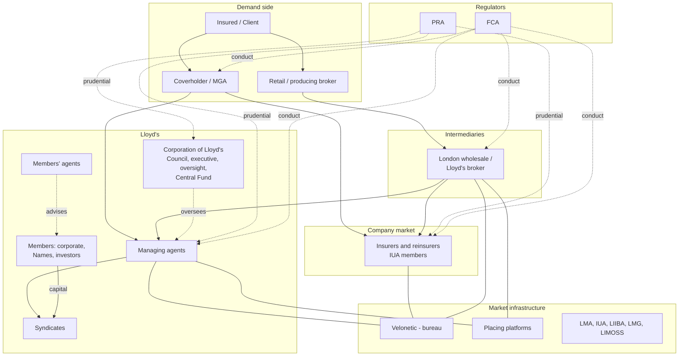
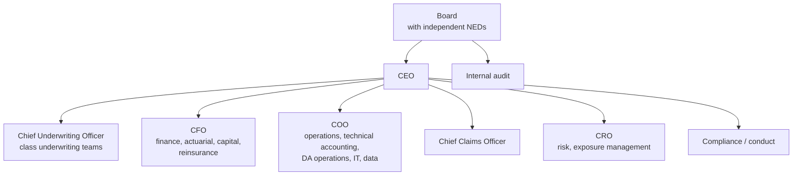

# Module 02 – Actors, Entities and Players

| | |
|---|---|
| **Level** | Beginner |
| **Path phase** | Phase 1 – Foundation, week 2 ([Module 18](18-World-Class-Consultant-Path.md)) |
| **Time** | 3–4 hours reading, 2 hours exercises |
| **Prerequisites** | [Module 01](01-Beginner-Foundations.md) |
| **You will be able to** | Name every party in the London market and explain what it does, how it earns money, who regulates it, and how it connects to the others; map the stakeholders for a consulting engagement; explain where profit is made and lost in the value chain |

---

## 1. Why this chapter matters

In the first client meeting, people test you on the basics without saying so. If you call Lloyd's "an insurer", confuse a managing agent with a syndicate, or say a broker "works for the insurer", the client quietly downgrades you. If you explain how a managing agent's economics differ from its members' economics, they lean in.

This chapter gives you the full cast. For each party we cover four things: **what it does**, **how it earns money**, **who regulates it**, and **what it means for a consultant**.

---

## 2. The full map

### 2.1 Each party through three lenses

| Party | Carries risk? | Handles money? | Creates or holds data? |
|---|---|---|---|
| Insured | Keeps deductible | Pays premium, receives claims | Original risk data |
| Retail / producing broker | No | Collects premium, passes on | Client data, first submission |
| London broker | No (but liable for its own negligence) | Holds premium and claims money | Submission, MRC, accounting messages |
| Coverholder / MGA | No (acts for insurers) | Collects premium, deducts commission | Bound risk data, bordereaux |
| Managing agent | No (manages for members) | Manages syndicate funds | Underwriting, claims, finance data |
| Syndicate (members) | **Yes** | Premium trust funds | — |
| Company market insurer | **Yes** | Own accounts | Own systems |
| Reinsurer | **Yes** (for ceded share) | Reinsurance premium and recoveries | Treaty and cession data |
| Corporation of Lloyd's | Only as last resort (Central Fund) | Central Fund, central settlement | Market returns, plans, capital |
| Velonetic (bureau) | No | Processes settlement | Signed premium and claims records |

**Why this table matters:** most operational problems happen at the hand-offs between columns – when money moves without matching data, or data moves without matching money.

---

## 3. Lloyd's in depth

### 3.1 What Lloyd's actually is

**[certain]** Lloyd's is a **society of members** established by Act of Parliament. Three things share the name:

| "Lloyd's" can mean | What it is |
|---|---|
| **The Society of Lloyd's** | The legal body made up of all members, governed by the Lloyd's Acts 1871–1982 |
| **The Corporation of Lloyd's** | The organisation (staff, executive, Council) that runs, regulates and supports the market |
| **The Lloyd's market** | All the syndicates, managing agents, brokers and coverholders that do business there |

Lloyd's itself does not choose risks. **Syndicates**, run by **managing agents**, underwrite using capital provided by **members**. The exception is **Lloyd's Europe** (Lloyd's Insurance Company S.A.), which is a legal insurer for EEA risks and reinsures them to syndicates.

**Useful analogy:** Lloyd's is like a stock exchange. The exchange sets rules, admits participants, provides infrastructure and protects the system. The traders (syndicates) take the positions. Unlike a stock exchange, Lloyd's also guarantees the system through the Central Fund.

### 3.2 Governance

| Element | Role | Notes |
|---|---|---|
| **Lloyd's Act 1982** | Legal basis of governance | Gives the Council power to make byelaws **[certain]** |
| **Council of Lloyd's** | Governing body: management and supervision of the market | Includes working members (from the market), external members (independent) and nominated members; members serve three-year terms, renewable up to nine years **[likely]** |
| **Chair** | Leads the Council | Sir Charles Roxburgh, from 1 May 2025 **[likely]** |
| **CEO and executive team** | Run the Corporation day to day | Patrick Tiernan, CEO from 1 June 2025 **[likely]** |
| **Council committees** | Delegated oversight | Committees have included Nominations & Governance, Remuneration, Risk, Audit and Investment; special bodies include a Capacity Transfer Panel and the Lloyd's Enforcement Board **[likely]** – committee structure was revised in March 2026, check the current terms of reference |
| **Byelaws and Market Bulletins** | Rules and instructions to the market | Market Bulletins (numbered Y####) are the main channel for new requirements |

### 3.3 What the Corporation does

| Function | What it means for managing agents |
|---|---|
| **Market oversight** | Approves syndicate business plans (SBF), monitors performance, applies principles-based oversight, intervenes when needed |
| **Capital** | Sets member capital (ECA = uSCR × 135%), runs Coming into Line, manages the Central Fund **[certain]** |
| **Licensing and international** | Maintains licences and trust funds worldwide; runs international platforms |
| **Market services** | Policy on placement, claims and accounting standards; sponsors market infrastructure |
| **Delegated authority** | Approves coverholders; sets DA standards; registers binding authorities |
| **Innovation** | Lloyd's Lab; product and capital innovation (e.g., London Bridge for ILS capital) |
| **Data and returns** | Collects market data (plans, results, RDS, capital returns) |

**How the Corporation is funded [likely]:** annual subscriptions and Central Fund contributions from members (set as small percentages of capacity/premium), plus charges for specific services. Clients often complain about the "cost of doing business at Lloyd's"; the 2026–2030 strategy commits to reducing it **[likely]**.

### 3.4 Syndicates

**What a syndicate is [certain]:**
- One or more members joined together to underwrite. **Not a legal entity** – it cannot own property or sue in its own name.
- Each member is **severally** liable for its share only – not for other members' shares.
- Identified by a number (e.g., 2623, 1618, 2478).
- Has a **stamp capacity**: the maximum premium income (net of acquisition costs) it may accept in a year of account, approved by Lloyd's.
- Each **year of account** operates as a separate venture and is normally closed after three years by reinsurance to close (RITC). See [Module 07](07-Advanced-Capital-Finance-Regulation.md).

**Market size in 2026:**

| Measure | Value | Tag |
|---|---|---|
| Aggregate stamp capacity | about £58bn (up about 4% on 2025) | [likely] – Insurance Insider survey |
| Approved capital | about £36.2bn (up 7.4%) | [likely] |
| New syndicates at 1 January 2026 | 13 | [likely] |
| Number of syndicates | around 100 | [likely] – check Lloyd's directory |

**Types of syndicate**

| Type | How it works | Why it exists |
|---|---|---|
| **Standard syndicate** | Full syndicate managed by a managing agent with its own underwriting teams | Core of the market |
| **Syndicate-in-a-Box (SIAB)** | Small new syndicate with a lighter set-up, usually hosted by a third-party managing agent | Lower barrier to entry for innovative businesses |
| **Special Purpose Arrangement (SPA)** | Writes a fixed quota share of a host syndicate's business | Lets capital providers access a host's underwriting without building a team |
| **Capital-backed / reinsurance syndicates** | Syndicate backed by an investor to reinsure a group's portfolio – e.g., AIG's Talbot syndicate 2478 backed by Blackstone (2025 capacity reported at £567m) **[likely]** | Brings institutional capital into Lloyd's |
| **Follow-only / algorithmic syndicates** | Follow other leaders using data and rules – e.g., Ki (syndicate 1618) **[likely]**; AIG-backed syndicate 2479 managed by Talbot using AI agents from 2026 **[likely]** | Low-cost capacity deployment |
| **Consortium** | Several syndicates (sometimes companies) writing a class under one leader | Access expertise and distribution |

**Partner insight [likely]:** the growth of capital-backed and follow-only syndicates means more of Lloyd's capacity is "passive" – it follows other people's underwriting decisions. In a softening market this is where adverse selection shows up first. Expect Lloyd's oversight to focus here.

### 3.5 Managing agents

**What they are [certain]:** companies authorised to manage syndicates on behalf of members. They employ the underwriters and support teams and run the business.

**Typical organisation of a managing agent**

**How managing agents earn money**

| Income | Description |
|---|---|
| **Managing agency fee** | A percentage of capacity, paid by members |
| **Profit commission** | A share of syndicate profit (often around 15–20% **[likely]**) |
| **Group economics** | Where the managing agent belongs to an insurance group that also provides the capital (aligned capital), the group takes most of the syndicate profit directly |

**Ownership models [likely]:**

| Model | Examples of the type |
|---|---|
| Listed specialty insurers | Groups listed in London or the US with Lloyd's platforms |
| Divisions of global insurers and reinsurers | Large groups using Lloyd's for licences and specialty access |
| Private / private-equity backed | Independent managing agents |
| **Turnkey / third-party managing agents** | Host syndicates (often SIABs and SPAs) for other capital providers and underwriting teams |

**Regulation:** dual-regulated by the **PRA** and **FCA**, and overseen by **Lloyd's**. Senior managers are approved under the Senior Managers & Certification Regime.

**Consulting angle:** the managing agent is your usual client at Lloyd's. Its executives answer to three masters: the board/members (returns), Lloyd's (plan and standards) and the regulators. A recommendation that ignores any of the three will fail.

### 3.6 Members – the capital providers

| Member type | Description | Liability | Share of capital |
|---|---|---|---|
| **Corporate members** | Companies, mostly owned by insurance groups and investors | Limited | Large majority **[likely]** |
| **Names – individual members** | Wealthy individuals; historically unlimited liability | Old unlimited Names are now few; new individual capital comes through limited liability vehicles (NameCos, Scottish limited partnerships) | About 10% of market capital **[likely]** |
| **Third-party / institutional capital** | Pension funds, ILS funds, private equity, via SPAs, corporate members or **London Bridge** (Lloyd's ILS vehicle) | Limited | Growing – London Bridge 2 opened 14 new cells with about $660m in Q4 2025 **[likely]** |

**Members' agents** advise Names on which syndicates to back and manage their participations **[certain]**. Names buy and sell syndicate participations in annual **capacity auctions**; the price reflects expected profitability.

**Aligned vs non-aligned capital**

| | Aligned | Non-aligned / third-party |
|---|---|---|
| Source | Managing agent's own group | Names, investors, other insurers |
| Governance concern | Group may favour its own capital | Fair treatment of third-party capital; conflicts in allocating risks between syndicates |
| Trend 2026 | Still dominant | Growing – Lloyd's strategy aims to attract more sophisticated capital and simplify Names processes **[likely]** |

**Consulting angle:** when a managing agent manages several syndicates with different capital providers, decisions about which syndicate takes which risk are a conflict of interest that Lloyd's and regulators watch. Allocation rules and audit trails are a frequent governance topic.

### 3.7 Lloyd's international platforms

| Platform | Purpose |
|---|---|
| **Lloyd's Europe** (Brussels) | EEA risks; local offices across Europe |
| **US** | Surplus lines eligibility, reinsurance, US trust funds; admitted licences in a few states **[likely]** |
| **Canada** | Licensed with Canadian trust funds |
| **Lloyd's China** (Shanghai), **Lloyd's Asia** (Singapore), **Lloyd's Japan**, **Lloyd's Dubai** (DIFC), **Lloyd's India** (reinsurance branches, including GIFT City) | Local platforms where syndicates write through service companies or branches **[likely]** |

---

## 4. The company market in depth

### 4.1 Who is in it

| Type | Description |
|---|---|
| **UK-authorised insurers** | Companies authorised by the PRA writing specialty and wholesale business in London |
| **UK branches of overseas groups** | Global insurers and reinsurers writing in London through branches |
| **Reinsurers** | Global reinsurers with London operations |
| **Hybrid groups** | Groups with both a company platform and a Lloyd's syndicate |

The **IUA** (International Underwriting Association) represents the company market. It reported £49.3bn of premium for 2024, including £5.5bn written elsewhere but controlled from London **[likely]**.

### 4.2 Lloyd's syndicate or company platform? How groups decide

| Factor | Lloyd's syndicate | Company platform |
|---|---|---|
| **Licences** | Uses Lloyd's 200+ licences and US surplus lines eligibility | Must obtain own licences or use fronting |
| **Rating** | Lloyd's market rating, shared by all syndicates | Own rating – depends on group strength |
| **Capital** | Lloyd's capital rules (ECA, uplift), mutual Central Fund | Solvency UK on own balance sheet |
| **Capital efficiency** | Lloyd's argues more risk per unit of capital than elsewhere **[likely]** | Depends on diversification of the group |
| **Cost** | Lloyd's subscriptions, Central Fund contributions, oversight costs | Own regulatory and infrastructure costs |
| **Oversight** | Lloyd's plus PRA and FCA | PRA and FCA |
| **Brand** | Lloyd's brand helps in many territories | Group brand |
| **Flexibility** | Annual business plan approval | More freedom to grow or change |

**Partner insight:** for hybrid groups, the choice of platform for each class is a strategic lever for cost, capital and access. Ask the client: "What decides which platform a risk goes on – and when did you last check the economics?"

---

## 5. Brokers in depth

### 5.1 Types of brokers

| Type | Role | Examples of the type **[likely]** |
|---|---|---|
| **Global brokers** | Retail, wholesale and reinsurance under one group | Marsh McLennan, Aon, WTW, Gallagher, Howden, Lockton |
| **Wholesale / specialty brokers** | Receive business from retail brokers worldwide and place in London | Specialist London wholesalers and US wholesale groups with London arms |
| **Reinsurance brokers** | Treaty and facultative reinsurance | Reinsurance divisions of global brokers and independents |
| **Producing / retail broker** | Holds the client relationship locally | Thousands worldwide |
| **Lloyd's broker** | Broker accredited to place business at Lloyd's | — |

### 5.2 Inside a London broker

| Team | Role |
|---|---|
| **Account executives / client managers** | Own the client or producing broker relationship |
| **Placing brokers** | Present risks and negotiate with underwriters |
| **Technicians / placement support** | Prepare MRCs, check contract certainty, submit data |
| **Accounts / credit control** | Premium collection and settlement |
| **Claims brokers** | Notify, present and negotiate claims |
| **Facilities teams** | Design and run broker facilities and follow capacity |
| **Analytics and data** | Market data, placement analytics, client insight |

### 5.3 How brokers earn money

| Source | Note |
|---|---|
| **Brokerage / commission** | Percentage of premium; typically 10–25% depending on class **[likely]** |
| **Fees** | Agreed with clients, sometimes in place of commission |
| **Contingent / profit commission, placement service agreements** | Paid by insurers; must be disclosed and conflicts managed |
| **Facility income** | From pre-arranged capacity facilities |
| **Investment income on client money** | Where permitted |

### 5.4 Broker strategy themes in 2026 **[likely]**

| Theme | What it means |
|---|---|
| **Consolidation** | Large acquisitions continue; scale gives leverage over carriers and data |
| **Facilities and follow capacity** | Brokers build pre-agreed capacity to place risks faster and earn more; carriers worry about adverse selection and loss of underwriting control |
| **Data ownership** | Brokers create the first structured data about a risk and increasingly treat it as an asset |
| **Soft market** | More capacity available; brokers' leverage on terms increases |

### 5.5 Whose agent is the broker?

**[certain]** In the open market, the broker is normally the **agent of the insured**: it owes duties of care and good faith to the client and must make a fair presentation on the client's behalf. In some tasks the broker acts for insurers (e.g., holding premium under a risk transfer agreement). Where a broker is also a coverholder, it binds risks as **agent of the insurer** – a conflict that must be managed.

**Consulting angle:** when a carrier asks for help with "broker data quality", remember that brokers act for clients, not carriers. Solutions must give brokers something too: faster quotes, fewer queries, quicker payment.

---

## 6. Delegated authority players (summary)

| Party | Role |
|---|---|
| **Coverholder** | Firm authorised to bind Lloyd's business under a **binding authority agreement** |
| **MGA** | Managing general agent – similar role, broader term (company market, US) |
| **Service company** | Coverholder owned by a managing agent's group; Lloyd's lists about 412 **[likely]** |
| **DCA / TPA** | Delegated claims administrator / third-party administrator handling claims |
| **Lloyd's Europe coverholders** | Authorised to bind EEA business for Lloyd's Europe |

About 45% of Lloyd's premium comes through delegated authority **[likely]**. Full detail in [Module 05](05-Intermediate-Delegated-Authority.md).

---

## 7. Market bodies and infrastructure – when you will meet them

| Body | What it does | When it appears in your projects |
|---|---|---|
| **LMA** | Represents managing agents; publishes clauses, guidance, the AI Adoption Toolkit (April 2026) | Wording projects, DA standards, AI governance |
| **IUA** | Represents company market; clauses and statistics | Company market clients; market data |
| **LIIBA** | Represents London brokers | Any change that affects broker workflow |
| **LMG** | Umbrella body (Lloyd's, LMA, IUA, LIIBA); "London Matters" reports; Data Council | Market strategy and data standards |
| **LIMOSS** (London Insurance Market Operations & Strategic Sourcing) | Owned by the LMA, IUA and Lloyd's; manages market service contracts, including bureau services; publishes the Market Business Glossary (CDR) | Bureau changes and market service costs |
| **Velonetic** | Bureau service provider (part of DXC), formerly Xchanging; premium, claims, accounting and settlement services | Any accounting, settlement or claims process project; refocused on incremental modernisation after Blueprint Two **[likely]** |
| **Placing platforms (PPL, Whitespace)** | Electronic placement | Placement process and data projects |
| **ACORD** | Data standards (GRLC messages, Core Data Record) | Data model and integration projects |
| **Lloyd's Lab** | Insurtech accelerator | Innovation scouting, AI pilots |

---

## 8. Regulators and public bodies

| Body | Role | How clients experience it |
|---|---|---|
| **PRA** (Bank of England) | Prudential regulation: capital, solvency, governance, operational resilience, internal models | Annual priorities letters; 2026 focus on internal models in a softening market and the DyGIST stress test **[likely]** |
| **FCA** | Conduct: brokers, insurers, managing agents, coverholders; product governance; financial crime | PS25/21 (Dec 2025) reduced conduct rules for larger commercial clients **[certain]** |
| **Lloyd's** | Market oversight under the Lloyd's Act | Plan approvals, principles-based oversight, returns, Market Bulletins |
| **HM Treasury / OFSI** | Financial sanctions | Screening and licensing; Russia-related sanctions burden |
| **HMRC** | Insurance Premium Tax | Tax processing |
| **ICO** | Data protection | Personal data in claims and DA bordereaux |
| **Overseas regulators** | US states (NAIC framework), Belgian NBB/FSMA for Lloyd's Europe, others | Licensing, local reporting, trust funds |
| **Pool Re / Flood Re** | UK terrorism reinsurance / household flood reinsurance | Terrorism and flood classes |

---

## 9. Supporting professions

| Profession | Role |
|---|---|
| **Loss adjusters** | Investigate and quantify claims for insurers |
| **Lawyers** | Wordings, coverage disputes, regulation, transactions |
| **Actuaries** | Pricing, reserving, capital modelling |
| **Catastrophe modellers** | Model natural catastrophe and cyber exposures |
| **Rating agencies** (A.M. Best, S&P, Fitch, Moody's) | Financial strength ratings |
| **Auditors** | Financial statements, Solvency UK, coverholder audits |
| **Consultancies** | Strategy, operations, technology, actuarial, risk |
| **Technology vendors and insurtechs** | Policy administration, underwriting workbenches, data ingestion, bordereaux, claims |

---

## 10. The contracts that connect everyone

| Relationship | Contract | Key terms |
|---|---|---|
| Client – broker | Terms of business / engagement letter | Services, remuneration, duties |
| Broker – insurer | **TOBA** (Terms of Business Agreement) | Authority, premium handling, risk transfer, documentation, claims, data |
| Insured – insurers | **MRC** and policy wording | Cover, limits, premium, subscription agreement |
| Insurer – coverholder | **Binding authority agreement** | Classes, territories, limits, GPI, commission, reporting, claims authority |
| Insurer – DCA/TPA | Claims administration agreement | Authority, loss funds, reporting |
| Managing agent – members | Standard managing agent's agreement | Management of syndicate, fees, profit commission |
| Member – Lloyd's | Membership and capital arrangements | FAL, Central Fund contributions, byelaws |
| Insurer – reinsurer | Reinsurance contract (often also an MRC) | Cover, retention, limits, premium, claims cooperation |
| Market firms – bureau | Service agreements via LIMOSS | Processing services and charges |

---

## 11. Where the money is made – profit pools

| Participant | Main source of profit | Main risk to profit | 2026 direction **[likely]** |
|---|---|---|---|
| Lead underwriters | Price-setting power, selection | Mispricing, cycle | Margins narrowing as rates fall |
| Follow underwriters | Low-cost capacity deployment | Adverse selection, dependence on leads | Most at risk in soft market |
| Coverholders / MGAs | Commission, profit commission | Capacity withdrawal by carriers | Continued growth but tighter scrutiny |
| Brokers | Brokerage, fees, facility income | Regulation of conflicts, client pressure | Strong; consolidating |
| Managing agents | Fees, profit commission, group returns | Cost of doing business, oversight | Efficiency focus |
| Capital providers | Underwriting and investment returns | Catastrophes, reserve deterioration | Inflows continuing, returns falling from highs |
| Bureau and infrastructure | Service charges | Modernisation risk | Incremental change |

**Partner insight:** in a softening market, profit moves away from capital providers and followers towards distribution (brokers, MGAs) and the best leads. Clients who do not have a distinctive lead position or distribution access face shrinking margins. This is the strategic backdrop to most 2026–2027 engagements.

---

## 12. Stakeholder map for a typical engagement at a managing agent

Example: a bordereaux automation and DA oversight programme.

| Stakeholder | Interest | What they need from you |
|---|---|---|
| CEO | Expense ratio, Lloyd's relationship | Value case, risk to plan |
| COO | Cost, operations stability | Operating model, delivery plan |
| CUO / class underwriters | Faster, better data on their portfolios | Underwriting MI, no extra admin |
| Head of DA | Oversight quality, audit findings | Framework, tooling, coverholder engagement |
| CFO | Premium recognition, aged debt, reserving | Finance data quality, reconciliation |
| CRO / exposure management | Accurate aggregates | Timely, validated risk data |
| Compliance | Lloyd's and FCA requirements | Control design and evidence |
| IT / data | Architecture, security | Integration and data model |
| Coverholders | Simpler reporting | Clear standards, fewer queries |
| London broker of the binders | Workflow impact | Early engagement |
| Lloyd's (indirectly) | DA standards and oversight | Evidence of control improvement |

---

## 13. Mini case – a coverholder fails

**Situation:** a US coverholder writing property for four syndicates becomes insolvent. It has collected premium from insureds that it has not paid to the London broker, and it has open claims.

| Who | Impact |
|---|---|
| **Insureds** | Cover remains with the syndicates (the coverholder bound on their behalf); claims must still be paid |
| **Syndicates** | Unpaid premium (credit loss) unless risk transfer applies; must take over claims handling (often through a TPA); data may be incomplete |
| **London broker** | Depending on TOBA and risk transfer terms, may have exposure for premium; relationship damage |
| **Managing agents** | Must report to Lloyd's; oversight failures examined; possible audit findings |
| **Lloyd's** | Reviews managing agents' DA oversight |
| **Regulators** | FCA interest if customers harmed |

**Lessons:** premium remittance timeliness, risk transfer terms, data completeness and exit plans are not admin details – they decide who loses money when a coverholder fails.

---

## 14. Common mistakes to avoid

| Mistake | Correct position |
|---|---|
| "Lloyd's paid the claim." | Syndicates pay claims; the Central Fund is a last resort. |
| "Lloyd's broker works for Lloyd's." | The broker normally acts for the client. |
| "A syndicate is a company." | A syndicate is not a legal entity; members are severally liable. |
| "The managing agent owns the syndicate's profit." | Members own the profit; the managing agent earns fees and profit commission (unless the group is also the capital provider). |
| "The coverholder is just a broker." | When binding, the coverholder acts for the insurer. |
| "Velonetic is part of Lloyd's." | Velonetic is a service provider (DXC) contracted for bureau services. |
| "IUA is a regulator." | IUA is a trade association. |

---

## 15. Partner's lens – how a top-tier strategy consultant would use this chapter

*Written in the working style of senior partners at McKinsey, Bain and BCG. It describes widely documented methods, not insider material from any firm.*

**1. Map the value chain before the org chart.** Partners start any industry by drawing the value chain and the **profit pool** at each step (section 11). Clients often ask "how do we grow?"; the partner asks "where in the chain is profit moving, and are you standing in the right place?" For a London follow syndicate in 2026, the honest answer may be: "Profit is moving away from you."

**2. Understand incentives, not just roles.** For each actor, ask: what is it paid for, and what is it not paid for? A coverholder paid on premium volume will write volume. A broker paid on facility income will steer risks to facilities. A managing agent paid on capacity fees likes growth. Most market problems are incentive problems before they are process problems.

**3. Identify the decision-maker and the blocker.** In every engagement, name three people: who **decides** (often CEO or COO), who **pays** (budget owner), and who can **block** (often the CUO or the Head of DA, because change lands on their teams). Partners spend as much time on the blocker as on the buyer.

**4. Use the "three masters" test for managing agents.** Every recommendation must work for (a) the board and capital providers, (b) Lloyd's, and (c) the PRA and FCA. If it fails one, it fails. Write the test into your steering committee papers.

**5. Spot the structural shifts early.** The 2026 shifts worth a CEO's attention: institutional capital entering through capital-backed syndicates and London Bridge; follow-only and AI-assisted capacity; broker consolidation and facilities; MGA growth; Lloyd's moving from Blueprint Two to incremental standards. A partner would turn each into a question for the client's strategy: "What happens to your business if this continues for three more years?"

**6. Build the client's stakeholder map in the first week.** Use section 12 as the template. Partners never wait for the client to tell them who matters.

---

## 16. Key takeaways

1. Lloyd's is a society and a market; syndicates take risk, managing agents run them, members provide capital, the Corporation regulates and supports.
2. The company market is of similar scale to Lloyd's; many groups run both platforms and choose per risk.
3. Brokers sit at the centre of the market and act for clients; their data and facilities give them growing power.
4. Delegated authority adds coverholders, MGAs and claims administrators – and most operational risk.
5. Market bodies and the bureau shape what any single firm can change.
6. In a softening market, profit is shifting from capital and followers towards distribution and top leads.

---

## 17. Check your understanding

| # | Question | Answer |
|---|---|---|
| 1 | What are the three meanings of "Lloyd's"? | The Society (members), the Corporation (organisation running the market), the market (all participants). |
| 2 | Why is a syndicate not liable for another member's share? | Liability is several, not joint; each member is liable for its own share. |
| 3 | Name two ways managing agents earn income. | Managing agency fees and profit commission. |
| 4 | What is the difference between aligned and non-aligned capital? | Aligned comes from the managing agent's own group; non-aligned from third parties (Names, investors). |
| 5 | Give two reasons a group might write a class at Lloyd's rather than on its company platform. | Lloyd's licences/US surplus lines access; shared Lloyd's rating; capital efficiency; brand. |
| 6 | Whose agent is a coverholder when it binds a risk? | The insurer's. |
| 7 | What does LIMOSS do? | Manages market service contracts (including bureau services) for its owners, the LMA, IUA and Lloyd's, and publishes the Market Business Glossary. |
| 8 | In a soft market, which participants' margins are usually under most pressure? | Follow underwriters and capital providers. |

---

## 18. Practice tasks

1. **Draw** the full market map from memory, then add money and data flows in two colours.
2. **Pick one managing agent** and find from public sources: owner, syndicates, main classes, capital type (aligned or not). Write a one-page profile.
3. **Write** a stakeholder map (section 12 format) for a claims transformation programme at the same managing agent.
4. **Practitioner conversation:** ask a broker or underwriter to explain how facilities have changed their work in the last two years (interview guide in [Module 19 §3](19-Practice-Toolkit-and-Templates.md)).

---

## Master Guide integration: actors, bodies and the client-room test

### Company market versus Lloyd's in one table

| Dimension | Lloyd's market | Company market |
|---|---|---|
| Basic model | A marketplace where syndicates underwrite on behalf of members | Corporate insurers and reinsurers underwrite through their own legal entities |
| Risk-bearing capital | Members back syndicates; each member's liability is **several, not joint** | The insurer's own capital plus its reinsurance |
| Underwriting unit | Syndicate, run by a managing agent | Carrier legal entity and its business units |
| Governance | Lloyd's Corporation oversight plus PRA and FCA | Carrier board, control functions and its regulators |
| Distribution | Lloyd's brokers, coverholders, service companies; open market and delegated | Brokers, MGAs, delegated partners, direct and other channels |
| Infrastructure | Lloyd's-specific oversight and reporting tools plus shared London infrastructure | Shared London infrastructure where used, plus carrier platforms |
| Common to both | Broker-led placement, subscription, specialist underwriting, common standards, shared services | Same |

The company market is not one company or one technology estate. It is many carriers with different appetites, operating models, platforms and levels of use of central services **[certain]**.

**Worked example.** A broker places a £100m property risk. Syndicate 1 writes 30%, Syndicate 2 writes 20%, and two company carriers write 25% each. Each participant is liable only for its own share. The lead sets terms and coordinates agreement but does not carry the others' shares.

### Participants the earlier tables did not separate

| Participant | Role | What they decide or answer for |
|---|---|---|
| Producing / retail broker | Owns the relationship with the insured or the local intermediary | Client data, local advice, compliance, placement instructions |
| Company-market broker | Places with corporate carriers; may run cross-market subscriptions | Placement strategy, carrier coordination |
| Follow underwriter | Takes a share, often on lead terms | Whether to follow, own line size, own referrals and controls |
| TPA (third-party administrator) | General market term for outsourced claims or policy administration | Service under an outsourcing contract. **Not** the same as a Lloyd's DCA, which needs specific delegated claims authority |
| Loss adjuster / surveyor | Investigates damage, cause, size of loss and mitigation | Evidence and recommendations; does **not** make the coverage decision |
| Coverage counsel | Advises on contract, liability, disputes and litigation | Legal interpretation, defence strategy, settlement advice |
| Forensic expert | Engineering, cyber, marine, accounting or other specialist | Cause, damage, quantum, expert evidence |
| Members' agent | Advises and represents members on participation and capital | Syndicate selection and capital for Names |

### The client-room test (use on every transaction)

Ask seven questions **[certain – standard diagnostic practice]**:

1. Who owns the client relationship?
2. Who has authority to bind?
3. Which legal entity carries the risk?
4. Who is the lead?
5. Who holds the master contract?
6. Who processes premium and claims cash?
7. Who owns the data and the control evidence?

If the client team cannot answer all seven for a sample of transactions, you have found the first workstream.

### Market bodies and infrastructure: additions and corrections

| Organisation | What it is | Why it matters |
|---|---|---|
| **LIMOSS** – London Insurance Market Operations & Strategic Sourcing | **Correction:** owned by the **LMA, IUA and Lloyd's** (earlier versions of this guide said LMA and IUA only) **[certain]**. Manages market service contracts and publishes the **Market Business Glossary (MBG)**, which holds the Core Data Record and reference data | Bureau service changes; where to find the current CDR version |
| **ACORD** | Global insurance data standards body | GRLC (Global Reinsurance and Large Commercial) standards and Ruschlikon messages (EBOT, ECOT) |
| **PPL** – Placing Platform Limited | Electronic placing platform | Placement workflow and collaboration; not a policy, premium or claims system |
| **Velonetic** | Shared London processing business; lineage runs back through Xchanging and the earlier bureau joint ventures **[likely]** | Premium accounting, claims agreement support and settlement. It is not any carrier's core system |
| **Lloyd's Academy / Learning at Lloyd's** | Lloyd's learning resources | Free foundation material |
| **IUA** | Represents company-market insurers and reinsurers | Not a regulator |

**Named firms – a classification note.** The source lists Beazley and Hiscox as "company insurers". Both are best described as **groups that run Lloyd's managing agents and also own company-market and US carriers** **[certain]**. Always say which entity you mean: "Beazley's Lloyd's syndicate 2623" is a different risk carrier from "Beazley Insurance dac". Ownership and structures change; check before naming firms in a proposal.

## 19. Sources for this chapter

- [Lloyd's governance structure](https://www.lloyds.com/about-lloyds/the-corporation/governance-structure)
- [Lloyd's Council terms of reference, March 2026](https://assets.lloyds.com/media-651c0e64-c1d0-4f97-90f7-883c69fe2ef2/b7df25bf-9593-47a0-8d1c-3500111763b3/ToR%20-%20lloyds.com%20version%20-%2019%20March%202026.pdf)
- [Lloyd's announces executive team](https://www.lloyds.com/about-lloyds/media-centre/press-releases/lloyds-announces-executive-team)
- [Insurance Insider – Lloyd's 2026 stamp capacity](https://www.insuranceinsider.com/article/2fne9k2m0h2mgn7ucs5q8/sections/data/lloyds-2026-stamp-capacity-growth-to-slow-down-to-4)
- [Insurance Business – private equity and Names capital at Lloyd's](https://www.insurancebusinessmag.com/uk/news/breaking-news/private-equity-and-the-names-are-pouring-capital-back-into-lloyds-593816.aspx)
- [Insurance Insider – Names' share of Lloyd's capital](https://www.portal.insuranceinsider.com/article/2brkiymvrzvoxmpiuygw0/london-market-section/neal-lloyds-exploring-reforms-to-encourage-names-involvement)
- [IUA company market data](https://iua.co.uk/IUANew/NewsPages/Press_Releases_2025/IUA-data-shows-company-market-premium-up-1.7-.aspx)
- [Lloyd's – oversight of delegated contracts](https://www.lloyds.com/market-resources/delegated-authorities/market-knowledge/oversight-and-monitoring-of-contracts)
