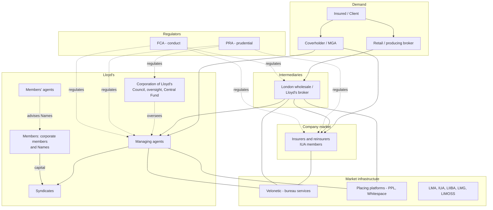

# Module 02 – Actors, Entities and Players

**Level:** Beginner | **Goal:** Know every party in the London market, what they do, how they make money, and how they relate. Mistakes here (for example, calling Lloyd's "an insurer") cost credibility in the first five minutes of a meeting.

---

## 1. The full map

---

## 2. Lloyd's – the structure in detail

### 2.1 Lloyd's is a marketplace, not an insurer

**[certain]** Lloyd's itself does not underwrite risk (except through Lloyd's Europe as the regulated entity for EEA business, which then reinsures to syndicates). Risk is underwritten by **syndicates**, which are run by **managing agents**, using capital provided by **members**. The **Corporation of Lloyd's** runs and supervises the market.

A useful analogy: Lloyd's is like a stock exchange. The exchange sets the rules, provides infrastructure and protects the system; the traders (syndicates) take the positions.

### 2.2 Corporation of Lloyd's

| Element | Role |
|---|---|
| **Council of Lloyd's** | The governing body of the Society under the Lloyd's Act 1982. Sets rules (byelaws) and strategy. Includes working, external and nominated members. |
| **Lloyd's Board / executive** | Runs the Corporation day to day under the CEO (Patrick Tiernan from 2025 **[likely]**). |
| **Market oversight** | Reviews and approves each syndicate's business plan, monitors performance, sets minimum standards and principles, and intervenes if needed. Historically called the Performance Management Directorate (PMD). |
| **Capital and Central Fund** | Sets each member's capital requirement, holds central assets, manages the Central Fund. |
| **Lloyd's Europe** | Lloyd's Insurance Company S.A. in Brussels, writes EEA risks and reinsures them to syndicates. |
| **Lloyd's Lab and innovation** | Accelerator for insurtechs; innovation and product development. |
| **Lloyd's international offices** | Licences and local platforms in many countries (e.g., Lloyd's China, Lloyd's Singapore, Lloyd's Dubai in DIFC, Lloyd's Japan). |

### 2.3 Syndicate

- **[certain]** A syndicate is one or more members joining together to provide capital and accept risk. It is **not a legal entity**. Each member is liable only for its own share (several, not joint, liability).
- Identified by a number (e.g., Syndicate 2623, 2987).
- Has a **stamp capacity** – the maximum premium (net of acquisition costs) it may write in a year of account, approved by Lloyd's.
- Operates on an **annual venture** basis: each **year of account (YOA)** is effectively a separate business, closed after three years (see Module 07).
- Number of syndicates: around 100 **[likely]**.

**Special types of syndicate**

| Type | Purpose |
|---|---|
| **Syndicate-in-a-Box (SIAB)** | A new syndicate with a lighter structure, outsourcing many functions to its managing agent, designed to bring innovation into the market. |
| **Special Purpose Arrangement (SPA) / Special Purpose Syndicate** | Writes a fixed quota share of a host syndicate's business (follow-only). Used by capital providers and investors. |
| **Follow-only / algorithmic syndicates** | Write follow lines automatically using data and rules (e.g., Ki, Syndicate 1618) **[likely]**. |
| **Consortium** | Several syndicates (sometimes with companies) share risks under one leader for a defined class. |

### 2.4 Managing agent

- **[certain]** A company that manages one or more syndicates on behalf of members. Employs the underwriters, claims staff, actuaries and operations teams.
- Regulated by PRA and FCA and supervised by Lloyd's.
- Earns: **managing agency fee** (percentage of capacity) and **profit commission** (share of syndicate profit, often around 15–20% **[likely]**).
- Many are owned by listed insurance groups (e.g., Beazley, Hiscox, Chaucer, Canopius, Brit, Talbot, Aspen, Markel, Tokio Marine Kiln, AXA XL, Chubb, Munich Re, Arch) **[likely]** – ownership changes, verify before naming in a pitch.
- Around 50 managing agents **[likely]**.

### 2.5 Members (capital providers)

| Member type | Description | Liability |
|---|---|---|
| **Corporate member** | A company (often part of an insurance group) providing capital. Provides the large majority of Lloyd's capacity. | Limited |
| **Names (individual members)** | Historically wealthy individuals with **unlimited** liability. New individual capital now comes through limited liability vehicles. | Old: unlimited. Today: mostly limited through NameCos or Scottish limited partnerships (SLPs) / LLPs. |
| **Third-party capital / institutional** | Pension funds, ILS funds and investors via SPAs, corporate members or London Bridge (ILS vehicle). | Limited |

- **Members' agents** (e.g., Argenta, Hampden) advise Names, choose which syndicates they back and handle the annual **capacity auctions** where Names buy and sell syndicate participations **[likely]**.
- A member provides **Funds at Lloyd's (FAL)** – capital held in trust to support its underwriting.

### 2.6 Aligned vs non-aligned capital

- **Aligned** – the managing agent's own group provides most capital (common today).
- **Third-party / non-aligned** – capital from outside the group (Names, investors).
- Matters for governance (conflicts of interest), profit commission and Lloyd's approval.

---

## 3. The company market

| Element | Description |
|---|---|
| **Insurers and reinsurers** | UK-authorised companies or UK branches of overseas groups writing wholesale and specialty business in London. Examples: AXA XL, Allianz Commercial, Zurich, Chubb, Swiss Re, Munich Re, Hannover Re, SCOR, Tokio Marine HCC, Sompo, Liberty Specialty Markets, QBE **[likely]**. |
| **IUA – International Underwriting Association** | Trade body for company market. Publishes clauses, market statistics, runs working groups. |
| **Company market size** | £49.3bn premium in 2024 (including £5.5bn "controlled business" written elsewhere) per IUA **[likely]**. |
| **Hybrid groups** | Many groups have both a company platform and a Lloyd's syndicate and choose which to use per risk ("dual platform"). |

**Key difference vs Lloyd's:** a company is a legal entity with its own balance sheet, rating and licences. A syndicate relies on Lloyd's licences, rating and the chain of security.

---

## 4. Brokers and intermediaries

### 4.1 Types

| Type | Role | Examples **[likely]** |
|---|---|---|
| **Global brokers** | Retail plus wholesale plus reinsurance. | Marsh (Marsh McLennan), Aon, WTW, Gallagher, Howden, Lockton |
| **Wholesale / specialty brokers** | Receive business from retail brokers worldwide and place it in London. | Amwins, Ryan Specialty (Ryan Specialty UK), CRC/McGill, Miller, Price Forbes (Ardonagh), BMS, Ed Broking, THB |
| **Reinsurance brokers** | Place treaty and facultative reinsurance. | Aon Reinsurance Solutions, Guy Carpenter (Marsh McLennan), Gallagher Re, Howden Re, TigerRisk (now Howden Re) |
| **Lloyd's broker** | A broker accredited by Lloyd's to place business at Lloyd's. Accreditation is now a lighter process than the old "Lloyd's broker" status. | — |
| **Producing / retail broker** | Holds the client relationship locally (e.g., a US agent or a Brazilian broker) and sends business to the London broker. | Thousands worldwide |

### 4.2 What the broker does

1. Understands client needs and assesses risk.
2. Prepares the **submission** (risk information, loss history, exposure schedules).
3. Chooses and approaches the lead market, then followers.
4. Negotiates terms and price.
5. Produces the **MRC** and ensures **contract certainty**.
6. Collects premium, deducts brokerage, pays insurers via settlement (holds client money in trust).
7. Handles endorsements and renewals.
8. Notifies and advocates claims for the client; collects claim money.

### 4.3 How brokers earn money

- **Brokerage / commission**: percentage of premium, typically 10–25% depending on class **[likely]**.
- **Fees**: agreed with the client.
- **Contingent / profit commission** and **placement service agreements** from insurers – controversial, must be disclosed and managed for conflicts.
- **Investment income** on client money held (where allowed).
- **Facilities income** – brokers increasingly build pre-agreed capacity facilities (see Module 04).

### 4.4 Agent of whom?

- **[certain]** Under English law, in the open market the broker is normally the **agent of the insured**.
- In delegated authority, a coverholder is the **agent of the insurer** for underwriting decisions.
- This determines who carries the risk when premium is lost or a mistake is made (e.g., errors and omissions claims against brokers).

---

## 5. Delegated authority players

| Party | Description |
|---|---|
| **Coverholder** | A company authorised by a managing agent (and approved by Lloyd's) to enter into insurance contracts on behalf of syndicates under a **binding authority agreement (BAA)**. |
| **MGA (Managing General Agent)** | Similar concept, wider term used for company market and US. Many MGAs are also Lloyd's coverholders. |
| **Service company** | A company owned by a managing agent's group that acts as a coverholder for that group's syndicate. Lloyd's lists 412 service companies **[likely]**. |
| **DCA (Delegated Claims Administrator) / TPA** | Handles claims under delegated authority on behalf of insurers. |
| **Program administrator** | US term for an MGA running a specialised programme. |
| **Lloyd's Europe coverholder** | Coverholder authorised to bind EEA risks for Lloyd's Insurance Company S.A. |

Module 05 covers delegated authority in depth.

---

## 6. Market bodies and infrastructure

| Body | What it does |
|---|---|
| **LMA – Lloyd's Market Association** | Represents managing agents. Publishes clauses (LMA wordings), guidance, training, the AI Adoption Toolkit (2026). |
| **IUA – International Underwriting Association** | Represents company market. Clauses, statistics. |
| **LIIBA – London & International Insurance Brokers' Association** | Represents London wholesale and specialty brokers. |
| **LMG – London Market Group** | Umbrella body of Lloyd's, LMA, IUA and LIIBA. Publishes "London Matters" reports; leads market-wide initiatives; has a Data Council. |
| **LIMOSS** | Owned jointly by LMA and IUA. Manages market service contracts (including bureau services) for Lloyd's and company market. |
| **Velonetic** | Bureau service provider (part of DXC). Formerly known as Xchanging / XIS. Runs premium and claims processing, central accounting and settlement services for Lloyd's and many company market firms. |
| **Placing platforms** | **PPL** (Placing Platform Limited) and **Whitespace** are the main electronic placement platforms used in London **[likely]**. |
| **ACORD** | Global insurance data standards body. London uses ACORD GRLC (Global Reinsurance and Large Commercial) standards and ACORD for the Core Data Record (CDR). |
| **Lloyd's Lab** | Innovation accelerator for insurtechs. |
| **Lloyd's Market Bulletins** | Official Lloyd's notices to the market (numbered "Y####"). Required reading for operations and compliance teams. |

---

## 7. Regulators and public bodies

| Body | Role in London |
|---|---|
| **PRA – Prudential Regulation Authority** (part of Bank of England) | Prudential supervision of insurers, managing agents and the Society of Lloyd's: capital, solvency, governance, resilience, internal models. |
| **FCA – Financial Conduct Authority** | Conduct supervision: brokers, insurers, managing agents, coverholders; product governance; client money; financial crime. |
| **HM Treasury / OFSI** | Financial sanctions (Office of Financial Sanctions Implementation). |
| **HMRC** | Insurance Premium Tax (IPT) and other taxes. |
| **Lloyd's (under Lloyd's Act 1982)** | Self-regulates the market in coordination with PRA and FCA. |
| **Overseas regulators** | US state regulators (NAIC framework), EIOPA and Belgian NBB/FSMA for Lloyd's Europe, etc. |
| **Pool Re / Flood Re** | UK government-backed terrorism reinsurance (Pool Re) and household flood reinsurance (Flood Re). |
| **International Group of P&I Clubs** | Not London market insurers in the Lloyd's sense, but key buyers of reinsurance from London (shipowner liability). |

---

## 8. Supporting professions

| Profession | Role |
|---|---|
| **Loss adjusters** (e.g., Crawford, Sedgwick, McLarens, Charles Taylor) **[likely]** | Investigate and quantify claims for insurers. |
| **Lawyers** | Coverage, disputes, wordings, regulation. |
| **Actuaries** | Pricing, reserving, capital modelling. |
| **Catastrophe modellers** | Model natural catastrophe and cyber exposures (Moody's RMS, Verisk, KCC, CoreLogic/Cotality) **[likely]**. |
| **Rating agencies** | A.M. Best, S&P, Fitch rate Lloyd's and company market insurers. |
| **Auditors and consultancies** | Big 4, specialist actuarial consultancies, technology and management consultancies. |
| **Insurtechs / vendors** | Underwriting workbenches, data ingestion, policy admin, bordereaux tools. |

---

## 9. Who pays whom – money map

| From | To | What |
|---|---|---|
| Insured | Broker | Gross premium |
| Broker | Insurer/syndicate | Net premium (gross minus brokerage) |
| Insurer | Coverholder | Commission (coverholder deducts it before remitting) |
| Insurer | Reinsurer | Reinsurance premium |
| Members | Lloyd's | Central Fund contributions, subscriptions |
| Syndicate | Managing agent | Managing agency fee, profit commission |
| Syndicate | Members | Profit (or members fund losses) on close of year of account |
| Insurer | Insured (via broker) | Claims |
| Reinsurer | Insurer | Reinsurance recoveries |
| Insurer | Tax authorities | IPT, US Federal Excise Tax (paid via Lloyd's arrangements), other premium taxes |

---

## 10. Common mistakes to avoid

| Mistake | Correct position |
|---|---|
| "Lloyd's paid the claim." | Syndicates pay claims; the Central Fund is a last resort. |
| "Lloyd's broker works for Lloyd's." | The broker normally acts for the client. |
| "A syndicate is a company." | A syndicate is not a legal entity; members are severally liable. |
| "The coverholder is a broker." | A coverholder is acting for the insurer when it binds. Some firms are both broker and coverholder, which creates conflicts to manage. |
| "Velonetic is Lloyd's." | Velonetic is a service provider (DXC) contracted for bureau services. |
| "IUA is a regulator." | IUA is a trade association. |
