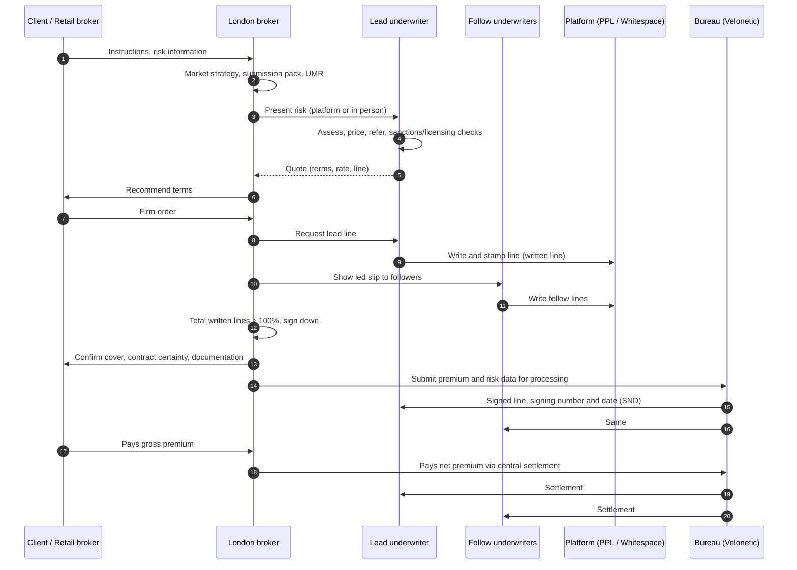
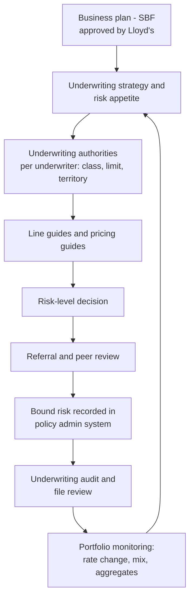

# Module 04 – Placement and Underwriting: The Open Market Lifecycle

**Level:** Intermediate | **Goal:** Walk through the full placement lifecycle step by step, understand the contract (MRC), the subscription mechanics (lead, follow, written and signed lines), the underwriting controls, and where things break.

---

## 1. Three ways business enters London

| Route | Who decides to accept each risk | Typical share of Lloyd's premium |
|---|---|---|
| **Open market** | The underwriter at the syndicate/company, risk by risk, negotiated with a broker. | Around half **[likely]** |
| **Delegated authority** | A coverholder/MGA binds risks under authority granted by the insurer. | About 45% **[likely]** |
| **Facilities and consortia** | Pre-agreed capacity: a leader or algorithm decides; followers are bound by pre-agreed rules. | Growing; included in the two numbers above |

This module covers the open market and facilities. Module 05 covers delegated authority.

---

## 2. The placement lifecycle end to end

### Step-by-step detail

| # | Step | What happens | Key outputs | What goes wrong |
|---|---|---|---|---|
| 1 | **Client engagement** | Retail broker or client instructs London broker. Broker checks KYC, sanctions, licensing, terms of business. | Terms of business agreement (TOBA), client due diligence | Incomplete KYC; wrong client classification under FCA rules |
| 2 | **Submission preparation** | Broker collects risk data: SOV, loss history, financials, engineering reports, prior wording. Creates **Unique Market Reference (UMR)**. | Submission pack, draft MRC | Data in many formats (PDF, Excel); missing values |
| 3 | **Market strategy** | Broker decides lead market, follow markets, platform, whether to use a facility. | Market list | Over-reliance on facilities may limit client choice (conflict of interest) |
| 4 | **Presentation to lead** | Broker presents risk on platform or face to face (still common at Lloyd's "boxes"). | — | Underwriter capacity to review is limited; long queues |
| 5 | **Underwriting assessment** | Lead underwriter reviews risk, runs pricing and cat models, checks appetite and authority, may refer to senior underwriter or peer review. | Technical price, decision | Inconsistent pricing; poor audit trail |
| 6 | **Quote and negotiation** | Lead proposes terms: premium, deductibles, limits, conditions, exclusions, line size. Broker negotiates. | Quote | Many versions; unclear which is final |
| 7 | **Firm order and binding** | Client confirms. Lead writes and stamps its line on the MRC. | **Written line**, binding | Binding before contract terms are complete (contract certainty failure) |
| 8 | **Following** | Broker takes the led MRC to follow markets. Followers write lines on same terms (can add own conditions in limited cases). | Follow lines | Followers add conditions; delays to reach 100% |
| 9 | **Signing down** | If total written lines exceed 100%, all lines are reduced proportionally. | **Signed lines** | Errors in signing down calculations |
| 10 | **Contract certainty and documentation** | Terms finalised and documented before inception. Broker issues evidence of cover; final contract documentation provided to the client promptly. | Final MRC, evidence of cover | Late documentation; mismatched wordings |
| 11 | **Premium and data processing** | Broker submits premium information to bureau (or direct to non-bureau carriers). Bureau checks and processes, issues **signing number and date (SND)**. | LPAN / premium advice, SND | Rejections ("queries") due to data errors |
| 12 | **Settlement** | Broker pays net premium within terms of trade; central settlement distributes to insurers. | Cash received | Aged debt, unallocated cash |
| 13 | **Mid-term changes** | Endorsements: additions, deletions, extensions, premium adjustments. Agreed according to the **General Underwriters' Agreement (GUA)**. | Endorsement | Endorsements not agreed by required parties |
| 14 | **Renewal** | 60–90 days before expiry, broker starts renewal: updated data, re-marketing or renewal terms from incumbent. | Renewal MRC | Late information; loss of lead |

---

## 3. The Market Reform Contract (MRC)

### 3.1 What it is

The MRC is the standard London market placing and contract document, introduced in 2007 as part of the contract certainty reforms **[certain]**. It is both the placing slip (the document underwriters sign) and the contract (or the basis for it). It is used for open market, binding authorities (as the MRC binding authority format) and reinsurance.

### 3.2 Sections of the MRC **[certain]**

| Section | Contents |
|---|---|
| **Risk Details** | UMR, type of insurance, insured, period, interest, limits, conditions, exclusions, premium, choice of law and jurisdiction, payment terms, taxes, recording and transmitting of information |
| **Information** | Information presented about the risk (or confirmation of what was disclosed) |
| **Security Details** | Insurers' liability (several not joint), order hereon, basis of written lines, basis of signed lines, signing provisions, and the stamps and lines of each insurer |
| **Subscription Agreement** | Slip leader, agreement parties for changes (GUA), claims agreement parties, claims administration, rules and extra conditions for followers, basis of agreement to contract changes |
| **Fiscal and Regulatory** | Tax payable by insurers, country of origin, regulatory clauses (e.g., US surplus lines information), allocation of premium to coding |
| **Broker Remuneration and Deductions** | Brokerage and other deductions from gross premium |

### 3.3 Unique Market Reference (UMR)

- **[certain]** Format: "B" + 4-digit broker code + broker's own reference (e.g., B0999ABC12345). Unique for each contract and used throughout its life: premium, endorsements, claims.
- Data teams use the UMR as the primary key to connect placement, accounting and claims records. If the UMR is wrong or duplicated, downstream reconciliation breaks.

### 3.4 Contract certainty

- **[certain]** Contract certainty means all terms are agreed by all parties before inception and the client receives contract documentation promptly after. Introduced by the market in response to regulator pressure (FSA, 2004–2007).
- Insurers and brokers run **contract certainty checks** (often measured against market codes of practice) and report results.
- **Consulting angle:** contract certainty failures cause claims disputes. Automated MRC checks are a strong AI/automation use case (Module 09).

---

## 4. Subscription mechanics in depth

### 4.1 Lead and follow

| Role | Responsibilities |
|---|---|
| **Slip leader / lead underwriter** | Sets terms and price. Often has claims lead responsibilities. Usually chosen for expertise, reputation and claims capability. |
| **Follower** | Accepts the leader's terms and takes a share. Relies on the leader's expertise. |
| **Agreement parties** | Defined in the subscription agreement – those whose agreement is needed for changes (often leader only for minor changes; leader plus second lead or all for major changes). |

**General Underwriters' Agreement (GUA):** **[certain]** a market agreement (introduced around 2007) that sets which contract changes the leader can agree alone and which need followers' agreement. The GUA reduces the need to go to every follower for each change.

### 4.2 Written lines vs signed lines – worked example

A risk requires 100% cover. The broker gets these written lines:

| Insurer | Written line |
|---|---|
| Syndicate A (lead) | 25% |
| Syndicate B | 20% |
| Company C | 30% |
| Syndicate D | 25% |
| Company E | 20% |
| **Total** | **120%** |

The order is 100%, so the broker **signs down** each line by 100/120:

| Insurer | Written | Signed |
|---|---|---|
| A | 25% | 20.83% |
| B | 20% | 16.67% |
| C | 30% | 25.00% |
| D | 25% | 20.83% |
| E | 20% | 16.67% |
| **Total** | 120% | **100%** |

- Underwriters can mark a line **"to stand"** (no signing down) – this must be honoured or that insurer agrees otherwise.
- **Why overplace?** Brokers overplace so they can sign down and give the client a margin if a market withdraws. The signing down must be done fairly and as stated in the "basis of signed lines".
- **Several liability:** each insurer is liable only for its own signed share. If one insurer fails, the others do not pay its share.

### 4.3 Mixed placements

Many risks are shared between **Lloyd's syndicates and company market insurers**. Bureau processing handles both, but some company market insurers are **non-bureau**, so the broker must process with them directly. This is one source of data duplication.

---

## 5. Facilities, consortia and follow capacity

| Structure | How it works | Benefit | Risk |
|---|---|---|---|
| **Lineslip** | Pre-agreed contract under which a lineslip leader (and sometimes a second lead) agrees individual risks declared by the broker for a class, binding all followers. | Faster placement, lower cost. | Followers rely heavily on the leader; adverse selection. |
| **Consortium** | Several syndicates/insurers agree to write a class together under one consortium leader who binds for all. Registered with Lloyd's. | Scale, expertise access for followers. | Concentrated decision-making. |
| **Broker facility** (e.g., portfolio or "follow" facilities) | Broker arranges pre-committed follow capacity that automatically follows selected leaders across many risks. | Lower friction; broker leverage. | Conflict of interest; data asymmetry; follower margin pressure. |
| **Algorithmic / data-driven follow** | A syndicate decides follow lines using data and rules, often instantly. | Speed and low cost. | Model risk; needs good data; in a soft market can follow underpriced risks. |

**Current debate [likely]:** In the soft market of 2026, critics argue that follow capacity and facilities push rates down because capital follows the lead without independent pricing. Lloyd's 2026 strategy puts emphasis on "leading underwriting performance", which implies more scrutiny of follow-only business.

---

## 6. Underwriting – what happens inside the insurer

### 6.1 Underwriting controls framework

| Control | Purpose |
|---|---|
| **Business plan (SBF – Syndicate Business Forecast)** | Lloyd's approves each syndicate's plan for premium, classes, loss ratios. Writing outside plan triggers Lloyd's intervention. |
| **Underwriting authority letters** | Define what each underwriter may write: class, maximum line, territories, exclusions. |
| **Line guide** | Maximum line sizes by class and risk quality. |
| **Pricing models / technical price** | Calculated price needed to meet target loss ratio. Compare actual vs technical price = **rate adequacy**. |
| **Referral rules** | Risks outside authority are referred to senior underwriters or committees. |
| **Peer review** | Second underwriter reviews a sample or high-risk decisions. |
| **Exposure management** | Monitor aggregates against risk appetite: probable maximum loss (PML), **Realistic Disaster Scenarios (RDS)** required by Lloyd's, cat model outputs (1-in-200 etc.). |
| **Sanctions and licensing checks** | Confirm the insurer may write the risk in that territory and that no sanctioned party is involved. Lloyd's provides tools for licensing/tax rules (e.g., **Crystal**) **[certain]**. |
| **Underwriting file and audit trail** | Evidence for regulators and Lloyd's that the decision followed the process. |

### 6.2 Pricing language you will hear

| Term | Meaning |
|---|---|
| **Rate** | Premium per unit of exposure (e.g., % of sum insured). |
| **Rate change / RARC** | **Risk-adjusted rate change** – change in price adjusted for changes in cover and exposure. Lloyd's reported a 6.7% fall in H1 2026 **[certain]**. |
| **Rate adequacy** | Actual price ÷ technical price. Below 100% = underpriced. |
| **Technical price / benchmark** | Model price needed to meet return targets. |
| **Loss cost / burning cost** | Historical losses ÷ exposure, used to price. |
| **Exposure rating** | Pricing based on exposure and benchmark curves rather than client loss history. |
| **Hit ratio / quote-to-bind** | Percentage of quotes that become bound policies. |
| **Retention ratio** | Percentage of renewals retained. |

### 6.3 The underwriting cycle

- **Hard market:** prices rise, terms tighten, capacity is scarce (e.g., 2019–2023 for many classes **[likely]**).
- **Soft market:** prices fall, terms widen, capital is plentiful (2025–2026 in many London lines **[likely]**).
- **Why this matters now:** In a softening market, the PRA warns that internal capital models may overstate profitability and understate capital **[likely]**. Clients will ask for help with **cycle management**: portfolio pruning, pricing discipline, expense control.

---

## 7. Endorsements, cancellations and renewals

| Process | Key points |
|---|---|
| **Endorsement** | Any change to a bound contract. Prepared by broker as MRC endorsement; agreed by agreement parties per the subscription agreement and GUA; processed by bureau with **Additional Premium (AP)** or **Return Premium (RP)**. |
| **Cancellation** | By notice under the contract terms. Return premium calculated on pro-rata or short-period basis. |
| **Extension** | Short extension while renewal terms are agreed – common in late renewals. |
| **Renewal** | Treated as a new contract (new UMR in most cases). Incumbent lead has an advantage but must re-price. |
| **Adjustable premium** | Deposit premium paid at inception, adjusted at expiry based on actual exposure (e.g., turnover, cargo shipped). |

---

## 8. Data and systems in placement

| System | Owner | Purpose |
|---|---|---|
| Broker placing system | Broker | Client data, submissions, MRC creation, accounting |
| Electronic placing platform (PPL, Whitespace) | Market / vendor | Shared MRC, lines, stamps, audit trail |
| Underwriting workbench | Insurer | Intake, triage, pricing, referral, decision record |
| Pricing and cat modelling tools | Insurer | Technical price, PML, aggregates |
| Policy administration system (e.g., Sequel Eclipse, DXC Genius, Guidewire, Duck Creek, Sapiens) **[likely]** | Insurer | Record of bound risk, endorsements, premium, financial postings |
| Bureau systems (Velonetic) | Market | Premium processing, signing, central settlement |

**Key data reconciliation points:** UMR, signed line, premium, currency, tax, brokerage, inception date, class of business coding (Lloyd's risk codes), territory.

---

## 9. Where consulting adds value in placement

| Problem | Symptoms | Typical solution |
|---|---|---|
| Slow quote turnaround | Underwriters spend time re-keying submission data | Submission ingestion and triage (AI-assisted); underwriting workbench |
| Poor pricing discipline | Wide variation in rate adequacy; no visibility | Pricing tools, rate monitoring dashboards, governance |
| Contract certainty failures | Disputes, late documentation | Automated MRC checks, wording comparison |
| High operating cost | Many manual touches; duplicate keying across systems | Process redesign, straight-through processing, data standards (CDR) |
| Follow business underperforms | Followers take poor risks in soft market | Follow strategy analytics: lead quality scoring |
| Poor exposure visibility | Aggregates calculated monthly in spreadsheets | Exposure management platform; data quality controls on SOVs |
