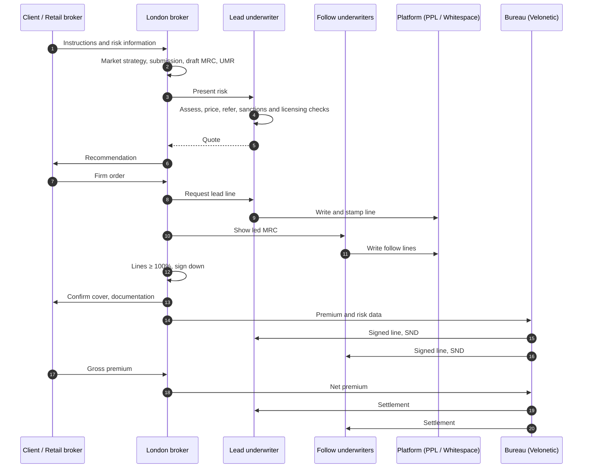
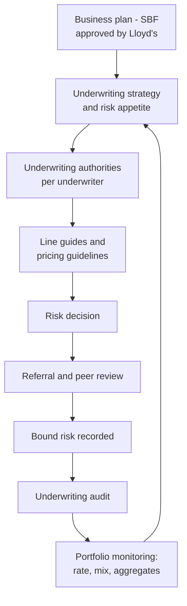
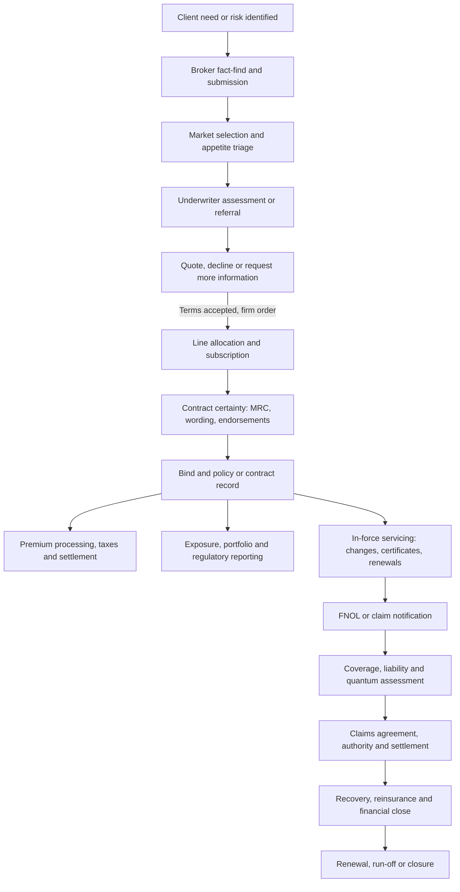

# Module 04 – Placement and Underwriting: The Open Market Lifecycle

| | |
|---|---|
| **Level** | Intermediate |
| **Path phase** | Phase 1 (late) and Phase 2 ([Module 18](18-World-Class-Consultant-Path.md)) |
| **Time** | 4–5 hours reading, 3 hours exercises |
| **Prerequisites** | Modules 01–02 |
| **You will be able to** | Walk through every stage of an open market placement; read and critique an MRC; explain lead/follow, written and signed lines, the GUA and facilities; explain how underwriters price and control risk; diagnose where placement and underwriting lose time, money and data |

---

## 1. Why this chapter matters

Placement is where the contract, the price and the first data about a risk are created. Every downstream problem – premium queries, reconciliation breaks, claims disputes, poor exposure data – can usually be traced back to something that happened, or did not happen, during placement. Underwriting is where most of the value is created or destroyed: a 5% mispricing on a £10m risk costs more than a year of process improvement in many teams.

---

## 2. Three routes into the market

| Route | Who decides on each risk | Share of Lloyd's premium | Economics |
|---|---|---|---|
| **Open market** | Underwriter at syndicate or company, risk by risk, with a broker | About half **[likely]** | Lower acquisition cost than DA; high underwriting effort per risk |
| **Delegated authority** | Coverholder/MGA within limits set by the insurer | About 45% **[likely]** | High acquisition cost (commission); low underwriting effort per risk for the insurer; high oversight cost |
| **Facilities and consortia** | A leader or algorithm decides; followers bound by pre-agreed rules | Growing; inside the two figures above | Very low effort for followers; risk of adverse selection |

This chapter covers the open market and facilities. Delegated authority is in [Module 05](05-Intermediate-Delegated-Authority.md).

---

## 3. The placement lifecycle – stage by stage



### Stage 0 – Renewal planning (90–120 days before expiry)

| | |
|---|---|
| **What happens** | Broker reviews the account: claims, changes in the client's business, last year's terms, market conditions. Sets a renewal strategy and timetable. |
| **Data and documents** | Renewal information request to client; claims history; prior MRC and wording |
| **Failure modes** | Late client information → rushed placement → contract certainty failures and extensions |
| **Metric** | % renewals with complete information 30 days before inception |

### Stage 1 – Client engagement, KYC and classification

| | |
|---|---|
| **What happens** | Broker confirms the client, its ownership, sanctions status and regulatory classification (commercial size thresholds after FCA PS25/21 **[certain]**). Agrees terms of business. |
| **Controls** | Sanctions and KYC screening; client classification; conflicts check |
| **Failure modes** | Wrong classification → wrong conduct rules applied; incomplete sanctions screening |

### Stage 2 – Submission preparation

| | |
|---|---|
| **What happens** | Broker builds the submission: schedules (e.g., statement of values, fleet list), loss history, financials, engineering or survey reports, prior wording. Drafts the **MRC** and creates the **Unique Market Reference (UMR)**. |
| **Data and documents** | Submission pack (often 20–200 pages), spreadsheets, MRC draft |
| **Failure modes** | Data in inconsistent formats; missing values; outdated schedules; the fair presentation is incomplete |
| **Metric** | % submissions accepted by the lead without information requests |

**Fair presentation:** under the Insurance Act 2015, the client (through the broker) must disclose every material circumstance, or enough to put the insurer on notice to ask, in a reasonably clear and accessible way **[certain]**. "Data dumping" – sending thousands of pages without structure – can fail the "clear and accessible" test.

### Stage 3 – Market strategy

| | |
|---|---|
| **What happens** | Broker decides: which lead (expertise, claims reputation, appetite, rating), which followers, whether to use a facility, which platform, layering structure. |
| **Considerations** | Client's security requirements (minimum ratings); broker's facility arrangements; conflicts of interest |
| **Failure modes** | Steering business to facilities that suit the broker more than the client; concentration on a few leads |

### Stage 4 – Presentation to the lead

| | |
|---|---|
| **What happens** | Broker presents the risk – on a platform, by email, or face to face (still common at Lloyd's underwriting "boxes"). |
| **Failure modes** | Underwriters receive far more submissions than they can review properly; prioritisation is informal |
| **Metric** | Time from submission received to first underwriter review |

### Stage 5 – Underwriting assessment

| | |
|---|---|
| **What happens** | Underwriter checks appetite and authority, assesses risk quality, runs pricing and cat models, checks sanctions and licensing, may refer to senior underwriters or peer review. |
| **Outputs** | Decision (decline, quote, quote with conditions); technical price; underwriting file note |
| **Failure modes** | Pricing outside guidelines without referral; weak audit trail; inconsistent decisions between underwriters |
| **Detail** | Section 9 of this chapter |

### Stage 6 – Quote and negotiation

| | |
|---|---|
| **What happens** | Lead proposes premium, deductibles, limits, conditions, exclusions, line size, **subjectivities** (conditions to be satisfied, e.g., "subject to satisfactory survey within 30 days"). Broker negotiates. |
| **Legal point** | A quote is usually an offer that can be accepted while valid; wording decides **[certain]** |
| **Failure modes** | Multiple versions of terms; unclear which is final; subjectivities not tracked after binding |

### Stage 7 – Firm order and binding

| | |
|---|---|
| **What happens** | Client instructs the broker to bind. Lead **writes its line** – stamps and signs (or accepts electronically). |
| **Legal point** | Each written line creates a binding contract with that insurer for its share, even before the placement is fully subscribed (*General Reinsurance Corp v Forsakringsaktiebolaget Fennia Patria*, 1983) **[certain]** |
| **Failure modes** | Binding while key terms are "to be agreed" → contract certainty failure |

### Stage 8 – Following

| | |
|---|---|
| **What happens** | Broker shows the led MRC to follow markets, who write their lines on the leader's terms. Followers may add limited conditions (e.g., their own sanctions or choice-of-law requirements). |
| **Failure modes** | Followers adding conditions that create different terms for different insurers; delays reaching 100% |
| **Metric** | Time from lead line to 100% placed |

### Stage 9 – Signing down

If written lines exceed 100%, all lines are reduced proportionally so they total 100% (section 6.2).

### Stage 10 – Contract certainty and documentation

| | |
|---|---|
| **What happens** | All terms finalised before inception; broker issues evidence of cover and final contract documentation to the client promptly. |
| **Controls** | Contract certainty checks by broker and insurer; subjectivities tracked |
| **Metric** | % contracts certain at inception; days to issue final documentation |

### Stage 11 – Premium and data processing

| | |
|---|---|
| **What happens** | Broker submits premium and contract data to the bureau (or directly to non-bureau insurers). Bureau validates and signs, allocating a **Signing Number and Date (SND)** to each entry. Premium settles through central settlement. |
| **Failure modes** | Bureau queries due to data errors; mismatches between broker, bureau and insurer records |
| **Detail** | [Module 06 Part A](06-Intermediate-Accounting-Settlement-Claims-Reinsurance.md) |

### Stage 12 – Mid-term changes

Endorsements (additions, deletions, extensions, premium adjustments) agreed according to the subscription agreement and the **General Underwriters' Agreement (GUA)** (section 6.5), then processed through the bureau.

### Stage 13 – Renewal

Treated as a **new contract** with a fresh duty of fair presentation **[certain]**. The incumbent lead has an advantage but must re-price.

---

## 4. The Market Reform Contract (MRC) in depth

### 4.1 What it is

The MRC is the standard London placing document and contract format, introduced in 2007 as part of the contract certainty reforms **[certain]**. It is used for open market insurance, reinsurance and binding authorities (MRC binding authority format). It can be paper/PDF or electronic on a placing platform.

### 4.2 The six sections

| Section | Contents | What goes wrong |
|---|---|---|
| **Risk Details** | UMR; type; insured; period; interest; situation; limits and sub-limits; deductibles; conditions; exclusions; premium; payment terms; choice of law and jurisdiction; taxes; recording, transmitting and storing information; notices | Vague terms ("as expiring"); wordings referenced but not attached; missing exclusions |
| **Information** | Information presented to insurers or reference to it | Unclear what was presented → fair presentation disputes |
| **Security Details** | Insurers' liability (several not joint); order hereon; basis of written lines; basis of signed lines; signing provisions; each insurer's stamp, line and reference | Signed line basis not stated; lines "to stand" ignored |
| **Subscription Agreement** | Slip leader; agreement parties for contract changes (GUA); claims agreement parties; claims administration; rules for followers' conditions; expenses | Agreement parties unclear → disputes on changes and claims |
| **Fiscal and Regulatory** | Tax payable by insurers; country of origin; regulatory information (e.g., US surplus lines details); allocation of premium to coding | Wrong tax or regulatory codes → bureau queries, tax errors |
| **Broker Remuneration and Deductions** | Brokerage and other deductions | Mismatched brokerage between systems |

### 4.3 Sample Risk Details extract (fictional)

```
UNIQUE MARKET REFERENCE:  B9999ABC2026001
TYPE:                     Property Damage and Business Interruption
INSURED:                  Atlas Logistics Ltd and subsidiaries
PERIOD:                   From 01 January 2027 to 31 December 2027, both days inclusive,
                          local standard time at the insured's address
INTEREST:                 All real and personal property ... and business interruption
SITUATION:                As per schedule of locations attached (Appendix A)
SUM INSURED / LIMIT:      GBP 250,000,000 any one occurrence
SUB-LIMITS:               Flood GBP 25,000,000 any one occurrence and in the aggregate
DEDUCTIBLE:               GBP 1,000,000 each and every loss
CONDITIONS:               As per wording attached (Appendix B) including
                          LMA3100 Sanction limitation and exclusion clause
EXCLUSIONS:               As per wording, including war, terrorism, cyber (LMA5400)
PREMIUM:                  GBP 1,850,000 (100%)
PAYMENT TERMS:            Premium payment clause LSW3001 – 60 days
CHOICE OF LAW:            England and Wales; exclusive jurisdiction of English courts
SUBJECTIVITIES:           Survey of Site 4 within 45 days of inception
```

**[likely]** Clause numbers shown are illustrative of real LMA clauses (LMA3100 is the market sanctions clause **[certain]**); always check the current clause library.

**Critique exercise:** what would you check? (1) Is Appendix A attached and dated? (2) Is the flood sub-limit consistent with the cat model output? (3) Is the subjectivity tracked with an owner? (4) Is the cyber exclusion appropriate for business interruption exposure?

### 4.4 Unique Market Reference (UMR)

Format: "B" + 4-digit broker code + broker's own reference **[certain]**. The UMR is the **primary key** across placement, accounting and claims. Duplicate or wrong UMRs break reconciliation downstream – check this first in any data quality review.

---

## 5. Contract certainty

| Aspect | Detail |
|---|---|
| **Definition** | All terms agreed by all parties before inception; contract documentation provided promptly after **[certain]** |
| **Origin** | Regulator pressure (FSA) in 2004–2007 after widespread late documentation and disputes |
| **Elements to check** | Complete MRC sections; wording attached or precisely referenced; no "to be agreed" items; subjectivities with deadlines; lines and signing basis stated; tax and regulatory information complete |
| **Consequences of failure** | Coverage disputes; delayed claims; regulatory criticism; reinsurance disputes (reinsurer may not follow uncertain terms) |
| **Measures** | % contracts certain at inception; % documentation issued within agreed days; number of post-inception changes to core terms |

**Consulting angle:** automated MRC completeness and wording checks are among the highest-value, lowest-risk AI use cases in London ([Module 09](09-Advanced-AI-in-London-Market.md)).

---

## 6. Subscription mechanics in depth

### 6.1 Lead selection

Brokers choose leads for: class expertise, claims reputation, line size, rating, willingness to lead, speed, and relationship. Clients often specify approved security. **Partner insight:** lead position is a competitive asset – leads see more risks first, influence terms, and attract follow capacity. Lead share is one of the best indicators of a syndicate's market standing.

### 6.2 Written vs signed lines – worked example

| Insurer | Written line | Signed line (× 100/120) |
|---|---|---|
| Syndicate A (lead) | 25% | 20.83% |
| Syndicate B | 20% | 16.67% |
| Company C | 30% | 25.00% |
| Syndicate D | 25% | 20.83% |
| Company E | 20% | 16.67% |
| **Total** | **120%** | **100%** |

- A line marked **"to stand"** must not be signed down without that insurer's agreement.
- The **basis of signed lines** in the MRC states how signing down works.
- **Why brokers overplace:** to give the client a margin if a market withdraws, and to keep competitive tension.
- **Data issue:** insurers often book the written line first and correct to the signed line later. Mismatches between written and signed lines are a common reconciliation break.

### 6.3 Several liability

Each insurer is liable only for its own signed share **[certain]**. If one insurer becomes insolvent, the others do not pay its share. This is why brokers' security committees vet each insurer.

### 6.4 Layered and subscribed – both at once

Large programmes combine layering and subscription: each layer has its own lead and followers, and sometimes its own price and wording.

| Layer | Limit | Lead | Followers | Price (rate on line) |
|---|---|---|---|---|
| Primary | £25m xs £1m | Syndicate A | 5 insurers | 12% |
| 1st excess | £75m xs £26m | Company C | 7 insurers | 4% |
| 2nd excess | £150m xs £101m | Syndicate F | 9 insurers | 1.5% |

**Risk:** excess layers may "follow form" the primary wording but with different exclusions – a common source of gaps.

### 6.5 The General Underwriters' Agreement (GUA)

| Aspect | Detail |
|---|---|
| **Purpose** | Defines which contract changes the slip leader can agree on behalf of all followers, and which need agreement from other agreement parties **[certain]** |
| **How it works** | Changes are categorised – e.g., administrative and minor changes can be agreed by the leader alone; material changes (e.g., significant changes to risk, limits or premium) need the leader plus other named agreement parties, or all insurers. The subscription agreement section of the MRC states the arrangement |
| **Why it matters** | Without it, every change would require every follower's agreement – slow and costly |
| **Consulting angle** | Track which endorsements needed all-insurer agreement and how long they took – a measure of subscription friction |

---

## 7. Facilities, consortia and follow capacity

| Structure | How it works | Benefit | Risk |
|---|---|---|---|
| **Lineslip** | Broker-arranged contract under which a lineslip leader (sometimes with a second lead) agrees individual declared risks for a class, binding all followers | Speed; lower cost for followers | Followers depend on the leader; adverse selection |
| **Consortium** | Several insurers write a class together; a consortium leader binds for all | Access to expertise and distribution | Concentrated decision-making |
| **Broker facility / portfolio facility** | Pre-committed follow capacity that automatically follows selected leads across many risks | Lower friction; broker leverage; certainty of capacity for clients | Conflict of interest; limited data for followers; margin pressure |
| **Algorithmic / data-driven follow** | A syndicate decides follow lines using data and rules, often in minutes – e.g., Ki (syndicate 1618) **[likely]** | Speed and low cost | Model risk; in soft markets can follow underpriced risks |

### 7.1 Why facilities matter in 2026 **[likely]**

- Capacity is plentiful and rates are falling, so brokers have leverage to place more through facilities.
- Followers gain volume at low cost but may lose independent pricing and risk-level data.
- Lloyd's strategy emphasises **leading underwriting performance**, suggesting more scrutiny of passive follow business.

### 7.2 How to analyse facility performance (consulting method)

| Analysis | Question |
|---|---|
| Loss ratio by channel (open market lead / open market follow / facility) at similar rate levels | Is facility business worse because of selection, or only mix? |
| Rate adequacy by channel | Are facility rates below technical price? |
| Lead quality | Which leads does the facility follow, and how do those leads perform? |
| Data availability | Does the follower get risk-level data or only summaries? |
| Exit terms | Can the follower withdraw mid-term? |

---

## 8. Electronic placing

| Platform | Notes |
|---|---|
| **PPL (Placing Platform Limited)** | Market placing platform launched 2016; moved to a "Next Gen" platform after delays **[likely]** |
| **Whitespace** | Electronic placing platform widely used in London **[likely]** |

**What e-placing changes:** a single shared contract record, timestamps and audit trail, electronic stamps and lines, structured data for parts of the MRC, and messages between broker and underwriters.

**What it does not change by itself:** submissions are still largely unstructured documents; underwriters' own systems still need data entry or integration; the bureau still processes the accounting.

**Consulting angle:** the value of e-placing depends on **integration** – pulling structured contract data from the platform into the insurer's underwriting workbench, policy system and finance without re-keying.

---

## 9. Underwriting inside the insurer

### 9.1 The underwriting control framework



| Control | Purpose | Typical weakness |
|---|---|---|
| **Business plan (SBF)** | Premium, classes, loss ratios approved by Lloyd's | Plan not cascaded into team targets |
| **Underwriting authority letters** | What each underwriter may write: classes, max line, territories, exclusions | Not checked systematically at bind |
| **Line guide** | Maximum line by class and risk quality | Exceptions not recorded |
| **Pricing guidelines / models** | Technical price | Spreadsheet models with no version control |
| **Referrals** | Risks outside authority go to senior underwriters | Informal referrals by email |
| **Peer review** | Second review of samples or high-risk decisions | Done after binding; little feedback loop |
| **Exposure management** | Aggregates, PML, RDS, cat model outputs | Monthly updates; no real-time view at bind |
| **Sanctions and licensing checks** | Legal permission to write and pay | Manual screening; not repeated at claims |
| **Underwriting audit** | Evidence that process was followed | Findings repeat year after year |

### 9.2 Building a technical price – worked example

| Component | Amount |
|---|---|
| Expected loss (from experience and exposure rating, including cat load) | £600,000 |
| Cost of capital: capital allocated £1.5m × 12% | £180,000 |
| Acquisition cost (brokerage) | 25% of premium |
| Internal expenses | 8% of premium |
| **Technical price** = (600,000 + 180,000) ÷ (1 − 0.25 − 0.08) | **≈ £1,164,000** |

If the market price is £1,050,000, **rate adequacy** = 1,050 ÷ 1,164 ≈ **90%** – the risk is about 10% underpriced against the target return.

### 9.3 Risk-adjusted rate change (RARC) – worked example

| Item | Expiring | Renewal |
|---|---|---|
| Premium | £1,000,000 | £1,050,000 |
| Exposure (e.g., insured values) | 100 | 110 |
| Deductible change effect on expected loss | — | −3% |

1. Adjust expiring premium for exposure growth: £1,000,000 × 110/100 = £1,100,000.
2. Adjust for the cover change (higher deductible lowers expected loss 3%): £1,100,000 × 0.97 = £1,067,000.
3. RARC = £1,050,000 ÷ £1,067,000 − 1 ≈ **−1.6%**.

The headline premium rose 5%, but on a like-for-like basis the price **fell** 1.6%. This is why Lloyd's and underwriters track **risk-adjusted** rate change. Lloyd's reported −6.7% for H1 2026 **[certain]**.

### 9.4 Pricing and portfolio vocabulary

| Term | Meaning |
|---|---|
| **Burning cost** | Historical losses ÷ exposure, adjusted for trend and development |
| **Exposure rating** | Price using exposure and benchmark loss curves |
| **Experience rating** | Price using the client's own loss history |
| **Hit ratio** | Bound ÷ quoted |
| **Retention ratio** | Renewals retained ÷ renewals offered |
| **Rate adequacy** | Actual price ÷ technical price |
| **PML** | Probable maximum loss from an event |
| **RDS** | Lloyd's Realistic Disaster Scenarios |
| **Line size** | Share written on a risk |

### 9.5 The underwriting workbench

A modern underwriting workbench brings together: submission intake, triage and prioritisation, risk data enrichment, pricing tools, referral workflow, authority checks, decision record, and links to the policy system and exposure tools. **[likely]** Many London firms have workbench projects; value depends on integration and adoption by underwriters, not on features.

---

## 10. Cycle management – underwriting in a soft market

| Action | What good looks like |
|---|---|
| **Know your technical price** | Every risk priced against a technical price; rate adequacy reported monthly |
| **Separate rate from exposure and cover changes** | RARC tracked by class and channel |
| **Hold terms, not just price** | Deductibles, exclusions, sub-limits monitored as carefully as rate |
| **Manage follow and facility share** | Caps and performance triggers |
| **Walk away** | Underwriters rewarded for profitable portfolio, not premium volume |
| **Reduce cost** | Expense ratio improvements protect margin when price cannot |
| **Use capital wisely** | Buy cheaper reinsurance where it improves return on capital |

The PRA's 2026 priorities letter warns that softening markets may cause internal models to overstate profitability and understate capital **[likely]**. Expect regulators and Lloyd's to challenge 2027 plans that assume rate adequacy holds.

---

## 11. Endorsements, cancellations and renewals

| Process | Detail | Common issue |
|---|---|---|
| **Endorsement** | Prepared by broker in MRC endorsement format; agreed per GUA; processed with additional or return premium | Agreed by the wrong parties; processed late |
| **Cancellation** | Under the cancellation clause; pro-rata or short-period return premium | Disputes about notice dates |
| **Extension** | Short extension while renewal terms are agreed | Repeated extensions hide late placement |
| **Adjustable premium** | Deposit premium adjusted on actual exposure at expiry | Adjustments never collected |
| **Renewal** | New contract; fresh fair presentation | "As expiring" terms copied without review |

---

## 12. Data and systems in placement and underwriting

| System | Owner | Purpose |
|---|---|---|
| Broker placing system | Broker | Client data, submissions, MRC, accounting |
| Electronic placing platform | Market/vendor | Shared contract record, lines, audit trail |
| Underwriting workbench | Insurer | Intake, triage, pricing, referral, decision record |
| Pricing and cat models | Insurer | Technical price, PML, aggregates |
| Policy administration system | Insurer | Contract record, lines, endorsements, premium |
| Bureau systems (Velonetic) | Market | Premium processing, signing, settlement |

**Key data points that must match across systems:** UMR, insured, period, written and signed line, premium (gross, net, currency), brokerage, tax, class/risk code, territory, deductibles and limits, layer, endorsements.

---

## 13. KPIs for placement and underwriting

| KPI | Why |
|---|---|
| Time from submission to first review | Underwriter capacity |
| Quote turnaround time | Competitiveness |
| Hit ratio / retention ratio | Market position |
| Rate adequacy and RARC by class and channel | Profitability |
| Lead share (% of premium led) | Market standing |
| % contracts certain at inception | Control |
| Referrals outside authority / breaches | Control |
| Bureau query rate | Data quality |
| Endorsement cycle time | Subscription friction |

---

## 14. Consulting opportunities

| Problem | Symptoms | Solution |
|---|---|---|
| Slow quote turnaround | Underwriters re-key submission data | Submission ingestion and triage; workbench |
| Weak pricing discipline | Wide variation in rate adequacy | Pricing tools, rate dashboards, governance |
| Contract certainty failures | Disputes, late documentation | Automated MRC checks, wording comparison |
| High cost per risk | Many manual touches; duplicate keying | Process redesign; integration with platforms |
| Poor follow performance | Facility business worse in soft market | Channel analytics; facility renegotiation |
| Weak exposure visibility | Aggregates calculated monthly in spreadsheets | Exposure platform; data quality at intake |

---

## 15. Mini case – the slow property team

**Situation:** a property team at a managing agent receives 300 submissions a week, quotes 30%, binds 10%. Quote turnaround averages 6 days; brokers complain. Underwriting assistants spend most of their time keying SOV data into models.

**Diagnosis questions:**
1. How much time per submission goes on data entry vs analysis?
2. What share of declines could be made in under 10 minutes with basic appetite rules?
3. What is the rate adequacy and loss ratio of risks bound with turnaround under 3 days vs over 6 days?

**Likely answer:** fast declines plus automated SOV extraction cut turnaround in half; underwriters spend more time on the top 30% of submissions; hit ratio on preferred risks rises.

---

## 16. Partner's lens

*Top-tier strategy consulting methods applied to this chapter.*

1. **Find where value is created, not where work is done.** In placement, most effort is administrative, but most value is in two decisions: **which risks to write** and **at what price**. A partner sizes both before proposing process automation. A 2-point improvement in rate adequacy on £300m of property premium is about £6m a year – usually far more than the cost saving from faster processing.
2. **Separate lead economics from follow economics.** Ask every client for performance split by lead, follow and facility. If they cannot produce it, that is the first finding.
3. **Treat time-to-quote as a revenue lever, not an efficiency metric.** Faster quotes on preferred risks win better business. Frame workbench and AI projects as **selection improvement**, then cost reduction.
4. **Trace one contract end to end.** In week one, take five real UMRs and trace them from submission to bureau signing to the policy system. Count re-keying points and mismatches. This one exercise usually produces the most persuasive slide in the diagnostic.
5. **Use the cycle.** In a soft market, the CEO's question is "how do we avoid writing tomorrow's losses?" Position underwriting work as **cycle management** – rate adequacy, terms discipline, facility caps – not as "pricing transformation".

---

## 17. Key takeaways

1. Placement creates the contract, the price and the first data; most downstream problems start here.
2. The MRC's six sections are the backbone of the London contract; the UMR is the key that links everything.
3. Each written line is a binding contract; signed lines may be reduced; liability is several.
4. The GUA lets leaders agree changes for followers; facilities let followers deploy capacity cheaply – at a risk.
5. Underwriting value comes from selection and price; measure rate adequacy and RARC by class and channel.
6. In 2026's soft market, cycle management is the main underwriting agenda.

---

## 18. Check your understanding

| # | Question | Answer |
|---|---|---|
| 1 | Name the six MRC sections. | Risk Details; Information; Security Details; Subscription Agreement; Fiscal and Regulatory; Broker Remuneration and Deductions. |
| 2 | Written lines total 125%. A 30% written line signs to? | 24%. |
| 3 | When is an insurer bound on an open market placement? | When it writes its line (subject to any conditions) – each line is a separate contract. |
| 4 | Expected loss £400k, capital charge £100k, acquisition 20%, expenses 10%. Technical price? | 500 ÷ 0.70 ≈ £714k. |
| 5 | Premium up 4%, exposure up 10%, no cover change. RARC? | 1.04 ÷ 1.10 − 1 ≈ −5.5%. |
| 6 | Why can facility business perform worse than led business at the same rate? | Adverse selection – followers take risks they did not select, sometimes without risk-level data. |
| 7 | What does the GUA do? | Sets which changes the leader can agree alone and which need other agreement parties. |

---

## 19. Practice tasks

1. **Draft** a fictional MRC Risk Details section for a marine cargo open cover; critique it against section 4.
2. **Calculate** technical price, rate adequacy and RARC for three fictional renewals.
3. **Trace** the data flow of one contract across five systems; list every point where the same data is entered again.
4. **Interview** an underwriter or broker about how facilities have changed their work (guide in [Module 19 §3](19-Practice-Toolkit-and-Templates.md)).

---

## Master Guide integration: submission to bind in detail

### Three flows run through every placement

| Flow | Path | What breaks if you ignore it |
|---|---|---|
| **Risk and decision** | Submission → appetite → pricing → underwriting decision → binding authority → claims decision | Fast quotes on risks the portfolio should not hold |
| **Contract and data** | Broker evidence → placement record → MRC and wording → policy record → endorsements → bordereaux and claims records → regulatory and management reporting | Contract uncertainty, failed policy matching, bad exposure data |
| **Money** | Insured premium → broker and market accounting → insurer cash; later claim payment → insured or beneficiary; plus reinsurance recoveries and commissions | Unallocated cash, aged debt, missed recoveries |

**Why it matters.** Transformations often fail because one flow is redesigned and the other two are not. A fast digital quote journey can still leave manual contract certainty, poor exposure data and slow premium settlement **[likely – common pattern in market programmes]**.



### What a good submission contains (varies by class)

- Insured legal entities, domiciles, group structure, ownership and insured interests.
- Business description, operations, revenue, payroll, turnover, assets and other exposure bases.
- **Property:** locations, geocodes, construction, occupancy, protection, values, business interruption detail.
- **Marine, aviation, transport:** fleet, vessel, aircraft, route, cargo, accumulation.
- Limits, deductibles, sub-limits, aggregates, retentions, territory and jurisdiction.
- Loss runs, claim narratives, reserves, large losses and what was fixed afterwards.
- Engineering reports, surveys, inspections, risk controls, certificates.
- Expiring terms and premium, coverage changes, the broker's market strategy.
- Requested wording, endorsements, warranties, subjectivities, target inception.
- Exposure and security data: cyber controls, business continuity, catastrophe exposure, supply-chain concentration.

**The real consulting problem.** Submissions arrive as PDFs, spreadsheets, emails, portals and feeds. The task is not "extract the documents". It is to build a **traceable, validated risk view** with source, confidence and a list of missing information.

### Appetite triage: outcomes and failure modes

Early outcomes: decline (outside appetite, prohibited class or territory); request information or a survey; refer (senior underwriter, product head, exposure management, legal, compliance, pricing); quote on terms; offer a part line subject to lead terms.

Common failures: incomplete locations or values; inconsistent entity names; old loss runs; the same submission arriving through several broker channels; information requests nobody tracks; wrong risk codes; and **turnaround measured without separating time waiting for the broker from time in underwriting**.

### The underwriter's eight questions

1. **Eligibility** – inside class, territory, product and licence permissions?
2. **Hazard and exposure** – what can happen, how bad, how often, what is the maximum plausible loss?
3. **Controls and vulnerability** – what reduces likelihood or severity; what risk is left?
4. **Accumulation** – what else could the same event, peril, supplier, region or systemic cause hit?
5. **Coverage fit** – can it be covered with suitable definitions, limits, exclusions, sub-limits, warranties, conditions?
6. **Technical price** – expected loss plus expenses, reinsurance, capital cost, uncertainty and target return.
7. **Portfolio fit** – does it improve or worsen mix, volatility, concentration and risk-adjusted return?
8. **Execution** – can the broker supply the data, and can we administer, service and settle it compliantly?

Underwriting is not only a price decision. Terms, capacity, attachment, deductibles, exclusions, warranties, subjectivities, referral and reinsurance can matter as much as premium.

### Technical premium bridge

```text
Expected ultimate loss
+ Loss adjustment / claims handling expense
+ Acquisition cost (brokerage or commission, depending on model)
+ Operating expense allocation
+ Reinsurance cost
+ Cost of capital / risk margin
+ Profit and uncertainty margin
= Indicated technical premium

Market price = technical view adjusted for competition, capacity, broker
relationship, portfolio strategy, terms, cycle and underwriting judgement.
```

No single formula is universal. Methods by class and data maturity: exposure rating, experience rating, burning cost, frequency-severity models, catastrophe models, scenario analysis, credibility weighting, GLMs, gradient boosting, expert judgement and structured referral. The live calculator in the interactive guide (RARC / technical price) uses this bridge.

### Worked example: the same warehouse, two levels of submission

A warehouse is submitted at £80m total insured value (buildings, stock, business interruption). The basic submission says "modern warehouse, sprinklered". An experienced underwriter asks for:

- Exact geocoded location and flood, wind, earthquake and wildfire exposure.
- Construction, roof, cladding, age, maintenance.
- Occupancy and how combustible the stock is; storage height and rack layout.
- Sprinkler type, water supply, impairment procedure, maintenance evidence.
- Fire detection, compartments, security, fire-service response.
- BI indemnity period, key suppliers, alternative sites, utility dependencies.
- Values split by building, stock, contents and BI; replacement cost and inflation assumptions.
- Prior losses and proof that survey recommendations were done.

**Lesson for AI work:** a tool that extracts "sprinklered" but not the sprinkler standard, impairment procedure or inspection evidence has not solved the underwriting problem.

### Signing down, "order hereon" and two corrections to the source

**Correction 1 – "order hereon".** The source defines it as "the remaining share after prior capacity has been secured". That is not the standard meaning. **"Order hereon" states what share of the whole risk is being placed on this slip** (for example "Order hereon: 60% of 100%"). Each written line is then read as a percentage of the order or of the whole, as the slip's **"Basis of written lines"** field states **[certain – MRC Security Details]**. Getting this wrong misstates every participant's exposure.

**Correction 2 – signing is normally pro rata.** The source's example signs four lines (40/30/25/25 = 120%) down to 30/25/25/20. That is **not** a pro rata signing. The standard MRC signing provision allocates lines written "to stand" in full and signs all other lines down **in equal proportions** until the total equals 100% of the order, unless the slip states other signing provisions **[certain]**:

| Participant | Written line | Pro rata signed (÷1.2) | Source example (only valid if C wrote "to stand" and the broker agreed other cuts) |
|---|---:|---:|---:|
| Syndicate A (lead) | 40% | 33.33% | 30% |
| Syndicate B | 30% | 25.00% | 25% |
| Company carrier C | 25% | 20.83% | 25% |
| Company carrier D | 25% | 20.83% | 20% |
| **Total** | **120%** | **100%** | **100%** |

The lead's signed share does not make it responsible for the other participants' shares. Use the signing calculator in the interactive guide to practise.

### Lead and follow: what is not implied

Do not assume that: the lead carries all the risk; followers have no underwriting duty of their own; every class uses the same claims agreement route; or "follow the leader" removes contract, conduct or regulatory accountability. A different carrier can lead different layers or sections, and followers may impose their own line size, subjectivities or terms.

### Layers, MRC versus wording, and contract certainty

- **Layered placements:** primary and excess layers have different attachment points, limits, prices and carriers. The placement record must keep the links between programme, section, layer, participants and wording.
- **MRC is not the policy wording.** The slip or MRC is the standard market record of key terms; the full contract can also include wording, schedules, endorsements, certificates and attachments. Contract certainty means the **whole** agreement is clear and timely, not just a completed data form.
- **Subjectivities:** track each one with owner, due date, evidence, status, escalation and the consequence if it is not met.
- **Common contract-certainty failures:** unclear insured entity, location or risk description; limits or deductibles that differ between slip and wording; unclear clause versions or conflicting endorsements; wrong period or time zone; missing signed lines or participant agreement; untracked subjectivities; manual rekeying into the policy system that creates differences.

### Bind, issuance, endorsements and renewal

**At bind:** confirm final terms, limit, deductible, premium, period, insureds and shares; confirm authority and that referrals are closed; complete the contract documents and store the master version; issue the policy, certificate or evidence of cover; create policy and exposure records; check tax, regulatory and reporting data; trigger premium processing and broker or client communications. Administration can sit with the carrier, managing agent, service company or coverholder depending on the model.

**Endorsement control questions:** Is the change allowed under authority? Does it change hazard or accumulation materially? Have all required participants agreed? Does it change rate or premium? Are downstream records and tax updated? Is the version and effective date clear?

**Renewal is a new underwriting decision, not a copy-forward.** Refresh exposure, claims, controls, catastrophe view, price, terms, capacity, reinsurance, sanctions and licensing, and client needs. Compare expiring and renewal data and flag changes and old assumptions.


## 20. Sources

- [Lloyd's half year results 2026](https://www.lloyds.com/insights/media-centre/press-releases/lloyds-announces-half-year-results-2026)
- [Clifford Chance – PRA 2026 insurance supervision priorities](https://www.cliffordchance.com/insights/resources/blogs/insurance-insights/2026/01/the-pras-2026-insurance-supervision-priorities.html)
- [Insurance Insider – PPL Next Gen platform goes live](https://www.insuranceinsider.com/article/2bd65d4pn7amg8t7mmadc/london-market-section/ppl-next-gen-platform-goes-live-after-delays)
- [Insurance Insider – PPL Next Gen opens to the market](https://www.insuranceinsider.com/article/2bhivepwwobqqshhhodmo/london-market-section/ppl-next-gen-platform-opens-to-the-entire-market)
- [FCA PS25/21](https://www.fca.org.uk/publication/policy/ps25-21.pdf)
