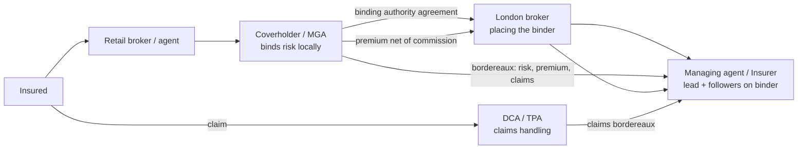
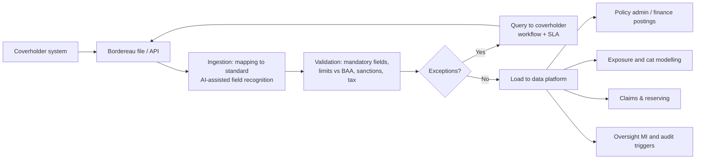

# Module 05 – Delegated Authority: Coverholders, MGAs and Bordereaux

**Level:** Intermediate | **Goal:** Understand how delegated authority (DA) works, why it is about 45% of Lloyd's premium **[likely]**, how it is controlled, and why it is the area where most operational and data problems sit.

---

## 1. What delegated authority is

An insurer (managing agent for a syndicate, or a company) gives a third party the authority to **underwrite and bind** risks, and sometimes to **handle claims**, on its behalf, within agreed limits.

Why insurers use DA:

- Reach small and medium risks in local markets (US E&S, Canada, Australia, Europe) that cannot be placed one by one in London economically.
- Access specialist expertise held by MGAs.
- Scale premium with low fixed cost.

Why it is risky:

- The insurer carries the risk but does not see each decision when it is made.
- Data arrives later (bordereaux), often in poor quality.
- Conduct, sanctions and claims failures by the coverholder are the insurer's problem.

---

## 2. The DA chain

**Key point:** the **binding authority agreement (BAA)** is itself placed in the London market like a risk – it has a UMR, an MRC (binding authority format), a lead and followers. The coverholder then binds many individual risks ("**certificates**" or "**declarations**") under it.

---

## 3. Types of delegated arrangements

| Type | Authority given | Notes |
|---|---|---|
| **Binding authority (full)** | Coverholder underwrites and binds within limits; issues documents. | Most common. |
| **Prior submit** | Coverholder must get insurer approval before binding each risk. | More control, slower. |
| **Lineslip / consortium** | Lead underwriter in London binds for followers. | Usually counted as open market, not DA. |
| **Claims authority (DCA/TPA)** | Third party handles and settles claims up to a limit. | Separate agreement; separate approval. |
| **Service company** | Group-owned coverholder of a managing agent. | Must still be approved and overseen. |
| **Sub-delegation** | Coverholder passes authority to others. | Restricted; Lloyd's expects managing agents to prevent unapproved sub-delegation **[likely]**. |

---

## 4. The DA lifecycle

| Stage | Activities | Key controls / outputs |
|---|---|---|
| **1. Due diligence** | Managing agent reviews the prospective coverholder: financials, experience, systems, compliance, key staff, sanctions, conduct. | Due diligence file, risk rating of coverholder |
| **2. Approval** | Coverholder approved by Lloyd's (via Lloyd's DA systems, e.g., ATLAS) for Lloyd's business; Lloyd's Europe approval for EEA business. | Approved coverholder record |
| **3. Contract placement** | BAA placed with lead and followers in London using standard LMA wordings (e.g., Lloyd's/LMA binding authority wording). Defines classes, territories, limits, premium income limit (GPI), commission, reporting requirements, claims authority. | BAA registered with Lloyd's **before inception** **[likely]** |
| **4. Binding** | Coverholder binds individual risks, issues certificates. | Policy documents, local compliance |
| **5. Reporting – bordereaux** | Monthly (usually) risk/premium and claims bordereaux sent to managing agent and broker. | Bordereaux in Lloyd's Coverholder Reporting Standards format |
| **6. Premium remittance** | Coverholder collects premium, deducts commission, pays to London broker, who pays insurers. | Settlement within agreed days; aged debt monitoring |
| **7. Claims** | Coverholder or DCA handles claims within authority; larger claims referred to London. | Claims bordereaux, referrals |
| **8. Oversight** | Managing agent monitors performance, data, compliance; runs audits (often coordinated audits across several managing agents). | Audit reports, remediation plans, MI to board |
| **9. Renewal or termination** | Review results, decide terms, renew or exit. | Renewal decision; run-off plan for terminated binders |

---

## 5. Bordereaux – the heart of DA operations

### 5.1 Types

| Bordereau | Content | Used for |
|---|---|---|
| **Risk bordereau** | Each risk bound: insured, location, cover, limit, premium, dates, class, tax | Exposure management, aggregates, pricing, regulatory reporting |
| **Premium bordereau** | Premium due, commissions, taxes | Accounting, credit control |
| **Claims bordereau** | Claims notified, paid, reserves, recoveries | Reserving, claims oversight, reinsurance recoveries |

### 5.2 Standards

- **Lloyd's Coverholder Reporting Standards** define required fields for risk, premium and claims bordereaux (version 5.x) **[likely]**.
- **Core Data Record (CDR)** work: ACORD/market consultation on a **delegated authority CDR** in 2026 **[likely]**. If adopted, it will define a market-standard data set for DA contracts and reporting.
- **LMA** reports a project to revise 400+ binding authority wordings with final wordings and a data model planned for 2026 **[likely]**.

### 5.3 Why bordereaux are a pain point

| Problem | Business impact |
|---|---|
| Arrive late (30–60+ days after month end) | Exposure and reserves always behind reality |
| Arrive in many formats (Excel, CSV, PDFs) | Heavy manual mapping; each coverholder different |
| Missing or wrong fields (addresses, values, class codes) | Cat model inaccuracy; tax and regulatory errors |
| No reconciliation to cash | Premium recorded but not paid; aged debt |
| Claims bordereaux lack detail | Poor reserving, leakage, missed reinsurance recoveries |
| Multiple carriers on one binder each re-process same data | Market-wide duplicated cost |

### 5.4 Bordereaux processing flow (target state)

**Market tools [likely]:** Lloyd's/Velonetic DA services (e.g., DCOM for contract management), insurtech bordereaux platforms, managing agents' own data platforms. Name vendors only after checking current market position.

---

## 6. Oversight of coverholders

### 6.1 What Lloyd's expects **[likely]**

- Managing agents must design and run oversight so that delegated business stays within risk appetite and complies with requirements, with regular reporting to the board.
- Every BAA, coverholder appointment and service company agreement must be registered on Lloyd's systems before inception.
- Key staff should be employed directly by the coverholder; managing agents must prevent unauthorised sub-delegation.
- Coordinated audits are encouraged where several managing agents share a binder (Lloyd's issued best-practice guidance for coordinated coverholder and DCA audits in 2026).
- Retrospective endorsements (changes backdated) may be reviewed by Lloyd's.

### 6.2 Oversight framework (what good looks like)

| Layer | Activities |
|---|---|
| **Risk-based tiering** | Rate each coverholder (high/medium/low) on premium size, class risk, performance, audit findings, data quality. |
| **Monitoring** | Monthly KPIs: premium vs GPI limit, loss ratio, bordereaux timeliness and quality, aged debt, claims handling metrics, complaints. |
| **Audit** | Annual or risk-based audits: underwriting, claims, compliance, financial crime, IT and data security, conduct. |
| **Breach management** | Log breaches of authority (e.g., risk outside territory), assess, remediate, report. |
| **Conduct and customer outcomes** | Product governance where retail customers are involved (FCA PROD, Consumer Duty) – note PS25/21 changes for larger commercial clients. |
| **Governance** | DA committee, board reporting, escalation rules, exit plans. |

### 6.3 Typical DA KPIs

| KPI | Why it matters |
|---|---|
| Bordereaux received on time (%) | Data timeliness |
| Data quality score (% of mandatory fields valid) | Exposure and reporting accuracy |
| Premium written vs GPI limit (%) | Authority control |
| Loss ratio by binder and by coverholder | Performance |
| Aged premium debt (> 90 days) | Credit risk, cash flow |
| Number of breaches / audit findings open | Control health |
| Claims settled within authority vs referred | Claims control |
| Cost of oversight per £ premium | Efficiency |

---

## 7. MGAs – the growth engine and the concern

| Point | Detail |
|---|---|
| **Growth** | MGAs have grown quickly in the UK, US and Europe as capacity providers seek distribution and specialist expertise **[likely]**. |
| **Capacity** | MGAs need capacity from Lloyd's syndicates, companies, or fronting carriers with reinsurance. |
| **Fronting model** | A licensed "fronting" insurer issues the policy and reinsures most of the risk to reinsurers; common in the US. Regulators and rating agencies watch fronting closely **[likely]**. |
| **Regulation** | FCA PS25/21 kept the position that an intermediary (e.g., MGA) cannot act as the lead co-manufacturer for PROD purposes **[certain]**. |
| **Lloyd's Europe** | Lloyd's Europe continues approving MGAs as coverholders for EEA business (e.g., approval of Aspect in Feb 2026) **[likely]**. |
| **Risk** | Misaligned incentives (MGA paid on premium, carrier bears loss); capacity withdrawal risk; data quality. |

---

## 8. Consulting opportunities in DA

| Opportunity | Value lever |
|---|---|
| Bordereaux automation and data platform | Lower operating cost, faster exposure view |
| Oversight framework redesign (risk-based) | Fewer audits, better focus, regulator confidence |
| Coverholder performance analytics | Better portfolio decisions; exit poor binders earlier |
| DA CDR readiness | Data model alignment to market standard |
| MGA launch / capacity strategy | Revenue for MGA; growth for carrier |
| Coordinated audit model | Lower cost for both coverholders and carriers |
| Claims oversight (DCA/TPA) | Lower leakage, better reserving |

**Question to ask a Head of DA:** "If one of your top 10 coverholders stopped sending bordereaux today, how many days would it take you to notice, and what is your exposure in that period?"
