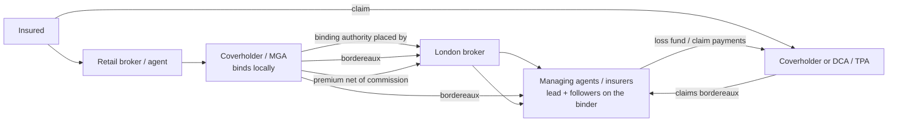
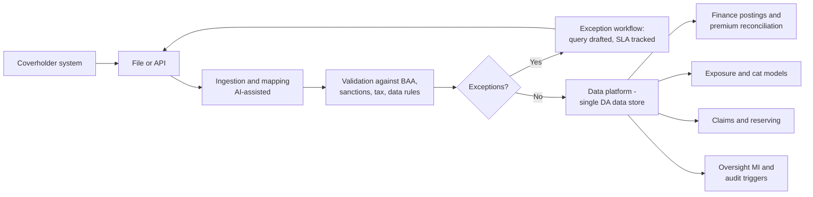

# Module 05 – Delegated Authority: Coverholders, MGAs and Bordereaux

| | |
|---|---|
| **Level** | Intermediate |
| **Path phase** | Phase 2 – and your recommended secondary spike ([Module 18 §3](18-World-Class-Consultant-Path.md)) |
| **Time** | 4–5 hours reading, 3 hours exercises |
| **Prerequisites** | Modules 01, 02, 04 |
| **You will be able to** | Explain how delegated authority (DA) works contractually, operationally and financially; read a binding authority; design a bordereaux process and a risk-based oversight framework; size the value of DA improvement; advise MGAs and carriers |

---

## 1. Why this chapter matters

About **45%** of Lloyd's premium comes through delegated authority **[likely]**. Lloyd's own DA pages cite around $26bn of annual premium and about 412 service companies **[likely]**. DA is where London reaches small and medium risks worldwide – and where most of the market's operational, data and conduct problems sit. If you want one area where a consultant can deliver measurable value quickly, this is it.

---

## 2. What delegated authority is

An insurer (a managing agent for its syndicates, or a company) gives a third party the authority to **underwrite and bind** risks – and sometimes to **handle claims** – on its behalf, within agreed limits.

### 2.1 Why insurers use it

| Reason | Explanation |
|---|---|
| **Reach** | Access local, small and medium risks (US E&S property, Canadian commercial, European SME, A&H) that cannot economically be placed one by one in London |
| **Expertise** | MGAs often have specialist underwriting talent and local knowledge |
| **Scale at low fixed cost** | Premium grows without growing underwriting headcount |
| **Speed for the customer** | Local binding in minutes, local documents, local claims service |

### 2.2 Why it is risky

| Risk | Explanation |
|---|---|
| **Control** | The insurer carries the risk but does not see each decision when made |
| **Data** | Information arrives later (bordereaux), often incomplete |
| **Conduct** | Mis-selling, unfair claims handling or sanctions breaches by the coverholder are the insurer's problem |
| **Incentives** | Coverholder paid mainly on premium volume; insurer bears the losses |
| **Credit** | Premium collected by the coverholder may not reach the insurer |

---

## 3. The DA chain and its contracts



| Contract | Between | Purpose |
|---|---|---|
| **Binding authority agreement (BAA)** – placed on an MRC binding authority format | Insurers and coverholder (placed by a London broker) | Grants authority and sets its limits |
| **Lloyd's coverholder approval** | Lloyd's and coverholder | Permission to act for Lloyd's syndicates |
| **TOBA** | London broker and insurers / coverholder | Premium handling, documentation, service terms |
| **Claims administration agreement** | Insurers and DCA/TPA | Claims authority, loss funds, reporting |
| **Letter of authority** | Managing agent and coverholder | Lloyd's has issued guidance on DA agreements and letters of authority in 2026 **[likely]** |
| **Certificates / policies** | Coverholder (for insurers) and insureds | The individual insurance contracts bound under the BAA |

**Key point:** the BAA is itself placed like any London risk – with a UMR, a lead and followers. Many binders are **co-led** (several managing agents share leadership); Lloyd's now requires claims arrangements for co-lead binders to be agreed using a model clause **[likely]**.

---

## 4. Types of delegated arrangements

| Type | Authority | Typical use |
|---|---|---|
| **Full binding authority** | Coverholder underwrites, binds and issues documents within limits | Most DA business |
| **Prior submit** | Coverholder must get insurer approval before binding each risk | New or higher-risk coverholders; larger risks |
| **Claims authority** | Coverholder or DCA/TPA settles claims up to a limit | Volume claims, local service |
| **Service company** | Group-owned coverholder of a managing agent | Local platforms (e.g., in Asia, Europe) |
| **Multi-carrier MGA** | MGA with binders from several carriers | Specialist MGAs in US, UK, Europe |
| **Fronted MGA programme** | Licensed fronting insurer issues policies; most risk reinsured to London and other reinsurers | US programme business |
| **Lloyd's Europe coverholder** | Binds EEA risks for Lloyd's Europe | EU distribution |
| **Lineslip / consortium** | London leader binds for followers | Usually counted as open market, not DA |

---

## 5. The DA lifecycle in depth

| Stage | What happens | Key controls | Common failures | Metric |
|---|---|---|---|---|
| **1. Strategy and appetite** | Managing agent decides which classes, territories and partners to pursue through DA | DA strategy in business plan; risk appetite limits | Growth targets without capacity to oversee | DA premium vs plan |
| **2. Due diligence** | Review the prospective coverholder: ownership, financials, underwriting experience, systems, data capability, compliance, key staff, sanctions, conduct, business continuity | Due diligence standards; risk rating | Box-ticking; no data capability test | Days to complete; findings |
| **3. Approval** | Lloyd's approval of coverholder (via Lloyd's DA systems such as ATLAS **[likely]**); Lloyd's Europe approval for EEA business | Lloyd's requirements | Delays; incomplete applications | Approval cycle time |
| **4. Contract placement** | BAA placed with lead and followers using standard LMA binding authority wordings; defines all limits | Standard wordings; legal review; registration with Lloyd's **before inception** **[likely]** | Non-standard terms; registration after inception | % registered pre-inception |
| **5. Binding** | Coverholder binds risks, issues certificates or policies | Authority limits in coverholder systems; referral rules | Risks outside territory or class; exceeding GPI | Breaches per month |
| **6. Reporting** | Risk, premium and claims bordereaux sent (usually monthly) | Reporting standards; deadlines in BAA | Late, incomplete, inconsistent | % on time; data quality score |
| **7. Premium remittance** | Coverholder collects premium, deducts commission, pays London broker, who pays insurers | Settlement terms in BAA; credit control | Late remittance; unreconciled cash | Aged debt > 90 days |
| **8. Claims** | Coverholder or DCA handles claims within authority; larger claims referred | Claims authority levels; loss fund controls; claims audits | Leakage; poor reserving; late claims data | Claims cycle time; leakage |
| **9. Oversight** | Monitoring, audits, breach management, reporting to the board | Risk-based oversight framework | Same effort for all coverholders regardless of risk | Oversight cost per £m premium |
| **10. Renewal or exit** | Review performance; renew, change terms or terminate; run-off plan | Renewal review standard; exit plans | Renewing poor performers to keep premium | Loss ratio of renewed vs exited binders |

---

## 6. The binding authority agreement – key terms

| Term | What it defines | Why it matters |
|---|---|---|
| **Classes and covers** | What the coverholder can write | Prevents writing outside appetite |
| **Territories** | Where risks may be located | Licensing, tax, cat exposure |
| **Maximum limits per risk** | Largest sum insured or limit | Controls severity |
| **Gross premium income (GPI) limit** | Maximum premium in the period | Controls volume; breach is a key monitoring trigger |
| **Rates and rating guidelines** | Minimum rates, rating tools | Price discipline |
| **Policy wordings** | Approved wordings and clauses | Contract certainty; conduct |
| **Commission** | Coverholder's commission; sometimes profit commission | Incentives; acquisition cost |
| **Premium remittance terms** | When and how premium is paid | Credit risk; cash flow |
| **Reporting requirements** | Bordereaux content, format and deadlines | Data quality |
| **Claims authority** | Settlement limits; referral; loss funds; DCA appointment | Claims control |
| **Referral conditions** | Risks needing insurer approval | Control of unusual risks |
| **Sanctions, data protection, financial crime** | Compliance obligations | Legal risk |
| **Audit and inspection rights** | Insurer access to records | Oversight |
| **Sub-delegation** | Whether coverholder can delegate further | Lloyd's expects managing agents to prevent unapproved sub-delegation **[likely]** |
| **Cancellation and run-off** | Notice; responsibilities after termination | Exit risk |

The LMA reports a project revising 400+ binding authority wordings, with final wordings and a data model planned in 2026 **[likely]**.

---

## 7. Bordereaux in depth

### 7.1 Types and content

| Bordereau | Typical fields | Used for |
|---|---|---|
| **Risk** | Certificate/policy number, insured, address and geocode, occupancy/class, inception and expiry, sum insured/limit, deductible, premium, tax, coverholder reference, UMR of binder | Exposure management, aggregates, pricing review, regulatory and tax reporting |
| **Premium** | Gross premium, commission, taxes, net due, instalments, currency, payment status | Accounting, credit control |
| **Claims** | Claim reference, policy reference, date of loss, cause, paid, outstanding, recoveries, status, cat code | Reserving, claims oversight, reinsurance recoveries |

### 7.2 Example risk bordereau row (fictional)

```
Binder UMR: B9999XYZ2026010 | Cert: FLH-26-004512 | Insured: J Smith Holdings LLC
Address: 120 Bay St, Tampa FL 33602 | Lat/Long: 27.9475,-82.4584 | Occupancy: Retail
Construction: Masonry | Year built: 1998 | TIV: USD 4,200,000 | Deductible: 2% wind
Inception: 2026-06-01 | Expiry: 2027-06-01 | Gross premium: USD 38,400
Commission: 25% | Surplus lines tax (FL): 4.94% | Coverholder ref: CH-0457
```

**Checks a validation engine should run:** territory allowed under the BAA? TIV under maximum per risk? Wind deductible meets minimum? Rate above minimum? Address geocoded? Tax rate correct for state? Cumulative GPI within limit? Sanctions screening on insured?

### 7.3 Standards

| Standard | Status |
|---|---|
| **Lloyd's Coverholder Reporting Standards** | Define required fields for risk, premium and claims bordereaux **[likely]** |
| **Delegated authority Core Data Record** | Market consultation in 2026 on a DA data standard **[likely]** |
| **LMA binding authority data model** | Part of the wording revision project **[likely]** |

### 7.4 Why bordereaux are a chronic problem

| Problem | Business impact |
|---|---|
| Late arrival (30–60+ days after month end) | Exposure and reserves always behind reality; cat aggregation understated |
| Many formats (each coverholder different) | Heavy manual mapping |
| Missing or wrong fields | Cat model inaccuracy; tax and regulatory errors |
| No reconciliation to cash | Premium booked but not received |
| Thin claims detail | Poor reserving; missed reinsurance recoveries |
| Each carrier on a binder processes the same data | Market-wide duplicated cost |

### 7.5 Target-state bordereaux process



**Design principles:**
1. **One standard internal data model** – map every coverholder to it once.
2. **Validate at ingestion** against the BAA, not weeks later.
3. **Treat exceptions as a workflow** with owners and service levels.
4. **Feed everything from one store** – finance, exposure, claims, oversight.
5. **Share across carriers on a binder** where possible (lead processes, followers consume) to remove duplication.

---

## 8. Oversight of coverholders

### 8.1 What Lloyd's expects **[likely]**

- Managing agents design and operate oversight so delegated business stays within appetite and complies with requirements, with regular board reporting.
- All binding authorities, coverholder appointments and service company agreements are **registered before inception**.
- Key staff should be employed directly by the coverholder; managing agents prevent unapproved sub-delegation.
- **Coordinated audits** where several managing agents share a lead binder (guidance issued May 2026).
- Retrospective endorsements (backdated changes) may be reviewed by Lloyd's.

### 8.2 Risk-based tiering – worked model

| Factor | Weight | Coverholder A score (1 low risk – 5 high risk) |
|---|---|---|
| Premium size | 20% | 4 |
| Class risk (e.g., cat-exposed property, liability) | 20% | 5 |
| Loss ratio vs plan | 20% | 3 |
| Data quality and timeliness | 15% | 4 |
| Audit findings open | 15% | 2 |
| Conduct exposure (retail/SME customers) | 10% | 3 |
| **Weighted score** | | **3.7 → Tier 1 (high)** |

| Tier | Oversight intensity |
|---|---|
| **Tier 1 (high)** | Monthly performance review; annual full audit; quarterly data quality review; senior relationship owner |
| **Tier 2 (medium)** | Quarterly review; audit every 18–24 months or risk-triggered |
| **Tier 3 (low)** | Semi-annual review; desk-based audit; automated monitoring with triggers |

**Why this matters:** many managing agents spread oversight effort evenly. Risk-based tiering moves effort to where risk is and is consistent with Lloyd's direction towards risk-based oversight **[likely]**.

### 8.3 Monitoring KPIs

| KPI | Trigger example |
|---|---|
| Bordereaux on time | < 90% on time for 2 months → escalate |
| Data quality score | < 95% valid mandatory fields → remediation plan |
| GPI utilisation | > 90% of limit → review before further binding |
| Loss ratio vs plan | > plan + 10 points → pricing review |
| Aged premium > 90 days | > 5% of premium → credit action |
| Breaches of authority | Any material breach → immediate review |
| Complaints (retail/SME) | Rising trend → conduct review |
| Claims within authority vs referred | Unusual pattern → claims audit |

### 8.4 Audit

| Area | What auditors check |
|---|---|
| Underwriting | Risks within authority; rating guidelines followed; files complete |
| Documentation | Approved wordings; certificates issued correctly |
| Premium handling | Trust/client money; remittance timeliness |
| Claims | Handling within authority; reserves; payments; files |
| Compliance | Sanctions; financial crime; data protection; licensing; complaints |
| Systems and data | Data security; business continuity; data accuracy |
| Conduct | Product governance and customer outcomes where retail/SME customers are involved |

### 8.5 Conduct after FCA PS25/21

Since December 2025, larger commercial customers (above DISP SME thresholds) and contracts of large risks are outside ICOBS, PROD and the Consumer Duty; consumers and SMEs remain in scope **[certain]**. Co-manufacturers can nominate a single lead for PROD 4 duties, but an intermediary such as an MGA cannot be the lead **[certain]**. **Practical issue:** bordereaux often do not capture customer size, so firms cannot easily prove which risks are in or out of scope.

---

## 9. Claims under delegated authority

| Topic | Detail |
|---|---|
| **Who handles** | Coverholder (if granted claims authority) or a DCA/TPA appointed by the insurers |
| **Authority levels** | None (all referred); limited settlement authority; full authority within a limit |
| **Loss funds** | Money advanced to the claims handler to pay claims locally; must be reconciled |
| **Claims bordereaux** | Monthly reporting of claims movements |
| **Co-lead binders** | Claims lead arrangements must be agreed; default rules apply until agreed **[likely]** |
| **Cat events** | Claims volume surges; DCA capacity and oversight become critical |
| **Common issues** | Late claims data; reserves not updated; leakage; missed reinsurance recoveries |

See [Module 06 Part B](06-Intermediate-Accounting-Settlement-Claims-Reinsurance.md).

---

## 10. MGAs and market structure

| Theme | Detail |
|---|---|
| **Growth** | MGAs have grown strongly in the US, UK and Europe as capital seeks distribution and specialist talent **[likely]** |
| **Capacity models** | Lloyd's binders; company market binders; fronting carrier plus reinsurance; multi-year capacity deals |
| **Capacity risk** | If carriers withdraw at renewal, an MGA can lose its business overnight – multi-carrier panels and longer capacity commitments reduce this |
| **Incentive alignment** | Profit commission, retained risk ("skin in the game") and multi-year terms align interests |
| **Regulation** | FCA authorisation in UK; PS25/21 co-manufacturing rules; Lloyd's coverholder standards |
| **Valuations** | MGAs attract private equity because they earn fee income without holding capital **[likely]** |

---

## 11. DA economics – worked example

A £50m gross premium US property binder:

| Line | Carrier view (£m) | Coverholder view (£m) |
|---|---|---|
| Gross premium | 50.0 | 50.0 bound |
| Coverholder commission (25%) | (12.5) | **12.5 income** |
| London broker brokerage on binder (5%) | (2.5) | — |
| Net premium to carrier | 35.0 | — |
| Claims (loss ratio 55% of gross) | (27.5) | — |
| Carrier internal costs including DA oversight (4% of gross) | (2.0) | — |
| Reinsurance cost (allocated) | (3.0) | — |
| **Carrier underwriting result** | **2.5** (5% of gross) | — |
| Profit commission to coverholder (e.g., 15% of profit above threshold) | possibly (0.4) | possibly 0.4 |
| Coverholder operating costs | — | (8.0) |
| **Coverholder profit** | — | **≈ 4.5–4.9** |

**Insights:**
- Acquisition costs take 30% of premium before any claims. The carrier's margin is thin and sensitive: a 5-point rise in loss ratio wipes out the profit.
- The coverholder earns a stable margin regardless of loss ratio (except through profit commission).
- **Levers for the carrier:** better selection of coverholders; profit-linked commission; lower oversight and processing cost per £m premium; faster data for exposure management.

---

## 12. Data and technology in DA

| Capability | Purpose |
|---|---|
| Coverholder management | Approvals, contracts, due diligence, audit records |
| Contract register | BAA terms in structured form (limits, territories, GPI) – needed for automated validation |
| Bordereaux ingestion and validation | Mapping, rules, exceptions |
| DA data store | Single source of DA risk, premium and claims data |
| Finance integration | Premium postings, cash matching |
| Exposure integration | Feed cat models with validated locations |
| Oversight MI | Tiering, KPIs, triggers, board reporting |
| AI | Mapping unknown layouts; anomaly detection; drafting queries; analysing coverholder performance ([Module 09](09-Advanced-AI-in-London-Market.md)) |

**Most common gap:** the BAA terms are in PDF only. Without a **structured contract register**, no system can check risks against authority automatically. Fix this first.

---

## 13. Consulting opportunities

| Opportunity | Value lever | Typical size |
|---|---|---|
| Bordereaux automation and DA data platform | Operations cost; faster exposure data | 0.1–0.3 points of expense ratio for a large DA book **[guessing]** |
| Risk-based oversight redesign | Oversight cost; regulator and Lloyd's confidence | Fewer audits; better focus |
| Coverholder performance analytics | Loss ratio through better partner selection and exits | Often the largest prize – 1+ point of loss ratio on DA books **[guessing]** |
| Commission and incentive redesign | Acquisition cost; alignment | Contract renewal cycle |
| DA data standard readiness | Data quality; future market alignment | Foundation |
| MGA launch / capacity strategy | Growth for MGA; distribution for carrier | Transaction-based |
| Claims oversight (DCA/TPA) | Leakage; reserving | Claims spend |

---

## 14. Mini case – the late Florida bordereaux

**Situation:** a Florida coverholder writing homeowners' business for three syndicates has not sent risk bordereaux for three months. Hurricane season starts in four weeks.

| Step | Action |
|---|---|
| Immediate | Lead managing agent formally requests data within 10 days; estimate exposure from last data plus growth trend; inform exposure management and reinsurance teams |
| Short term | Coordinated audit; restrict authority (e.g., no new coastal business) until data received; check premium remittance |
| Structural | Automated bordereaux tracking with triggers; late data raises the coverholder's risk tier; BAA renewal adds data and API requirements |

**Partner question:** "How many of your coverholders could be in this position today without you knowing?"

---

## 15. Partner's lens

*Top-tier strategy consulting methods applied to this chapter.*

1. **Selection beats processing.** The biggest value in DA is usually **which coverholders you work with and on what terms**, not how fast you process their bordereaux. Start every DA diagnostic with a **coverholder profitability league table** (loss ratio, growth, data quality, oversight cost). The bottom 10% of coverholders often generate most of the losses and most of the oversight effort.
2. **Follow the incentives.** Commission paid on premium encourages volume. Ask: what share of commission is linked to profit, and what share of coverholders have retained risk? Incentive redesign is a lever most clients have not used.
3. **Make the contract machine-readable.** Without structured BAA terms, no automation or AI can check authority. Position the contract register as the first, unglamorous step that unlocks everything else.
4. **Price oversight as a cost of goods.** Express oversight and processing cost per £m of DA premium by coverholder. Executives immediately see which partners are too expensive to manage.
5. **Think market, not firm.** Each binder may have several carriers processing the same bordereaux. A partner asks: "Could the lead process once and followers consume?" That is a market-level idea that wins attention from Lloyd's, the LMA and CEOs.

---

## 16. Key takeaways

1. DA is about 45% of Lloyd's premium and carries most of the market's operational, data and conduct risk.
2. The BAA defines authority; it must be registered before inception and should be held in structured form.
3. Bordereaux are late, inconsistent and duplicated – validation at ingestion against the BAA is the core fix.
4. Oversight should be risk-based: tier coverholders and focus effort.
5. DA economics are thin for carriers: acquisition costs of around 30% leave little room for loss ratio slippage.
6. The biggest value lever is partner selection and incentives; processing efficiency comes second.

---

## 17. Check your understanding

| # | Question | Answer |
|---|---|---|
| 1 | Whose agent is the coverholder when binding? | The insurer's. |
| 2 | What must happen before a binder incepts at Lloyd's? | It must be registered on Lloyd's systems. |
| 3 | Name the three bordereaux types. | Risk, premium, claims. |
| 4 | Why is a GPI limit important? | It caps the premium volume the coverholder can write; breaches signal loss of control. |
| 5 | What is a loss fund? | Money advanced to a claims handler to pay claims locally. |
| 6 | After PS25/21, can an MGA be the lead co-manufacturer under PROD 4? | No. |
| 7 | Why can't many firms automate authority checks? | Binding authority terms are held only in PDF documents, not as structured data. |

---

## 18. Practice tasks

1. **Build** a structured contract register template for 10 BAA terms (section 6).
2. **Design** validation rules for the example bordereau row in section 7.2.
3. **Score** five fictional coverholders using the tiering model in section 8.2.
4. **Model** the DA economics in section 11 in a spreadsheet; test loss ratios of 50%, 60% and 70%.
5. **Write** a two-page POV: "Bordereaux are a data product, not a report" ([Module 19 §4](19-Practice-Toolkit-and-Templates.md)).

---

## 19. Sources

- [Lloyd's – oversight and monitoring of delegated contracts](https://www.lloyds.com/market-resources/delegated-authorities/market-knowledge/oversight-and-monitoring-of-contracts)
- [Lloyd's – contract layering and sub-delegation](https://www.lloyds.com/market-resources/delegated-authorities/market-knowledge/contract-layering-and-sub-delegation)
- [Lloyd's – key staff guidance](https://www.lloyds.com/conducting-business/delegated-authorities/applications-and-processes/post-approval-changes/key-staff)
- [Lloyd's – retrospective endorsement guidance](https://www.lloyds.com/market-resources/delegated-authorities/market-knowledge/retrospective-endorsement-guidance)
- [Lloyd's – coordinated coverholder and DCA audit guidance](https://assets.lloyds.com/media-651c0e64-c1d0-4f97-90f7-883c69fe2ef2/4f4fcaa1-492c-47f7-b021-fb3c5d37cda4/Coverholder%20and%20DCA%20Coordinated%20Audit%20Best%20Practice%20Guidance.pdf)
- [LMA – coverholder audit scope and guidance](https://lmalloyds.com/coverholder-audit-scope-and-associated-guidance/)
- [LMA – co-lead binder claims market guidance](https://lmalloyds.com/wp-content/uploads/2025/09/CoLead-Binder-Claims-Market-Guidance-V1.0-24052023-Final.pdf)
- [FCA PS25/21](https://www.fca.org.uk/publication/policy/ps25-21.pdf)
