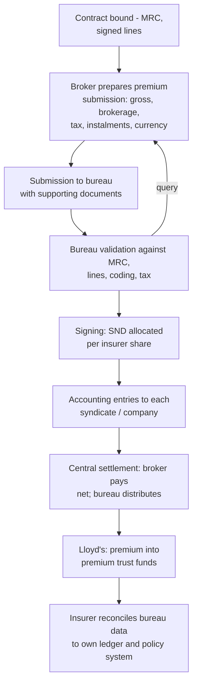
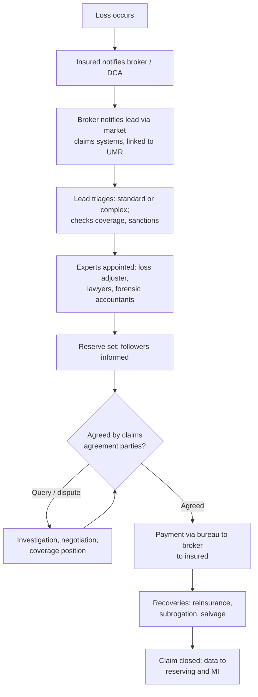
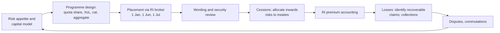

# Module 06 – Accounting, Settlement, Claims and Reinsurance

| | |
|---|---|
| **Level** | Intermediate |
| **Path phase** | Phase 2 ([Module 18](18-World-Class-Consultant-Path.md)) |
| **Time** | 5 hours reading, 3 hours exercises |
| **Prerequisites** | Modules 01, 02, 04 |
| **You will be able to** | Trace premium and claims money end to end; explain bureau processing, signing and settlement; diagnose aged debt and reconciliation problems; explain how claims are agreed on subscription business under the Lloyd's Claims Lead Arrangements; run the outwards reinsurance cycle; size value in finance and claims operations |

---

## 1. Why this chapter matters

CFOs and COOs judge consultants on whether they understand how money actually moves. In London, premium and claims money pass through brokers, a central bureau and many insurers, in many currencies, with many taxes. The cost of making this work – technical accounting, credit control, reconciliation, claims administration – is one of the largest controllable costs in a carrier. And claims is where the insurer's promise is tested and where leakage quietly erodes the loss ratio.

---

## Part A – Accounting and settlement

### A1. Why London accounting is complex

1. One contract has many insurers, each with a different signed line.
2. Premium flows client → retail broker → London broker → insurers, with deductions at each step.
3. Instalments, adjustments, endorsements and return premiums create many transactions per contract.
4. Many currencies and many tax regimes.
5. Some insurers settle through the bureau; others directly.
6. Written lines are often booked first and corrected later to signed lines.

### A2. Bureau and non-bureau

| Model | How it works | Who uses it |
|---|---|---|
| **Bureau** | Broker submits premium and claims transactions to a central bureau (**Velonetic**), which validates, records ("signs") and settles them for all participating insurers | All Lloyd's business; many company market insurers **[certain]** |
| **Non-bureau (direct)** | Broker deals with each insurer directly – separate accounting messages and payments | Company market insurers outside the bureau |

**Mixed placements** (Lloyd's plus non-bureau company insurers) mean the broker processes the same contract twice in different ways – a structural source of cost and error.

### A3. Premium flow step by step

### A4. Key terms

| Term | Meaning |
|---|---|
| **Premium advice / LPAN** | Broker's premium submission to the bureau (historically "London Premium Advice Note") **[certain]** |
| **Signing Number and Date (SND)** | Reference the bureau allocates to each processed transaction; the **Original SND (OSND)** links later transactions back to the original premium entry **[certain]** |
| **De-linked processing** | Signing (recording) is separated from cash settlement, so processing is not held up by payment timing **[likely]** |
| **Settlement Due Date (SDD)** | Date by which premium should be paid, set by the contract's premium payment terms |
| **Premium payment clause / warranty** | Contract term setting payment terms and consequences of non-payment (e.g., insurer's right to cancel) |
| **Terms of Trade (TOT)** | Credit periods agreed between brokers and insurers |
| **Central settlement** | Net settlement between brokers and insurers via the bureau in main currencies **[likely]** |
| **Premium trust funds (PTF)** | Trust funds holding Lloyd's syndicate premiums; US situs business goes to US trust funds (e.g., Lloyd's American Trust Fund) **[certain]** |
| **Client money (CASS 5)** | Brokers hold premium and claims money under FCA client money rules |
| **Risk transfer** | Agreement that money paid to the broker counts as paid to the insurer – protects clients if the broker fails |
| **AP / RP** | Additional / return premium |
| **Deposit and adjustment premium** | Paid up front; adjusted on actual exposure at expiry |

### A5. Taxes and charges

| Tax | Applies to |
|---|---|
| **UK Insurance Premium Tax** | UK risks: standard rate 12%, higher rate 20% for certain products **[certain]** |
| **US Federal Excise Tax** | Premiums to non-US insurers for US risks: 4% direct, 1% reinsurance **[certain]** |
| **US surplus lines taxes** | State taxes paid by US surplus lines brokers |
| **Overseas premium taxes and levies** | Vary by country; Lloyd's provides guidance through Crystal |
| **Fire brigade charges, pool levies** | Specific countries |

**Data point:** tax depends on risk location, insured location, class and sometimes the insurer's status. A data model must hold these separately; tax errors are common in DA business.

### A6. Credit control and aged debt

**Aged premium debt** = premium past its settlement due date. It reduces cash and investment income, creates credit risk, and can affect capital.

| Root cause | Example | Fix |
|---|---|---|
| Late documentation | Contract not certain → premium not submitted | Contract certainty discipline |
| Bureau queries | Data errors rejected | Validation before submission |
| Disputes | Disagreement on premium or terms | Faster query resolution |
| DA remittance delays | Coverholder holds premium | Remittance terms, monitoring |
| Client non-payment | Retail broker or client delay | Premium payment clause enforcement |
| Unallocated cash | Cash received but not matched | Automated cash matching |

**Worked example:** a syndicate has £1.2bn annual premium and 14% of receivables over 90 days, equal to about £60m. Collecting £40m of that 60 days earlier at 4% investment yield adds about £0.26m a year in income – small – but it also removes credit risk and the operational cost of chasing. The bigger prize is usually the **effort** spent managing debt and the **credit and capital** effect, not interest.

### A7. Reconciliation – the hidden cost

Insurers must reconcile three records of the same transactions:

1. **Their own policy and finance systems** (what they think they wrote).
2. **Bureau records** (what was signed and settled).
3. **Broker statements and cash** (what was paid).

**Example of a break:**

| Record | Line | Premium (USD) |
|---|---|---|
| Insurer policy system | 12.5% (written) | 125,000 |
| Bureau signing | 10.0% (signed) | 100,000 |
| Cash received | 10.0% | 98,500 (FX difference on GBP leg) |

Three different numbers for one contract. Causes: written vs signed line, FX, timing. Multiply by tens of thousands of transactions and you have a large, often offshore, reconciliation team.

### A8. What the technical accounting team does

| Activity | Description |
|---|---|
| Premium booking | Record premium, instalments, adjustments |
| Signing reconciliation | Match bureau signings to policy records |
| Cash allocation | Match cash to premium and claims entries |
| Credit control | Chase overdue premium; manage broker relationships |
| Claims accounting | Record claims payments and recoveries |
| Reinsurance accounting | Outwards premiums and recoveries |
| Month-end support | Earned premium, unearned premium reserve, deferred acquisition costs, accruals |

**Consulting angle:** technical accounting is often the largest operations team in a managing agent and the least automated. Reconciliation automation and validation before bureau submission are reliable, measurable savings.

---

## Part B – Claims

### B1. The claims process

### B2. Who agrees a claim – the Lloyd's Claims Lead Arrangements

The **Lloyd's Claims Lead Arrangements (LCLA)** replaced the earlier **Lloyd's Claims Scheme (Combined)** **[likely]**. In simple terms:

| Element | Rule **[likely]** – check the current LCLA text |
|---|---|
| **Standard claims** | Handled and agreed by the **Lloyd's lead** managing agent alone; followers are bound |
| **Complex claims** | Handled jointly by the **Lloyd's lead and a second Lloyd's lead** (the claims agreement parties) |
| **Complexity thresholds (per Lloyd's share)** | First-party insurance £2m; third-party insurance £1m; non-proportional treaty reinsurance £5m – or other complexity criteria |
| **Dynamic triage** | The lead re-triages a claim as standard when complex criteria no longer apply |
| **Second lead identification** | The second lead should be clearly identifiable in the contract |
| **Disputes** | A defined process applies if lead and second lead cannot agree, or if followers holding a defined share ask for it |
| **Co-lead binders** | A claims lead agreement (model clause LMA9186) is required; default rules apply until agreed |

**Company market and mixed placements:** company market insurers apply their own market claims agreement practices; on mixed placements, the MRC's subscription agreement section sets out who agrees claims for each part of the market **[likely]**.

**Why it matters:** clear claims agreement rules reduce cost and delay for followers and clients. Unclear agreement parties in the MRC cause disputes when a large claim arrives.

### B3. Claims systems and records **[likely]**

| System / term | Purpose |
|---|---|
| **ECF – Electronic Claims File** | Market electronic claims file for sharing documents and agreements |
| **CLASS** | Lloyd's bureau claims system recording claims movements |
| **IMR – Insurers' Market Repository** | Shared document repository |
| **UCR / TR** | Unique Claim Reference; Transaction Reference for each movement |
| **Insurer claims system** | Each insurer's own system for handling, reserving and payment |

### B4. Claims roles

| Role | Responsibility |
|---|---|
| **Claims broker** | Notifies, presents and negotiates for the client; collects payment |
| **Lead claims handler** | Triage, coverage, experts, reserves, agreement for followers |
| **Second lead (complex claims)** | Joint agreement with lead |
| **Follower claims handler** | Reviews and monitors; bound by agreed decisions |
| **Loss adjuster** | Investigates and quantifies for insurers |
| **Loss assessor** | Acts for the insured |
| **DCA / TPA** | Handles delegated claims |
| **Coverage lawyers** | Advise on policy response and disputes |

### B5. Claims vocabulary

| Term | Meaning |
|---|---|
| FNOL | First notification of loss |
| Case reserve / outstanding | Estimate of remaining cost on a known claim |
| Incurred | Paid + outstanding |
| IBNR / IBNER | Incurred but not reported / not enough reported (actuarial) |
| Ultimate | Final expected cost |
| Coverage position / reservation of rights | Insurer's position on policy response |
| Ex gratia | Payment without admitting liability |
| Subrogation / salvage / contribution | Recoveries and sharing of losses |
| Aggregation / event | Whether losses count as one event (key in reinsurance) |
| Leakage | Money paid that should not have been |

### B6. Reserving – the link to finance

| Concept | Meaning |
|---|---|
| Case reserves | Set by claims handlers |
| IBNR | Set by actuaries using methods such as chain ladder and Bornhuetter-Ferguson |
| Reserve adequacy | Whether total reserves cover ultimate claims |
| Prior-year development | Releases (favourable) or strengthening (adverse) |
| Statement of Actuarial Opinion | Lloyd's requires an independent opinion on each syndicate's reserves **[certain]** |

**Consulting angle:** inconsistent case reserving (some handlers reserve optimistically, others prudently) distorts IBNR and reserve releases. Reserve-setting guidelines and AI-supported file reviews improve consistency.

### B7. Catastrophe and major loss events

| Stage | Activity |
|---|---|
| **Event coding** | Assign event/catastrophe codes so losses aggregate across contracts and reinsurance |
| **Initial estimates** | Syndicates estimate gross and net losses; report to Lloyd's on major loss returns **[likely]** |
| **Surge** | Loss adjusters and DCAs scale up; triage separates simple from complex |
| **Reinsurance** | Notify cat XoL reinsurers; calculate reinstatement premiums |
| **Liquidity** | Fund large payments; possible cash calls |
| **Wording issues** | Event definitions, hours clauses, exclusions |

### B8. Claims leakage – where money is lost

| Source | Example |
|---|---|
| Coverage | Paying claims excluded by wording |
| Quantum | Overpaying the amount of loss |
| Process | Duplicate payments; late payments causing interest or damages (Enterprise Act 2016 **[certain]**) |
| Recoveries | Missed reinsurance, subrogation or salvage |
| Expenses | Uncontrolled adjuster and legal fees |
| Fraud | Inflated or false claims, increasingly with AI-generated documents |

Leakage is usually measured by **file reviews** – reviewing a sample of closed files against best practice and estimating overpayment.

### B9. Claims KPIs

| KPI | Purpose |
|---|---|
| Time to acknowledge / first contact | Service |
| Cycle time (notification to settlement) | Efficiency and client experience |
| Reserve accuracy | Financial reliability |
| Leakage rate | Cost control |
| Litigation rate | Dispute management |
| Expense per claim | Efficiency |
| Recoveries achieved | Net loss reduction |
| Broker and client satisfaction | Franchise value – Lloyd's targets top-tier NPS **[likely]** |

---

## Part C – Reinsurance operations

### C1. The outwards reinsurance cycle

### C2. Worked recovery – cat XoL with reinstatement

**Programme:** £80m xs £20m cat XoL; annual premium £8m (rate on line 10%); one reinstatement at 100% additional premium, pro rata to amount.

**Event:** hurricane causes £65m net loss to the syndicate.

| Step | Amount |
|---|---|
| Retention | £20m kept by syndicate |
| Recovery | £65m − £20m = **£45m** |
| Reinstatement premium | £8m × 45/80 = **£4.5m** payable to reinsurers |
| Net benefit of recovery | £45m − £4.5m = £40.5m |
| Remaining limit after reinstatement | £80m restored for a second event |

**Common errors:** claims not coded to the event; recoveries calculated on gross instead of net; reinstatement premium not accrued; recoveries filed late.

### C3. Inwards reinsurance accounting

Inwards treaty business is usually accounted quarterly. The cedant (or broker) sends **technical accounts** showing premium, claims, commissions and balance due. Reinsurers book **estimated premium income (EPI)** at inception and adjust when actual accounts arrive. Late statements and differences between estimates and actuals are common reserving and reconciliation challenges.

### C4. Reinsurance pain points

| Process | Pain point |
|---|---|
| Programme design | Weak link between capital model and buying decisions |
| Cessions | Inwards risks not allocated to the correct treaty |
| Recoveries | Missed or late recoveries; manual matching of claims to treaties |
| Credit risk | Reinsurer disputes or failure; collateral monitoring |
| Commutations | Valuing future liabilities for a lump-sum settlement |

---

## Part D – End-to-end money trace

**Premium:** £1,000,000 gross; Syndicate A signed 40%, Company B signed 60%; brokerage 20%; no tax.

| Step | Amount |
|---|---|
| Client pays broker | £1,000,000 |
| Broker deducts brokerage | £200,000 |
| Net premium to insurers | £800,000 |
| Syndicate A (40%) → premium trust fund via bureau | £320,000 |
| Company B (60%) → via bureau or directly | £480,000 |

**Claim:** £2,000,000 agreed.

| Step | Amount |
|---|---|
| Syndicate A pays 40% | £800,000 |
| Company B pays 60% | £1,200,000 |
| Paid through bureau → broker → client | £2,000,000 |
| Syndicate A recovers 30% under its quota share | £240,000 |

If you can explain both tables to a CFO without notes, you understand the core of London market finance.

---

## Part E – Consulting opportunities

| Opportunity | Value lever |
|---|---|
| Validation before bureau submission | Fewer queries; faster settlement |
| Reconciliation automation | Smaller teams; fewer write-offs |
| Cash matching and credit control analytics | Lower aged debt and credit risk |
| Claims triage and segmentation | Right effort per claim; faster cycle times |
| Leakage review and claims controls | Loss ratio |
| Reserve consistency | Reserving quality; fewer surprises |
| Reinsurance recovery automation | Fewer missed recoveries |
| Cat claims playbook | Surge readiness |

---

## Part F – Mini case: the growing aged debt

**Situation:** a managing agent's premium over 90 days has grown from 6% to 14% of receivables in 18 months. The CFO suspects brokers; the COO suspects the bureau.

**Approach:**
1. Segment aged debt by broker, channel (open market, DA, facility), class, currency and root cause.
2. Sample 50 items and trace each from contract to cash.
3. Typical finding **[guessing]**: 40% DA remittance delays from a few coverholders; 25% bureau queries from data errors; 20% unallocated cash; 15% genuine client delays.
4. Actions: coverholder remittance enforcement; pre-submission validation; automated cash matching; broker scorecards.

---

## Part G – Partner's lens

*Top-tier strategy consulting methods applied to this chapter.*

1. **Follow the money and count the touches.** Take ten real contracts and trace every premium and claims transaction through every system. Count manual touches per £1m of premium. This is the most persuasive single fact for an operations case.
2. **Separate value into four buckets for the CFO:** cost (FTE, outsourcing), cash (aged debt), credit and capital (exposure to brokers, coverholders and reinsurers), and loss ratio (leakage, missed recoveries). CFOs trust analyses that keep these separate.
3. **Claims is a loss-ratio lever, not an operations function.** A 2% leakage reduction on £500m of claims is £10m a year – often more than the entire claims operating budget. Frame claims work in loss-ratio points.
4. **Recoveries are found money.** Missed reinsurance recoveries and subrogation are rarely measured. A recovery audit often pays for the whole engagement – a classic partner "quick win" that builds trust.
5. **Respect market rules.** Many accounting and claims processes are defined by market agreements (bureau rules, LCLA). Solutions must work within them – or explicitly propose market change through the LMA and IUA.

---

## Key takeaways

1. All Lloyd's business goes through the bureau; the SND links every accounting entry.
2. Written vs signed lines, FX and timing create three versions of every transaction; reconciliation is a major hidden cost.
3. Aged debt has a few common root causes; fix them at source.
4. Under the Lloyd's Claims Lead Arrangements, the lead agrees standard claims; lead and second lead agree complex claims; followers are bound.
5. Leakage and missed recoveries are loss-ratio issues worth more than most operational savings.
6. Reinsurance operations connect claims, finance and capital; errors mean lost recoveries.

---

## Check your understanding

| # | Question | Answer |
|---|---|---|
| 1 | What does the OSND do? | Links later transactions (endorsements, claims) to the original premium entry. |
| 2 | Name three causes of aged premium debt. | Late documentation, bureau queries, DA remittance delays, unallocated cash, client non-payment. |
| 3 | Who agrees a complex claim on a Lloyd's subscription contract? | The Lloyd's lead and the second Lloyd's lead. |
| 4 | £100m xs £25m cat XoL, premium £10m, one reinstatement at 100%. Net loss £75m. Recovery and reinstatement premium? | Recovery £50m; reinstatement premium £10m × 50/100 = £5m. |
| 5 | Why is reconciliation hard in London? | Written vs signed lines, FX, timing, multiple insurers and systems, bureau and non-bureau processing. |
| 6 | Name four sources of claims leakage. | Coverage, quantum, process (duplicates, delays), missed recoveries, expenses, fraud. |

---

## Practice tasks

1. **Trace** the money for a fictional mixed Lloyd's/company placement with two instalments and one return premium.
2. **Build** a three-way reconciliation table for five fictional transactions with different break causes.
3. **Calculate** recoveries and reinstatement premiums for two events under one cat XoL.
4. **Design** a claims triage model (standard vs complex) using the LCLA thresholds.

---

## Sources

- [Keoghs – guide to Lloyd's Claims Lead Arrangements](https://keoghs.co.uk/keoghs-insight/keoghs-guide-to-lloyds-claims-lead-arrangements)
- [Lloyd's – Claims Lead Arrangements summary (Dec 2024)](https://assets.lloyds.com/media/df8d4986-2246-4a88-b7fa-f5ed75232a2d/CLA%20summary%20December%202024.pdf)
- [Lloyd's – Guidance on the Lloyd's Claims Lead Arrangements](https://assets.lloyds.com/media/722c1caa-960f-43c9-a210-3635038f25d7/Guidance-on-the-Lloyds-Claims-Lead-Arrangements-0523.pdf)
- [LMA – co-lead binder claims guidance](https://lmalloyds.com/wp-content/uploads/2025/09/CoLead-Binder-Claims-Market-Guidance-V1.0-24052023-Final.pdf)
- [Lloyd's full year results 2025](https://www.lloyds.com/insights/media-centre/press-releases/lloyds-announces-full-year-results-2025)
