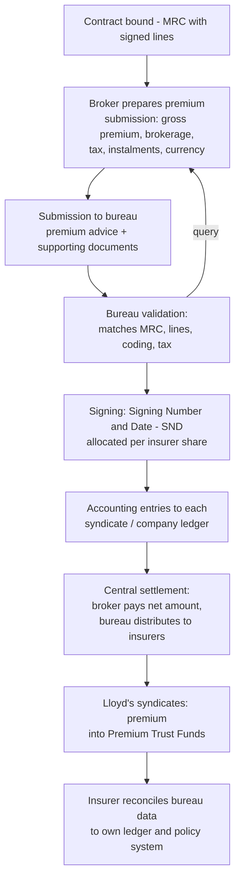
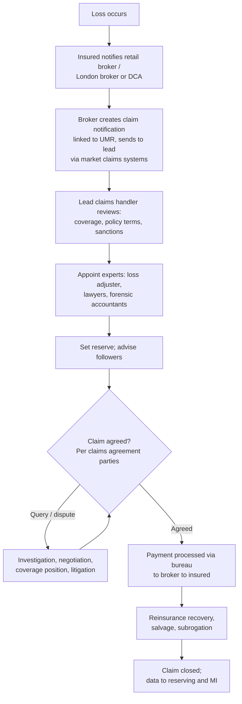
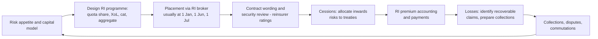

# Module 06 – Accounting, Settlement, Claims and Reinsurance

**Level:** Intermediate | **Goal:** Trace premium and claims money end to end, understand how claims are agreed in a subscription market, and how reinsurance protects the insurer. Finance and operations leaders will test you on this.

---

## Part A – Accounting and settlement

### A1. Why London accounting is complex

1. One risk has many insurers, each with a different signed line.
2. Premium is paid by the client to the broker, then by the broker to many insurers.
3. Payments happen in many currencies and with many taxes.
4. Instalments, adjustments, endorsements and return premiums create many transactions per contract.
5. Some insurers use the bureau; others are paid directly.

### A2. Bureau vs non-bureau

| Model | How it works |
|---|---|
| **Bureau** | Broker submits premium and claims transactions to a central bureau (**Velonetic**), which validates, records ("signs") and settles them for all participating insurers, including all Lloyd's syndicates and many company market insurers. |
| **Non-bureau (direct)** | Broker deals directly with each insurer: sends its own accounting entries and pays each insurer separately. |

**[certain]** All Lloyd's business goes through Lloyd's central accounting and settlement. The company market can use the bureau (formerly via the London Processing Centre / IUA arrangements) or deal directly.

### A3. Premium flow – step by step

### A4. Key accounting terms

| Term | Meaning |
|---|---|
| **Premium advice note (LPAN)** | The broker's premium submission document/message to the bureau, historically "London Premium Advice Note" **[certain]**. Now mainly electronic. |
| **Signing Number and Date (SND)** | Reference allocated by the bureau when a transaction is processed. Used to identify that premium entry in accounts. The **Original SND (OSND)** links later transactions (e.g., claims, endorsements) back to the original premium entry **[certain]**. |
| **De-linked processing** | Since the mid-2000s, the bureau records (signs) premium separately from cash payment so processing is not held up by payment timing **[likely]**. |
| **Settlement Due Date (SDD)** | Date by which premium should be paid by the broker, driven by the contract's premium payment terms. |
| **Premium payment clause / warranty** | Contract term specifying when premium must be paid and what happens if not (cancellation rights). |
| **Terms of Trade (TOT)** | Agreed credit periods between brokers and insurers for paying premium. |
| **Central settlement** | Net settlement of amounts owed between brokers and insurers via the bureau, in main settlement currencies (GBP, USD, CAD, EUR) **[likely]**. |
| **Premium Trust Fund (PTF)** | Trust funds holding Lloyd's syndicate premiums. US dollar business for US situs risks goes into US trust funds (e.g., Lloyd's American Trust Fund) **[certain]**. |
| **Insurance broker client money / IBA** | Brokers hold premium and claims money in client money accounts under FCA CASS 5 rules, or under risk transfer agreements where the money is treated as held for insurers. |
| **Risk transfer** | When the insurer agrees that money paid to the broker counts as paid to the insurer (common in London market TOBAs). Protects client if the broker fails. |
| **AP / RP** | Additional premium / return premium from endorsements. |
| **Instalments** | Premium paid in parts; each creates separate settlement entries. |
| **Deposit / adjustment premium** | Premium paid upfront and later adjusted on actual exposure. |

### A5. Taxes and regulatory charges

| Tax/charge | Applies to |
|---|---|
| **Insurance Premium Tax (IPT)** | UK risks; standard rate 12% **[certain]**. |
| **US Federal Excise Tax (FET)** | Premiums paid to non-US insurers for US risks: 4% direct, 1% reinsurance **[certain]**; Lloyd's has arrangements to account for it. |
| **US surplus lines taxes** | Paid by the US surplus lines broker by state. |
| **Overseas premium taxes and parafiscal charges** | Vary by country; Lloyd's provides guidance to market (Crystal). |
| **Fire brigade charges, terrorism pool levies** | Specific countries. |

**Consulting angle:** Tax errors in DA business are common and expensive. A good data model holds risk location, insured location and tax rules separately.

### A6. Credit control and aged debt

- **Aged premium debt** = premium due but not received. It hurts cash flow, investment income and capital (credit risk).
- Root causes: late documentation, disputes, client not paying retail broker, bureau rejections, DA remittance delays.
- Good practice: daily cash matching, automated chasers, broker scorecards, root-cause analytics.

### A7. Reconciliation – the hidden cost

Insurers must reconcile three versions of the same truth:

1. **Their own policy/finance system** (what they think they wrote).
2. **Bureau records** (what was signed and settled).
3. **Broker statements and cash** (what was paid).

Mismatches arise from manual re-keying, different FX rates, line differences, missed endorsements. Reconciliation teams are often large and offshore. This is one of the strongest cases for common data standards (CDR) and automation.

---

## Part B – Claims

### B1. Claims process overview

### B2. Who agrees a claim in a subscription market

| Arrangement | Description |
|---|---|
| **Lloyd's Claims Scheme** | Rules that set how claims on Lloyd's subscription contracts are agreed. In simple terms: non-complex claims can be agreed by the leader alone; complex claims need the leader and a second agreement party, and followers are bound by their decisions **[likely]** – check the current scheme text. |
| **Claims Lead Arrangements (CLA)** | Equivalent arrangements for company market and mixed Lloyd's/company placements (LMA/IUA) **[likely]**. |
| **Claims agreement parties in the MRC** | The subscription agreement section of the MRC names who agrees claims. |
| **Followers** | Bound by the leader's (and second lead's) decisions on agreed claims within the scheme; can still review files. |

### B3. Claims systems and records **[likely]**

| System/term | Purpose |
|---|---|
| **ECF – Electronic Claims File** | Market electronic claims file used by brokers and insurers to share claims documents and agreements. |
| **CLASS** | Lloyd's bureau claims system that records claims movements and agreements. |
| **IMR – Insurers' Market Repository** | Shared document repository used for premium and claims documents. |
| **UCR / TR** | Unique Claim Reference and Transaction Reference identifying each claim and movement. |
| **Insurer claims system** | Each insurer's own system for handling, reserving and payments. |

### B4. Claims vocabulary

| Term | Meaning |
|---|---|
| **FNOL** | First notification of loss. |
| **Case reserve / outstanding** | Insurer's estimate of remaining cost for a known claim. |
| **Incurred** | Paid + outstanding. |
| **IBNR** | Incurred but not reported – estimate for claims not yet notified or not fully reserved. Set by actuaries. |
| **Ultimate** | Final expected cost of all claims for a period/year of account. |
| **Loss adjuster** | Independent expert who investigates and quantifies a loss. |
| **Coverage position / reservation of rights** | Insurer's statement on whether and how the policy responds. |
| **Ex gratia** | Payment made without admitting liability. |
| **Subrogation** | Insurer's right, after paying, to recover from the party who caused the loss. |
| **Salvage** | Value recovered from damaged property. |
| **Contribution** | Sharing a loss between policies that cover the same risk. |
| **Aggregation / event definition** | Whether several losses count as one event (key in reinsurance and cat claims). |
| **Claims leakage** | Money paid that should not have been (overpayment, missed recoveries, poor process). |
| **Loss fund** | Funds given to a DCA/TPA to pay claims locally. |
| **Bulk / blanket claims** | Claims reported in aggregate via claims bordereaux for DA business. |

### B5. Catastrophe and major loss claims

When a major event happens (e.g., a hurricane, wildfire, large cyber outage):

1. **Event coding:** the market assigns event/catastrophe codes so losses can be aggregated across contracts and reinsurance.
2. **Initial loss estimates:** syndicates report expected losses to Lloyd's on major loss returns **[likely]**; Lloyd's publishes market estimates.
3. **Surge capacity:** loss adjusters and DCAs scale up; claims triage becomes critical.
4. **Reinsurance notifications and recoveries:** cat XoL recoveries; reinstatement premiums become payable.
5. **Liquidity:** large claims may require syndicates to draw funds (cash calls from members or loss funds).
6. **Wording disputes:** event definitions, hours clauses, exclusions (e.g., war, cyber, communicable disease).

### B6. Claims KPIs

| KPI | Meaning |
|---|---|
| Time to first contact / acknowledge | Service level |
| Claims cycle time (notification to settlement) | Efficiency and client experience |
| Reserve accuracy (development of case reserves) | Financial reliability |
| Leakage rate (from file reviews) | Cost control |
| Litigation rate | Dispute management |
| Expense per claim | Efficiency |
| Recoveries achieved (RI, subrogation, salvage) | Net loss reduction |
| Broker/client satisfaction (NPS) | Franchise value; Lloyd's 2026 strategy targets top-tier NPS **[likely]** |

### B7. Claims consulting themes

- Claims triage and segmentation (simple vs complex) to apply the right effort.
- DCA/TPA oversight and leakage reviews.
- Cat surge playbooks.
- Litigation management and panel optimisation.
- Claims data quality for reserving and reinsurance.
- AI document summarisation, coverage checks, fraud indicators (Module 09).

---

## Part C – Reinsurance (outwards) operations

### C1. The outwards reinsurance cycle

### C2. Key processes and pain points

| Process | Pain point |
|---|---|
| **Programme design** | Balancing cost of reinsurance vs capital relief; soft market makes reinsurance cheaper in 2026 **[likely]**. |
| **Cessions / allocation** | Each inwards risk must be allocated to the correct treaty; errors create unrecoverable claims. |
| **Recoveries** | Large lists of claims must be checked against treaties; missed recoveries are a common leakage. |
| **Bad debt / credit risk** | Reinsurer may fail or dispute; collateral and ratings monitoring needed. |
| **Commutation** | Settling all future liabilities under a treaty for a lump sum. |

### C3. Inwards reinsurance accounting

Inwards treaty business is usually accounted quarterly: the cedant (or broker) sends **technical accounts** showing premium, claims, commissions and balances. These must be matched to estimates the reinsurer booked earlier ("premium estimates" or "EPI – estimated premium income"). Differences between estimates and actuals are a common reserving and reconciliation challenge.

---

## Part D – End-to-end money trace (test yourself)

Trace **£1,000,000 gross premium** on a risk led by Syndicate A (signed 40%) and followed by Company B (signed 60%), with 20% brokerage, IPT not applicable:

| Step | Amount |
|---|---|
| Client pays broker | £1,000,000 |
| Broker deducts brokerage (20%) | £200,000 retained |
| Net premium due to insurers | £800,000 |
| Syndicate A share (40%) | £320,000 → via bureau into Syndicate A premium trust fund |
| Company B share (60%) | £480,000 → via bureau (if bureau) or directly |

A £2,000,000 claim is agreed:

| Step | Amount |
|---|---|
| Syndicate A pays 40% | £800,000 |
| Company B pays 60% | £1,200,000 |
| Bureau settles to broker, broker pays client | £2,000,000 |
| Syndicate A recovers under its quota share treaty (say 30%) | £240,000 from reinsurer |

If you can explain this table to a CFO without notes, you understand the core of London market finance.
