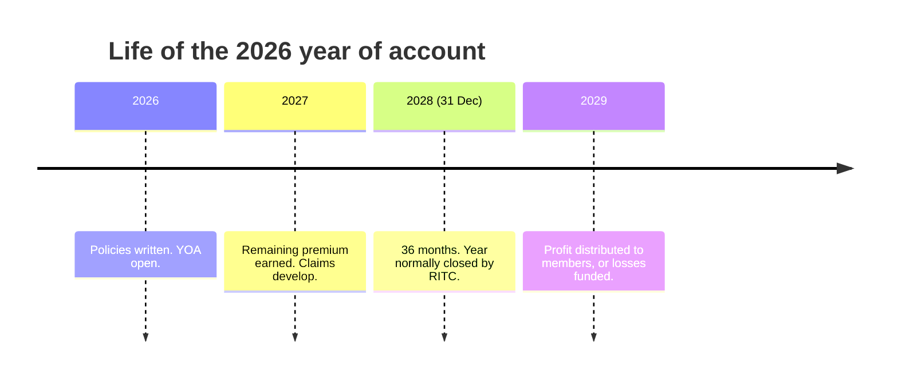
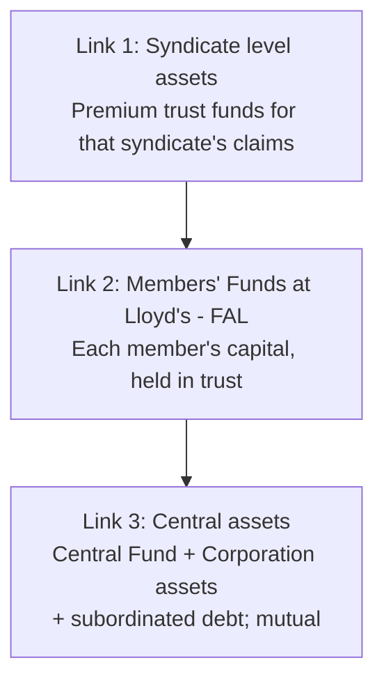
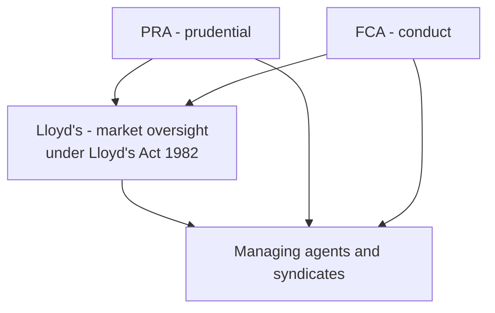

# Module 07 – Capital, Finance and Regulation

| | |
|---|---|
| **Level** | Advanced |
| **Path phase** | Phase 2 (late) and Phase 3 ([Module 18](18-World-Class-Consultant-Path.md)) |
| **Time** | 5–6 hours reading, 3 hours exercises |
| **Prerequisites** | Modules 01, 02, 04, 06 |
| **You will be able to** | Explain the Lloyd's annual venture, year of account and RITC; draw the chain of security; walk through capital setting (SBF, uSCR, ECA, FAL, Coming into Line); read Lloyd's and syndicate results; explain the main reporting bases; explain PRA, FCA and Lloyd's regulation in late 2026; link operational change to capital and return on capital |

---

## 1. Why this chapter matters

CFOs, CROs and Lloyd's-facing executives decide the biggest questions: how much to grow, which classes to write, how much reinsurance to buy, whether to close a year of account, whether to launch a syndicate. All of these run through capital, financial reporting and regulation. A consultant who can connect an operational recommendation to **capital and return on capital** speaks at board level. One who cannot stays at the operations level.

---

## Part A – Lloyd's financial architecture

### A1. The annual venture and the year of account

**[certain]** Each syndicate underwrites as an **annual venture**. All policies incepting in a calendar year belong to that **year of account (YOA)**. Members can change their participation each year, so each YOA can have different capital providers. Results are measured per YOA as well as per calendar year.

**Worked example – how premium on the 2026 YOA is earned**

A syndicate writes £120m of 12-month policies spread evenly through 2026.

| Calendar year | Premium earned from the 2026 YOA | Why |
|---|---|---|
| 2026 | about £60m | On average, policies have run half their term by 31 Dec 2026 |
| 2027 | about £60m | The remaining half of the cover |
| 2028 | — | Claims still developing (especially liability) |

So the 2026 YOA's result is only known after its policies have expired and claims have developed – which is why Lloyd's historically used **three-year accounting**.

### A2. Closing a year: reinsurance to close (RITC)

| Concept | Meaning |
|---|---|
| **RITC** | **[certain]** At closure, the members of the closing YOA pay a premium to the members of a later YOA (usually the next YOA of the same syndicate, or another syndicate) to take over all remaining liabilities. The old members exit with a final result |
| **Open year** | If liabilities are too uncertain to price an RITC, the YOA stays open. Members cannot exit; capital stays tied up |
| **Third-party RITC** | A run-off specialist takes over the closing YOA's liabilities |
| **Distribution / cash call** | Profit paid to members; losses funded from Funds at Lloyd's or new cash |

**Worked example – closing the 2023 YOA at end-2025**

| Item | £m |
|---|---|
| Premiums (net) for 2023 YOA | 500 |
| Claims paid to date | (220) |
| Expenses | (160) |
| Investment return | 25 |
| RITC premium paid to 2024 YOA (best estimate of remaining claims + margin) | (110) |
| **Result for 2023 members** | **35 profit** |

The **RITC premium** is the critical number: too low and the 2024 members (who may be different people) subsidise 2023 members; too high and the reverse. This is a fairness and conflict issue that managing agents must govern carefully.

### A3. The chain of security

| Link | Description |
|---|---|
| **1. Syndicate assets** | Premiums and investment income in premium trust funds; first source for claims |
| **2. Funds at Lloyd's** | Each member's capital (cash, securities, letters of credit), sized by Lloyd's; used if syndicate assets are insufficient |
| **3. Central assets** | Mainly the Central Fund, funded by member contributions; available at the Council's discretion to meet valid claims if a member cannot pay. This mutualisation gives every Lloyd's policy the same financial strength rating |

**Ratings (2026):** S&P AA- (Very Strong), Fitch AA- (Very Strong), Kroll Bond Rating Agency AA-, all stable; AM Best A+ (Superior), upgraded from A in August 2024 and affirmed in 2026 **[likely]** – these market ratings are the floor of security for every policy written at Lloyd's.

**2025 figures:** total capital, reserves and subordinated debt £49.8bn; central solvency ratio 496%; return on capital 22.0% **[likely]**. Skadden's summary refers to a $160bn chain of security **[likely]**.

### A4. How capital is set

| Term | Meaning |
|---|---|
| **SBF** | Syndicate Business Forecast – the plan for the next YOA: premium by class, loss ratios, expenses, reinsurance |
| **One-year SCR** | Capital for a 1-in-200 loss over one year (Solvency UK) |
| **uSCR** | Capital for a 1-in-200 loss to ultimate (full run-off of the business) – used for member capital |
| **ECA** | **[certain]** Economic Capital Assessment = uSCR + 35% uplift; protects the Central Fund and Lloyd's rating |
| **LCR** | Lloyd's Capital Return – the capital submission |
| **Coming into Line (CIL)** | Deadline for members to provide FAL for the coming year **[certain]** |
| **Lloyd's internal model** | Market-wide model approved by the PRA for the Society's central capital |

**Worked example – a corporate member's FAL**

| Syndicate | Member's capacity share | Syndicate uSCR as % of capacity | Member's uSCR |
|---|---|---|---|
| Syndicate 1 | £200m | 45% | £90m |
| Syndicate 2 | £100m | 60% | £60m |
| **Total (before diversification)** | £300m | | £150m |
| Diversification credit (illustrative 10%) | | | (£15m) |
| Member uSCR | | | £135m |
| **ECA = 135% × £135m** | | | **£182m FAL required** |

FAL as a percentage of capacity ≈ 61%. **Consulting point:** anything that lowers uSCR (better reinsurance, more diversified mix, lower reserve risk, fewer operational risk events) reduces FAL by 1.35 times that amount.

### A5. Members' economics

| Item | Description |
|---|---|
| Profit or loss | Paid or funded at YOA close |
| Managing agency fee | Percentage of capacity paid to the managing agent |
| Profit commission | Share of profit paid to the managing agent |
| Central Fund contributions and subscriptions | Set annually by Lloyd's |
| Members' agent fees | For Names |
| Capacity value | Names trade syndicate participations at annual auctions |

### A6. Third-party capital routes

| Route | How it works |
|---|---|
| **Corporate member** | Investor sets up a corporate member to back one or more syndicates |
| **SPA** | Quota share of a host syndicate's business |
| **Capital-backed syndicate** | E.g., Talbot syndicate 2478 backed by Blackstone (2025 capacity reported at £567m) **[likely]** |
| **London Bridge** | Lloyd's protected cell company for ILS investors; London Bridge 2 opened 14 cells with about $660m of new capital in Q4 2025 **[likely]** |
| **Names** | Individuals via limited liability vehicles; about 10% of market capital **[likely]** |

Lloyd's 2026–2030 strategy aims to attract more sophisticated capital, simplify Names processes and tailor oversight to different capital providers **[likely]**.

---

## Part B – Reading Lloyd's and syndicate results

| Metric | 2024 | 2025 | H1 2026 | Tag |
|---|---|---|---|---|
| GWP | £55.5bn | £57.9bn | £34.7bn | [certain] |
| Combined ratio | 86.9% | 87.6% | 90.8% | [certain] |
| Underlying (ex major claims) combined ratio | 79.1% | 81.8% | 84.0% | [likely] |
| Major claims ratio | 7.8% | 5.8% | 6.8% | [likely] |
| Prior-year releases benefit | — | 1.7 pts (£721m) | 3.5 pts (analyst) | [likely] |
| Risk-adjusted rate change | — | — | −6.7% | [certain] |
| Profit before tax | — | £10.6bn | £3.5bn | [certain] |
| Return on capital | — | 22.0% | — | [likely] |
| 2026 forecast | — | GWP £64bn ±5%; CR 90–95%; 3% investment return | — | [likely] |

**How an advisor reads this [likely]:**
1. The underlying ratio has risen about 5 points in two years as rates fall.
2. Headline results depend on benign catastrophe experience and reserve releases.
3. Lloyd's own 2026 forecast (CR 90–95%) already expects deterioration.
4. Implication for clients: 2027 plans that assume stable margins will be challenged by Lloyd's and the PRA.

---

## Part C – Financial reporting bases

| Basis | Who | Key features |
|---|---|---|
| **Syndicate annual accounts** | Each syndicate | UK GAAP (FRS 102 / FRS 103); technical and non-technical accounts; annual (calendar year) basis **[likely]** |
| **Underwriting year (YOA) results** | Managing agents, members | Results by YOA; drives distributions and RITC |
| **Lloyd's aggregate results** | Society of Lloyd's | Pro forma aggregation of syndicates plus Society accounts |
| **IFRS 17** | Listed groups owning managing agents | Effective from 2023 **[certain]** |
| **Solvency UK** | Syndicates, Lloyd's, companies | Balance sheet on Solvency basis; QRTs, SFCR, RSR, ORSA |

### C1. IFRS 17 in plain English

| Concept | Meaning |
|---|---|
| **Premium Allocation Approach (PAA)** | Simplified method used for most short-term P&C contracts – similar to unearned premium accounting |
| **Liability for remaining coverage** | Like unearned premium |
| **Liability for incurred claims** | Claims reserves, **discounted** for time value of money, plus an explicit **risk adjustment** |
| **Onerous contracts** | Groups of contracts expected to be loss-making must recognise the loss immediately |
| **Insurance revenue** | Replaces "gross written premium" as the main revenue measure |

**Practical challenge:** the same syndicate result appears differently under UK GAAP (syndicate), YOA (members), IFRS 17 (group) and Solvency UK (regulator). Reconciling these bases is a recurring finance transformation task – and a source of confusion in board discussions. Always ask: **"Which basis is this number on?"**

---

## Part D – Reserving and reserve risk

### D1. Chain ladder – simple example

| Year | 12 months | 24 months | 36 months |
|---|---|---|---|
| 2023 | 100 | 150 | 165 |
| 2024 | 120 | 180 | ? |
| 2025 | 110 | ? | ? |

Development factors: 12→24 = (150 + 180) ÷ (100 + 120) = 1.50; 24→36 = 165 ÷ 150 = 1.10.

| Year | Projected ultimate | Reported | IBNR |
|---|---|---|---|
| 2024 | 180 × 1.10 = 198 | 180 | 18 |
| 2025 | 110 × 1.50 × 1.10 = 181.5 | 110 | 71.5 |

### D2. Key reserving issues in 2026

| Issue | Detail |
|---|---|
| **Social inflation** | Rising US liability claims from litigation trends – the main reserve risk for US casualty **[certain]** |
| **Reserve releases** | Supported results in 2025–2026; may reduce as soft-market years mature **[likely]** |
| **Statement of Actuarial Opinion** | Independent opinion on each syndicate's reserves required by Lloyd's **[certain]** |
| **Data quality** | Late DA claims data and inconsistent case reserving distort IBNR |

---

## Part E – Capital modelling for non-actuaries

### E1. What drives capital

| Risk type | Examples | How operations affect it |
|---|---|---|
| **Premium risk** | Next year's claims worse than planned | Pricing discipline; underwriting controls |
| **Reserve risk** | Existing claims develop worse | Reserving quality; claims handling |
| **Catastrophe risk** | Hurricanes, earthquakes, cyber events | Exposure data quality; aggregation control; reinsurance |
| **Credit risk** | Reinsurers, brokers, coverholders fail to pay | Credit control; reinsurer security; remittance terms |
| **Market risk** | Investment losses, FX | Asset management |
| **Operational risk** | Process failures, fraud, systems, DA breaches, cyber | Controls; automation; resilience |

### E2. Worked example – reinsurance and capital

A syndicate considers buying an extra £100m xs £150m cat layer costing £6m a year.

| Without layer | With layer |
|---|---|
| uSCR £800m | uSCR £720m (cat risk falls) |
| ECA = £1,080m | ECA = £972m |
| Capital released | **£108m** |
| Cost of capital at 12% on £108m | £13m a year saved |
| Reinsurance cost | (£6m) |
| Expected recoveries (modelled) | about £2m |
| **Net benefit** | **≈ £9m a year** |

In a softening reinsurance market, this calculation favours buying more protection **[likely]**. This is "capital efficiency" in practice.

### E3. The PRA's concern in 2026

The PRA warns that, as rates soften, internal models may **overstate underwriting profitability** and **understate capital**, and will engage more with firms whose assumed and actual profitability differ most **[likely]**. Practically: if the plan assumes a 92% combined ratio but actual business is trending to 96%, capital is understated.

---

## Part F – Regulation in late 2026

### F1. Three layers

### F2. PRA

| Area | Requirement / 2026 focus |
|---|---|
| **Objectives** | Safety and soundness; policyholder protection; secondary objectives on competition and competitiveness and growth |
| **Fundamental Rules** | Eight high-level rules (integrity, skill, prudent risk management, adequate resources, risk strategy, control, openness with regulators, orderly resolution) **[certain]** |
| **Solvency UK** | Reforms from 31 Dec 2024: lower risk margin, reporting changes, internal model changes **[likely]** |
| **Internal models** | Focus on overstated profitability in a softening market **[likely]** |
| **DyGIST** | Dynamic General Insurance Stress Test – semi-live three-week crisis simulation in May 2026; results expected late 2026 **[likely]** |
| **Operational resilience** | Important business services within impact tolerances (March 2025 deadline) **[certain]** |
| **Outsourcing and third parties** | Critical outsourcing including cloud, bureau, TPAs, AI vendors |
| **Solvent exit planning** | Plans for orderly exit **[likely]** |
| **Climate** | **SS5/25** (3 December 2025) replaced SS3/19: climate treated as a financial risk within underwriting, risk management, capital, ORSA and internal models; firms expected to complete a gap review by 3 June 2026 **[likely]** |
| **AI** | Governance, model risk and accountability **[likely]** |
| **SM&CR** | Named senior managers accountable |

### F3. FCA

| Area | Position |
|---|---|
| **PS25/21 (9 Dec 2025)** | Larger commercial customers and contracts of large risks excluded from ICOBS, PROD and Consumer Duty; co-manufacturers can nominate a lead for PROD 4; bespoke contracts excluded from PROD 4; intermediaries cannot be lead co-manufacturer **[certain]** |
| **Consumer Duty** | Applies to retail customers and SMEs below thresholds; FCA reviewing core definitions in 2026 **[likely]** |
| **PROD, ICOBS, CASS 5** | Product governance; conduct of business; client money |
| **Financial crime and sanctions** | Screening, controls, reporting; Russia sanctions burden in marine, aviation, energy |
| **Culture and non-financial misconduct** | Ongoing focus |

### F4. Lloyd's oversight

| Tool | Description |
|---|---|
| **Business plan approval** | Most powerful lever – Lloyd's can cap growth, require remediation or increase capital loading |
| **Principles-based oversight** | Managing agents assessed against principles; intensity tailored to maturity and performance **[likely]** |
| **Minimum standards and requirements** | Claims, DA, reserving, capital, conduct |
| **Market Bulletins** | Official instructions |
| **2026 strategy commitments** | More predictable, risk-based oversight; streamlined reporting; lower cost of doing business **[likely]** |

### F5. Key legislation

| Law | Why it matters |
|---|---|
| Marine Insurance Act 1906 | Core marine law |
| Insurance Act 2015 | Fair presentation; proportionate remedies; warranties suspend cover; terms not relevant to the loss (s.11) **[certain]** |
| Enterprise Act 2016 | Damages for late payment of claims **[certain]** |
| Third Parties (Rights against Insurers) Act 2010 | Direct claims against insurers of insolvent insureds |
| Lloyd's Acts 1871–1982 | Governance |
| FSMA 2000 / 2023 | Regulatory framework; FSMA 2023 added a competitiveness and growth objective **[certain]** |
| Data protection (UK GDPR, DPA 2018, Data (Use and Access) Act 2025) | Personal data **[likely]** for 2025 Act detail |
| Sanctions and Anti-Money Laundering Act 2018 | UK sanctions |

### F6. International

| Platform | Notes |
|---|---|
| Lloyd's Europe | EEA risks since 2019; regulated in Belgium |
| US | Surplus lines and reinsurance; US trust funds; some admitted licences **[likely]** |
| Canada | Licensed; Canadian trust funds |
| Asia, Middle East, India | Lloyd's China, Lloyd's Asia, Lloyd's Japan, Lloyd's Dubai, Lloyd's India **[likely]** |

---

## Part G – Lloyd's 2026–2030 strategy

| Driver (Lloyd's wording) **[certain]** | Meaning **[likely]** | Consulting implication |
|---|---|---|
| **Leading underwriting performance** | Attract top underwriters; reward lead capability; discipline on poor performers | Portfolio management; lead/follow strategy |
| **Efficient and flexible marketplace** | Lower cost of doing business; risk-based oversight; streamlined reporting; incremental modernisation and common data standards after Blueprint Two | Cost-out; data standards; operating models |
| **Maximised capital advantage** | Most capital-efficient marketplace for complex risk by 2031; return on capital >12% across the cycle; more institutional capital; simpler Names processes | Capital modelling; reinsurance optimisation; third-party capital |
| **A Lloyd's to be proud of** | Culture, talent, data, technology and AI strategies; AI to support human decisions | Talent and AI capability |

---

## Part H – Run-off and legacy

| Tool | Description |
|---|---|
| Third-party RITC | Closing YOA transferred to a run-off syndicate |
| Loss Portfolio Transfer (LPT) | Reinsurer takes over existing reserves for a premium |
| Adverse Development Cover (ADC) | Protection against reserves developing worse than expected |
| Part VII transfer | Court-approved transfer of a book between UK entities |
| Commutation | Lump-sum settlement of reinsurance obligations |

**Why it matters now [likely]:** social inflation on older US casualty years and soft-market pressure push clients to clean up legacy and free capital.

---

## Part I – Consulting opportunities

| Opportunity | Value lever |
|---|---|
| Capital efficiency review (reinsurance, mix, model) | Capital released; return on capital |
| Plan challenge preparation (SBF) | Lloyd's approval; realistic plans |
| Finance transformation (UK GAAP / IFRS 17 / Solvency UK alignment) | Faster close; lower cost; better MI |
| Reserving process and data quality | Fewer surprises; capital |
| Legacy strategy (RITC, LPT, ADC) | Capital freed; open years closed |
| Regulatory programmes (DyGIST lessons, operational resilience, AI governance) | Compliance; regulator confidence |
| Third-party capital structures | Growth capacity |

---

## Part J – Mini case: freeing capital for growth

**Situation:** a managing agent wants to grow a profitable specialty class by £150m but its capital provider will not add FAL.

**Options and effects:**

| Option | Effect on capital | Trade-off |
|---|---|---|
| Buy more cat reinsurance (cheap in 2026) | Lower cat risk → lower uSCR | Reinsurance cost |
| ADC on deteriorating casualty years | Lower reserve risk → lower uSCR | Premium cost; counterparty risk |
| Exit an unprofitable class | Frees capital and improves loss ratio | Lost premium and relationships |
| Bring in an SPA or third-party capital | Adds capital | Shares profit; governance |
| Improve exposure data quality | Reduces modelled uncertainty in cat risk **[guessing]** | Data investment |

**Partner answer:** combine an ADC and an exit of the weakest class; the released ECA funds the specialty growth with a higher return on capital, and the story is stronger for the 2027 SBF.

---

## Part K – Partner's lens

*Top-tier strategy consulting methods applied to this chapter.*

1. **Return on capital is the board's language.** Translate every initiative into return on capital: profit change ÷ capital change. An initiative that adds £5m profit but needs £60m more capital may destroy value at a 12% cost of capital.
2. **Capital is set by models, and models are fed by data.** Poor exposure data, late bordereaux and inconsistent reserving all add uncertainty, which can add capital. This link turns "data quality" from an IT topic into a CFO topic.
3. **Know the calendar.** Lloyd's business timetable (plans, capital returns, Coming into Line) drives client decisions. A recommendation that misses the SBF window waits a year. Plan engagements backwards from these dates.
4. **Name the basis.** In every board paper, label numbers as YOA, calendar year (UK GAAP), IFRS 17 or Solvency UK. Mixed bases are the most common source of confusion – and of lost credibility.
5. **Anticipate the regulator.** In 2026 the PRA is testing whether plans and models are too optimistic. Advise clients to show conservative, evidence-based assumptions – it speeds approval rather than slowing it.

---

## Key takeaways

1. Lloyd's works in annual ventures; years of account close by RITC, usually at 36 months.
2. The chain of security – syndicate assets, FAL, central assets – underpins every Lloyd's policy.
3. Member capital = ECA = uSCR × 135%; lowering uSCR lowers capital by 1.35 times.
4. Results look strong, but underlying ratios are rising as rates fall; plans and models face challenge.
5. Different reporting bases (YOA, UK GAAP, IFRS 17, Solvency UK) must be named and reconciled.
6. PRA, FCA and Lloyd's form three layers of oversight; 2026 priorities are cycle risk, resilience, AI and simpler conduct rules for large clients.

---

## Check your understanding

| # | Question | Answer |
|---|---|---|
| 1 | Why does an RITC price create a fairness issue? | Members of the closing and receiving years may differ; a wrong price transfers value between them. |
| 2 | uSCR £400m. ECA? | £540m. |
| 3 | Name the three links of the chain of security. | Syndicate assets; Funds at Lloyd's; central assets. |
| 4 | What does IFRS 17 add to claims reserves compared with traditional accounting? | Discounting and an explicit risk adjustment. |
| 5 | What is the PRA's main GI concern for 2026? | Internal models overstating profitability and understating capital as markets soften. |
| 6 | A layer costs £5m and releases £50m of capital at 12% cost of capital, with £1m expected recoveries. Net benefit? | £6m + £1m − £5m = £2m a year. |

---

## Practice tasks

1. **Calculate** FAL for a fictional member on three syndicates.
2. **Model** a reinsurance-for-capital trade-off for two layer options.
3. **Read** one syndicate's annual accounts and identify: calendar-year combined ratio, YOA commentary, reserve releases and reinsurance strategy.
4. **Write** a one-page board briefing: "What the PRA's 2026 priorities mean for our 2027 plan."

---

## Sources

- [Lloyd's full year results 2025](https://www.lloyds.com/insights/media-centre/press-releases/lloyds-announces-full-year-results-2025)
- [Lloyd's half year results 2026](https://www.lloyds.com/insights/media-centre/press-releases/lloyds-announces-half-year-results-2026)
- [Lloyd's five-year strategy](https://www.lloyds.com/about-lloyds/our-purpose/our-strategy)
- [Skadden – Lloyd's new five-year strategy](https://www.skadden.com/insights/publications/2026/04/lloyds-of-london-new-five-year-strategy)
- [Lloyd's member capital guidance 2027](https://www.lloyds.com/member-capital-guidance-2027.pdf)
- [Lloyd's business timetable](https://www.lloyds.com/tools-and-systems/business-timetable)
- [Clifford Chance – PRA 2026 priorities](https://www.cliffordchance.com/insights/resources/blogs/insurance-insights/2026/01/the-pras-2026-insurance-supervision-priorities.html)
- [FCA PS25/21](https://www.fca.org.uk/publication/policy/ps25-21.pdf)
- [Artemis – London Bridge capital](https://www.artemis.bm/news/lloyds-targets-more-flexibility-for-capital-entering-investing-london-bridge-hit-2-9bn-in-2025)
