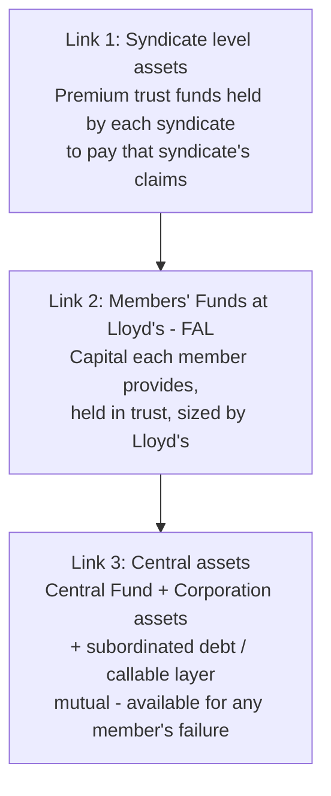
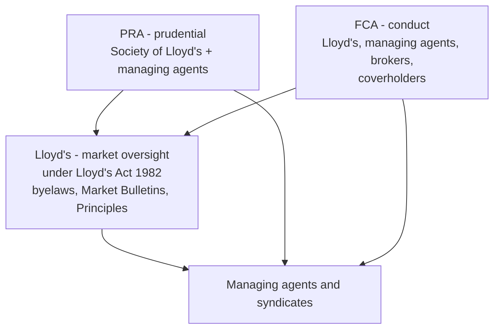

# Module 07 – Capital, Finance and Regulation

**Level:** Advanced | **Goal:** Understand how Lloyd's capital works, how syndicates account for results, how capital is set, and the regulatory framework in late 2026. CFOs, CROs and Lloyd's-facing leaders will judge you on this module.

---

## Part A – Lloyd's financial architecture

### A1. Annual venture and year of account

- **[certain]** Each syndicate underwrites as an **annual venture**. All policies incepting in a calendar year belong to that **year of account (YOA)**, e.g., the 2026 YOA.
- Members can change their participation each year, so each YOA can have a different set of capital providers.
- Results are measured per YOA, not only per calendar year.

### A2. Three-year accounting and closing a year

| Concept | Meaning |
|---|---|
| **Three-year accounting** | Historically, a YOA was closed after 36 months, when results became reasonably certain. Lloyd's market results are now also reported on an annual (calendar year) basis under UK GAAP, but YOA closure still drives member profit distribution **[certain]**. |
| **RITC – Reinsurance to Close** | **[certain]** At closure, the members of the closing YOA pay a premium to the members of a later YOA (usually the next YOA of the same syndicate, or another syndicate) to take over all remaining liabilities. This lets the old members exit with a final result. |
| **Open year / run-off year** | If liabilities are too uncertain to price an RITC, the YOA stays open. Members cannot exit; capital stays tied up. |
| **Third-party RITC** | A run-off specialist syndicate takes over liabilities of a closing YOA – a legacy transaction. |
| **Cash call** | If a YOA makes losses, members must fund them, from FAL or additional cash. |

**Why consultants care:** RITC pricing depends on reserve quality; open years tie up capital and reduce return on capital. Legacy transactions (RITC, LPT, ADC) are a recurring advisory theme.

### A3. The Chain of Security

| Link | Description |
|---|---|
| **1. Syndicate assets** | Premiums and investment income held in premium trust funds. First source for paying claims. |
| **2. Funds at Lloyd's (FAL)** | Each member's own capital (cash, securities, letters of credit) supporting its underwriting. Used if its syndicate assets are insufficient. |
| **3. Central assets** | Mainly the **Central Fund**, funded by member contributions. At the discretion of the Council, used to pay valid claims if a member cannot meet its obligations. This mutualisation is why every Lloyd's policy has the same financial strength rating. |

- Skadden's summary of the 2026 strategy refers to a **$160bn chain of security** **[likely]**.
- Lloyd's 2025: total capital, reserves and subordinated debt of **£49.8bn**; **central solvency ratio 496%** **[certain]**.
- Lloyd's financial strength ratings are in the high "A" to "AA-" range from A.M. Best, S&P and Fitch **[likely]** – check lloyds.com before quoting exact ratings.

### A4. How capital is set at Lloyd's

```mermaid
flowchart LR
  A[Syndicate Business Forecast - SBF<br/>business plan for next YOA] --> B[Syndicate internal model:<br/>one-year SCR and ultimate SCR - uSCR]
  B --> C[Lloyd's Capital Return - LCR<br/>submitted to Lloyd's]
  C --> D[Lloyd's review and challenge<br/>of plan and model]
  D --> E[ECA = uSCR x 135%<br/>Economic Capital Assessment]
  E --> F[Each member's FAL requirement<br/>= share of ECA<br/>adjusted for diversification]
  F --> G[Coming into Line - CIL:<br/>members provide FAL by deadline<br/>usually late November]
  G --> H[Underwriting for new YOA<br/>starts 1 January]
```

| Term | Meaning |
|---|---|
| **SBF** | Syndicate Business Forecast – the business plan submitted to and approved by Lloyd's (premium, classes, loss ratios, expenses, reinsurance). |
| **SCR (one-year)** | Solvency II/UK capital to cover a 1-in-200 loss over one year. |
| **uSCR (ultimate SCR)** | Capital to cover 1-in-200 loss to ultimate, i.e., over the full run-off of the business. Lloyd's uses this to set member capital. |
| **ECA** | **[certain]** Economic Capital Assessment = uSCR plus a **35% uplift**. Gives Lloyd's a buffer to protect the central fund and its rating. |
| **LCR** | Lloyd's Capital Return – the capital submission. |
| **LIM – Lloyd's Internal Model** | The market-wide internal model approved by the PRA, used to set the Society's central capital. |
| **Coming into Line (CIL)** | The point when members must have their FAL in place for the coming year **[certain]**. |
| **Stamp capacity** | Maximum premium (net of acquisition cost) a syndicate may write for a YOA. |

**Consulting angle:** capital efficiency is now a strategic pillar at Lloyd's. Projects include internal model improvements, reinsurance optimisation, business mix optimisation, and capital allocation to classes based on return on capital.

### A5. Members' economics

| Item | Description |
|---|---|
| Profit | Paid out to members at YOA close. |
| Managing agency fee | Typically a small % of capacity. |
| Profit commission | Share of profits paid to managing agent. |
| Central Fund contributions | Percentage of premium/capacity set by Lloyd's annually. |
| Lloyd's subscriptions | Fees to fund the Corporation. |
| Members' agent fees | For Names. |
| Capacity value | Names can buy and sell capacity at annual auctions; value reflects expected profitability. |

### A6. Lloyd's market performance numbers you must know

| Metric | 2024 | 2025 | H1 2026 | Tag |
|---|---|---|---|---|
| GWP | £55.5bn | £57.9bn | £34.7bn | [certain] |
| Combined ratio | 86.9% | 87.6% | 90.8% | [certain] |
| Underlying (ex-major claims) combined ratio | 79.1% | 81.8% | 84.0% | [likely] |
| Major claims ratio | 7.8% | 5.8% | 6.8% | [likely] |
| Risk-adjusted rate change | — | about −3.5% (H1 2025) | −6.7% | [likely] |
| Profit before tax | — | £10.6bn | £3.5bn | [certain] |
| Return on capital | — | 22.0% | — | [likely] |
| 2026 forecast (from FY25 results) | — | GWP £64bn ±5%, CR 90–95% | — | [likely] |

**How to read this (advisor view) [likely]:** headline results are strong, but the **underlying** combined ratio is rising each period as rates fall. Strong results rely partly on prior-year reserve releases and lighter catastrophe years. A client conversation in late 2026 should be about **protecting margin in a softening market**, not about growth at any price.

---

## Part B – Financial reporting and reserving

### B1. Reporting frameworks

| Reporting | Who | Framework |
|---|---|---|
| Syndicate annual accounts | Each syndicate | UK GAAP (FRS 102 / FRS 103) **[likely]** |
| Lloyd's market results | Society of Lloyd's | Aggregated pro forma results + Society accounts |
| Listed group accounts | Insurance groups owning managing agents | IFRS 17 (from 2023) for most groups **[certain]** |
| Solvency reporting | Syndicates, Lloyd's, companies | Solvency UK: QRTs, SFCR, RSR, ORSA |
| US reporting | US trust funds, surplus lines | US regulators |

**IFRS 17 key ideas** (for group-owned managing agents): premium allocation approach (PAA) for most P&C contracts; discounting of claims liabilities; explicit risk adjustment; onerous contract testing. The translation between syndicate UK GAAP and group IFRS 17 is a recurring finance-transformation task.

### B2. Reserving

| Concept | Meaning |
|---|---|
| **Case reserves** | Set by claims handlers on known claims. |
| **IBNR** | Set by actuaries for unknown or under-reserved claims. |
| **Methods** | Chain ladder, Bornhuetter-Ferguson, expected loss ratio, frequency/severity. |
| **Reserve releases / strengthening** | Prior-year development. Lloyd's 2025 benefited from about £721m of releases (1.7 points) **[likely]**. |
| **Statement of Actuarial Opinion (SAO)** | Lloyd's requires an independent actuarial opinion on each syndicate's reserves **[certain]**. |
| **Social inflation** | Rising US liability claims costs due to litigation trends – main reserving risk for US casualty **[certain]**. |

---

## Part C – Regulation in late 2026

### C1. The three-layer regulatory model for Lloyd's

Managing agents are **dual-regulated** by the PRA and FCA, and also overseen by Lloyd's. Lloyd's coordinates with both regulators.

### C2. PRA – key requirements and 2026 priorities

| Area | What it means |
|---|---|
| **Solvency UK** | UK version of Solvency II after reforms effective 31 Dec 2024: lower risk margin, simpler reporting, changes to internal model approval **[likely]**. Three pillars: capital (SCR, MCR, own funds, technical provisions), governance (system of governance, ORSA), reporting (QRT, SFCR, RSR). |
| **Internal models** | Approved models used for SCR; PRA in 2026 focuses on whether models **overstate underwriting profitability** as the cycle softens **[likely]**. |
| **DyGIST** | Dynamic General Insurance Stress Test – semi-live, three-week crisis simulation in May 2026 testing management response; results expected late 2026 **[likely]**. |
| **Operational resilience** | Firms must identify important business services and stay within impact tolerances in severe but plausible scenarios (deadline March 2025) **[certain]**. |
| **Outsourcing and third-party risk** | Oversight of critical outsourcing (cloud, bureau, TPAs, AI vendors). |
| **Solvent exit planning** | Insurers must plan how they could exit the market in an orderly way **[likely]**. |
| **Climate risk** | Expectations on climate risk management and scenario analysis **[certain]**; updated supervisory statement in 2025 **[likely]**. |
| **AI** | PRA has highlighted increased AI use and expects model risk, governance and accountability to keep pace **[likely]**. |
| **SM&CR** | Senior Managers and Certification Regime – named senior managers are personally accountable. |

### C3. FCA – conduct in the London market

| Area | Current position |
|---|---|
| **PS25/21 – Simplifying insurance rules (9 Dec 2025)** **[certain]** | Larger commercial customers (above the DISP SME eligible complainant thresholds) and contracts of large risks are excluded from ICOBS, PROD and the Consumer Duty. Co-manufacturers can nominate one lead firm for PROD 4 obligations. Bespoke contracts are excluded from PROD 4. Intermediaries (e.g., MGAs) still cannot act as lead co-manufacturer. |
| **Consumer Duty (from July 2023)** | Still applies to retail customers and SMEs below thresholds – relevant for DA and A&H, small commercial. FCA plans to review core definitions (e.g., "retail customer") during 2026 **[likely]**. |
| **PROD 4** | Product governance: target market, fair value, distribution strategy. |
| **ICOBS** | Insurance conduct of business rules. |
| **CASS 5** | Client money rules for brokers. |
| **Financial crime and sanctions** | Firms must screen for UK, EU, US and UN sanctions; OFSI enforces UK sanctions. Russia-related sanctions remain a big operational burden in marine, aviation and energy. |
| **Non-financial misconduct** | FCA focus on culture, consistent with Lloyd's own culture programme. |

### C4. Lloyd's own oversight

| Tool | Description |
|---|---|
| **Lloyd's Act 1982 and byelaws** | Legal basis. |
| **Market Bulletins** | Official instructions and guidance. |
| **Principles for doing business / Principles-Based Oversight** | Lloyd's assesses managing agents against principles (e.g., underwriting, claims, governance, delegated authority, culture), and tailors oversight intensity to maturity and performance **[likely]**. |
| **Business plan approval** | SBF approval is the most powerful lever: Lloyd's can cap growth or require remediation. |
| **Minimum Standards and requirements** | Specific operational standards (claims, DA, reserving, capital, conduct). |
| **2026 strategy commitment** | Lloyd's says it will make oversight more predictable and risk-based, streamline reporting and reduce cost of doing business **[likely]**. |

### C5. Key legislation

| Law | Why it matters |
|---|---|
| **Marine Insurance Act 1906** | Core marine law; principles widely applied. |
| **Insurance Act 2015** | Duty of fair presentation by the insured (replaces strict duty of disclosure for non-consumers), proportionate remedies for non-disclosure, warranties suspend cover rather than end it, terms not relevant to the loss cannot be used to deny claims (s.11) **[certain]**. |
| **Enterprise Act 2016** | Insurers can be liable for damages for late payment of claims **[certain]**. |
| **Third Parties (Rights against Insurers) Act 2010** | Third party can claim directly against insolvent insured's insurer. |
| **Lloyd's Acts 1871–1982** | Governance of Lloyd's. |
| **Financial Services and Markets Act 2000 / 2023** | Regulatory framework; FSMA 2023 gave regulators secondary competitiveness and growth objective **[certain]**. |
| **Data protection (UK GDPR, Data Protection Act 2018, Data (Use and Access) Act 2025)** | Personal data in claims, A&H, cyber, DA bordereaux **[likely]** for the 2025 Act's details. |
| **Sanctions and Anti-Money Laundering Act 2018** | UK sanctions framework. |

### C6. International footprint and licensing

| Platform | Purpose |
|---|---|
| **Lloyd's Europe (Brussels)** | Writes EEA risks since 2019; policies reinsured 100% to syndicates. Regulated by Belgian NBB and FSMA. |
| **US** | Lloyd's is a major surplus lines and reinsurance market; US dollar trust funds protect US policyholders; Lloyd's also has admitted licences in a few states (e.g., Illinois, Kentucky, US Virgin Islands) **[likely]**. |
| **Canada** | Lloyd's operates as a licensed insurer with Canadian trust funds. |
| **Lloyd's China (Shanghai), Lloyd's Asia (Singapore), Lloyd's Japan, Lloyd's Dubai (DIFC), Lloyd's India (reinsurance branch, including GIFT City)** | Local platforms where syndicates write via service companies or branches **[likely]**. |
| **Licensing rule** | Each risk must be written in a territory where Lloyd's holds the right licence or under a valid exemption (e.g., reinsurance, large risks). Checking this is a core underwriting control. |

---

## Part D – Lloyd's 2026–2030 strategy: what it means for clients

| Driver (Lloyd's wording) **[certain]** | What it means in practice **[likely]** | Consulting implications |
|---|---|---|
| **Leading underwriting performance** | Attract and keep the best underwriters; reward lead capability; continued discipline on poor performers. | Portfolio management, pricing discipline, lead/follow strategy. |
| **Efficient and flexible marketplace** | Lower cost of doing business; risk-based oversight; streamlined reporting; move away from Blueprint Two to incremental modernisation and common data standards. | Operating model and cost-out; CDR adoption; process simplification. |
| **Maximised capital advantage** | Most capital-efficient marketplace for complex risk by 2031; return on capital ambition above 12% across a 10-year cycle; simpler Names processes; more institutional capital. | Capital modelling, ILS/third-party capital structures, syndicate launches. |
| **A Lloyd's to be proud of** | Culture, talent (e.g., more early careers), data, technology and AI strategies; AI to support human decisions, not replace them. Skadden reports cost-to-income and NPS targets **[likely]**. | Talent and AI capability building; culture programmes. |

**Advisor warning [guessing]:** strategy documents describe intent. Expect execution detail through Market Bulletins and Lloyd's market communications during 2026–2027. Do not promise clients specific benefits until those details are published.

---

## Part E – Run-off and legacy

| Tool | Description |
|---|---|
| **RITC (third party)** | Closing YOA transferred to a run-off syndicate. |
| **LPT – Loss Portfolio Transfer** | Reinsurer takes over existing reserves for a premium. |
| **ADC – Adverse Development Cover** | Reinsurance protecting against reserves developing worse than expected. |
| **Part VII transfer** | Court-approved legal transfer of a book of insurance policies between UK entities. |
| **Commutation** | Ending reinsurance obligations for a lump sum. |
| **Why it matters now** | Social inflation on older US casualty years and soft-market pressure push clients to clean up legacy to free capital **[likely]**. |

---

## Part F – Advanced checklist

- [ ] Explain RITC and why an open year hurts members.
- [ ] Draw the chain of security from memory.
- [ ] Explain ECA = uSCR × 1.35 and why Lloyd's adds 35%.
- [ ] Explain the effect of falling rates on the underlying combined ratio and on internal model capital.
- [ ] Explain PS25/21 and its effect on DA products for SMEs vs large commercial clients.
- [ ] Explain Lloyd's four strategic drivers and one consulting opportunity under each.
