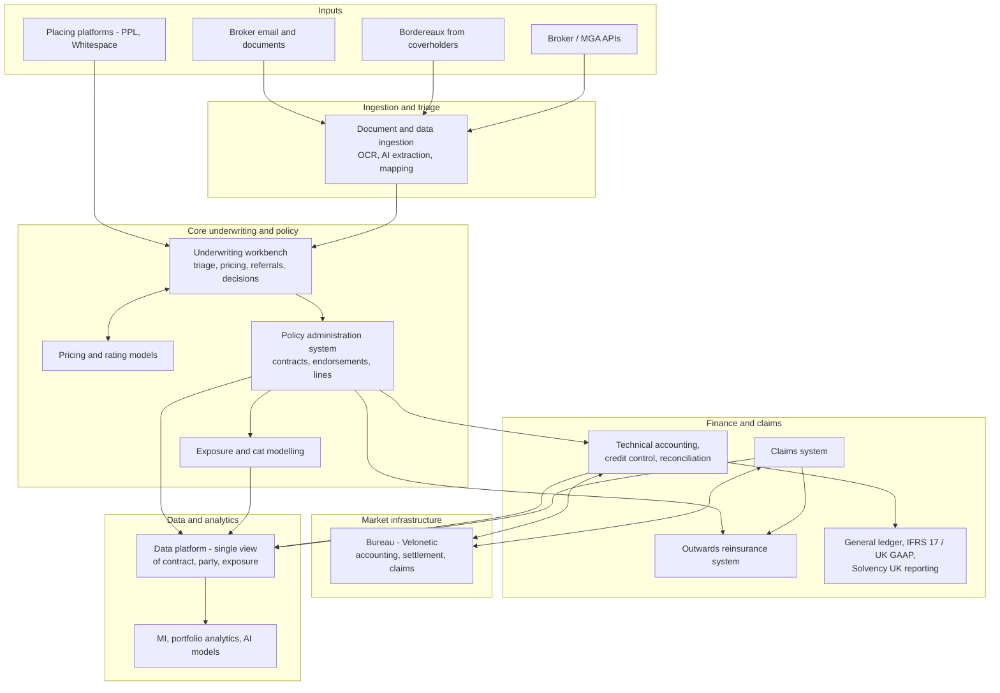

# Module 08 – Modernisation, Data Standards and Technology

**Level:** Advanced | **Goal:** Understand why London market modernisation has been so hard, where it stands after Lloyd's retired Blueprint Two in March 2026, what the target technology and data landscape looks like for a carrier, and what to recommend to clients now.

---

## 1. Twenty-five years of modernisation – and the lessons

| Period | Initiative | Outcome | Lesson |
|---|---|---|---|
| 2000–2006 | **Kinnect** – Lloyd's market-wide electronic trading platform | Abandoned after heavy spend **[likely]** | Big central platforms fail without firm-level benefits. |
| 2000s | **Project Rüschlikon** – ACORD messaging for reinsurance accounting and claims | Partial adoption, mainly by large reinsurers and brokers **[likely]** | Standards succeed where the biggest players see direct benefit. |
| 2004–2007 | **Contract certainty** and the **MRC** | Successful | Regulator pressure plus a simple standard works. |
| 2016 | **PPL** electronic placing launched | Adopted, often driven by Lloyd's mandates **[likely]** | Adoption needs mandates and usability. |
| 2016–2019 | **London Market Target Operating Model (TOM)** | Merged into Lloyd's programme | Market-wide governance is slow. |
| 2019–2020 | **Future at Lloyd's** – Blueprint One and **Blueprint Two** | Ambitious digital processing vision; repeated delays (cutover moved from 2024 into 2025 and then 2026) **[likely]** | Single cutover across hundreds of firms is very high risk. |
| Mar 2026 | **Blueprint Two name and original vision retired** after review; Velonetic refocused on incremental modernisation; common data standards retained; re-platforming unlikely before 2028 **[likely]** | Market moves to incremental, standards-led change | Standards and incremental change over big bang. |

### 1.1 Why market-wide change is so hard

1. **Many parties, uneven benefit.** Brokers, managing agents, companies, coverholders and the bureau all must change. Benefits fall unevenly; brokers often carry the cost of data capture while carriers gain.
2. **Shared legacy infrastructure.** Bureau systems are decades old and deeply embedded in every firm's processes.
3. **Data captured late and poorly.** Placement data is unstructured (PDFs, emails), so downstream automation is limited.
4. **No single owner.** Lloyd's, LMA, IUA, LIIBA, LIMOSS, Velonetic, vendors – decision rights are spread.
5. **Business is always "live".** You cannot stop the market to migrate.

---

## 2. Blueprint Two – what you need to know now

### 2.1 What it originally aimed to do **[likely]**

| Component | Purpose |
|---|---|
| **Core Data Record (CDR)** | Capture a defined set of structured data at placement so accounting, settlement, tax and regulatory reporting can be automated. |
| **Digital Gateway** | Validate placement data against the CDR before it enters downstream processing, for both Lloyd's and company market business. |
| **Digital processing services** | New accounting, settlement and claims services replacing legacy bureau systems. |
| **Delegated authority data services** | Standardised DA contract and bordereaux data handling. |
| **Placement standards** | Lloyd's stopped building its own placement platform and set standards for third-party platforms. |

### 2.2 What happened in March 2026 **[likely]**

- Lloyd's Council approved retiring the name and original vision of Blueprint Two after a review. The CEO said the programme had not delivered the benefits originally expected.
- Lloyd's strategy now refers to **transitioning away from Blueprint Two**, **refocusing Velonetic on incremental technology modernisation**, an **open architecture**, and **common data standards**.
- The **CDR** continues as a data standard (ACORD-maintained versions; extensions to treaty reinsurance and a delegated authority CDR were in consultation during 2026 **[guessing]** – confirm with ACORD/LMG before citing).
- Full re-platforming of bureau services is not expected before **2028**.

### 2.3 How to talk about it with clients

| Client says | Your position |
|---|---|
| "We spent millions getting Blueprint Two ready – was it wasted?" | "Not if the spend improved your own data. CDR-aligned data, clean master data and integration capability are still needed. What is at risk is any spend tied to the specific cutover." |
| "Should we pause all modernisation until the market decides?" | "No. Waiting costs you more than the market's uncertainty. Focus on changes that pay back inside your own firm within 18–24 months and stay standards-aligned." |
| "Will the bureau be replaced?" | "Not quickly. Plan for incremental change to bureau services through at least 2028, and design your systems to integrate through APIs and standard messages." |

---

## 3. Data standards you must know

| Standard | What it covers |
|---|---|
| **MRC** | Structure of the contract (sections, fields). |
| **CDR – Core Data Record** | Minimum structured data set for risk, premium, tax and regulatory processing, captured at placement. Maintained with ACORD. |
| **ACORD GRLC** | Global Reinsurance and Large Commercial messaging standards (placement, accounting, claims, documents). |
| **Lloyd's Coverholder Reporting Standards** | Bordereaux field definitions for DA. |
| **Lloyd's risk codes** | Codes classifying business for Lloyd's reporting and capital. |
| **Lloyd's/LMA clause references** | e.g., LMA5564 for cyber war exclusions – useful for wording analytics. |
| **Market references** | UMR (contract), UCR (claim), SND/OSND (accounting entries). |

**Practical point:** any data model you design for a London carrier must hold UMR, signed lines by insurer, MRC sections, CDR fields, Lloyd's risk codes, tax and regulatory data, and links between premium entries (SND) and claims (UCR).

---

## 4. Technology landscape of a London carrier

### 4.1 Reference architecture

### 4.2 Typical vendors and tools **[likely]** (verify current positions before naming in a proposal)

| Capability | Examples |
|---|---|
| Policy administration (specialty) | Sequel Eclipse, DXC Genius / Assure, Guidewire, Duck Creek, Sapiens, Insurity |
| Underwriting workbench | Send, hx Renew, Federato, Concirrus, Artificial Labs, in-house builds |
| Submission ingestion | Cytora, specialist AI document tools, platform-native extraction |
| Placing platforms | PPL, Whitespace |
| Cat modelling | Moody's RMS, Verisk, KCC, Cotality (formerly CoreLogic) |
| Exposure / aggregation | Vendor cat platforms, in-house tools |
| Bordereaux / DA management | Specialist DA platforms, Velonetic DA services, data platform builds |
| Data platform | Snowflake, Databricks, Microsoft Fabric/Azure, AWS, Google Cloud |
| Finance | SAP, Oracle, Workday, plus IFRS 17 engines |

### 4.3 Common architecture problems

| Problem | Effect |
|---|---|
| Multiple policy systems after M&A | No single view of exposure or client |
| Data re-keyed 3–5 times across broker, platform, PAS, bureau | Errors, cost, delays |
| Spreadsheet-based pricing and exposure | Key person risk, weak audit trail |
| Bureau data not reconciled to internal data | Large reconciliation teams |
| Point solutions without integration | "Insurtech sprawl" – many tools, little benefit |
| Weak master data (broker, coverholder, insured, location) | Poor analytics, duplicate records, sanctions risk |

---

## 5. Data strategy for a London carrier

### 5.1 Five data domains to get right

| Domain | Golden record contains |
|---|---|
| **Party** | Insured, broker, coverholder, reinsurer, with identifiers (LEI, company numbers), sanctions status |
| **Contract** | UMR, MRC sections, lines, layers, wordings, clauses, dates |
| **Exposure** | Locations (geocoded), values, vessels (IMO), aircraft (serial), cyber footprint |
| **Financial** | Premium, instalments, tax, brokerage, SND, settlement status, FX |
| **Claims** | UCR, event codes, reserves, payments, recoveries, documents |

### 5.2 Data quality dimensions to measure

Completeness, accuracy, timeliness, consistency across systems, uniqueness, and validity against standards (CDR, Lloyd's codes).

### 5.3 Data governance basics

- Named **data owners** (business) and **data stewards** (operations) for each domain.
- Data quality rules embedded at the point of capture (placement, bordereaux ingestion), not only checked downstream.
- Lineage from source document to regulatory report.
- Data quality KPIs reported to the executive committee.

---

## 6. What to recommend now ("no-regret moves") **[likely]**

| # | Move | Why it holds regardless of market decisions |
|---|---|---|
| 1 | Align your internal contract data model to the **CDR** | Standards survived the Blueprint Two decision; brokers and platforms are moving to them. |
| 2 | Fix **master data** (party, broker, coverholder, location) | Every analytics, AI and regulatory use case depends on it. |
| 3 | Invest in **ingestion** (submissions, bordereaux) with AI-assisted extraction | Removes manual keying, the largest controllable cost. |
| 4 | Build **API and message-based integration** to platforms and bureau | Protects you from future market platform changes. |
| 5 | Consolidate **policy and data platforms** after M&A | Single view of exposure and lower run cost. |
| 6 | Create a **reconciliation automation** capability | Fast payback; reduces aged debt and operational risk. |
| 7 | Set up **AI governance** before scaling AI | Required by regulators and the LMA toolkit direction. |

---

## 7. Technical consulting skills to build

| Skill | What to learn |
|---|---|
| Business process modelling | BPMN, swimlanes for placement, DA, claims |
| Data modelling | Entity models for contract, party, exposure; mapping to CDR and ACORD |
| Requirements | User stories with London market acceptance criteria (UMR, lines, SND) |
| Integration | APIs, ACORD messages, event-driven architecture basics |
| Data platforms | Modern data stack, data quality tooling, lineage |
| Vendor selection | Fit-gap analysis, total cost of ownership, reference checks |
| Testing | Test data for multi-insurer placements, currency, tax, endorsements |
| AI | Prompting, retrieval-augmented generation (RAG), evaluation, model risk |
