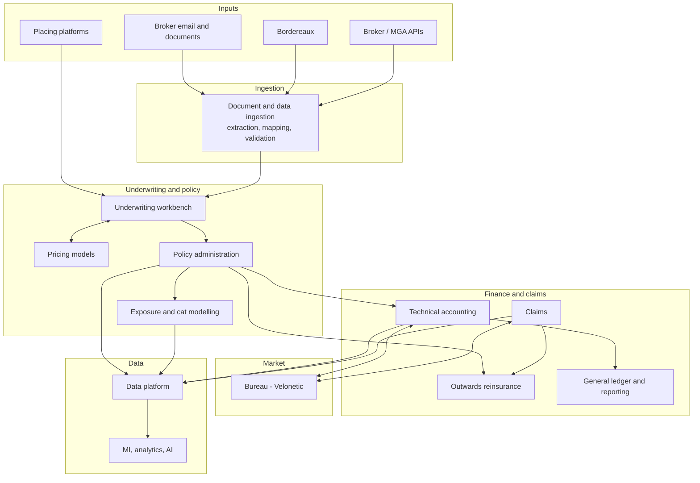

# Module 08 – Modernisation, Data Standards and Technology

| | |
|---|---|
| **Level** | Advanced |
| **Path phase** | Phase 2–3; core to your recommended spike ([Module 18 §3](18-World-Class-Consultant-Path.md)) |
| **Time** | 4–5 hours reading, 3 hours exercises |
| **Prerequisites** | Modules 04–06 |
| **You will be able to** | Explain why London modernisation has repeatedly struggled; explain the Blueprint Two story and where things stand after March 2026; describe the main data standards; design a target architecture and data strategy for a London carrier; run a vendor selection; advise on "what now" after Blueprint Two |

---

## 1. Why this chapter matters

Technology and data spend is one of the largest discretionary costs for London carriers, and one of the most frequent consulting topics. It is also where consultants most often lose credibility: by pitching yesterday's market programme, by recommending tools without fixing data, or by ignoring the constraints of a shared market. This chapter gives you the history, the standards, the architecture and the current position so you can advise with authority.

---

## 2. Twenty-five years of modernisation – and the lessons

| Period | Initiative | Outcome | Lesson |
|---|---|---|---|
| 2000–2006 | **Kinnect** – Lloyd's electronic trading platform | Abandoned after heavy spend **[likely]** | Central platforms fail without benefits for each firm |
| 2000s | **Project Rüschlikon** – ACORD messaging for reinsurance accounting and claims | Partial adoption by large reinsurers and brokers **[likely]** | Standards succeed where big players gain directly |
| 2004–2007 | **Contract certainty and the MRC** | Successful | Regulator pressure plus a simple standard works |
| 2016 | **PPL** electronic placing | Adopted, partly through Lloyd's mandates; later moved to a "Next Gen" platform after delays **[likely]** | Adoption needs mandates and usability |
| 2016–2019 | **London Market Target Operating Model (TOM)** | Folded into Lloyd's programme | Market-wide governance is slow |
| 2019–2020 | **Future at Lloyd's – Blueprint One and Two** | Ambitious digital processing vision; cutover moved repeatedly from 2024 into 2025 and 2026 **[likely]** | Single cutover across hundreds of firms is very high risk |
| Mar 2026 | **Blueprint Two name and original vision retired**; Velonetic refocused on incremental modernisation; common data standards retained; re-platforming not expected before 2028 **[likely]** | Shift to incremental, standards-led change | Standards and incremental delivery over "big bang" |

### 2.1 Why market-wide change is so hard

| Barrier | Explanation |
|---|---|
| **Collective action problem** | Everyone benefits if everyone changes, but each firm pays its own costs and gains only when others change too |
| **Uneven costs and benefits** | Brokers often carry the cost of capturing structured data; carriers and the bureau gain most |
| **Shared legacy** | Bureau systems are decades old and embedded in every firm's processes |
| **Unstructured data at source** | Submissions and contracts are documents, so automation downstream is limited |
| **Spread decision rights** | Lloyd's, LMA, IUA, LIIBA, LIMOSS, Velonetic, platforms and vendors all have a say |
| **Always live** | The market cannot stop to migrate; old and new must run together |
| **Long tail** | Contracts and claims from old years of account stay open for years – old data and processes must be supported |

---

## 3. Blueprint Two – the full story

### 3.1 The original vision **[likely]**

| Component | Purpose |
|---|---|
| **Core Data Record (CDR)** | Structured contract data captured at placement so accounting, settlement, tax and regulatory reporting can be automated |
| **Digital Gateway** | Validate placement data against the CDR before downstream processing, for Lloyd's and company market business |
| **Digital processing services** | New accounting, settlement and claims services replacing legacy bureau systems |
| **Delegated authority data services** | Standardised DA contract and bordereaux data |
| **Placement standards** | Lloyd's stopped building its own placement platform; set standards for third-party platforms |

### 3.2 What happened

| Date | Event | Tag |
|---|---|---|
| 2020 | Blueprint Two launched | [certain] |
| 2023–2024 | Phase 1 cutover targeted for mid/late 2024 | [likely] |
| 2024–2025 | Cutover pushed into 2025, then 2026 | [likely] |
| March 2026 | Lloyd's Council approves retiring the name and original vision after a review; CEO says expected benefits were not delivered | [likely] |
| 2026 | Lloyd's strategy refers to transitioning away from Blueprint Two, refocusing Velonetic on incremental modernisation, open architecture and common data standards | [likely] |
| 2026 | CDR continues; extensions (e.g., treaty reinsurance, delegated authority) consulted on | [guessing] – confirm with ACORD/LMG |
| 2028+ | Bureau re-platforming not expected before 2028 | [likely] |

### 3.3 How to talk about it with clients

| Client says | Your position |
|---|---|
| "We spent millions getting ready – was it wasted?" | "Not if it improved your own data. CDR-aligned data, clean master data and integration capability are still needed. What is at risk is spend tied only to the specific cutover." |
| "Should we pause modernisation until the market decides?" | "No. Waiting costs more than the market's uncertainty. Focus on changes that pay back inside your firm within 18–24 months and stay standards-aligned." |
| "Will the bureau be replaced?" | "Not quickly. Plan for incremental change through at least 2028 and integrate through standard messages and APIs." |
| "Who owns market modernisation now?" | "Lloyd's sets direction, but the work is spread across Velonetic, LIMOSS, the LMA, IUA and LIIBA, platforms and standards bodies. Engage through the associations." |

---

## 4. Data standards you must know

| Standard / reference | What it covers |
|---|---|
| **MRC** | Structure of the contract (six sections) |
| **CDR – Core Data Record** | Minimum structured data for processing: contract and parties, risk details, insurers and lines, premium and instalments, tax and regulatory, broker remuneration and deductions **[likely]** |
| **ACORD GRLC messages** | Global Reinsurance and Large Commercial standards for placement, accounting (e.g., technical accounts), claims and documents |
| **Lloyd's Coverholder Reporting Standards** | Bordereaux fields |
| **Lloyd's risk codes** | Classification of business for reporting and capital |
| **Clause references** | LMA/IUA/Institute clause numbers – enable wording analytics |
| **Market references** | UMR (contract), UCR (claim), TR (claim transaction), SND/OSND (accounting entries) |

**Rule for data models:** a London carrier's model must hold UMR, MRC sections, signed lines by insurer, CDR fields, risk codes, tax and regulatory data, and the links between premium entries (SND/OSND) and claims (UCR/TR).

---

## 5. Reference architecture for a London carrier

### 5.1 Layer by layer

| Layer | Capabilities | Build or buy (typical) |
|---|---|---|
| **Ingestion** | Email and document capture; extraction (AI); mapping to standard model; validation; exception workflow | Buy platform + configure; AI models increasingly commoditised |
| **Underwriting workbench** | Triage, enrichment, pricing integration, referrals, authority checks, decision record | Buy or build; differentiation in workflow and data |
| **Pricing and rating** | Technical price models by class | Build (actuarial IP) on standard tools |
| **Policy administration** | Contract record, lines, endorsements, premium, financial postings | Buy (specialty PAS) |
| **Exposure and cat** | Aggregation, cat models, RDS | Buy models; build aggregation views |
| **Technical accounting** | Premium, claims and RI accounting; reconciliation; credit control | Buy + automation |
| **Claims** | FNOL, handling, reserving, payments, recoveries | Buy |
| **Outwards reinsurance** | Programme, cessions, recoveries | Buy or specialist build |
| **Finance and reporting** | GL, UK GAAP, IFRS 17, Solvency UK | Buy |
| **Data platform** | Golden records, history, data quality, lineage | Cloud platform + build data products |
| **MI and AI** | Dashboards, models, AI services, governance | Build on platform |

### 5.2 Vendors and tools **[likely]** – verify before naming in proposals

| Capability | Examples |
|---|---|
| Specialty policy administration | Sequel Eclipse, DXC Genius / Assure, Guidewire, Duck Creek, Sapiens, Insurity |
| Underwriting workbench | Send, hx Renew, Federato, Concirrus, Artificial Labs, in-house builds |
| Submission ingestion | Cytora and other AI document platforms |
| Placing platforms | PPL, Whitespace |
| Cat models | Moody's RMS, Verisk, KCC, Cotality |
| Data platforms | Snowflake, Databricks, Microsoft Fabric/Azure, AWS, Google Cloud |
| Finance | SAP, Oracle, Workday, IFRS 17 engines |

---

## 6. Common architecture problems and their root causes

| Problem | Root cause | Effect |
|---|---|---|
| Several policy systems | M&A without consolidation | No single exposure view; high run cost |
| Data keyed 3–5 times | No integration between platforms, PAS and bureau | Errors, cost, delay |
| Spreadsheet pricing and exposure | Under-investment; key-person dependence | Weak audit trail; model risk |
| Bureau data not reconciled | Different line bases, FX, timing | Large reconciliation teams |
| Insurtech sprawl | Point solutions bought by separate teams | Many tools, little integrated value |
| Weak master data | No owner for party, broker, coverholder, location records | Duplicate records; sanctions risk; poor analytics |
| Old years on old systems | Long-tail claims keep legacy alive | Decommissioning blocked |

---

## 7. Data strategy for a London carrier

### 7.1 Five data domains

| Domain | Golden record contains | Typical owner |
|---|---|---|
| **Party** | Insureds, brokers, coverholders, reinsurers – with identifiers (LEI, company numbers) and sanctions status | COO / compliance |
| **Contract** | UMR, MRC sections, lines, layers, wordings, clauses, dates | CUO |
| **Exposure** | Geocoded locations, values, vessels (IMO), aircraft, cyber footprint | CRO / exposure management |
| **Financial** | Premium, instalments, tax, brokerage, SND, settlement status, FX | CFO |
| **Claims** | UCR, event codes, reserves, payments, recoveries, documents | Chief Claims Officer |

### 7.2 Data quality – measure it like a business KPI

| Dimension | Example measure | Target example |
|---|---|---|
| Completeness | % of CDR mandatory fields populated at bind | ≥ 98% |
| Accuracy | % of sampled records matching source documents | ≥ 97% |
| Timeliness | % of bordereaux processed within 10 days of month end | ≥ 90% |
| Consistency | % of contracts where PAS, bureau and finance agree on line and premium | ≥ 95% |
| Uniqueness | Duplicate party records per 1,000 | < 5 |
| Validity | % of locations geocoded to street level | ≥ 90% (property) |

### 7.3 Data governance – who does what

| Role | Responsibility |
|---|---|
| **Data owner** (business executive) | Accountable for a domain's quality and use |
| **Data steward** (operations) | Defines rules; fixes issues; monitors quality |
| **Data custodian** (IT/data team) | Runs platforms; implements controls |
| **Data council** | Prioritises issues; approves standards |

### 7.4 Data products

A **data product** is a dataset managed like a product: a clear owner, defined users, quality targets, documentation and service levels. Example: "**DA risk data product**" – all bound DA risks, validated against binder terms, geocoded, refreshed within 10 days of bordereaux receipt, used by exposure management, finance and oversight. Treating bordereaux as a data product rather than a report is a strong POV for your spike.

---

## 8. Integration patterns

| Pattern | Use | London example |
|---|---|---|
| **APIs (real time)** | Interactive workflows | Workbench requests enrichment data; MGA binds via carrier API |
| **Standard messages (ACORD)** | Market exchanges | Technical accounts, claims messages |
| **Event-driven** | React to changes across systems | "Risk bound" event updates exposure and finance |
| **File/batch** | Large periodic loads | Bordereaux, bureau extracts |
| **Platform integration** | Pull structured contract data from placing platforms | MRC data into PAS without re-keying |

**Principle:** design for **open architecture** – integrate through standards so that market changes (bureau, platforms) do not require rebuilding internal systems. Lloyd's strategy now also refers to open architecture **[likely]**.

---

## 9. Cloud, resilience and third-party risk

| Topic | Requirement |
|---|---|
| **Operational resilience** | Identify important business services (e.g., paying claims, binding cover) and stay within impact tolerances **[certain]** |
| **Outsourcing and third parties** | PRA expectations on due diligence, contracts, exit plans for material outsourcing and cloud **[certain]** |
| **Cyber security** | Protect client and market data; supplier security |
| **Data protection** | Personal data in claims, A&H, DA bordereaux; international transfers |
| **AI vendors** | Treat as material third parties where they support important services ([Module 09](09-Advanced-AI-in-London-Market.md)) |

---

## 10. Build vs buy and vendor selection

### 10.1 When to build and when to buy

| Build when | Buy when |
|---|---|
| The capability differentiates you (pricing models, underwriting insights) | The capability is standard (accounting, policy admin, claims) |
| No product fits London specifics | Mature London-specific products exist |
| You have engineering capacity to maintain it | You want vendor-funded upgrades |

### 10.2 Vendor selection method

| Step | Activity |
|---|---|
| 1. Requirements | Business capabilities and London specifics (subscription, lines, bureau, YOA, DA) |
| 2. Long list → short list | Market scan; RFI |
| 3. Scripted demonstrations | Vendors run **your** scenarios (e.g., a mixed Lloyd's/company placement with a signing down and an endorsement) |
| 4. Fit-gap | Score against requirements; estimate configuration and custom work |
| 5. Reference checks | Speak to London clients of the vendor |
| 6. Total cost of ownership | Licence, implementation, run, internal team, data migration – over 5–7 years |
| 7. Risk assessment | Vendor viability, delivery capacity, exit options |

**Example scoring weights:** London functional fit 35%; technology and integration 20%; total cost 20%; vendor strength and delivery 15%; references 10%.

### 10.3 London-specific scenarios to script in demos

- Placement with written lines above 100% and signing down.
- Lloyd's and non-bureau company insurers on the same contract.
- Endorsement requiring only the leader under the GUA, and one requiring all insurers.
- Instalment premium with a return premium.
- Binder with monthly bordereaux and a claims bordereau.
- Claim on a complex subscription contract with lead and second lead.
- Year-of-account and calendar-year reporting from the same data.

---

## 11. Designing a modernisation programme

| Principle | Explanation |
|---|---|
| **Value first** | Sequence by value and dependency, not by system |
| **Data foundation early** | Master data and the data platform unlock later use cases |
| **Incremental releases** | Deliver value every quarter; avoid big-bang cutovers (the Blueprint Two lesson) |
| **Plan for the long tail** | Decide how open years of account and old claims will be handled on new systems or retained platforms |
| **Test with London scenarios** | Multi-insurer, multi-currency, signing down, endorsements, bureau messages |
| **Change management** | Underwriters and operations must see benefit, or adoption fails |
| **Decommission** | Budget and track legacy decommissioning to realise run-cost savings |

---

## 12. No-regret moves after Blueprint Two **[likely]**

| # | Move | Why it holds |
|---|---|---|
| 1 | Align the internal contract data model to the **CDR** | Standards survived the March 2026 decision |
| 2 | Fix **master data** (party, broker, coverholder, location) | Every analytics, AI and regulatory use case depends on it |
| 3 | Invest in **ingestion** (submissions, bordereaux) | Removes the largest controllable manual cost |
| 4 | Build **API and standard-message integration** | Protects against future market platform changes |
| 5 | Consolidate **policy and data platforms** after M&A | Single exposure view; lower run cost |
| 6 | Automate **reconciliation** | Fast payback; lower aged debt and operational risk |
| 7 | Set up **AI governance** before scaling AI | Regulators and the LMA toolkit expect it |

---

## 13. Technical consulting skills to build

| Skill | What to learn |
|---|---|
| Process modelling | BPMN and swimlanes for placement, DA, claims |
| Data modelling | Entity models for contract, party, exposure; mapping to CDR and ACORD |
| Requirements | User stories with London acceptance criteria (UMR, lines, SND) |
| Integration | APIs, ACORD messages, event-driven basics |
| Data platforms | Modern data stack; data quality tooling; lineage |
| Vendor selection | Fit-gap, total cost of ownership, scripted demos |
| Testing | Test data for multi-insurer, multi-currency placements |
| AI | Extraction, retrieval-augmented generation, evaluation, model risk ([Module 09](09-Advanced-AI-in-London-Market.md)) |

---

## 14. Mini case – consolidating policy systems after M&A

**Situation:** after two acquisitions, a managing agent runs three policy administration systems (£6m a year run cost). Exposure reports are built by hand from three extracts. Each system holds open years of account and active claims.

| Option | Pros | Cons |
|---|---|---|
| A. Migrate everything to one system | Single view; lowest run cost | High migration risk for old years and claims |
| B. New business on one system; old years run off on legacy | Lower risk | Legacy run cost continues for years |
| C. Data platform first; consolidate later | Fast single exposure view | Two-step programme |

**Recommended:** C then B – build the data platform for a single view within 6–9 months; move new business to the target system by class over 12–18 months; migrate open years only where claims volumes justify it; decommission the rest as years close.

---

## 15. Partner's lens

*Top-tier strategy consulting methods applied to this chapter.*

1. **Never lead with technology.** Lead with the business outcome (expense ratio, exposure accuracy, faster quotes), then show technology as the means. Boards approve outcomes, not platforms.
2. **Learn from Blueprint Two in every proposal.** Show the client how your plan avoids big-bang risk: incremental releases, value every quarter, standards-aligned, independent of a single market cutover date. This answers the CEO's unspoken fear.
3. **Price the cost of doing nothing.** Calculate the annual cost of re-keying, reconciliation and duplicate systems. It is often larger than the programme budget over three years.
4. **Make data a CFO and CRO topic.** Link data quality to capital (exposure uncertainty), reserving (claims data) and reporting risk. Data programmes funded by finance and risk last longer than those funded by IT.
5. **Insist on decommissioning.** Many programmes add systems and never remove old ones. Partners make decommissioning a named benefit with an owner.

---

## 16. Key takeaways

1. London modernisation has repeatedly failed when it relied on single market-wide cutovers.
2. In March 2026 Lloyd's retired Blueprint Two; common data standards (including the CDR) and incremental modernisation continue.
3. Every London data model must handle UMR, lines, MRC sections, CDR fields and bureau references.
4. Architecture problems mostly come from M&A, point solutions and weak master data.
5. Measure data quality like a business KPI and assign business owners.
6. No-regret moves: CDR alignment, master data, ingestion, integration, consolidation, reconciliation automation, AI governance.

---

## 17. Check your understanding

| # | Question | Answer |
|---|---|---|
| 1 | Give three reasons market-wide modernisation is hard. | Collective action problem; uneven costs and benefits; shared legacy; unstructured data at source; spread decision rights; always-live market; long tail. |
| 2 | What survived the Blueprint Two decision? | Common data standards including the CDR; incremental modernisation of bureau services. |
| 3 | Which references link premium and claims records? | UMR, SND/OSND, UCR/TR. |
| 4 | What is a data product? | A dataset managed with an owner, users, quality targets, documentation and service levels. |
| 5 | Name three London scenarios to script in a vendor demo. | Signing down; mixed bureau/non-bureau; GUA endorsements; instalments and RP; binder bordereaux; complex claim; YOA reporting. |

---

## 18. Practice tasks

1. **Draw** a data model for contract, party, exposure, financial and claims domains with London references.
2. **Write** ten user stories with acceptance criteria for a policy system handling subscription placements.
3. **Build** a total cost of ownership comparison for two fictional PAS options over seven years.
4. **Write** a two-page POV: "After Blueprint Two – five no-regret moves for managing agents."

---

## Master Guide integration: CDR, architecture principles and integration patterns

### The Core Data Record – what it is and is not

The CDR is a defined set of critical data elements for London market processing, validation and reporting. It aligns with ACORD structures and aims to stop repeated capture, improve matching and give reusable data across the lifecycle. **It is not a policy administration system and not a full enterprise data model** **[certain]**.

**2026 scope expansion**

| Date | Release | Status |
|---|---|---|
| May 2026 | CDR v3.3 – treaty reinsurance (plus minor fixes to v3.2) | **[certain]** – LMG Data Council announcement |
| Sept 2026 | v3.4 Claims and v3.5 Agreements of Delegation | **[guessing]** – stated in the source; I could not confirm these version labels. Check the LIMOSS MBG |
| 1 Oct 2026 | LMG: CDR now spans pre-bind tagging, placement, **FNOL claims data** and **delegated authority agreement data** (binders, lineslips, digital platforms). The DA CDR is a subset of the Computable Binding Authority Agreement (CBAA) model | **[certain]** |
| Next | The expanded CDR is being built into the next MRC version | **[certain]** that work is under way; timing **[guessing]** |

**What CDR enables:** better capture at source; less duplicate entry; automated premium validation and settlement; matching claims to policies and participants; tax, regulatory and management reporting; better DA reporting and oversight; reusable data across broker, carrier and central services.

**Standards map**

| Item | What it is |
|---|---|
| ACORD GRLC | Data standards for global reinsurance and large commercial |
| MBG (LIMOSS) | Reference portal for market terms, CDR, reference data and implementation artefacts |
| CDR | Versioned data element set |
| MRC | Contract document and data structure |
| PRR (roles and responsibilities) | Market material that clarifies who does what in placing and processing; use the current approved edition |
| ACORD Ruschlikon (EBOT, ECOT) | Back-office message standards – not insurer systems |

**Data quality rule template – define for every critical element:** business meaning; mandatory or conditional; data type; allowed values; source; owner; evidence and provenance; validation rule; timing; downstream users; correction workflow; audit history; version. Build controls around entity resolution, address and geocode, dates, currency, limit and attachment, class and territory, tax, participant share, policy matching and claims references.

### Ten architecture principles for London programmes

1. **Design around the lifecycle and service outcomes** – placement-to-cash and FNOL-to-settlement, not technology boxes.
2. **Preserve participant autonomy** – brokers, carriers, managing agents and service providers will not all move to one core platform.
3. **Common data, not one database** – CDR- and ACORD-aligned models, APIs, events and data contracts; keep ownership and legal entity boundaries.
4. **Capture data close to source** and reuse it; stop document-to-screen rekeying.
5. **Separate contract truth from workflow state** – the master contract version and the transaction status are different things.
6. **Build controls into workflows** – authority, referral, approval, audit, segregation of duties and exceptions are first-class design items.
7. **Make shared-service dependencies visible** – design for outage, fallback, reconciliation, replay and continuity.
8. **Keep financial reconciliation deterministic** – AI can help extract and investigate; posting, cash and premium allocation need controlled validation.
9. **Trace end to end** – link broker reference, quote, order, contract, policy, participant, premium, claim, payment and recovery.
10. **Do not hide data quality in AI** – bad source data should trigger repair workflows, not feed a confident model.

### Integration patterns

| Pattern | Use for |
|---|---|
| API-led | Real-time needs: quote, policy enquiry, authority check, payment status |
| Event-driven | Lifecycle events: submission received, quote issued, order confirmed, bound, endorsed, FNOL, reserved, paid, bordereau accepted |
| Batch and file | Bordereaux, bulk reports, some market processing – add control totals, schema and version checks, duplicate detection, reconciliation |
| Document intelligence | Submissions, slips, wordings, surveys, loss runs, claims evidence – with provenance and confidence |
| Canonical model and data contracts | Common business concepts across sources, with source-specific extensions |
| Reference data services | Classes, territories, currencies, tax codes, perils, legal entities, brokers, participants, statuses |
| Master data and entity resolution | Insureds, brokers, coverholders, locations, counterparties – deterministic keys plus controlled probabilistic matching |

**Non-functional requirements checklist:** availability, throughput, RTO, RPO, data residency, latency, encryption, access segregation, retention, audit, non-repudiation, observability, version compatibility, reconciliation, model performance, explainability, disaster recovery, exit portability. For shared market and cloud dependencies, include a **tested manual fallback and reconciliation** so restoration does not create duplicate or missing transactions.

**Build versus buy – evaluation criteria:** market fit; configurability; London standards support; reference clients; capability depth; APIs; upgrade path; data ownership; cloud and security posture; third-party concentration; regulatory evidence; total cost of ownership; implementation partners; exit options. A product speeds time to value but can impose process limits. A bespoke workbench can differentiate underwriting but creates support, model governance and maintenance duties.

## 19. Sources

- [Insurance Times – Lloyd's sunsets Blueprint Two](https://www.insurancetimes.co.uk/news/lloyds-sunsets-name-and-original-vision-of-blueprint-two-after-review/1458048.article)
- [Insurance Times – market reacts to another Blueprint Two delay](https://www.insurancetimes.co.uk/news/market-reacts-to-another-blueprint-two-delay/1456270.article)
- [Velonetic – Digital Gateway](https://www.velonetic.co.uk/blueprint-two/progress/solutions/digital-gateway)
- [Skadden – Lloyd's new five-year strategy](https://www.skadden.com/insights/publications/2026/04/lloyds-of-london-new-five-year-strategy)
- [Insurance Insider – PPL Next Gen goes live](https://www.insuranceinsider.com/article/2bd65d4pn7amg8t7mmadc/london-market-section/ppl-next-gen-platform-goes-live-after-delays)
- [TxMinds – London market modernisation after Blueprint Two](https://www.txminds.com/blog/london-market-modernization-blueprint-two/)
