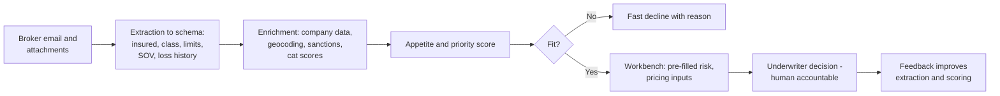
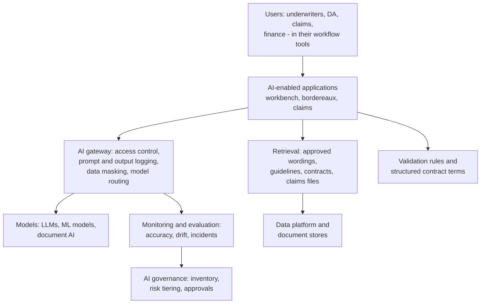
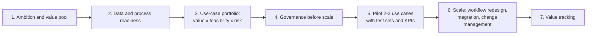

# Module 09 – AI in the London Market

| | |
|---|---|
| **Level** | Advanced |
| **Path phase** | Phase 2–3; your recommended primary spike ([Module 18 §3](18-World-Class-Consultant-Path.md)) |
| **Time** | 5 hours reading; ongoing hands-on practice |
| **Prerequisites** | Modules 04–08 |
| **You will be able to** | Separate AI value from hype in London; explain how modern AI works in business terms; map use cases across the lifecycle; design and evaluate an AI solution; set up governance consistent with UK regulation and the LMA toolkit; advise on AI as an insured risk; build a business case and an AI programme |

---

## 1. Reality check – where the market is in 2026

| Evidence | Tag |
|---|---|
| **LMA survey on AI risk management** (April 2026): 39 responses covering over 60% of market stamp capacity; 93% have an AI governance framework in place (72%) or in development (21%). Market described as at an **early stage**; general AI assistants drive most current use. Use cases mentioned include marine sanctions tracking, wording analytics for slip-level exclusions, and risk reporting linked to external data | [likely] |
| **LMA AI Adoption Toolkit** with Barnett Waddingham (23 April 2026): principles-based; start with lower-risk use cases; embed controls from the outset; scale gradually | [likely] |
| **Lloyd's 2026–2030 strategy**: AI should strengthen human decision-making, not replace it; Lloyd's will define data, technology and AI strategies | [likely] |
| **Syndicate 2479** (AIG-backed, managed by Talbot) began underwriting 1 January 2026, reportedly using AI agents to assess diversification and appetite fit | [likely] |
| **PRA 2026 priorities** highlight insurers' increasing use of AI | [likely] |

**Advisor view [likely]:** most London firms have moved past experiments but few have AI at scale in core workflows. The binding constraint is **data and workflow**, not model capability. Firms that win will combine AI with data standards, clean master data, redesigned processes and governance.

---

## 2. How modern AI works – what a consultant must understand

You do not need to be a data scientist. You do need to explain these ideas clearly to executives.

| Concept | Plain explanation | Why it matters in London |
|---|---|---|
| **Machine learning (ML)** | Models learn patterns from historical data to predict outcomes | Works where structured history exists (claims severity, propensity to bind); limited for rare, complex risks |
| **Large language model (LLM)** | A model trained on very large amounts of text that can read, summarise, compare, extract and draft text | London's work is document-heavy: submissions, MRCs, wordings, claims files |
| **Context window** | How much text the model can read at once | Long submissions and wordings may need splitting or retrieval |
| **Hallucination** | The model produces confident but wrong content | Unacceptable for coverage, pricing or reserving without checks |
| **Retrieval-augmented generation (RAG)** | The model answers using documents retrieved from a controlled library (e.g., wordings, guidelines) and cites them | Grounds answers in the firm's own approved sources |
| **Structured extraction** | Model fills a defined schema (fields) from documents | Turns submissions and bordereaux into data |
| **Agents** | AI that plans and carries out multi-step tasks using tools, with approval points | Submission-to-quote, exception handling – needs strong controls |
| **Evaluation** | Measuring accuracy on a test set of real examples | The difference between a demo and a production system |
| **Fine-tuning vs prompting** | Adjusting a model with extra training vs instructing it | Most London use cases succeed with good prompting, retrieval and validation rather than fine-tuning **[likely]** |

---

## 3. Use-case map across the lifecycle

Maturity: **Now** = in production at several London firms; **Emerging** = pilots and early production; **Future** = limited evidence. Judgements are **[likely]** unless noted.

| Stage | Use case | Value lever | Maturity | Risk tier |
|---|---|---|---|---|
| Broking | Submission pack creation; market selection support | Broker productivity | Now / Emerging | Low–Medium |
| Intake | Extract data from emails, SOVs, loss runs | Remove manual keying | Now | Low |
| Triage | Score appetite fit and priority; route to underwriter | Selection; hit ratio | Now / Emerging | Medium |
| Underwriting assistant | Summarise risk; compare to guidelines; draft referral notes | Underwriter capacity | Emerging | Medium |
| Pricing | ML factors; external data enrichment | Rate adequacy | Now (data-rich classes) | Medium–High |
| Wording | Compare MRC to standards; flag missing or changed clauses | Contract certainty | Now / Emerging | Medium |
| Follow decisions | Data-driven follow lines | Low-cost capacity | Emerging | High |
| Exposure | Geocoding; property attributes from imagery; clash detection | Cat capital, pricing | Now | Medium |
| Sanctions | Screen parties, vessels, voyages; AIS tracking | Avoid breaches | Now | Medium–High |
| Delegated authority | Map and validate bordereaux; detect breaches; coverholder analytics | Cost; exposure speed | Now / Emerging | Low–Medium |
| Accounting | Cash matching; break classification; late-payment prediction | Aged debt; ops cost | Emerging | Low |
| Claims FNOL and triage | Extract notices; classify complexity; route | Speed | Now | Medium |
| Claims file review | Summarise reports; draft reserve rationale; coverage checklist | Handler productivity; reserve consistency | Emerging | Medium |
| Leakage and fraud | Detect anomalies, duplicates, missed recoveries; spot AI-generated documents | Loss ratio | Emerging | Medium–High |
| Reinsurance | Match claims to treaties; check cessions | Recoveries | Emerging | Low–Medium |
| Actuarial | Data preparation; anomaly detection; narrative drafting | Productivity | Emerging | Medium |
| Regulatory reporting | Draft narratives; lineage checks | Reporting cost | Emerging / Future | Medium |
| Agentic workflows | Submission-to-quote; bordereaux exception agent | Step change in cost per transaction | Emerging / Future | High |

---

## 4. Deep dives

### 4.1 Submission intake and triage

| Aspect | Detail |
|---|---|
| **Value** | Underwriters review more of the right risks; faster declines; quicker quotes |
| **Measures** | Field-level extraction accuracy; time to first review; quote turnaround; hit ratio on high-score risks; adoption |
| **Pitfalls** | Weak accuracy on complex SOVs; scores trained only on past acceptance (copying past bias); no feedback loop |
| **Design tip** | Train or tune scoring on **profitability**, not just on past bind decisions |

### 4.2 Wording analytics and contract certainty

- Compare each MRC and wording against approved standards and mandatory clauses (sanctions, state-backed cyber exclusions, communicable disease, war).
- Flag missing, changed or unusual clauses before binding; explain the difference in plain English.
- **Why it matters:** the Russia aircraft litigation shows how much money depends on precise wording.
- **Guardrails:** evaluate on a test set of real wordings reviewed by lawyers; show the clause text, not just the AI's summary; underwriter decides.

### 4.3 Bordereaux processing

- AI proposes mappings from each coverholder's layout to the standard model; humans confirm once; mappings are reused.
- Validation rules check every row against structured binder terms ([Module 05 §7](05-Intermediate-Delegated-Authority.md)).
- AI drafts queries to coverholders for exceptions and classifies exception causes.
- **Measures:** mapping accuracy; exceptions per 1,000 rows; days from receipt to validated data; effort per bordereau.

### 4.4 Claims file summarisation and triage

- Structured summary of long files: facts, coverage issues, reserve drivers, next actions, deadlines.
- Triage by complexity (aligned to the Lloyd's Claims Lead Arrangements thresholds for complex claims).
- **Guardrail:** reserve and coverage decisions stay with handlers; AI output logged and reviewable.

### 4.5 Exposure and geospatial

- Improve geocoding of SOVs and bordereaux; extract building attributes from aerial imagery; detect clashes (same location on several policies).
- After catastrophes, compare imagery to exposures to estimate losses quickly.
- **Value:** better cat model inputs → better pricing and possibly lower capital uncertainty.

### 4.6 Marine sanctions and voyage monitoring

- Combine vessel tracking (AIS), ownership data and sanctions lists to flag vessels with suspicious behaviour (signal gaps, ship-to-ship transfers, port calls in sanctioned areas).
- Mentioned as an emerging use case in the LMA survey **[likely]**.

### 4.7 Agentic and algorithmic underwriting

- An agent performs steps (extract, enrich, check appetite, propose line) and stops at approval gates.
- Suitable first for follow business, small risks and unchanged renewals.
- **Risks:** correlated errors across many risks; adverse selection in a soft market; accountability under SM&CR; Lloyd's scrutiny of plans.

---

## 5. How to evaluate an AI solution (the skill most consultants lack)

### 5.1 Build a test set

| Step | Detail |
|---|---|
| Collect real examples | e.g., 200 submissions, 50 bordereaux, 100 claims files (anonymised where needed) |
| Create the "gold standard" | Experts record the correct answers (fields, classifications, flags) |
| Cover the hard cases | Different brokers, layouts, languages, classes, poor scans |
| Keep it separate | Do not tune the system on the test set |

### 5.2 Measures

| Measure | Meaning | Example |
|---|---|---|
| **Field-level accuracy** | % of fields extracted correctly | 96% of TIV values correct |
| **Precision** | Of the items flagged, how many were right | 80% of sanctions alerts were genuine concerns |
| **Recall** | Of the true items, how many were flagged | 99% of true sanctions matches were caught |
| **Straight-through rate** | % processed with no human change | 70% of bordereaux rows pass validation |
| **Human correction rate** | % of AI outputs changed by users | 12% of claim summaries edited |
| **Time saved** | Before vs after | 40 → 15 minutes per submission |

**Trade-off example – sanctions screening:** high **recall** matters most (missing a sanctioned party is serious), so accept lower precision (more false alerts) and manage the review workload. For submission triage, balance both – too many false declines lose good business.

### 5.3 Production readiness checklist

- Accuracy above agreed threshold on the test set, by segment (not just on average).
- Clear human review points and override logging.
- Monitoring of accuracy and drift after go-live.
- Security, data residency and confidentiality controls agreed.
- Fallback process if the AI service is unavailable (operational resilience).
- Owner and accountable senior manager named.

---

## 6. Reference architecture for AI in a carrier

**Design principles:** AI inside the workflow (not a separate chatbot); controlled retrieval from approved sources; validation rules around AI outputs; full logging; model choice can change without rebuilding applications.

---

## 7. AI as a risk to insure

| Theme | What is happening | Tag |
|---|---|---|
| **Affirmative AI liability** | Lloyd's-backed products covering AI model errors, e.g., Armilla AI (limits reported up to $25m) and Testudo (generative AI liability, launched January 2026) | [likely] |
| **Silent AI** | Existing PI/E&O, D&O, cyber, product liability and crime policies may respond to AI-related losses never priced – like "silent cyber" a decade ago | [likely] |
| **Exclusions** | Some markets have introduced generative AI exclusions; London wordings under review | [guessing] on market-wide adoption |
| **Aggregation** | Many insureds relying on the same model or vendor → correlated losses | [likely] |
| **Deepfake fraud** | AI-generated voice/video used in payment fraud; also used in fraudulent claims | [certain] as a phenomenon |
| **D&O "AI washing"** | Claims against companies overstating AI capabilities | [likely] |

**Silent AI exposure review – method:**
1. Inventory wordings across classes; identify where AI-related losses could trigger cover.
2. Map insureds' AI use (sector, dependency on specific vendors/models).
3. Build scenarios (e.g., a widely used model produces faulty outputs for 30 days).
4. Estimate exposure; decide: exclude, affirm with sub-limits and pricing, or accept.

---

## 8. Governance and regulation

### 8.1 What applies

| Area | Requirement |
|---|---|
| **UK approach** | No single AI law; regulators apply existing rules **[certain]** |
| **PRA** | Model risk, governance, operational resilience and third-party risk apply to AI; SS1/23 (model risk) formally applies to banks but insurers often use it as a benchmark **[likely]**; internal model governance where AI affects capital |
| **FCA** | Consumer Duty and fair value for retail/SME; PS25/21 removes larger commercial customers from Consumer Duty, ICOBS and PROD **[certain]**; financial crime and SM&CR still apply |
| **SM&CR** | Named senior manager accountable for AI risks in their area |
| **UK GDPR / DPA 2018** | Lawful basis, minimisation, rights around automated decisions with significant effects on individuals |
| **EU AI Act** (Lloyd's Europe, EU operations) | AI for risk assessment and pricing in life and health insurance for individuals is high-risk; most commercial P&C uses are not. Under the Digital Omnibus provisional agreement of 7 May 2026, high-risk (Annex III) obligations move to **2 December 2027** and Annex I (embedded) to 2 August 2028; confirm formal adoption **[likely]** |
| **LMA toolkit** | Principles including governance and accountability, risk tiering, data protection, security and intellectual property **[likely]** |
| **Confidentiality** | Broker submissions and client data are confidential; contractual and technical controls needed for external models |

### 8.2 Minimum viable governance framework

| Element | Description |
|---|---|
| **AI policy** | Board-approved; acceptable use, roles, risk appetite |
| **Use-case inventory** | Owner, purpose, data, model, vendor, risk tier for every use case |
| **Risk tiering** | Low (internal productivity) → Medium (decision support) → High (automated decisions affecting customers, capital or reporting) |
| **Controls by tier** | Low: training, logging. Medium: test set evaluation, human review, monitoring. High: independent validation, senior approval, ongoing audit |
| **Human-in-the-loop** | Humans accountable for binding, reserving and claims decisions |
| **Third-party management** | Vendor due diligence; data residency; exit plans |
| **Training** | AI literacy for staff and board |

### 8.3 Risk tiering examples

| Use case | Tier | Why |
|---|---|---|
| Drafting internal emails and meeting notes | Low | No decision impact |
| Bordereaux field mapping with human confirmation | Low–Medium | Validated by rules and humans |
| Submission triage scores | Medium | Influences which risks are reviewed |
| Claims summaries supporting reserving | Medium | Influences financial estimates |
| Automated follow-line decisions | High | Binds capital without individual human review |
| Pricing factors used in capital model | High | Affects capital and plan |

---

## 9. Building an AI programme

### 9.1 Prioritisation example

| Use case | Value | Feasibility | Risk | Priority |
|---|---|---|---|---|
| Property SOV extraction | High | High | Low | 1 |
| Bordereaux mapping and validation | High | High | Low | 1 |
| Claims file summarisation | Medium | High | Medium | 2 |
| Wording comparison | High | Medium | Medium | 2 |
| Triage scoring | High | Medium | Medium | 2 |
| Agentic follow underwriting | High | Low | High | 3 |
| Automated claims settlement | Medium | Low | High | 3 |

### 9.2 Business case – illustrative **[guessing]**; replace with client data

| Driver | Assumption | Value |
|---|---|---|
| 60 underwriting assistants | 50% of time on data entry | 30 FTE of data entry |
| Extraction removes half of that | 50% | 15 FTE released |
| Cost per FTE | £75k | **£1.1m a year capacity** |
| Faster quotes on preferred risks | +2 points hit ratio on top-quartile submissions | Growth/loss ratio upside – show separately |
| Costs | Platform, integration, change, run | £0.6–0.9m year 1; £0.3m run |

Present **cost savings** and **underwriting benefits** separately – CFOs discount the second.

### 9.3 AI operating model

| Model | Description | When it fits |
|---|---|---|
| **Central AI centre of excellence** | Central team builds and governs | Early stage; small firms |
| **Hub and spoke** | Central platform and governance; business teams own use cases | Most London managing agents at scale **[likely]** |
| **Fully federated** | Each business builds its own | Large groups with mature data capability |

Roles needed: AI product owners in the business; data and ML engineers; evaluation specialists; risk and compliance partners; change managers.

### 9.4 Adoption – the overlooked success factor

- Involve underwriters and handlers in designing outputs.
- Show the AI's sources and confidence; never hide how it reached a result.
- Measure and publish time saved and quality improvements.
- Change incentives and procedures – otherwise people work around new tools.

### 9.5 Maturity model

| Level | Description |
|---|---|
| 1. Ad hoc | Individuals use general AI tools; no policy |
| 2. Governed experiments | Policy; inventory; a few pilots |
| 3. Embedded use cases | Several use cases in production, integrated, value tracked |
| 4. AI-enabled operating model | Processes redesigned around AI; data foundations and standards in place |
| 5. AI-native | Agentic workflows with oversight across the lifecycle |

**[likely]** Most London managing agents sit at levels 2–3 in late 2026.

---

## 10. Failure modes

| Failure | Prevention |
|---|---|
| Pilot purgatory | Fund integration and workflow change with the pilot; set scale criteria up front |
| Garbage in | Fix master data and validation; measure data quality |
| No baseline | Measure current performance before the pilot |
| Shadow AI | Provide approved tools; train staff; monitor |
| Over-automation in a soft market | Keep human decisions for binding; monitor rate adequacy |
| Ignoring brokers | Work with brokers on data standards and shared benefits |
| No accountability | Named owner and senior manager for each use case |

---

## 11. Mini case – AI bordereaux pilot

**Situation:** a managing agent with 120 coverholders wants to "use AI for bordereaux".

| Step | Action |
|---|---|
| 1 | Baseline: effort per bordereau, days to validated data, exceptions per 1,000 rows |
| 2 | Build structured binder terms for the top 30 coverholders (prerequisite) |
| 3 | Test set: 3 months of bordereaux from 15 coverholders with expert-validated outputs |
| 4 | Pilot AI mapping and validation; measure accuracy and straight-through rate by coverholder |
| 5 | Scale criteria: ≥ 98% mapping accuracy on key fields; ≥ 60% straight-through; exception workflow live |
| 6 | Governance: Low–Medium tier; human confirmation of new mappings; monthly accuracy report |

**Expected outcome [guessing]:** 40–60% less effort on mapping and validation; validated exposure data weeks earlier.

---

## 12. Partner's lens

*Top-tier strategy consulting methods applied to this chapter.*

1. **Start from the value pool, not the technology.** A partner sizes where AI can move the P&L – expense ratio, selection, leakage, recoveries – before discussing models. "Where is the £10m?" comes before "Which LLM?".
2. **Workflow beats model.** The same model gives very different value depending on whether it is embedded in the underwriter's workbench or sits in a separate chat window. Redesign the workflow; the model is replaceable.
3. **Evaluation is credibility.** Bring test-set results by segment, not demos. Executives and regulators trust numbers like "97% field accuracy on 2,000 real SOV rows".
4. **Governance is an accelerator.** Firms with clear risk tiering approve low-risk use cases in weeks. Position governance as the way to move faster safely – consistent with the LMA toolkit and Lloyd's stance.
5. **Bring the other side of the coin.** Boards also need to understand AI as an insured risk (silent AI, aggregation, new products). Advising on both the operational and underwriting sides of AI is rare – and differentiating.

---

## 13. Build your own AI skills

| Week | Exercise | Skill |
|---|---|---|
| 1 | Use an LLM to explain glossary terms; check against [Module 12](12-Glossary.md) | Prompting, verification |
| 2 | Write a fictional MRC; extract Risk Details into a schema; measure field accuracy | Extraction and evaluation |
| 3 | Create 10 fictional bordereaux with different layouts; map them to a standard; record failure patterns | Mapping, error analysis |
| 4 | Build a small RAG assistant over public Lloyd's/LMA guidance; test with 20 questions; score answers | RAG, evaluation design |
| 5 | Draft an AI governance pack for a fictional managing agent (section 8.2) | Governance design |
| 6 | Write a business case with assumptions and sensitivities (section 9.2) | Value case design |
| 7 | Design an agentic submission workflow with approval gates and controls | Agent design |

**Rule:** never put real client data into public AI tools; use fictional or public data for practice.

---

## 14. Key takeaways

1. London AI adoption is real but early; data and workflow are the constraints.
2. LLMs fit London's document-heavy work; hallucination requires grounding, validation and human decisions.
3. Highest current value: intake, wording checks, bordereaux, claims summarisation, exposure, sanctions.
4. Evaluate with test sets and segment-level metrics; precision and recall trade-offs depend on the use case.
5. Governance by risk tier enables speed; humans stay accountable for binding, reserving and claims decisions.
6. AI is also a new insured risk – silent AI, aggregation and affirmative products.

---

## 15. Check your understanding

| # | Question | Answer |
|---|---|---|
| 1 | What is RAG and why use it? | Retrieval-augmented generation – answers grounded in an approved document library, reducing hallucination and enabling citations. |
| 2 | For sanctions screening, which matters more: precision or recall? | Recall – missing a true match is serious; manage the extra false alerts. |
| 3 | Name three items in a production readiness checklist. | Test-set accuracy by segment; human review and override logging; monitoring; security; fallback; named owner. |
| 4 | Which tier is automated follow-line decision-making? | High. |
| 5 | What is silent AI? | Unpriced AI-related exposure in existing policies not designed for it. |

---

## Master Guide integration: AI governance a client will expect you to defend

### Governance model – eight elements

1. Board and senior management accountability, with a named executive owner.
2. An AI inventory: models, vendors, use cases, owners, data, risk tier, decision impact, lifecycle status.
3. Risk tiering by customer impact, materiality, autonomy, data sensitivity, legal exposure and **whether the outcome can be reversed**.
4. AI risk management joined to existing risk, conduct, outsourcing, privacy, cyber, resilience and product governance (no parallel universe).
5. An approved lifecycle: build, validate, deploy, change, monitor, incident, retire.
6. Human oversight with clear authority, competence, override and escalation.
7. Third-party and foundation-model due diligence, exit plan and concentration check.
8. Training and acceptable-use rules for underwriters, claims handlers, brokers and operations.

### Data and model controls

Lineage, lawful basis, minimisation, access, retention, cross-border transfer, quality, representative samples, label checks, bias testing, drift monitoring, robustness, uncertainty, explainability, benchmarks, reproducibility.

**Extra for LLMs:** retrieval freshness, citation coverage, prompt-injection defence, output constraints, approved source lists, hallucination tests, leakage tests, safe failure behaviour.

### "Human in the loop" is not a control by itself

A review is a real control only if the reviewer has **competence, time, information, authority and the ability to challenge**. Someone who clicks "approve" under volume pressure is not oversight. Measure override rate, review time, defects that escape, approval quality, reviewer training and outcomes after the decision.

### Agent controls – ten rules

1. Tool allowlists and least-privilege identity.
2. Separate read, draft and commit permissions.
3. No payment, bind, decline or policy change without an approval gate.
4. An explicit workflow state machine with transition checks.
5. Idempotency keys, transaction logs, retries and compensating actions.
6. Rate limits, budgets, timeouts and circuit breakers.
7. Sandboxed handling of documents and code; treat attached content as untrusted.
8. Prompt and tool-call logs with sensitive-data controls.
9. Kill switch, rollback, incident response and a deterministic fallback.
10. End-to-end evaluation and monitoring by workflow segment.

### Evaluation scorecard

| Dimension | Measure | Example test |
|---|---|---|
| Extraction | Field-level precision and recall; exact match on critical fields | Extract period, limits, location, named insured, premium from test submissions |
| Grounding | Claims supported, citations correct, sources current | Every statement in a coverage summary traces to a clause and page |
| Reasoning support | Completeness and usefulness of the risk view | Underwriter compares AI pack with an expert pack |
| Workflow | Task completion, correct routing, safe stop, idempotency | Simulate a missing loss run, an out-of-authority limit, a duplicate submission |
| Decision quality | Acceptance, override, error, later loss outcomes | Compare triage suggestions with underwriter decisions and later claims |
| Fairness | Segment outcomes and proxy-variable tests where lawful | Compare errors and adverse outcomes by segment |
| Robustness | Ambiguous, corrupted, adversarial, out-of-range inputs | Prompt injection hidden in an attached PDF; inconsistent values across schedules |
| Security and privacy | Leakage, access, vendor controls | Check isolation, retention, external model access, logs |
| Productivity | Cycle time and minutes saved **after** review and rework | Net minutes saved per submission |
| Business outcome | Risk-adjusted economics and customer outcomes | Quote quality, loss performance, retention, claims service |

### EU AI Act – do not over-generalise

The Act treats some AI used for **risk assessment and pricing in life and health insurance** as high-risk **[certain]**. It does not make every insurance product, or all property and casualty underwriting, high-risk. For a cross-border insurer or MGA, map each use case, the provider or deployer role, product, customer, territory and the effective dates (see Module 13 for the 2026 timing change) with legal and compliance. Classification is a legal decision, not the AI team's assumption.

### FCA position (October 2026)

The FCA's good-practice paper adds no new rules: existing requirements apply when firms use AI. Themes: safety, security and robustness; fairness; transparency and explainability; accountability and governance; contestability and redress **[certain]**.

## 16. Sources

- [LMA – AI Adoption Toolkit launch](https://lmalloyds.com/lma-launches-ai-adoption-toolkit-to-support-governance-led-implementation-across-the-lloyds-market/)
- [LMA – Survey on AI risk management (PDF)](https://lmalloyds.com/wp-content/uploads/2026/04/LMA-Survey-on-AI-Risk-Management.pdf)
- [Barnett Waddingham – practical toolkit for AI adoption in the Lloyd's market](https://www.barnett-waddingham.co.uk/comment-insight/blog/practical-toolkit-for-ai-adoption-in-the-lloyds-market/)
- [Browne Jacobson – LMA's AI governance blueprint](https://www.brownejacobson.com/insights/the-word-may-2026/lma-s-ai-governance-blueprint)
- [Skadden – Lloyd's new five-year strategy](https://www.skadden.com/insights/publications/2026/04/lloyds-of-london-new-five-year-strategy)
- [AI Media House – AIG's AI test runs through Lloyd's](https://aimmediahouse.com/banking/aigs-ai-test-runs-through-lloyds)
- [Clifford Chance – PRA 2026 priorities](https://www.cliffordchance.com/insights/resources/blogs/insurance-insights/2026/01/the-pras-2026-insurance-supervision-priorities.html)
