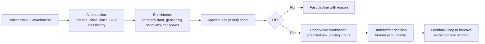
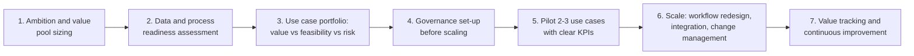

# Module 09 – AI in the London Market

**Level:** Advanced | **Goal:** Separate real AI value from hype, know the use cases across the lifecycle, understand AI as both a tool and a new risk to insure, and be able to design a governed AI programme for a London carrier or broker.

---

## 1. Reality check – where the market actually is (2026)

| Evidence | Source and tag |
|---|---|
| LMA survey on AI risk management (April 2026): 39 responses representing over 60% of market stamp capacity; 93% have an AI governance framework in place (72%) or in development (21%). Market described as still at an **early stage**; general GenAI tools (e.g., Microsoft Copilot, ChatGPT-type tools) drive most current use. Use cases mentioned include marine sanctions tracking, wording analytics for slip-level exclusions and risk reporting linked to external data. | LMA survey and trade press **[likely]** |
| LMA and Barnett Waddingham launched an **AI Adoption Toolkit** (23 April 2026): principles-based, start with lower-risk use cases, embed controls from the outset, scale gradually. | LMA **[likely]** |
| Lloyd's 2026–2030 strategy positions AI to **strengthen human decision-making rather than replace it** and commits to defining data, technology and AI strategies. | Lloyd's strategy, Skadden summary **[likely]** |
| AIG-backed **Syndicate 2479**, managed by Talbot, began underwriting from 1 January 2026; reports say it uses large language model agents to assess diversification and fit with underwriting appetite. | Trade press **[likely]** |
| PRA 2026 priorities letter highlights increased AI use by insurers. | Law firm summaries **[likely]** |

**Advisor view [likely]:** Most London firms are past experimentation but not yet at scale. The biggest blocker is **unstructured and inconsistent data**, not model capability. Firms that win will combine AI with data standards (CDR), clean master data and redesigned workflows.

---

## 2. Types of AI you will discuss

| Type | What it does | London examples |
|---|---|---|
| **Predictive machine learning** | Learns patterns from structured historical data to predict outcomes. | Claims severity, propensity to bind, lapse, fraud scores, pricing factors. |
| **Document AI / extraction** | Turns PDFs, emails and spreadsheets into structured data. | Submissions, SOVs, bordereaux, loss runs, MRCs. |
| **Generative AI (LLMs)** | Reads, summarises, compares and drafts text; answers questions over documents. | Wording comparison, claims file summaries, underwriting notes, broker emails. |
| **Retrieval-augmented generation (RAG)** | LLM answers using a controlled document set (e.g., underwriting guidelines, wordings library). | "Is this risk within appetite?" assistant; clause library Q&A. |
| **Agentic AI** | AI that plans and performs multi-step tasks using tools (e.g., extract → check sanctions → price → draft quote) with human approval points. | Submission-to-quote agents; bordereaux exception handling; follow-line decisions. |
| **Geospatial and computer vision** | Analyses satellite, aerial, vessel tracking and photo data. | Property risk features, post-cat damage assessment, vessel AIS tracking for sanctions/war zones. |

---

## 3. Use-case map across the lifecycle

Maturity: **Now** = proven and in production in several London firms; **Emerging** = pilots and early production; **Future** = limited evidence yet. Tags reflect my judgement **[likely]** unless noted.

| Lifecycle stage | Use case | Value lever | Maturity |
|---|---|---|---|
| **Distribution / broking** | Submission pack creation, market selection support, client data cleansing | Broker productivity, placement speed | Now / Emerging |
| **Submission intake** | Extract data from emails, SOVs, loss runs; create structured submission | Reduce manual keying; faster quotes | Now |
| **Triage** | Score submissions for appetite fit and likely profitability; route to right underwriter | Underwriter focus on best risks; higher hit ratio | Now / Emerging |
| **Underwriting assistant** | Summarise risk, compare to guidelines, draft referral notes, highlight missing info | Underwriter capacity | Emerging |
| **Pricing** | ML factors for frequency/severity; external data enrichment | Rate adequacy, loss ratio | Now (data-rich classes) |
| **Wording and contract certainty** | Compare MRC to standard wordings; flag non-standard clauses, missing exclusions (e.g., cyber, sanctions, war) | Contract certainty, fewer disputes | Now / Emerging |
| **Follow decisions** | Data-driven follow lines; algorithmic follow | Low-cost capacity deployment | Emerging |
| **Exposure management** | Geocoding, clash detection, accumulations; AI-enriched property attributes | Better cat capital and pricing | Now |
| **Sanctions and compliance** | Screen parties, vessels, voyages; monitor AIS data | Avoid sanctions breaches | Now |
| **Delegated authority** | Map and validate bordereaux; flag authority breaches; coverholder performance analytics | Lower cost, faster exposure view | Now / Emerging |
| **Accounting and reconciliation** | Match cash to premium entries; classify breaks; predict late payment | Lower aged debt; smaller ops teams | Emerging |
| **Claims – FNOL and triage** | Extract claim notices, classify complexity, route | Faster response | Now |
| **Claims – file review** | Summarise expert reports and correspondence; draft reserve rationale; coverage checklist | Handler productivity; reserve quality | Emerging |
| **Claims – leakage and fraud** | Detect anomalies, duplicate payments, missed recoveries | Lower loss cost | Emerging |
| **Reinsurance** | Identify recoverable claims; check cessions vs treaties | Fewer missed recoveries | Emerging |
| **Reserving and actuarial** | Faster data preparation; anomaly detection; narrative drafting | Actuarial productivity | Emerging |
| **Regulatory reporting** | Draft narrative reports; data lineage checks | Lower reporting cost | Future / Emerging |
| **Agentic end-to-end** | Submission-to-quote with human approval; bordereaux exception agent | Step change in cost per transaction | Future / Emerging |

---

## 4. Five deep dives

### 4.1 Submission intake and triage

- **Value:** London underwriters often see many more submissions than they can review properly **[likely]**. Faster declines and better prioritisation improve both cost and loss ratio.
- **Success measures:** extraction accuracy by field, time from receipt to first review, quote turnaround, hit ratio on high-score risks, underwriter adoption.
- **Pitfalls:** poor accuracy on complex SOVs; underwriters not trusting scores; no feedback loop.

### 4.2 Wording analytics and contract certainty

- Compare each MRC against the firm's standard wordings and mandatory clauses (e.g., state-backed cyber exclusions, sanctions clauses, communicable disease exclusions).
- Flag missing, changed or unusual clauses for the underwriter before binding.
- **Why it matters:** the Russia aircraft litigation shows how much money depends on the exact cover and exclusions.
- **Pitfalls:** LLMs can miss subtle changes; must be evaluated against a test set of real wordings with lawyers.

### 4.3 Bordereaux processing

- AI maps each coverholder's file layout to the standard (Lloyd's reporting standards / future DA CDR).
- Validation rules check limits, territories, classes and dates against the BAA.
- Exceptions go to a workflow; AI drafts the query to the coverholder.
- **Value:** large reduction in manual mapping effort; faster exposure updates.

### 4.4 Claims file summarisation and triage

- Summarise long claims files (adjuster reports, legal letters) into a structured view: facts, coverage issues, reserve drivers, next actions.
- Triage new claims by complexity and route.
- **Guardrail:** reserve and coverage decisions remain with the handler; AI output is advisory and logged.

### 4.5 Agentic and algorithmic underwriting

- An agent performs steps (extract, enrich, check appetite, propose line) and stops at approval gates.
- Suitable first for **follow** business, small risks, renewals with no material change.
- **Risks:** model error replicated across many risks at once (correlated mistakes); soft-market adverse selection; accountability under SM&CR; Lloyd's oversight of new syndicates and plans.

---

## 5. AI as a risk to insure

| Theme | What is happening | Tag |
|---|---|---|
| **Affirmative AI liability products** | Lloyd's-backed products cover losses from AI model errors and failures, e.g., Armilla AI (limits reported up to $25m) and Testudo (generative AI liability, launched Jan 2026). | [likely] |
| **Silent AI exposure** | Existing PI/E&O, D&O, cyber, product liability and crime policies may pay AI-related losses that were never priced. Similar to "silent cyber" a decade ago. | [likely] |
| **Exclusions** | Some US liability forms introduced generative AI exclusions; London wordings are being reviewed. | [guessing] on specific market-wide adoption – check LMA clause library. |
| **Aggregation** | Many insureds using the same foundation model or AI vendor create correlated losses. | [likely] |
| **Deepfake fraud** | AI-generated voice/video used in payment fraud – hits crime and cyber policies; also a claims fraud risk. | [certain] as a phenomenon |
| **D&O** | "AI washing" – claims against companies overstating AI capabilities. | [likely] |

**Client question you should be ready to answer:** "How do we know how much AI risk we are already carrying?" Answer: run a **silent AI exposure review** – wording review across classes, exposure mapping by insured AI use, scenario analysis for correlated AI failures, then decide on exclusion, affirmation or pricing.

---

## 6. Governance and regulation

### 6.1 What applies

| Area | Requirement |
|---|---|
| **UK approach** | No single AI law; regulators apply existing rules (principles-based). **[certain]** |
| **PRA** | Model risk, governance, operational resilience and third-party risk expectations apply to AI. SS1/23 (model risk management) formally applies to banks, but insurers often use it as a benchmark **[likely]**. Internal model governance applies where AI affects capital. |
| **FCA** | Consumer Duty and fair value for retail/SME customers; PS25/21 removes larger commercial customers from Consumer Duty, ICOBS and PROD **[certain]**; but fair treatment, financial crime and SM&CR still apply. |
| **SM&CR** | A named senior manager must be accountable for AI risks in their area. |
| **UK GDPR / DPA 2018** | Lawful basis, data minimisation, rights around automated decision-making with significant effect on individuals – relevant for A&H, claims involving individuals, DA consumer business. |
| **EU AI Act** (for Lloyd's Europe and EU operations) | AI used for risk assessment and pricing in **life and health insurance for individuals** is classed as high-risk; most commercial P&C use is not. Obligations for general-purpose AI models apply from August 2025. Timing of high-risk obligations has been subject to EU simplification proposals – check the latest position **[likely]**. |
| **Lloyd's / LMA** | LMA AI Adoption Toolkit principles include governance and accountability, risk tiering, data protection, and security and intellectual property **[likely]**. Lloyd's oversight will expect AI use to be governed within existing principles. |
| **Confidentiality** | Broker submissions and client data are confidential; using them to train or prompt external models needs contractual and technical controls. |

### 6.2 AI governance framework (minimum viable)

| Element | Description |
|---|---|
| **AI policy** | Approved by board; defines acceptable use, roles and risk appetite. |
| **Use case inventory** | Every AI use case registered with owner, purpose, data, model, vendor, risk tier. |
| **Risk tiering** | Low (internal productivity) → Medium (decision support) → High (automated decision affecting customers, capital or financial reporting). Controls scale with tier. |
| **Human-in-the-loop design** | Clear approval points; humans accountable for binding, reserving and claims decisions. |
| **Evaluation and testing** | Test sets of real documents; accuracy thresholds; bias tests where individuals are affected; regular re-testing. |
| **Monitoring** | Drift, error rates, overrides, incidents. |
| **Third-party management** | Due diligence on AI vendors; data residency; exit plans. |
| **Training** | AI literacy for underwriters, claims, operations, board. Lloyd's strategy refers to building an "AI-trained" workforce **[likely]**. |

---

## 7. Building an AI programme for a client – a practical approach

### 7.1 Prioritisation matrix (example)

| Use case | Value | Feasibility | Risk | Priority |
|---|---|---|---|---|
| Submission extraction (property SOV) | High | High | Low | 1 |
| Bordereaux mapping | High | High | Low | 1 |
| Claims file summarisation | Medium | High | Medium | 2 |
| Wording comparison | High | Medium | Medium | 2 |
| Triage scoring | High | Medium | Medium | 2 |
| Agentic follow underwriting | High | Low | High | 3 |
| Automated claims settlement | Medium | Low | High | 3 |

### 7.2 Business case logic (illustrative – **[guessing]**, replace with client data)

For a managing agent with 60 underwriting assistants keying submission data:

- Time spent on data entry: about 50% of role.
- Extraction automation removes about half of that effort.
- Capacity released ≈ 60 × 50% × 50% = **15 FTE equivalent**.
- Plus faster quotes → higher hit ratio on preferred risks (often the larger prize, but harder to prove).

Always present **cost savings** and **loss ratio / growth benefits** separately; CFOs discount the second.

### 7.3 AI maturity model

| Level | Description |
|---|---|
| 1. Ad hoc | Individuals use general AI tools; no policy. |
| 2. Governed experiments | Policy in place; inventory; a few pilots. |
| 3. Embedded use cases | Several use cases in production, integrated into workflows, value tracked. |
| 4. AI-enabled operating model | Processes redesigned around AI; data platform and standards in place; roles changed. |
| 5. AI-native | Agentic workflows with human oversight across the lifecycle; continuous learning. |

**[likely]** Most London managing agents are at level 2–3 in late 2026.

---

## 8. Failure modes to warn clients about

1. **Pilot purgatory** – many proofs of concept, none scaled, because workflow and integration were not funded.
2. **Garbage in** – AI on top of bad data creates confident errors.
3. **No baseline** – value cannot be shown because current performance was never measured.
4. **Shadow AI** – staff paste confidential broker data into public tools.
5. **Over-automation in a soft market** – faster binding of underpriced risks.
6. **Ignoring the broker** – carrier-side AI cannot fix data the broker never captured; work with brokers on standards.
7. **No accountability** – unclear who owns an AI-supported decision.

---

## 9. Build your own AI skills (for you as a consultant)

| Week | Exercise | Skill gained |
|---|---|---|
| 1 | Use an LLM to explain each glossary term back to you, then check against [module 12](12-Glossary.md). | Prompting, verification |
| 2 | Write a sample MRC (fictional) and ask an LLM to extract all Risk Details into a table. Measure accuracy field by field. | Extraction and evaluation |
| 3 | Create 10 fictional bordereaux with different layouts; ask an LLM to map them to a standard set of fields. Record failure patterns. | Data mapping, error analysis |
| 4 | Build a small RAG assistant over public Lloyd's / LMA guidance documents. Test with 20 questions. | RAG, evaluation design |
| 5 | Draft an AI governance one-pager for a fictional managing agent using the framework in section 6.2. | Governance design |
| 6 | Write a business case for one use case with explicit assumptions and sensitivity. | Value case design |

**Rule:** never put real client data into a public AI tool. Use fictional or public data for practice.
