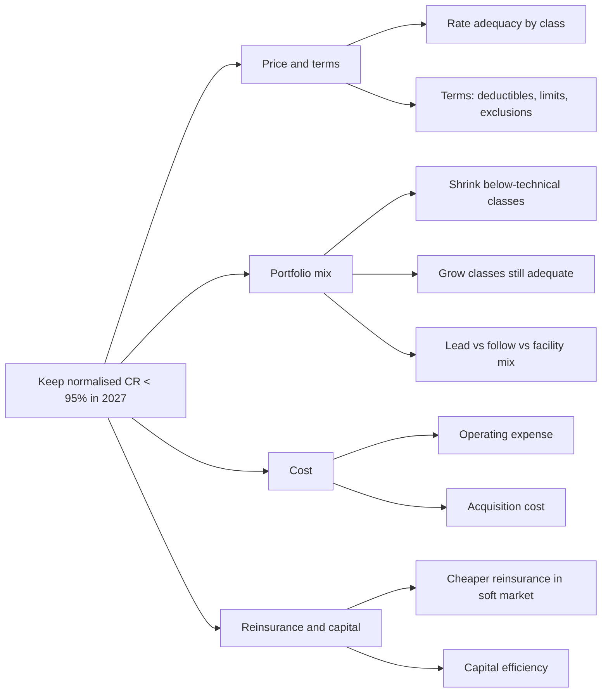

# Module 10 – Business Scenarios and Case Studies

| | |
|---|---|
| **Level** | All – the bridge from knowledge to consulting |
| **Path phase** | Phases 2–4 ([Module 18](18-World-Class-Consultant-Path.md)) |
| **Time** | 45–60 minutes per case |
| **Prerequisites** | Modules 01–09 (each case lists its main links) |
| **You will be able to** | Solve London market business problems the way a top-tier consulting team would: define the question, form a hypothesis, structure the problem, choose analyses, interpret findings, recommend, size value and anticipate objections |

---

## 1. How to use this chapter

Each case follows the same structure used in top-tier consulting work ([Module 11](11-Consulting-Playbook.md)):

1. **Situation** – facts and numbers.
2. **Key question** – precise, measurable, time-bound.
3. **Day-one hypothesis** – your best guess before analysis.
4. **Issue tree** – how to break the problem down.
5. **Market mechanics** – the London-specific knowledge you need.
6. **Analyses and illustrative findings**.
7. **Recommendation and value**.
8. **Risks and objections**.
9. **Questions to ask the client**.
10. **The trap** – the mistake most people make.

**Method:** read only the situation and key question. Spend 30 minutes writing your hypothesis, issue tree, analyses and recommendation. Then compare. Cases are fictional unless they describe a named real event; real events are tagged.

### Scoring rubric for your answers

| Criterion | 1 – weak | 3 – good | 5 – partner level |
|---|---|---|---|
| Problem definition | Restates topic | Clear question | Question tied to a decision and a deadline |
| Structure | List of ideas | MECE tree | MECE tree with the right first split |
| London fluency | Generic insurance | Correct terms | Uses market mechanics to shape the answer |
| Quantification | None | Some numbers | Value sized in ratio points and £m, with assumptions |
| Recommendation | Options only | One recommendation | Recommendation with phasing, owners, risks |
| Communication | Bottom-up | Answer stated | Pyramid: answer, three reasons, evidence |

---

## Case 1 – Restoring margin in a softening market

**Links:** Modules 01, 04, 07, 11

**Situation.** Syndicate A writes £900m GWP (£750m net earned). 2025 combined ratio 89%. Cat losses were light and reserve releases contributed 3 points. Risk-adjusted rates are falling about 6–7% a year across its main classes **[likely – market level]**. The CEO must submit the 2027 business plan (SBF) to Lloyd's.

**Key question.** How should Syndicate A shape its 2027 plan to protect a combined ratio below 95% on a normalised basis while keeping Lloyd's approval?

**Day-one hypothesis.** The underlying ratio is already about 95%; rate falls will push it above 97% in 2027 unless the syndicate shrinks under-priced classes, protects terms, and takes 1–2 points out of expenses.

**Issue tree.**

**Market mechanics.** Lloyd's approves the SBF and in 2026 is warning that rate adequacy for 2027 is under threat **[likely]**; the PRA is watching internal models that may overstate profitability **[likely]**. Plans with unrealistic loss ratios will be challenged.

**Analyses and illustrative findings.**

| Analysis | Finding |
|---|---|
| Combined ratio bridge | 89% headline → 95% normalised (cat +3, releases +3) |
| Rate adequacy by class | 3 of 8 classes below 95% of technical price |
| Channel split | Facility business 6 points worse than led business |
| Expense benchmark | Operating expense ratio 2 points above peer estimate |
| Reinsurance pricing | Cat reinsurance cheaper by about 10% vs 2025 **[guessing]** |

**Recommendation.**
1. Reduce the three under-priced classes by 25–40% in the 2027 plan.
2. Cap facility share; require lead-selection rights and risk-level data.
3. Hold terms: set minimum deductibles and exclusions by class.
4. Buy additional cat protection while cheap to release capital.
5. Launch a cost programme for 1.5 points over two years.

**Value.** About 3 points of normalised combined ratio by 2028 ≈ £22m a year on £750m NEP; plus capital released.

**Risks and objections.** Premium shrinkage worries the board and capital providers → present return on capital, not GWP. Brokers push back on facility caps → pre-wire with key brokers.

**Questions to ask.** "Which classes are below technical price today?" "How much of your 2025 result was cat luck and reserve releases?" "What does your plan assume for rate change in 2027?"

**The trap.** Recommending growth because headline results are strong.

---

## Case 2 – A coverholder stops reporting

**Links:** Modules 05, 06

**Situation.** A Florida coverholder writing homeowners' business for three syndicates (Syndicate B leads with 40%) has not sent risk bordereaux for three months. Last known GPI used: £38m of a £50m limit. Hurricane season starts in four weeks.

**Key question.** What must Syndicate B do in the next 30 days to protect its exposure position, and how should it prevent a repeat?

**Day-one hypothesis.** Exposure is understated by at least 20%; the coverholder may be in operational or financial difficulty; oversight is not risk-based.

**Market mechanics.** BAA terms set reporting deadlines and remedies; Lloyd's expects registration, oversight and coordinated audits where binders are shared **[likely]**; the lead managing agent coordinates.

**Analyses and illustrative findings.**

| Analysis | Finding |
|---|---|
| Exposure estimate | Trend suggests GPI now about £47m – near limit; coastal share rising |
| Remittance | Premium remittances also 60 days late |
| Oversight history | Coverholder rated "medium" – last audit 26 months ago |
| Portfolio scan | 6 other coverholders have bordereaux more than 45 days late |

**Recommendation.**
- **Immediate:** formal notice; data within 10 days; restrict new coastal business; inform exposure and reinsurance teams; check remittance and risk transfer terms.
- **Short term:** coordinated audit with the other two syndicates.
- **Structural:** automated bordereaux tracking; late data triggers higher risk tier; BAA renewal adds data and remittance requirements.

**Value.** Avoids unpriced cat exposure; reduces credit risk; oversight effort refocused on high-risk partners.

**Questions to ask.** "How many coverholders could be in this position today without you knowing?" "Are binder terms held as structured data?"

**The trap.** Treating it as an admin delay rather than an exposure and credit event.

---

## Case 3 – Hurricane: claims surge, capital and reinsurance

**Links:** Modules 06, 07

**Situation.** A major hurricane hits the US Gulf Coast. Syndicate C (property binders and open market property) estimates a £180m gross loss; after quota share and per-risk reinsurance, £130m falls to its catastrophe programme. Its cat XoL is £150m xs £40m with one reinstatement at 100%; annual premium £15m.

**Key question.** How should Syndicate C manage claims, recoveries, liquidity and its plan in the next 90 days?

**Day-one hypothesis.** The gross loss estimate is probably low because DA claims data lags; recoveries and reinstatement premiums are not yet fully modelled; DCA capacity is the main operational risk.

**Market mechanics.** Event coding; major loss reporting to Lloyd's **[likely]**; claims agreed by the lead (and second lead for complex claims) under the Lloyd's Claims Lead Arrangements; reinstatement premium on cat XoL.

**Illustrative calculation.** With £130m falling to the cat programme: recovery = £130m − £40m = £90m; reinstatement premium = £15m × 90/150 = **£9m**; net retained = £40m + £9m reinstatement.

**Recommendation.**
- Daily loss estimate updates; event-coded claims data model.
- Pre-agreed DCA surge capacity; triage simple vs complex claims.
- Reinsurance recovery tracking by event; accrue reinstatement premiums.
- Liquidity plan; communicate early with Lloyd's and capital providers.
- Review the 2027 plan: pricing, aggregates and reinsurance purchase.

**Questions to ask.** "How quickly can you produce a reliable gross and net loss estimate?" "Are DA claims linked to events and locations?"

**The trap.** Forgetting reinstatement premiums and DA claims lag in early loss estimates.

---

## Case 4 – Systemic cyber event

**Links:** Modules 03, 09

**Situation.** A faulty software update causes a global IT outage (similar in nature to the July 2024 CrowdStrike outage **[certain]** as an event type). Syndicate D writes SME cyber through MGAs and large corporate cyber in the open market.

**Key question.** What is Syndicate D's exposure, and how should it change wordings and accumulation management?

**Day-one hypothesis.** Losses depend on whether wordings cover non-malicious system failure and on waiting periods; accumulation is poorly measured because technology dependency data is not captured.

**Market mechanics.** Lloyd's requires state-backed cyber attack exclusions (from March 2023) **[certain]** – not relevant here because the event is not malicious, but always checked; event definitions in reinsurance determine recoveries.

**Recommendation.** Wording inventory (system failure cover, waiting periods); collect technology dependency data at underwriting; scenario tests; align reinsurance event definitions; apply the same approach to AI systemic risk.

**Questions to ask.** "Which wordings cover non-malicious failure?" "Do you know which insureds depend on which vendors?"

**The trap.** Assuming cyber losses only come from attacks.

---

## Case 5 – Aircraft stranded in Russia (real case)

**Links:** Modules 03, 07

**Facts [likely].** After Russia's 2022 invasion of Ukraine, hundreds of leased aircraft remained in Russia. In June 2025 the High Court found lessors could recover under **war risks** cover rather than all risks; AerCap recovered just over $1bn. Permission to appeal was refused in September 2025, but the Court of Appeal granted permission in March 2026. Separate related proceedings continued in 2026.

**Key question (for an exposed insurer).** How should the insurer manage reserves, reinsurance and wording lessons from this litigation?

**Lessons.**
1. The cause of loss and the exact wording decide which panel pays (war vs all risks).
2. Sanctions can block payments; claims processes need sanctions checks.
3. Litigation reserves remain uncertain for years.
4. Wording analytics and political risk aggregation have real value.

**Questions to ask.** "What is your reserve range for the remaining litigation and how does reinsurance respond?" "Which other aviation and marine contingent covers have similar political exposure?"

**The trap.** Treating it as an aviation-only issue rather than a wording and aggregation lesson for all political and war exposures.

---

## Case 6 – Launching a new syndicate

**Links:** Modules 02, 07

**Situation.** A US specialty insurer wants a Lloyd's platform for licences and rating. Thirteen new syndicates started on 1 January 2026 **[likely]**; capital is entering the market while rates soften.

**Key question.** Should the insurer enter Lloyd's in 2027, and through which structure?

**Options.**

| Option | Pros | Cons |
|---|---|---|
| Own managing agent + syndicate | Control | Cost; time; Lloyd's approval burden |
| Syndicate-in-a-Box with a turnkey agent | Faster; lower fixed cost | Less control; reliance on host |
| Corporate member backing existing syndicates | Fast capital deployment | No underwriting control |
| SPA on a host syndicate | Simple | Follows host's underwriting |

**Recommendation logic.** In a softening market, a distinctive underwriting edge is essential. If the insurer has a proven specialist team and a reason for Lloyd's licences, start with a SIAB or turnkey arrangement and plan modest first-year premium; otherwise deploy capital via a corporate member or SPA and revisit in a harder market.

**Questions to ask.** "Why Lloyd's rather than a company platform or fronting?" "What is your differentiated underwriting edge at falling rates?"

**The trap.** Building a plan on 2023–2024 pricing.

---

## Case 7 – Closing a problematic year of account

**Links:** Module 07

**Situation.** Syndicate E's 2023 year of account has deteriorating US casualty reserves (social inflation). The board must decide whether to close it by RITC at end-2025 or leave it open.

**Key question.** Close, leave open, or transfer to a third party – which option is best for members of all affected years?

**Analysis.** Independent reserve review with a range; RITC price under each reserve scenario; capital effect of leaving open; quotes for LPT/ADC or third-party RITC.

**Recommendation logic.** If the reserve range is wide but quantifiable, buy an ADC to cap the tail and close by RITC to the 2024 year at a fair price. If the range cannot be estimated, keep open temporarily but set a plan and timeline; explore third-party RITC.

**Questions to ask.** "What drives the reserve uncertainty?" "How are members of different years treated fairly?"

**The trap.** Choosing the option that flatters one year's members at the expense of another's.

---

## Case 8 – Cutting the cost of doing business

**Links:** Modules 06, 08, 11

**Situation.** A mid-size managing agent's operating expense ratio is 4 points above peers. The CEO wants 2 points out in two years without hurting underwriting.

**Key question.** Where can 2 points of expense ratio be removed by the 2028 year of account, and in what order?

**Day-one hypothesis.** Half of the gap is manual processing (re-keying, reconciliation, bordereaux), a quarter is duplicated systems after M&A, a quarter is scale and Lloyd's costs.

**Analyses.** Activity analysis; cost by value chain stage; FTE per £m GWP by function; application cost map; aged debt analysis.

**Typical levers [guessing].**

| Lever | Typical impact |
|---|---|
| Submission and bordereaux automation | 15–30% of affected operations effort |
| Reconciliation automation | 20–40% of reconciliation effort |
| Shared services / nearshore | 20–30% labour cost in moved activities |
| Application rationalisation | 10–20% IT run cost |
| Risk-based DA oversight | Fewer audits; lower external spend |

**The trap.** Cutting underwriting support so far that underwriters lose time for selection – costing more in loss ratio than it saves.

---

## Case 9 – After Blueprint Two: what now?

**Links:** Module 08

**Situation.** A managing agent froze its operations roadmap in 2024 waiting for Blueprint Two. In March 2026 Lloyd's retired the programme **[likely]**. The COO asks: "What now?"

**Recommendation structure.**
1. Inventory what was built: CDR mapping, gateway integration, data fixes – keep what improves internal data.
2. Re-baseline the roadmap on internal value: ingestion, data platform, reconciliation, DA data.
3. Stay standards-aligned (CDR, ACORD) and integrate through APIs and messages.
4. Engage through LMA/LMG on market direction.
5. Apply an 18–24-month payback rule.

**The trap.** Either waiting again for the market, or abandoning standards altogether.

---

## Case 10 – AI submission triage

**Links:** Module 09

**Situation.** A property team receives 300 submissions a week and quotes 30%. Underwriters spend most of their time reading emails and spreadsheets.

**Approach.**
1. Baseline: time per submission, quote and bind rates, loss ratio of bound risks.
2. Test set from 3 months of historical submissions; target ≥ 95% accuracy on key fields.
3. Appetite scoring trained on **profitability**, not just past acceptance.
4. Embed in the workbench; track overrides.
5. Governance: medium risk tier; human decision; monthly accuracy review.

**KPIs.** Time to first review; % reviewed within 24 hours; hit ratio on top-scored submissions; underwriter time on analysis vs admin.

**The trap.** Scoring that copies past bias and speeds up binding of under-priced risks.

---

## Case 11 – Broker facilities and follow performance

**Links:** Module 04

**Situation.** 30% of Syndicate F's property premium comes from broker facilities. Facility business runs 7 points worse than its led business at similar headline rates.

**Key question.** Should Syndicate F stay in the facilities, and on what terms?

**Analyses.** Loss ratio by channel normalised for mix; rate adequacy by channel; performance of leads followed; data rights; exit terms.

**Recommendation logic.** Keep facilities that follow strong leads and provide risk-level data; renegotiate or exit the rest; cap facility share of each class.

**The trap.** Valuing facility premium for its low acquisition effort while ignoring selection.

---

## Case 12 – Conduct rules after PS25/21

**Links:** Modules 05, 07

**Situation.** A managing agent's coverholders sell to consumers, SMEs and larger commercial customers. Compliance asks what changes after FCA PS25/21 (December 2025).

**Answer outline [certain for the rule; likely for practical effect].**
- Larger commercial customers above DISP SME thresholds and contracts of large risks are outside ICOBS, PROD and Consumer Duty; consumers and SMEs remain in scope.
- Reclassify products and books; simplify controls for out-of-scope books; keep product governance for in-scope books.
- Co-manufacturing: insurers can nominate one lead for PROD 4; MGAs cannot be lead.

**Question to ask.** "Do your bordereaux capture customer size data to classify each risk?" (Often they do not.)

**The trap.** Assuming all commercial business is now out of scope.

---

## Case 13 – Major marine loss (real event)

**Facts [certain].** In March 2024 the container ship *Dali* struck and collapsed the Francis Scott Key Bridge in Baltimore. Losses involve hull, cargo, P&I (through the International Group of P&I Clubs and its reinsurance programme, heavily placed in London), bridge property, business interruption and liability. It is expected to be among the largest marine insurance losses **[likely]**.

**Lessons.** One event triggers many classes and reinsurance layers; liability limitation laws and litigation decide the final cost; London reinsurers of the International Group programme carry significant exposure.

**Question to ask.** "How do you capture clash exposure across marine, property and reinsurance for the same port or asset?"

---

## Case 14 – MGA capacity strategy

**Links:** Module 05

**Situation.** A UK specialty MGA writes £80m GWP on a single Lloyd's binder. The lead syndicate signals it will cut capacity by 40% for 2027 due to soft-market concerns.

**Key question.** How should the MGA secure capacity for 2027–2029?

**Options.** Add a second Lloyd's lead and company market capacity (multi-carrier panel); fronting carrier plus reinsurance; multi-year capacity deal with profit commission and retained risk; slow growth.

**Recommendation logic.** Build a panel of two to three capacity providers; offer alignment (retained share, profit-linked commission, risk-level data, API reporting); show underwriting performance by segment.

**The trap.** Competing on commission rather than on data and alignment.

---

## 15. Scenario-solving checklist (use every time)

1. **Clarify** the decision and the deadline.
2. **Map** actors and flows: risk, money, data.
3. **Quantify** the problem in ratio points, £m and capital.
4. **Hypothesise** the answer on day one.
5. **Structure** with a MECE tree; pick the right first split.
6. **Analyse** the 20% that gives 80% of insight.
7. **Recommend** one option, phased, with owners.
8. **Size** value and name assumptions.
9. **Anticipate** objections from Lloyd's, regulators, brokers, followers and staff.
10. **Communicate** answer-first.

---

## 16. Partner's lens

*How a senior top-tier consultant would use these cases.*

1. **Every case is a P&L case.** Even "operational" problems (late bordereaux, aged debt) are exposure, credit or capital problems. Find the money first.
2. **The market constrains the answer.** Lloyd's plan approval, the Claims Lead Arrangements, the bureau, brokers and followers all limit what one firm can do. Strong answers name the constraint and work with it.
3. **Timing beats perfection.** Many London decisions have fixed windows (SBF, renewals, Coming into Line, hurricane season). A good answer delivered in time beats a perfect answer delivered late.
4. **Practise out loud.** Partners can give a 30-second answer to any case. Record yourself on each case until you can.

---

## 17. Practice tasks

1. Solve Cases 1, 2 and 8 under time pressure (30 minutes each) and score yourself with the rubric.
2. Write a one-page answer-first recommendation for Case 9.
3. Build the value model for Case 1 in a spreadsheet.
4. Ask a practitioner to review one of your case answers and score it.

---

## 18. Sources

- [Lloyd's half year results 2026](https://www.lloyds.com/insights/media-centre/press-releases/lloyds-announces-half-year-results-2026)
- [HSF Kramer – Russian aircraft lessor policy claims judgment](https://www.hsfkramer.com/en_US/notes/insurance/2025-posts/high-court-finds-in-favour-of-lessors-in-russian-aircraft-lessor-policy-claims-full-analysis)
- [Claims Journal – insurers win permission to appeal Russia jet ruling](https://www.claimsjournal.com/news/national/2026/03/31/336625.htm)
- [Insurance Insider – Lloyd's 2026 stamp capacity](https://www.insuranceinsider.com/article/2fne9k2m0h2mgn7ucs5q8/sections/data/lloyds-2026-stamp-capacity-growth-to-slow-down-to-4)
- [FCA PS25/21](https://www.fca.org.uk/publication/policy/ps25-21.pdf)
- [Keoghs – Lloyd's Claims Lead Arrangements](https://keoghs.co.uk/keoghs-insight/keoghs-guide-to-lloyds-claims-lead-arrangements)
