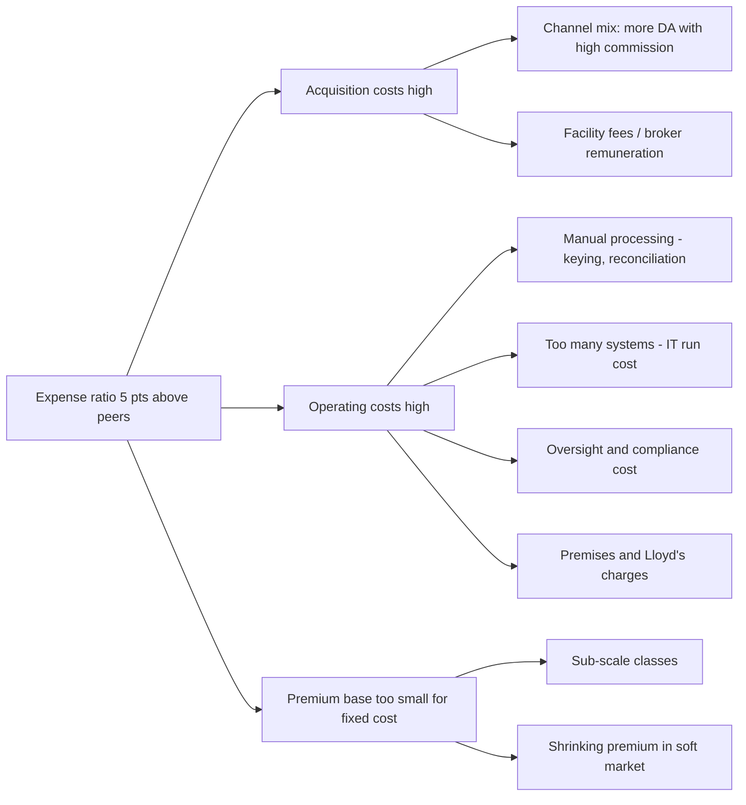

# Module 11 – Consulting Playbook and Client Conversation Defence

**Level:** Champion | **Goal:** Turn knowledge into consulting impact. Know what each executive cares about, which numbers to bring, how to structure problems, which engagements are common, and how to defend your position when challenged.

---

## 1. Know the buyer – what each executive worries about

| Role | Top concerns in late 2026 **[likely]** | Numbers they watch | Opening question that earns respect |
|---|---|---|---|
| **CEO (managing agent / carrier)** | Margin in a softening market; Lloyd's plan approval; growth vs discipline; talent | Combined ratio, RoC, GWP growth, expense ratio | "Where in your portfolio are rates now below technical price, and what is your plan for those classes in 2027?" |
| **CUO – Chief Underwriting Officer** | Rate adequacy, portfolio mix, lead position, facility/follow performance | RARC, rate adequacy, loss ratio by class, hit/retention | "How do you separate your lead performance from your follow performance in MI?" |
| **CFO** | Capital efficiency, reserve adequacy, cost, reporting (IFRS 17, UK GAAP, Solvency UK) | RoC, SCR/ECA, expense ratio, aged debt, reserve releases | "How much capital is tied up in open or deteriorating years?" |
| **COO** | Cost per transaction, ops resilience, post-Blueprint Two roadmap, outsourcing | Cost per policy/claim, FTE per £m GWP, processing backlog | "How many times is a single contract keyed across your systems?" |
| **CRO** | Internal model credibility, cat aggregation, cyber/AI accumulation, PRA scrutiny | SCR coverage, RDS, PML, model validation findings | "How does your internal model reflect falling rates in the 2027 plan year?" |
| **Chief Claims Officer** | Leakage, DCA oversight, cat surge, litigation costs, social inflation | Cycle time, leakage, reserve development, litigation rate | "What share of your claims spend do you see at file level vs only through bordereaux?" |
| **Head of DA** | Bordereaux quality, coverholder performance, audits, Lloyd's requirements | Timeliness, data quality, GPI utilisation, breaches | "Which 10 coverholders drive most of your oversight effort, and is that where your risk is?" |
| **CDO / CIO** | Data platform, standards (CDR), AI governance, legacy, vendor sprawl | Data quality scores, run cost, delivery velocity | "Which data domain, if fixed, would unlock the most use cases?" |
| **Chief Compliance / Conduct** | PS25/21 reclassification, sanctions, Consumer Duty for SME/retail, SM&CR | Breaches, complaints, product reviews | "Have you re-mapped your products to the new FCA customer definitions?" |
| **Broker leadership** | Facility income, placement efficiency, data ownership, client value | Revenue per placement, time to place, client retention | "Which of your placement steps still depends on re-keying by the carrier?" |

---

## 2. Twenty numbers to know before any London market meeting

| # | Metric | Where to find / current reference |
|---|---|---|
| 1 | Lloyd's GWP (latest) | £57.9bn FY2025; £34.7bn H1 2026 **[certain]** |
| 2 | Lloyd's combined ratio | 87.6% FY2025; 90.8% H1 2026 **[certain]** |
| 3 | Lloyd's risk-adjusted rate change | −6.7% H1 2026 **[certain]** |
| 4 | Lloyd's 2026 forecast | GWP £64bn ±5%; CR 90–95% **[likely]** |
| 5 | London market size | ~$187bn GWP 2024 (LMG) **[likely]** |
| 6 | Company market premium | £49.3bn 2024 (IUA) **[likely]** |
| 7 | DA share of Lloyd's premium | ~45% **[likely]** |
| 8 | ECA uplift | 35% on uSCR **[certain]** |
| 9 | Lloyd's central solvency ratio | 496% (2025) **[likely]** |
| 10 | Lloyd's RoC ambition | >12% over a 10-year cycle **[likely]** |
| 11 | Client's own combined ratio and split (attritional/large/cat/PYD) | Client annual report/syndicate accounts |
| 12 | Client's expense ratio vs peers | Syndicate accounts |
| 13 | Client's GWP by class and channel (open market, DA, facilities) | Client MI |
| 14 | Client's lead vs follow split | Client MI |
| 15 | Aged premium debt > 90 days | Client finance |
| 16 | Bordereaux timeliness | Client DA team |
| 17 | Quote turnaround time | Client underwriting |
| 18 | Claims cycle time / leakage estimate | Client claims |
| 19 | Number of policy and claims systems | Client IT |
| 20 | Number of AI use cases in production | Client CDO |

---

## 3. Problem-solving toolkit

### 3.1 Issue tree example – "Why is our expense ratio high?"

Rules: each branch should be **mutually exclusive and collectively exhaustive (MECE)**; each end branch should be testable with data.

### 3.2 Hypothesis-led approach

1. Write the answer you expect on day 1 (the hypothesis).
2. List the analyses that would prove or disprove it.
3. Collect only the data needed for those analyses.
4. Update the hypothesis weekly.

### 3.3 Operating model lens (use for any transformation)

| Dimension | Questions |
|---|---|
| **Strategy and appetite** | What business do we want, and through which channels? |
| **Process** | How does work flow end to end? Where are hand-offs and re-work? |
| **People and organisation** | Roles, spans, skills, location (London vs offshore) |
| **Data** | What data, which standards, who owns it, how good is it? |
| **Technology** | Which systems, how integrated, build vs buy |
| **Governance and controls** | Decision rights, oversight, regulatory compliance |
| **Partners** | Brokers, coverholders, DCAs, bureau, vendors |
| **Performance** | KPIs, incentives |

---

## 4. Common engagement types (and what good delivery looks like)

| Engagement | Typical client | Key deliverables | Success measure |
|---|---|---|---|
| Underwriting performance review | CUO | Class-level profitability, rate adequacy, action plan | Loss ratio improvement; plan approval |
| Operating model and cost transformation | CEO/COO | Target operating model, business case, roadmap | Expense ratio reduction |
| DA oversight transformation | Head of DA, CRO | Risk-based framework, MI, bordereaux automation | Fewer breaches; lower cost; Lloyd's feedback |
| Data platform and standards (CDR) | CDO/COO | Data model, platform architecture, governance | Data quality scores; reconciliation effort |
| Claims transformation | Chief Claims Officer | Triage model, DCA oversight, leakage review | Leakage reduction; cycle time |
| AI strategy and governance | CEO/CDO/CRO | AI policy, inventory, use case portfolio, pilots | Use cases in production with value tracked |
| Capital optimisation | CFO/CRO | Reinsurance optimisation, model review, capital allocation | Capital released; RoC |
| Syndicate / MGA launch | Founders, investors | Business plan, Lloyd's application, operations setup | Approval and go-live |
| Legacy / RITC strategy | CFO | Options analysis, reserve review, transaction support | Capital freed; year closed |
| Regulatory change (PS25/21, Solvency UK, op resilience) | Compliance/CRO | Gap analysis, implementation plan | Compliance with lower cost |
| Systems selection and implementation (PAS, workbench) | CIO/COO | Requirements, vendor selection, implementation | On-time delivery; adoption |
| M&A integration | CEO/CFO | Integration plan, systems consolidation | Synergies achieved |

---

## 5. Client conversation defence – challenges you will face

The format: **challenge → weak answer → strong answer**.

| # | Client challenge | Weak answer | Strong answer |
|---|---|---|---|
| 1 | "You're a consultant – have you ever placed a risk?" | "No, but I've read a lot." | "No, I'm not a broker or underwriter. My value is seeing the end-to-end flow across placement, accounting and claims, and where cost and leakage build up between your teams. Let me show you what we found in your bordereaux data." |
| 2 | "London is relationship-driven; AI won't change that." | "AI will transform everything." | "Agreed that relationships drive the lead decision. AI's value is in the work around the decision – extraction, checks, triage – which takes most of your underwriting assistants' time today." |
| 3 | "Blueprint Two failed, so why invest in data now?" | "Blueprint Two will come back." | "The market programme stopped; your data problem didn't. The work that pays back inside your own firm – CDR-aligned data, ingestion, reconciliation – stands regardless of what the market does next." |
| 4 | "Our expense ratio is high because of Lloyd's costs." | "Yes, Lloyd's is expensive." | "Lloyd's charges are part of it, but in similar firms most of the gap is internal manual processing and system duplication. Let's split the gap into what you control and what you don't." |
| 5 | "Facilities give us cheap premium." | "Facilities are good." | "They give volume at low acquisition effort. The question is margin: in your data, facility business runs X points worse than your own lead business. Let's test whether that's mix or selection." |
| 6 | "We already have an AI policy." | "Great." | "Good start. How many use cases are registered, which are risk-tiered high, and who is the accountable senior manager for each?" |
| 7 | "The PRA won't allow that model change." | "We'll talk to the PRA." | "The PRA's 2026 focus is whether internal models overstate profitability in a softening market. If our change makes assumptions more conservative and better evidenced, it supports the dialogue rather than weakens it." |
| 8 | "Our coverholders won't change their bordereaux format." | "Then we can't help." | "You don't need them to change first. Ingestion tools map their formats to your standard. Use the BAA renewal to add data requirements over 12–24 months." |
| 9 | "This benchmark doesn't apply to us – we're different." | Accept it. | "Which part is different – class mix, channel, or scale? Let's normalise for those and see what gap remains." |
| 10 | "Show me the payback." | Give a vague % saving. | Give a business case with explicit assumptions, a baseline, sensitivity (low/base/high) and the first measurable checkpoint at 90 days. |

### 5.1 Rules for holding your ground

1. **Anchor on their data.** Opinions lose; numbers from their own systems win.
2. **Concede what is true quickly.** It makes your disagreement credible.
3. **Separate fact, inference and judgement** – use the same tags as this guide.
4. **Never bluff market facts.** Say "I'll confirm that" and do it within 24 hours.
5. **Name the trade-off.** Every recommendation costs something; say what.

---

## 6. Phrases that signal experience (use correctly)

| Phrase | When to use |
|---|---|
| "Is that a lead or follow position?" | Any discussion of underwriting performance. |
| "What's the signed line versus written line?" | Placement or premium discussions. |
| "Is that bureau or non-bureau?" | Accounting and settlement. |
| "Which year of account?" | Any Lloyd's results discussion. |
| "Is that within the BAA authority?" | DA discussions. |
| "Who are the claims agreement parties?" | Claims on subscription business. |
| "Is that before or after reserve releases?" | Combined ratio discussions. |
| "What's the rate adequacy, not just rate change?" | Pricing discussions. |
| "Is that open market, DA, or facility business?" | Any channel performance discussion. |
| "Is that customer in scope after PS25/21?" | Conduct discussions. |

---

## 7. Your first 90 days on a London market engagement

| Weeks | Focus | Outputs |
|---|---|---|
| 1–2 | Understand the client: syndicate accounts, business plan, org chart, systems map | One-page client fact base |
| 3–4 | Process walk-throughs: placement, DA, claims, accounting (sit with operations teams) | As-is process maps with pain points and volumes |
| 5–6 | Data deep dive: extract samples, measure quality, reconcile | Data quality baseline |
| 7–8 | Root cause and options | Issue tree, option assessment |
| 9–10 | Business case and roadmap | Value case, phased roadmap |
| 11–12 | Executive presentation and mobilisation | Steering committee pack, plan, KPIs |

---

## 8. Personal development plan to become a London market champion

| Area | Action |
|---|---|
| **Domain** | Read Lloyd's Market Bulletins monthly; follow Insurance Insider, Insurance Times, The Insurer, Reinsurance News; read Lloyd's and syndicate annual reports. |
| **Qualification** | Chartered Insurance Institute (CII): **Award in London Market Insurance** (entry) and **Certificate in Insurance** / **Diploma** units (e.g., London market insurance essentials, Lloyd's and London market) **[likely]** – check current CII unit names. |
| **Network** | LMA, IUA, LIIBA events; Lloyd's Lab demo days; Insurance Institute of London lectures. |
| **Technical** | Data modelling, SQL, basic Python, AI evaluation (see Module 09 exercises). |
| **Consulting** | Practise 3-minute executive explanations; write one-page recommendations for each scenario in Module 10. |
| **Feedback** | Ask a London market practitioner to review your scenario answers monthly. |
