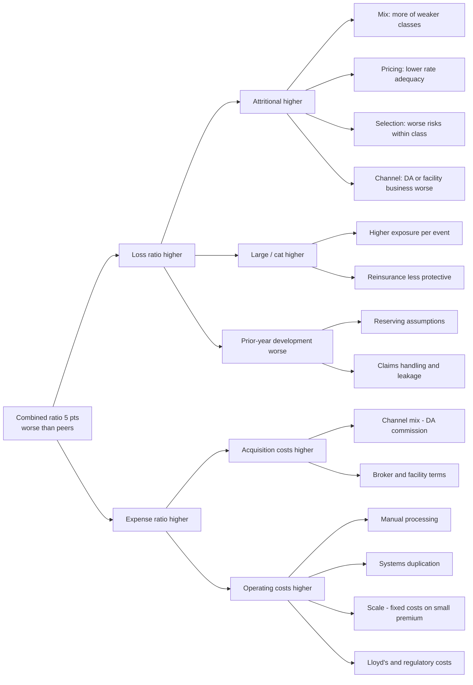
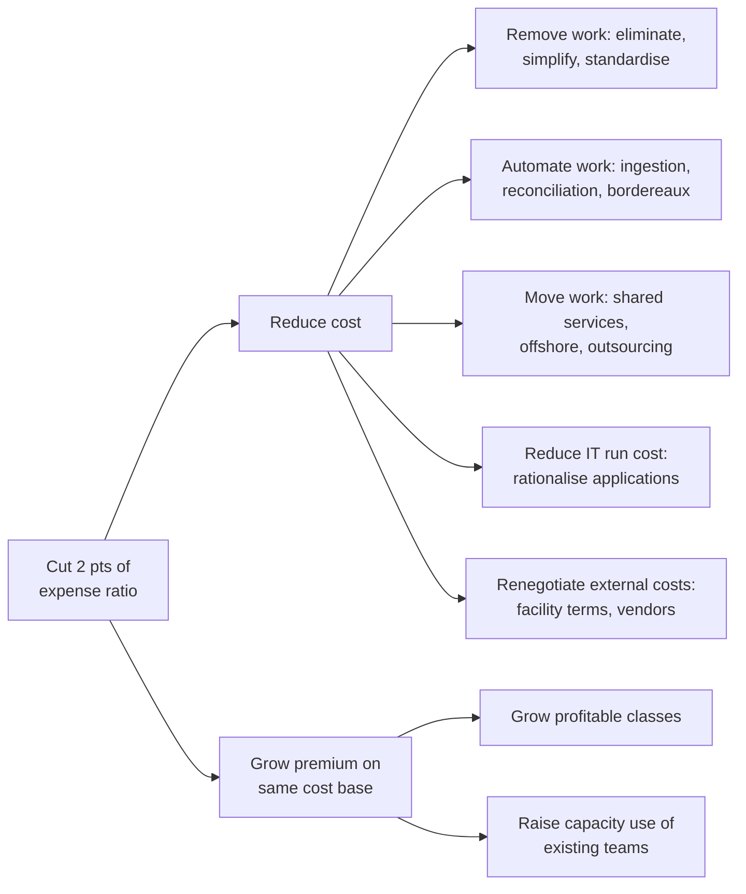
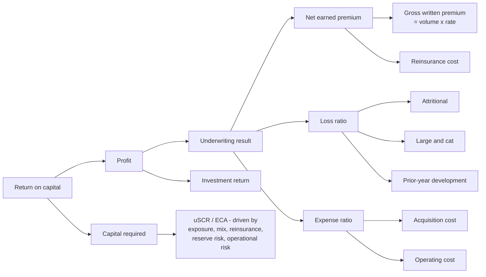
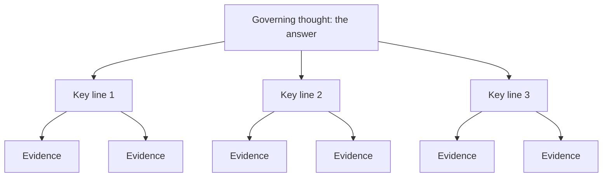

# Module 11 – Consulting Playbook: Top-Tier Strategy Consulting Craft Applied to the London Market

| | |
|---|---|
| **Level** | Champion |
| **Path phase** | Phases 2–4 – use continuously ([Module 18](18-World-Class-Consultant-Path.md)) |
| **Time** | 5–6 hours reading; then weekly practice |
| **Prerequisites** | Modules 01–02; ideally 04–07 |
| **You will be able to** | Define a client problem precisely; build issue and hypothesis trees; size value in London market terms; structure a storyline using the pyramid principle; run the first two weeks of an engagement; handle executive challenge; shape and sell work |

*This chapter describes the widely documented working methods of top-tier strategy firms (McKinsey, Bain, BCG and similar) – as set out in public books, training material and practitioner accounts – applied to the London market. It is not insider material from any firm.*

---

## 1. What top-tier consulting actually sells

Clients do not pay top-tier fees for information. Information is cheap. They pay for four things:

| What they buy | What it looks like |
|---|---|
| **A clear answer** | "Exit two classes, re-price three, cut 1.8 points of expense ratio" – not "here are the options" |
| **Confidence in the answer** | Facts, analysis and logic the board can rely on |
| **Speed** | A decision-quality answer in 6–8 weeks, not 6 months |
| **Change that sticks** | Plans, owners and tracking that turn the answer into results |

Everything in this chapter serves those four outcomes. The London market adds two special requirements: you must **speak the market's language fluently** (otherwise clients do not trust the answer), and you must **respect the market's constraints** (Lloyd's, the bureau, brokers, subscription) or the answer cannot be implemented.

---

## 2. Step 1 – Define the problem precisely

### 2.1 Why it matters

Most failed engagements solve the wrong problem. "Help us with our DA operations" is a topic, not a problem. Top-tier teams spend real effort writing one precise question before any analysis.

### 2.2 Problem statement worksheet

| Element | Question | London example |
|---|---|---|
| **Key question** | What exactly must we answer? Specific, measurable, time-bound | "How can Syndicate X reduce its expense ratio by 2 points by the 2028 year of account without increasing its loss ratio?" |
| **Decision-maker** | Who decides, and what decision? | CEO and board; approve a 2-year programme and 2027 business plan |
| **Context** | What is happening that makes this urgent? | Rates down 6.7% in H1 2026; Lloyd's challenging 2027 plans; expense ratio 4 points above peers |
| **Criteria for success** | How will we know we succeeded? | 2-point reduction locked into the 2028 SBF; no loss ratio deterioration; Lloyd's plan approval |
| **Scope** | What is in and out? | In: operations, DA processing, technology, facilities terms. Out: exiting classes (separate review) |
| **Constraints** | What cannot change? | Bureau processes; existing coverholder contracts until renewal; no redundancies in underwriting |
| **Stakeholders** | Who must be involved or convinced? | COO, CUO, CFO, Head of DA, IT; Lloyd's oversight team (indirectly) |
| **Key sources** | Where will facts come from? | Syndicate accounts, cost ledger, FTE data, process volumes, bordereaux logs |

**Test:** if two senior people at the client read your key question and would give different success criteria, it is not precise enough.

---

## 3. Step 2 – Structure the problem: issue trees

### 3.1 Two kinds of tree

| Tree | Question it answers | Use when |
|---|---|---|
| **Diagnostic (why) tree** | Why is this happening? | Problem is not yet understood |
| **Solution (how) tree** | How could we fix it? | Problem is understood; options needed |

Both must be **MECE**: **mutually exclusive** (no overlaps) and **collectively exhaustive** (nothing missing).

### 3.2 Diagnostic tree – "Why is our combined ratio 5 points worse than peers?"

Each end branch must be **testable with data**. "Selection is worse" is tested by comparing loss ratios of risks within the same class and price band against peers or market data.

### 3.3 Solution tree – "How can we cut 2 points of expense ratio?"

**Tip:** the first split of a tree decides the quality of the work. Common good first splits in London work: loss vs expense; price vs volume; open market vs delegated vs facility; lead vs follow; class; year of account.

---

## 4. Step 3 – Work hypothesis-first

### 4.1 The idea

Instead of collecting all the data and then looking for an answer, write your **best guess of the answer on day one**, then design the minimum analysis to prove or disprove it. This is faster and forces focus. You must be willing to drop a hypothesis when the data says no.

### 4.2 Hypothesis tree for the expense ratio problem

| Hypothesis | Analysis to test it | Data source | Kill criterion |
|---|---|---|---|
| H1: Over 40% of operations effort is re-keying and reconciliation | Activity analysis of operations teams; volume and time sampling | Team interviews, timesheets, process logs | < 25% of effort |
| H2: DA bordereaux processing costs 2× peers per £m premium | Cost per bordereau and per £m DA premium; benchmark | Cost ledger, bordereaux logs, benchmark data | Within 20% of peers |
| H3: Five legacy systems duplicate policy data, adding £4m+ IT run cost | Application inventory and cost mapping | IT budget, architecture | Run cost < £2m |
| H4: Facility terms cost 1+ point more than open market acquisition | Acquisition cost by channel | Finance data by channel | Difference < 0.3 points |
| H5: Premium credit control is manual, leaving > 15% of premium > 90 days | Aged debt analysis | Finance ledger | < 5% |

### 4.3 Workplan (the "analysis plan")

| Analysis | Hypothesis | Output (ghost chart) | Owner | Due |
|---|---|---|---|---|
| Combined ratio bridge vs peers | All | Waterfall chart | Analyst A | Week 1 |
| Activity analysis – operations | H1 | Stacked bar of effort by activity | Consultant B | Week 2 |
| Bordereaux cost benchmark | H2 | Bar chart vs peers | Consultant B | Week 3 |
| Application cost map | H3 | Table and heat map | Tech lead | Week 3 |
| Channel profitability | H4 | Bar: acquisition + loss ratio by channel | Analyst A | Week 2 |
| Aged debt | H5 | Ageing profile | Analyst A | Week 2 |

**The "ghost chart"**: sketch the chart you expect before you have the data. It tells the team exactly what data to get and stops endless data collection.

### 4.4 The 80/20 rule

Usually 20% of analyses give 80% of the insight. Top-tier teams ask every few days: "What is the most important thing we do not yet know, and what is the quickest way to find it?" In London work, the quickest high-value analyses are almost always: **combined ratio bridge, channel/class profitability, activity analysis, and aged debt**.

---

## 5. Step 4 – Size the value (London driver trees)

### 5.1 The London value driver tree

### 5.2 Conversion rules to memorise

| Change | Value on £1bn net earned premium |
|---|---|
| 1 point of loss ratio | £10m a year |
| 1 point of expense ratio | £10m a year |
| 1% better rate adequacy on renewals (if sustained) | Up to about £10m a year (before any volume effect) |
| £1m premium debt collected 60 days earlier | Small income effect, but lower credit risk and capital |
| 10% lower capital on £600m at 12% cost of capital | About £7m a year |
| 1 FTE in London operations | About £70–100k fully loaded **[guessing]** – check client data |

### 5.3 Worked sizing – bordereaux automation

**Client facts (fictional):** £400m DA premium; 120 coverholders; 1,400 risk and claims bordereaux a month; 35 FTE in DA operations at £75k each = £2.6m.

| Step | Assumption | Result |
|---|---|---|
| Share of DA operations effort on mapping, validation and queries | 60% (from activity analysis) | 21 FTE |
| Effort removed by ingestion and validation automation | 50% of that work **[guessing]** – prove in pilot | 10.5 FTE ≈ £0.8m a year |
| Faster exposure data (weeks earlier) | Better cat aggregation and reinsurance buying | Not sized in base case – mention as upside |
| Fewer authority breaches found late | Lower leakage | Upside |
| Expense ratio effect on £1bn NEP | £0.8m ÷ £1bn | 0.08 points |

**What a partner would say:** "On its own, bordereaux automation is under a tenth of a point. It is worth doing only as part of a programme that also tackles reconciliation, policy system duplication and facility terms. Present it as one of five levers that together deliver 2 points." This honesty builds credibility.

### 5.4 Market-sizing drill (case-interview style)

**Question:** "What is the annual cost of processing delegated authority business across Lloyd's?"

| Step | Estimate |
|---|---|
| Lloyd's GWP 2025 | £57.9bn **[certain]** |
| Share through DA | about 45% **[likely]** → about £26bn |
| Cost of DA operations and oversight across carriers, as % of DA premium | 1.5–3% **[guessing]** |
| Annual cost pool | about £0.4–0.8bn |
| Share addressable by automation and standards | 30–50% **[guessing]** |
| Market-wide value pool | about £120–400m a year |

The precision does not matter; the structure does. A partner uses this kind of estimate to judge whether a market problem deserves board attention.

---

## 6. Step 5 – Gather facts efficiently

### 6.1 Sources for London work

| Source | What you get |
|---|---|
| **Syndicate annual reports and accounts** (lloyds.com) | Results, class mix, combined ratio, commentary – free and comparable |
| **Lloyd's market results** | Market averages: combined ratio, major claims, rate change, expense trends |
| **Client data requests** | Ledger, policy and claims extracts, FTE data, bordereaux logs, IT costs |
| **Interviews** | How work really happens, where pain is, who matters |
| **Process walk-throughs** | Watching operations teams do the work |
| **Market bodies** | LMA, IUA, LIIBA, LMG publications and surveys |
| **Regulators** | PRA priorities letters, FCA policy statements |

### 6.2 Interview discipline

- Prepare 5–7 questions linked to hypotheses (guide in [Module 19 §3](19-Practice-Toolkit-and-Templates.md)).
- Ask for numbers: "How many?", "How long?", "How often?".
- Close with: "If you were CEO, what would you change first?" and "Who else should I speak to?"
- Write up within 24 hours: key facts, quotes, surprises, hypothesis impact.

### 6.3 Data request discipline

- Ask for the minimum data that tests the hypotheses.
- Give a template with field definitions.
- Agree a date and an owner.
- Expect London data to be messy: duplicated UMRs, different line bases (written vs signed), currencies, year of account vs calendar year. Agree definitions early.

---

## 7. Step 6 – Synthesise: the pyramid principle

### 7.1 The idea

Executives want the **answer first**, then the reasons, then the evidence. The pyramid principle (from Barbara Minto, a former McKinsey consultant) is the standard method:

Rules:
1. **Start with the answer** (the governing thought).
2. Each level **summarises** the level below.
3. Ideas in each group are **MECE** and of the same kind.
4. Ideas are in **logical order** (time, structure or importance).

### 7.2 Situation – Complication – Question (SCQ)

Use SCQ to open a storyline:

- **Situation:** what the audience already accepts. "The syndicate delivered a 91% combined ratio in 2025."
- **Complication:** what changed. "Rates are now falling 6–7% a year; the underlying ratio is 96% and rising; Lloyd's is challenging growth plans."
- **Question:** what the audience needs answered. "How do we protect margin for the 2027 and 2028 years of account?"
- **Answer:** the governing thought.

### 7.3 Worked storyline – executive summary

> **Governing thought:** Syndicate X can restore 4 points of underlying combined ratio by the 2028 year of account by exiting two unprofitable classes, enforcing pricing discipline on follow business, and removing 2 points of expense through automation and system consolidation – worth about £40m a year on current premium.
>
> **1. The loss ratio problem is concentrated, not general.** Two classes (US casualty binders and property facility business) produce 70% of the loss ratio gap to peers; the other classes perform at or better than market.
>
> **2. Pricing discipline has weakened most in follow business.** Rate adequacy on follow lines fell from 102% to 91% in 18 months, against 98% on led business.
>
> **3. Expenses are 4 points above peers because of manual processing and duplicated systems.** 45% of operations effort is re-keying and reconciliation; five policy systems cost £6m a year to run.
>
> **4. A two-year programme delivers £40m a year with manageable risk.** Phase 1 (2027 plan): class exits and follow pricing rules – 2 points. Phase 2 (2027–28): automation and system consolidation – 2 points.

Notice: every key line is a **full sentence with a conclusion**, not a topic like "Loss ratio analysis".

### 7.4 Action titles and the "horizontal read"

Every slide has an **action title** – a full sentence stating the slide's conclusion. Reading only the titles of a deck, in order, should tell the full story. This is called the **horizontal read** (or "dot-dash" when written as bullet storyline).

| Weak title (topic) | Strong title (action) |
|---|---|
| "Loss ratio by class" | "Two classes create 70% of the loss ratio gap to peers" |
| "Operations effort" | "Almost half of operations effort is re-keying and reconciliation" |
| "Facility business" | "Facility business runs 7 points worse than led business at similar rates" |
| "Roadmap" | "A two-phase programme delivers 4 points by the 2028 year of account" |

### 7.5 Ghost deck

Before analysis is complete, write the deck as blank slides with action titles and sketched charts. Update titles as evidence arrives. A ghost deck keeps the team focused and shows the client early where the story is going.

**Ghost deck for the Syndicate X case (12 slides):**

| # | Action title (draft) | Chart |
|---|---|---|
| 1 | Restoring 4 points of combined ratio is achievable by the 2028 year of account and worth ~£40m a year | Executive summary |
| 2 | Headline results hide a 96% and rising underlying combined ratio | Waterfall: headline → underlying |
| 3 | The gap to peers is 2.5 points loss ratio and 4 points expense ratio | Bar: client vs peer components |
| 4 | Two classes create 70% of the loss ratio gap | Bar by class |
| 5 | Follow business rate adequacy has fallen 11 points in 18 months | Line chart, led vs follow |
| 6 | Facility business runs 7 points worse than led business | Bar by channel |
| 7 | Almost half of operations effort is re-keying and reconciliation | Stacked bar of activities |
| 8 | Five policy systems cost £6m a year and duplicate data | Application map |
| 9 | Five levers deliver 4 points | Lever waterfall |
| 10 | Phase 1 (2027 plan) delivers 2 points with low execution risk | Lever table |
| 11 | Phase 2 delivers the rest through automation and consolidation | Roadmap |
| 12 | Decisions needed from the board today | List |

### 7.6 Chart choices for London work

| Message | Chart |
|---|---|
| Bridge from headline to underlying combined ratio | **Waterfall** |
| Client vs peers on ratios | Clustered bar |
| Trend in rate change / rate adequacy | Line |
| Profitability by class or channel | Bar sorted by value |
| Effort by activity | Stacked bar |
| Value of levers | Waterfall |
| Roadmap | Gantt-style timeline |

Rules: one message per chart; label data directly; source and date on every chart; show the year of account or calendar year basis clearly.

---

## 8. Step 7 – Communicate with executives

### 8.1 The 30-second answer

Prepare for every meeting a 30-second answer to "So what have you found?" Structure: **answer → three reasons → what we need from you**.

> "You can get 4 points back by 2028. Two classes cause most of the loss gap, follow pricing has slipped, and operations carry 4 points of avoidable cost. We need your decision on the two classes before the 2027 plan goes to Lloyd's."

### 8.2 Pre-wiring

No important finding should surprise a senior stakeholder in a steering committee. Top-tier teams **pre-wire**: they walk each key stakeholder through the findings that affect them one to one before the meeting. In London, pre-wire the **CUO** before any finding about classes or underwriting, and the **Head of DA** before any finding about coverholders.

### 8.3 Handling challenge

| Rule | Example |
|---|---|
| Acknowledge what is true | "You are right that 2024 was distorted by one large loss." |
| Return to data | "Excluding that loss, the class still runs 6 points worse than market." |
| Separate fact from judgement | "That figure is from your ledger. The peer comparison is our estimate from public accounts." |
| Offer to test | "If you think mix explains it, we can normalise by sub-class by Friday." |
| Do not fold without new information | Hold your position unless the challenge brings new facts. |

See section 13 for London-specific challenges and strong responses.

### 8.4 Workshops

| Phase | Practice |
|---|---|
| Before | Clear objective; pre-read; right people (decision-makers plus experts); pre-wire |
| During | Start with the answer and the decision needed; use real data; capture decisions and actions visibly |
| After | Send decisions and actions within 24 hours |

---

## 9. Engagement architecture

### 9.1 Typical phases

| Phase | Duration | Output |
|---|---|---|
| **Diagnostic** | 4–6 weeks | Fact base, root causes, value at stake, priorities |
| **Design** | 6–10 weeks | Target operating model, detailed initiatives, business case, roadmap |
| **Implementation / transformation** | 6–24 months | Delivered initiatives, value tracked, capability built |

### 9.2 Team and governance

| Role | Responsibility |
|---|---|
| Partner / director | Client relationship, answer quality, steering committee |
| Engagement manager | Daily leadership, storyline, workplan, client management |
| Consultants and analysts | Analyses, interviews, slides |
| Experts | Actuarial, DA, claims, data, AI, regulatory |
| Client lead and counterparts | Ownership of findings and implementation |
| Steering committee | Decisions, priorities, removing blockers |

### 9.3 Weekly rhythm

| Day | Activity |
|---|---|
| Monday | Team problem-solving session: hypotheses, storyline, priorities |
| Midweek | Client counterpart check-ins; interim findings |
| Thursday | Partner review of draft pages |
| Friday | Client lead update; plan next week |
| Every 2–4 weeks | Steering committee |

### 9.4 The first two weeks at a London managing agent

| Day | Activity |
|---|---|
| Before day 1 | Read last 3 years' syndicate accounts; Lloyd's market results; client's public statements; draft day-one hypothesis; draft stakeholder map |
| Days 1–2 | Kick-off with sponsor; agree key question, success criteria, governance; issue data request |
| Days 3–5 | 10–15 interviews: CEO, CUO, CFO, COO, Head of DA, Chief Claims Officer, CRO, 3–4 class underwriters, operations leads |
| Week 2 | Combined ratio bridge; class and channel profitability; process walk-throughs (placement, bordereaux, technical accounting, claims); first ghost deck |
| End of week 2 | Sponsor meeting: emerging hypotheses confirmed or dropped; plan for weeks 3–6 |

### 9.5 Implementation and value tracking

| Tool | Purpose |
|---|---|
| **Initiative charter** | Owner, scope, value, milestones, risks for each initiative |
| **Benefits register** | Each benefit with baseline, target, owner, timing, run-rate vs one-off |
| **Stage gates** | Idea → validated → planned → executed → value realised |
| **Value tracking dashboard** | Reported to steering committee monthly |

**London-specific rule:** link benefits to the **business plan (SBF)** and to **year of account** results, so the CFO and Lloyd's see them in the numbers they already use.

---

## 10. Selling and shaping work

### 10.1 Where London market work comes from

| Trigger | Typical buyer | Typical engagement |
|---|---|---|
| Lloyd's plan challenge or poor results | CEO, CUO | Underwriting performance review |
| Soft market margin pressure | CEO, CFO, COO | Cost and operating model transformation |
| Regulatory finding or new rules | CRO, CCO | Remediation, governance |
| Market change (Blueprint Two retired) | COO, CIO | Roadmap re-plan, data standards |
| M&A | CEO, CFO | Integration |
| New syndicate or MGA | Founders, investors | Business plan and set-up |
| Catastrophe | Claims, CFO | Surge support, claims review |
| AI ambition without governance | CEO, CDO, CRO | AI strategy, governance, scaling |

### 10.2 The point-of-view meeting

Top-tier partners rarely open with "how can we help?". They bring a **perspective**: a short fact-based view of the client's situation from public data (syndicate accounts, market results), a hypothesis about the issue, and an offer to test it. Example opener: "Your underlying combined ratio has risen 4 points in two years, faster than the market. Our hypothesis is that follow business and facility terms explain most of it. We would like to test that with you in four weeks."

### 10.3 Proposal structure

1. The client's situation and question – in their numbers.
2. Our hypothesis and why we believe it.
3. Approach: phases, analyses, decision points.
4. Outcomes and how they will be measured.
5. Team and relevant experience (your artefacts and case studies).
6. Timeline and commercials.

---

## 11. Know the buyer – what each executive worries about

| Role | Top concerns in late 2026 **[likely]** | Numbers they watch | Opening question that earns respect |
|---|---|---|---|
| **CEO** | Margin in a softening market; Lloyd's plan approval; growth vs discipline; talent | Combined ratio, RoC, GWP, expense ratio | "Where in your portfolio are rates now below technical price, and what is your plan for those classes in 2027?" |
| **CUO** | Rate adequacy, mix, lead position, facility/follow performance | RARC, rate adequacy, loss ratio by class, hit/retention | "How do you separate your lead performance from your follow performance in MI?" |
| **CFO** | Capital efficiency, reserves, cost, reporting | RoC, ECA, expense ratio, aged debt, reserve releases | "How much capital is tied up in open or deteriorating years?" |
| **COO** | Cost per transaction, resilience, post-Blueprint Two roadmap, outsourcing | Cost per policy/claim, FTE per £m GWP, backlogs | "How many times is a single contract keyed across your systems?" |
| **CRO** | Internal model credibility, aggregation, cyber/AI accumulation, PRA scrutiny | SCR coverage, RDS, PML, validation findings | "How does your internal model reflect falling rates in the 2027 plan year?" |
| **Chief Claims Officer** | Leakage, DCA oversight, cat surge, litigation, social inflation | Cycle time, leakage, reserve development | "What share of your claims spend do you see at file level vs only through bordereaux?" |
| **Head of DA** | Bordereaux quality, coverholder performance, audits | Timeliness, data quality, GPI use, breaches | "Which 10 coverholders drive most of your oversight effort, and is that where your risk is?" |
| **CDO / CIO** | Data platform, standards, AI governance, legacy | Data quality, run cost, delivery speed | "Which data domain, if fixed, would unlock the most use cases?" |
| **Compliance** | PS25/21 reclassification, sanctions, SM&CR | Breaches, complaints | "Have you re-mapped your products to the new FCA customer definitions?" |
| **Broker leadership** | Facility income, placement efficiency, data ownership | Revenue per placement, time to place | "Which of your placement steps still depends on re-keying by the carrier?" |

---

## 12. Twenty numbers to know before any London market meeting

| # | Metric | Current reference |
|---|---|---|
| 1 | Lloyd's GWP | £57.9bn FY2025; £34.7bn H1 2026 **[certain]** |
| 2 | Lloyd's combined ratio | 87.6% FY2025; 90.8% H1 2026 **[certain]** |
| 3 | Lloyd's risk-adjusted rate change | −6.7% H1 2026 **[certain]** |
| 4 | Lloyd's 2026 forecast | GWP £64bn ±5%; CR 90–95% **[likely]** |
| 5 | London market size | ~$187bn GWP 2024 **[likely]** |
| 6 | Company market premium | £49.3bn 2024 **[likely]** |
| 7 | Lloyd's 2026 stamp capacity / approved capital | ~£58bn / ~£36.2bn **[likely]** |
| 8 | DA share of Lloyd's premium | ~45% **[likely]** |
| 9 | ECA uplift | 35% on uSCR **[certain]** |
| 10 | Lloyd's RoC ambition | >12% over a 10-year cycle **[likely]** |
| 11–20 | Client's own: combined ratio split; expense ratio vs peers; GWP by class and channel; lead vs follow split; aged debt > 90 days; bordereaux timeliness; quote turnaround; claims cycle time; number of systems; AI use cases in production | Client data |

---

## 13. Client challenge – strong responses

| # | Client challenge | Strong answer |
|---|---|---|
| 1 | "You're a consultant – have you ever placed a risk?" | "No – I'm not a broker or underwriter. My value is seeing the full flow across placement, accounting and claims, and where cost and leakage build up between your teams. Let me show you what we found in your bordereaux data." |
| 2 | "London is relationship-driven; AI won't change that." | "Agreed – relationships drive the lead decision. AI's value is in the work around the decision – extraction, checks, triage – which takes most of your underwriting assistants' time." |
| 3 | "Blueprint Two failed, so why invest in data now?" | "The market programme stopped; your data problem didn't. CDR-aligned data, ingestion and reconciliation pay back inside your firm whatever the market does next." |
| 4 | "Our expense ratio is high because of Lloyd's costs." | "Lloyd's charges are part of it, but in similar firms most of the gap is internal manual processing and system duplication. Let's split the gap into what you control and what you don't." |
| 5 | "Facilities give us cheap premium." | "They give volume at low acquisition effort. The question is margin: in your data facility business runs X points worse than your led business. Let's test whether that is mix or selection." |
| 6 | "We already have an AI policy." | "Good start. How many use cases are registered, which are high-risk, and who is the accountable senior manager for each?" |
| 7 | "The PRA won't allow that model change." | "The PRA's 2026 focus is models overstating profitability in a softening market. If our change makes assumptions more conservative and better evidenced, it supports the dialogue." |
| 8 | "Our coverholders won't change their bordereaux format." | "You don't need them to change first. Ingestion maps their formats to your standard. Use binder renewals to add data requirements over 12–24 months." |
| 9 | "This benchmark doesn't apply to us – we're different." | "Which part – class mix, channel, or scale? Let's normalise for those and see what gap remains." |
| 10 | "Show me the payback." | Business case with explicit assumptions, baseline, low/base/high cases and a measurable 90-day checkpoint. |

---

## 14. Phrases that signal London fluency

| Phrase | When to use |
|---|---|
| "Is that a lead or follow position?" | Underwriting performance |
| "Written or signed line?" | Placement and premium |
| "Bureau or non-bureau?" | Accounting and settlement |
| "Which year of account?" | Any Lloyd's results discussion |
| "Within the binder's authority?" | Delegated authority |
| "Who are the claims agreement parties – and is it standard or complex?" | Claims on subscription business |
| "Before or after reserve releases?" | Combined ratio discussions |
| "Rate adequacy, not just rate change?" | Pricing |
| "Open market, DA or facility?" | Channel performance |
| "In scope after PS25/21?" | Conduct |

---

## 15. Common engagement types

| Engagement | Typical client | Key deliverables | Success measure |
|---|---|---|---|
| Underwriting performance review | CUO | Class profitability, rate adequacy, action plan | Loss ratio; plan approval |
| Operating model and cost transformation | CEO/COO | Target operating model, business case, roadmap | Expense ratio |
| DA oversight transformation | Head of DA, CRO | Risk-based framework, MI, bordereaux automation | Breaches, cost, Lloyd's feedback |
| Data platform and standards | CDO/COO | Data model, architecture, governance | Data quality; reconciliation effort |
| Claims transformation | Claims | Triage, DCA oversight, leakage review | Leakage; cycle time |
| AI strategy and governance | CEO/CDO/CRO | Policy, inventory, portfolio, pilots | Use cases in production with value |
| Capital optimisation | CFO/CRO | Reinsurance optimisation, model review | Capital released; RoC |
| Syndicate / MGA launch | Founders, investors | Business plan, Lloyd's application, operations | Approval and go-live |
| Legacy / RITC strategy | CFO | Options, reserve review, transaction support | Capital freed; year closed |
| Regulatory change | Compliance/CRO | Gap analysis and plan | Compliance at lower cost |
| Systems selection and implementation | CIO/COO | Requirements, selection, delivery | Adoption, on-time |
| M&A integration | CEO/CFO | Integration plan, systems consolidation | Synergies |

---

## 16. Full worked case – Syndicate X: restoring margin in a softening market

*Fictional client built from typical London market patterns.*

### 16.1 Situation

Syndicate X: £1.2bn GWP, £1.0bn net earned premium, 2025 combined ratio 91%. Mix: 30% US property (half via binders, half open market), 25% US casualty (mainly binders), 20% marine and energy (mostly led), 15% specialty (mixed), 10% property treaty reinsurance. About 30% of property premium comes through broker facilities.

### 16.2 Day-one hypothesis

"The 91% headline hides an underlying ratio near 96%. The problem is concentrated in delegated casualty and facility property, plus an expense base inflated by manual DA and accounting processes. Fixing both is worth 4 points."

### 16.3 Key analyses and findings

**Combined ratio bridge (2025)**

| Item | Points |
|---|---|
| Headline combined ratio | 91.0 |
| Remove benign cat year (cat 3 pts vs 6-pt normalised) | +3.0 |
| Remove prior-year releases | +2.0 |
| **Underlying (normalised) combined ratio** | **96.0** |

**Loss ratio by class and channel (normalised)**

| Segment | Loss ratio | vs market estimate |
|---|---|---|
| Marine & energy (led) | 52% | Better by 4 |
| Specialty | 58% | In line |
| Property treaty | 55% | In line |
| US property – open market | 57% | In line |
| US property – facilities | 66% | **Worse by 7** |
| US casualty – binders | 74% | **Worse by 9** |

**Expense analysis**

| Item | Finding |
|---|---|
| Operating expense ratio | 12% vs peer estimate 8% |
| Activity analysis | 45% of operations effort is re-keying, reconciliation and bordereaux mapping |
| Systems | Five policy administration systems after two acquisitions; £6m a year run cost |
| Aged debt | 14% of premium receivable older than 90 days |

### 16.4 Recommendations and value

| Lever | Action | Points | £m a year |
|---|---|---|---|
| 1. Casualty binder remediation | Exit 3 worst coverholders; re-price and tighten authority on the rest | 1.2 | 12 |
| 2. Facility discipline | Cap facility share; require lead selection rights and risk-level data | 0.8 | 8 |
| 3. Operations automation | Submission and bordereaux ingestion; reconciliation automation | 1.0 | 10 |
| 4. System consolidation | Move to one policy platform over 24 months | 0.6 | 6 |
| 5. Credit control | Automated cash matching and broker scorecards | 0.4 | 4 (incl. lower credit risk) |
| **Total** | | **4.0** | **~40** |

### 16.5 Roadmap

| Phase | Timing | Focus |
|---|---|---|
| 1 | Q4 2026 – Q1 2027 | Binder and facility actions in 2027 SBF; credit control quick wins |
| 2 | 2027 | Ingestion and reconciliation automation; consolidation design |
| 3 | 2027–2028 | System consolidation; value locked into the 2028 plan |

### 16.6 Risks and mitigations

| Risk | Mitigation |
|---|---|
| Broker reaction to facility caps | Pre-wire with top 3 brokers; position as data partnership |
| Premium loss from binder exits | Accept: unprofitable premium; show RoC improvement |
| Delivery risk on system consolidation | Phase by class; keep legacy for run-off |
| Lloyd's view of lower GWP | Present improved underlying ratio and RoC in SBF |

---

## 17. Practice drills

| Drill | How |
|---|---|
| **Problem statement** | Rewrite three vague client asks ("help with DA", "AI strategy", "reduce cost") as full problem statements |
| **Issue tree** | Build MECE trees for: "Why is our claims cycle time long?"; "How can we grow profitably in a soft market?" |
| **Sizing** | Estimate: annual cost of premium reconciliation across the London market; value of 1-day faster quote turnaround for a property team |
| **Storyline** | Turn a syndicate teardown ([Module 19 §1](19-Practice-Toolkit-and-Templates.md)) into a 5-slide action-title storyline |
| **30-second answer** | Record yourself answering "So what?" for each scenario in [Module 10](10-Business-Scenarios-and-Case-Studies.md) |
| **Challenge practice** | Use the AI sparring prompt in [Module 19 §6](19-Practice-Toolkit-and-Templates.md) with the CEO role |

---

## 18. What separates a partner from a good consultant

| Good consultant | Partner |
|---|---|
| Answers the question asked | Checks whether it is the right question |
| Presents analysis | Presents a decision |
| Explains the process | Explains the value |
| Knows the client's problem | Knows the client's industry, competitors and regulator |
| Avoids conflict | Holds a position under pressure, changes it only on new facts |
| Delivers the project | Builds the relationship that leads to the next three projects |
| Uses frameworks visibly | Uses frameworks invisibly – the client sees only clear thinking |

---

## 19. Key takeaways

1. Write a precise problem statement before any analysis.
2. Structure with MECE issue trees; test with hypotheses; prioritise the 20% of analyses that matter.
3. Size everything: 1 point of combined ratio on £1bn is £10m a year.
4. Communicate answer-first with the pyramid principle and action titles.
5. Pre-wire stakeholders; hold your position unless new facts arrive.
6. Link value to the business plan and the year of account – the language of London CFOs and Lloyd's.

---

## 20. Check your understanding

| # | Question | Answer |
|---|---|---|
| 1 | What makes a key question good? | Specific, measurable, time-bound, with a clear decision-maker and success criteria. |
| 2 | Difference between diagnostic and solution trees? | Diagnostic asks why; solution asks how. |
| 3 | What is a ghost chart? | A sketch of the expected chart before data, to focus data collection. |
| 4 | What is SCQ? | Situation, Complication, Question – opening structure for a storyline. |
| 5 | What is the horizontal read? | Reading only slide titles should tell the whole story. |
| 6 | Value of 0.5 points of expense ratio on £800m NEP? | £4m a year. |
| 7 | Why pre-wire? | No senior stakeholder should be surprised in a steering committee; it builds support and surfaces objections early. |

---

## 21. Further reading

- Barbara Minto, *The Pyramid Principle* – structured thinking and writing.
- Ethan Rasiel, *The McKinsey Way* – working practices of a top-tier firm.
- Charles Conn and Robert McLean, *Bulletproof Problem Solving* – issue trees and hypothesis-driven work.
- Gene Zelazny, *Say It with Charts* – business charts.
- Syndicate annual reports and accounts on lloyds.com – your best free practice data.
