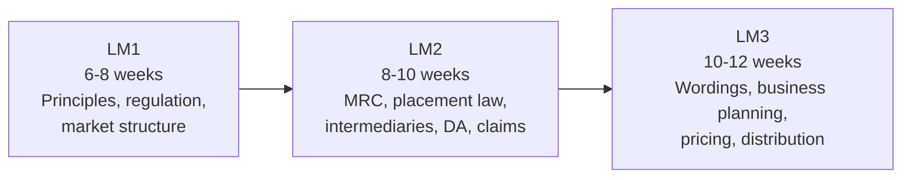

# Module 14 – CII London Market Units LM1, LM2, LM3: Course Structure and Exam Strategy

**Purpose:** Map the Chartered Insurance Institute (CII) London Market units to this guide, so you can (1) pass the exams and (2) use the same knowledge in client work. The exam teaches the rules; the rest of this guide teaches how the rules play out in practice.

**Source:** CII examination syllabuses for LM1, LM2 and LM3, published October 2026, examined **1 January 2027 to 31 December 2027** (LM3 states 1 December 2027) **[certain]**. Always check the CII unit page for "qualification updates" before you sit the exam.

---

## 1. The three units at a glance

| | **LM1** | **LM2** | **LM3** |
|---|---|---|---|
| **Title** | London Market insurance essentials | London Market insurance principles and practices | London Market underwriting principles |
| **Objective (CII)** | Essential grounding in how the London insurance market operates | Broader understanding of insurance process and practice across the London Market | Underwriting disciplines; business planning, capacity, pricing, clear and certain contracts; delegated underwriting and distribution |
| **Exam format** | 50 MCQs | 55 MCQs + 4 case studies of 5 MCQs each (75 questions) | 75 MCQs |
| **Time** | 1 hour | 2 hours | 2 hours |
| **Learning outcomes** | 11 | 11 | 5 |
| **Level** | Entry (Beginner) | Intermediate | Intermediate–Advanced |
| **Law basis** | English law and practice | English law and practice | English law and practice |
| **Detailed notes in this guide** | [Module 15](15-CII-LM1-Study-Notes.md) | [Module 16](16-CII-LM2-Study-Notes.md) | [Module 17](17-CII-LM3-Study-Notes.md) |

Together, LM1, LM2 and LM3 lead to the CII **Certificate in London Market Insurance** **[likely]** – confirm current qualification rules and credit values on the CII website.

---

## 2. Where the marks are (question weighting)

The CII states that the number of questions per learning outcome is a guide, usually within ±2 **[certain]**. Use the weighting to plan study time.

### LM1 – 50 questions

| # | Learning outcome | Questions | Priority |
|---|---|---|---|
| 1 | Basic terminology used within the general insurance market | 6 | High |
| 2 | Fundamental principles of insurance | 10 | **Very high** |
| 3 | Main classes written in the London Market | 4 | Medium |
| 4 | The insurance cycle | 1 | Low |
| 5 | Reinsurance within the insurance market | 3 | Medium |
| 6 | Structure of the London Market | 5 | High |
| 7 | London Market regulatory and legal environment | 10 | **Very high** |
| 8 | Appropriate systems and controls (sanctions) | 2 | Medium |
| 9 | Data protection and money laundering | 2 | Medium |
| 10 | Broker's role | 4 | Medium |
| 11 | Underwriter's role | 3 | Medium |

**Insight:** 20 of 50 questions (40%) come from principles and regulation. Learn these first.

### LM2 – 55 questions + 20 case-study questions

| # | Learning outcome | Questions | Priority |
|---|---|---|---|
| 1 | Business nature of the London Market | 1 | Low |
| 2 | Main classes of insurance | 3 | Medium |
| 3 | Reinsurance (including calculations) | 3 | Medium |
| 4 | Market security | 3 | Medium |
| 5 | Regulatory and legal requirements | 6 | High |
| 6 | Insurance intermediation | 6 | High |
| 7 | Underwriting function | 7 | High |
| 8 | **The way business is conducted in the London Market** | **14** | **Very high** |
| 9 | Delegated underwriting | 4 | Medium |
| 10 | Claims handling | 4 | Medium |
| 11 | Resolving complaints | 4 | Medium |
| — | 4 case studies × 5 questions (any outcome) | 20 | **Very high** |

**Insight:** Outcome 8 (MRC, fair presentation, GUA, on risk, premiums, termination, conflicts) plus the case studies decide the result. Case studies test application, so practise with [Module 10](10-Business-Scenarios-and-Case-Studies.md).

### LM3 – 75 questions

| # | Learning outcome | Questions | Priority |
|---|---|---|---|
| 1 | Framework within which business is conducted | 5 | Medium |
| 2 | Role, purpose and implications of policy wording | 16 | **Very high** |
| 3 | Business planning and capital setting | 18 | **Very high** |
| 4 | Pricing of risk (individual and portfolio) | 12 | High |
| 5 | **Methods of writing business and distribution** | **24** | **Very high** |

**Insight:** Distribution and delegated underwriting (outcome 5) is almost a third of the exam. Business planning and capital (outcome 3) is the area most candidates find unfamiliar – Lloyd's SBF, monitoring and the technical account.

---

## 3. Mapping the syllabuses to this guide

| Topic | LM1 | LM2 | LM3 | Guide module |
|---|---|---|---|---|
| Insurance principles (good faith, indemnity, contribution, subrogation, proximate cause) | 1, 2 | 8.3, 10.3 | — | 15, 16 |
| Risk, peril, hazard, pooling, functions of insurance | 2 | — | — | 01, 15 |
| Classes of business | 3 | 2 | — | 03 |
| Insurance cycle | 4 | 7.4 | — | 04 §6.3 |
| Reinsurance | 5 | 3 | — | 03 §2.7, 06 Part C, 16 |
| Market structure and participants | 6 | 1 | 1.1 | 02 |
| Regulation (PRA, FCA, Lloyd's, international) | 7 | 5, 11 | 1.1 | 07 Part C, 15, 17 |
| FOS and FSCS | 7.4 | 11.3–11.4 | — | 15, 16 |
| Sanctions, data protection, money laundering | 8, 9 | — | — | 15 |
| Brokers and intermediaries, TOBA, agency | 10 | 6 | 1.2 | 02 §4, 16 |
| Underwriters, lead and follow | 11 | 7 | 5.1 | 04 |
| Market security, chain of security, ratings, solvency | — | 4 | 3.3 | 07 Part A |
| MRC, contract certainty, GUA, on risk | — | 8 | 2.2–2.3 | 04 §3–4, 16 |
| Policy wording, interpretation, side letters | — | 8.9–8.10 | 2 | 17 |
| Premium collection and processing | 10.3 | 8.12 | — | 06 Part A |
| Delegated underwriting, lineslips, consortia | — | 9 | 5 | 05, 04 §5, 17 |
| Claims handling | 2.9, 10.4 | 10 | — | 06 Part B |
| Reserving, open years, RITC | — | 7.6–7.7 | — | 07 Part A–B |
| Exposure modelling, RDS, cat models | — | 7.5 | 4.3 | 04 §6, 17 |
| Business planning (SBF), monitoring, capital setting | — | — | 3 | 07 §A4, 17 |
| Financial statements, technical account, ratios | — | 4.1 | 3.4 | 01 §1.1, 17 |
| Pricing, statistics, burning cost, triangulation | — | — | 4 | 04 §6.2, 17 |
| Fronting, layering, affinity, master policies | — | — | 5.1–5.2 | 17 |
| Complaints, SM&CR, claims handling rules | — | 11 | 1.1.6 | 07 Part C, 16 |

### What the exams do NOT cover (but clients will ask)

The CII units focus on principles, law and market practice. They do not go deeply into: the Blueprint Two decision and market modernisation ([Module 08](08-Advanced-Modernisation-Data-Technology.md)), AI ([Module 09](09-Advanced-AI-in-London-Market.md)), Lloyd's 2026–2030 strategy and current results ([Module 07](07-Advanced-Capital-Finance-Regulation.md)), data architecture, or consulting skills ([Module 11](11-Consulting-Playbook.md)). Passing the exams is necessary for credibility but not sufficient for consulting.

---

## 4. Recommended study sequence

**[guessing]** Study hours: about 50–60 hours for LM1, 80–100 hours for LM2, 100–120 hours for LM3, for someone working full time without London market operations experience. Adjust after your first practice test.

### Weekly method (works for all three units)

1. Read the CII study text chapter (the exam is set against it).
2. Read the matching module in this guide for practical context.
3. Make one-page notes per learning outcome in your own words.
4. Do the practice MCQs in modules 15–17, then the CII examination guide questions.
5. Review wrong answers: write why the right answer is right.
6. In the final two weeks, do full timed mock exams.

---

## 5. MCQ exam technique

| Technique | Why |
|---|---|
| Read the **last line** of the question first | Know what is being asked before reading the scenario. |
| Watch for **"NOT"**, **"MOST likely"**, **"main"** | CII questions often test the best answer, not just a correct one. |
| Eliminate two options first | Usually two options are clearly wrong. |
| For calculations, write the formula before the numbers | Reinsurance, IPT, burning cost, return period questions reward method. |
| Answer by English law and current market practice | Not by your own country's practice. |
| Time: LM1 ≈ 70 seconds per question; LM2 and LM3 ≈ 95 seconds | Flag hard questions and return. |
| For LM2 case studies, read the case once fully, then each question | The five questions build on the same facts. |

---

## 6. Common traps across the three units

| Trap | Correct position |
|---|---|
| "Utmost good faith means the insured must disclose everything." | For non-consumer insurance, the **Insurance Act 2015** duty of fair presentation applies; for consumers, **CIDRA 2012** applies (duty to take reasonable care not to misrepresent). |
| "Breach of warranty ends the contract." | Since the Insurance Act 2015, cover is **suspended** during breach and restored when the breach is remedied (s.10). |
| "The broker is the insurer's agent." | Normally the broker is the agent of the **insured**; exceptions arise in delegated authority and some administrative tasks. |
| "Lloyd's underwrites the risk." | **Syndicates** underwrite; Lloyd's is the market and regulator of the market. |
| "Signed line is always the same as written line." | Signed lines may be reduced (signed down) when the placement is over-subscribed. |
| "Subrogation applies to life insurance." | Subrogation applies only to **contracts of indemnity**. |
| "GUA = General Underwriting Agreement." | It is the **General Underwriters' Agreement**. |
| "FSCS pays 100% of all general insurance claims." | Generally **90%** with no upper limit; **100%** for compulsory insurance and certain claims **[likely]** – check current FSCS rules. |
