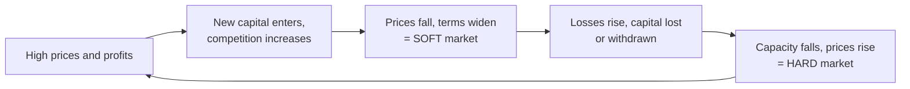

# Module 15 – CII LM1: London Market Insurance Essentials – Study Notes

**Exam:** 50 MCQs, 1 hour | **Syllabus:** published October 2026, examined 1 Jan – 31 Dec 2027 **[certain]**
**How to use:** Each section follows a CII learning outcome (LO). The notes cover the key points you need, in plain English, with links to the deeper modules. Confirm detail against the CII LM1 study text – it is the basis of the exam.

---

## LO1 – Basic terminology used in the general insurance market (≈6 questions)

### 1.1 Good faith and fair presentation

| Point | Detail |
|---|---|
| **Good faith** | Both parties must act honestly. Insurance has historically been a contract of "utmost good faith" (*uberrimae fidei*). The Insurance Act 2015 kept the principle but removed avoidance of the whole contract as the automatic remedy for breach (s.14). |
| **Duty of fair presentation (non-consumer)** | Insurance Act 2015, s.3: before the contract is entered into, the insured must disclose **every material circumstance** it knows or ought to know, **or** enough information to put a prudent insurer on notice that it needs to ask further questions. The presentation must be **reasonably clear and accessible**, and material facts must be **substantially correct**. |
| **What the insured "knows"** | Knowledge of senior management and of individuals responsible for the insurance (s.4); "ought to know" = what a **reasonable search** would reveal (including information held by agents, e.g., brokers). |
| **Material circumstance** | One that would influence the judgement of a prudent insurer in deciding whether to take the risk and on what terms. |
| **Consumers** | Consumer Insurance (Disclosure and Representations) Act 2012 (**CIDRA**): the consumer must take **reasonable care not to make a misrepresentation**; there is no general duty to volunteer information. |
| **Insurer's side** | Insurer must also act in good faith (e.g., handling claims fairly). |

Remedies for breach of fair presentation are in [Module 16 – LO8](16-CII-LM2-Study-Notes.md).

### 1.2 Proximate cause

- Defined as the **dominant, effective or efficient cause** that sets in motion a chain of events producing the loss – not necessarily the cause nearest in time (*Leyland Shipping v Norwich Union*, 1918) **[certain]**.
- Insurer pays if the proximate cause is an **insured peril** and not excluded.
- Concurrent causes: if one cause is insured and another is excluded, the exclusion usually prevails (*Wayne Tank v Employers Liability*, 1974) **[certain]**.
- Classic chain example: fire (insured) → firefighters' water damages stock → water damage is covered because fire is the proximate cause.

### 1.3 Indemnity and how it is modified

**Indemnity** = putting the insured back in the same financial position as immediately before the loss – no better, no worse.

| How indemnity is provided | Cash payment, repair, replacement, reinstatement |
|---|---|
| **Modifications that reduce payment** | Excess/deductible; **franchise** (no payment below a threshold, full payment above it); **average** (claim reduced in proportion to under-insurance: claim × sum insured ÷ value at risk); limits and sub-limits |
| **Modifications that go beyond strict indemnity** | **Reinstatement / new for old** (no deduction for wear and tear); **agreed value** policies (value agreed at inception – common in marine, fine art); first loss policies |
| **Not indemnity contracts** | Life and personal accident benefits (fixed sums) |

**Average – worked example:** Stock worth £200,000 insured for £150,000. Loss £40,000. Payment = £40,000 × 150,000 ÷ 200,000 = **£30,000**.

### 1.4 Contribution

- Applies when **two or more policies** cover the **same interest**, **same subject matter**, **same peril**, and both are **in force** at the time of loss.
- The insured cannot recover more than the loss in total. Insurers share the loss.
- Most policies have a **rateable proportion clause** (each insurer pays only its share).
- Methods: **maximum (independent) liability** – based on each policy's sum insured; **independent liability** – based on what each would have paid alone.

**Example (independent liability):** Loss £6,000. Policy A would pay £6,000 alone; Policy B would pay £3,000 alone. Total £9,000. A pays 6/9 × £6,000 = £4,000; B pays 3/9 × £6,000 = £2,000.

### 1.5 Subrogation

- After paying a claim, the insurer **stands in the shoes** of the insured to recover from a responsible third party.
- Applies only to **contracts of indemnity**.
- Arises from tort (negligence), contract, statute, or salvage.
- Insurer cannot recover more than it paid (the insured keeps any excess beyond that, subject to the policy).
- Policy conditions usually allow the insurer to start recovery action **before** payment.
- **Waiver of subrogation** clauses (e.g., in construction contracts) prevent insurers suing other named parties.

---

## LO2 – Fundamental principles of insurance (≈10 questions)

### 2.1–2.2 Risk and categories of risk

**Risk** = uncertainty about a loss; in insurance, the possibility of a financial loss from an event.

| Category | Meaning | Insurable? |
|---|---|---|
| **Pure risk** | Only loss or no loss (fire, theft) | Generally yes |
| **Speculative risk** | Loss, no loss or gain (business investment, gambling) | Generally no |
| **Particular risk** | Affects individuals; personal in cause and effect (burglary) | Yes |
| **Fundamental risk** | Affects society widely; impersonal in cause (war, pandemic, major flood) | Often excluded or covered by state schemes / specialist markets |
| **Financial risk** | Outcome can be measured in money | Yes |
| **Non-financial risk** | Cannot be measured in money (choice of career) | No |
| **Static vs dynamic** | Static: exists in an unchanging society (lightning); dynamic: from changes in society/economy (technology change) | Static usually insurable |

### 2.3 Pooling

Many people with similar risks pay premiums into a **common pool**; the pool pays the losses of the few. Works because of the **law of large numbers**: with more similar exposures, actual losses get closer to expected losses, so premiums can be set fairly.

### 2.4–2.5 Peril and hazard

| Term | Meaning | Example |
|---|---|---|
| **Peril** | The cause of loss | Fire, storm, theft |
| **Hazard** | A feature that increases the likelihood or size of loss from a peril | Storing petrol near a boiler |
| **Physical hazard** | Physical features of the risk | Timber construction, no sprinklers (poor); fire alarm and sprinklers (good) |
| **Moral hazard** | Attitude and behaviour of people connected with the risk | Dishonesty, carelessness, poor claims history, poor management (poor); strong risk management culture (good) |

### 2.6 Insurable and uninsurable risks

**Insurable risk requirements:** financial value; pure risk; particular (not catastrophic for the whole pool); fortuitous (accidental from the insured's view); **insurable interest**; not against public policy; large number of similar exposures; affordable premium.

**Generally uninsurable:** speculative/trading losses; deliberate acts of the insured; inevitable losses (wear and tear, depreciation); criminal fines and penalties (generally); some fundamental risks without specialist cover.

### 2.7–2.8 Purpose and functions of insurance

| Primary functions | Secondary functions |
|---|---|
| **Risk transfer** – from insured to insurer | **Loss prevention and control** – surveys, risk advice |
| **Common pool** – losses of few paid by many | **Social benefits** – security, employment, compensation for victims |
| **Equitable premiums** – each pays according to the risk brought to the pool | **Investment** – premiums invested in the economy; invisible earnings for UK |
| | **Peace of mind / enabling business** – lenders require insurance; trade possible |

### 2.9 Importance of claims handling

The claim is the moment the insurer delivers its promise. Good claims handling: protects reputation and broker relationships, keeps clients, controls cost (leakage), meets regulation (fair treatment) and supplies data for pricing and reserving. See [Module 06 Part B](06-Intermediate-Accounting-Settlement-Claims-Reinsurance.md).

---

## LO3 – Main classes of insurance written in the London Market (≈4 questions)

See [Module 03](03-Beginner-Lines-of-Business.md). For the exam, know the main features of: marine (hull, cargo, liability, war), aviation (hull, liability, products, space), energy (onshore, offshore), property (including terrorism and political violence), casualty/liability (public/products liability, professional indemnity, D&O, medical malpractice, cyber), specialty (political risk, credit, K&R, contingency, fine art, bloodstock), personal lines/A&H through delegated authority, and reinsurance.

---

## LO4 – The insurance cycle (≈1 question)

Drivers: capital supply, catastrophe events, investment returns, competition, reserve releases or deteriorations. The London market in 2026 is in a **softening** phase (Lloyd's risk-adjusted rates −6.7% in H1 2026) **[certain]**.

---

## LO5 – Reinsurance (≈3 questions)

**Purposes of reinsurance:** capacity (write larger risks), stability (smooth results), catastrophe protection, financial support (capital and solvency relief), expertise and confidence (new classes), withdrawal from a class (run-off).

**Key terms:** cedant/reassured; reinsurer; retrocession; treaty vs facultative; proportional (quota share, surplus) vs non-proportional (excess of loss, stop loss); retention; capacity; ceding commission; layer; reinstatement; burning cost. Details and calculations: [Module 03 §2.7](03-Beginner-Lines-of-Business.md) and [Module 16 – LO3](16-CII-LM2-Study-Notes.md).

---

## LO6 – Structure of the London Market (≈5 questions)

| Sub-point | Key notes | Guide |
|---|---|---|
| 6.1 Main participants | Lloyd's (Corporation, managing agents, syndicates, members), company market, brokers, P&I clubs, coverholders/MGAs, service providers | [Module 02](02-Beginner-Actors-Entities-Players.md) |
| 6.2 Why clients use London | Capacity for large risks; expertise in complex/specialty classes; security (Lloyd's chain of security, ratings); global licences; innovation; claims reputation; concentration of brokers and underwriters in one place | [Module 01 §3](01-Beginner-Foundations.md) |
| 6.3 Market associations | LMA (managing agents), IUA (company market), LIIBA (brokers), LMG (umbrella), plus Lloyd's | [Module 02 §6](02-Beginner-Actors-Entities-Players.md) |
| 6.4 How business is transacted | Broker presents to lead; subscription (lead and follow); MRC; open market vs delegated authority vs lineslips/consortia; electronic placing platforms; central processing and settlement via the bureau | [Module 04](04-Intermediate-Placement-and-Underwriting.md) |

---

## LO7 – Regulatory and legal environment (≈10 questions)

### 7.1 The industry regulators – role, aims, approach, principles

| | **FCA** | **PRA** |
|---|---|---|
| Focus | Conduct of business | Prudential soundness |
| Objectives | Strategic: markets function well. Operational: protect consumers, protect market integrity, promote effective competition. Secondary: international competitiveness and growth (from FSMA 2023) | Safety and soundness of firms; appropriate protection for policyholders (insurers). Secondary: competition; competitiveness and growth |
| Who | All insurance firms and intermediaries (solo-regulated firms like most brokers) | Insurers, Lloyd's, managing agents (dual-regulated with FCA) |
| Approach | Outcomes-based, data-led, Consumer Duty for retail | Judgement-based, forward-looking, proportionate |

**FCA Principles for Businesses (12)** **[certain]**: (1) integrity; (2) skill, care and diligence; (3) management and control; (4) financial prudence; (5) market conduct; (6) customers' interests; (7) communications with clients; (8) conflicts of interest; (9) customers: relationships of trust; (10) clients' assets; (11) relations with regulators; (12) **Consumer Duty** – act to deliver good outcomes for retail customers. (Principles 6 and 7 do not apply where Principle 12 applies.)

**PRA Fundamental Rules (8)** **[certain]**: integrity; skill, care and diligence; prudent risk management; adequate financial resources; effective risk strategy and risk management systems; organise and control affairs responsibly; deal with regulators openly; be able to resolve in an orderly way.

### 7.2 International regulators and licensing

- Each country regulates insurance written on its residents/risks. A London insurer can write a risk abroad only if it holds a **local licence** or the business is allowed on a **non-admitted** basis (e.g., US surplus lines, large commercial risks, most reinsurance).
- **US:** state-based regulation; National Association of Insurance Commissioners (NAIC) coordinates; Lloyd's syndicates are eligible surplus lines insurers and hold US trust funds.
- **EU:** after Brexit, UK insurers lost passporting; Lloyd's set up **Lloyd's Insurance Company S.A. (Lloyd's Europe)** in Brussels.
- **IAIS** sets global Insurance Core Principles.
- Lloyd's holds licences in 200+ countries and territories and provides licensing guidance (Crystal) **[certain]**.

### 7.3 Governance of the Lloyd's Market

- **Lloyd's Act 1982**: the **Council of Lloyd's** is the governing body with power to make byelaws; includes working, external and nominated members; Chair and Deputy Chairs elected from Council.
- The Council delegates day-to-day management to the executive under the **CEO** and committees.
- Lloyd's supervises managing agents through business plan approval, minimum standards / principles for doing business, Market Bulletins, and intervention powers.
- PRA and FCA regulate the **Society of Lloyd's** and managing agents; Lloyd's works with both under cooperation arrangements.

### 7.4 Financial Ombudsman Service and FSCS

| | **Financial Ombudsman Service (FOS)** | **Financial Services Compensation Scheme (FSCS)** |
|---|---|---|
| Purpose | Free, independent resolution of complaints against financial firms | Compensation when an authorised firm **fails** (insolvent) |
| Who can use | **Eligible complainants**: consumers, micro-enterprises, small businesses (fewer than 50 employees and turnover below £6.5m or balance sheet below £5m), small charities and trusts, some guarantors | Mainly individuals and small businesses (for general insurance, small businesses with turnover under £1m **[likely]**) |
| Process | Complainant must first complain to the firm; firm has **8 weeks** to give a final response; complainant has **6 months** from final response to refer to FOS | Claim made to FSCS after firm declared in default |
| Limits | Maximum award limit adjusted annually (e.g., £445,000 for complaints referred from 1 April 2025 about acts on/after 1 April 2019) **[likely]** – check current figure | General insurance: **90%** of claim, no upper limit; **100%** for compulsory insurance (e.g., employers' liability, motor third party) and certain claims such as injury **[likely]** |
| Binding? | Decision binding on firm if complainant accepts | — |

**Large London market commercial clients are usually not eligible** for FOS or FSCS – an exam favourite.

### 7.5–7.6 Regulator powers over insurers and intermediaries

- **Authorisation**: firms need Part 4A permission under FSMA 2000; must meet **Threshold Conditions** (e.g., adequate resources, suitability, effective supervision, appropriate business model).
- **Approval of individuals** under the **Senior Managers & Certification Regime (SM&CR)**; Conduct Rules apply to most staff.
- **Supervision**: returns, visits, reviews, skilled person reports (s.166 FSMA).
- **Enforcement**: fines, public censure, variation or cancellation of permission, prohibition of individuals, restitution orders.
- **Intermediaries**: FCA authorises and supervises brokers (solo-regulated); rules include ICOBS, SYSC, client money (CASS 5), professional indemnity insurance requirements, capital resources rules.
- **Appointed representatives** operate under a principal firm's responsibility.

### 7.7 Essentials of a valid insurance contract

| Element | Meaning in insurance |
|---|---|
| **Offer and acceptance** | Proposal/presentation (offer) and acceptance by insurer; in London, the underwriter writing a line on the slip is acceptance |
| **Consideration** | Premium (or promise to pay) and the insurer's promise to pay claims |
| **Capacity to contract** | Parties legally able (e.g., not minors; company acting within powers) |
| **Legality** | Lawful purpose; not against public policy (e.g., cannot insure illegal cargo) |
| **Intention to create legal relations** | Presumed in commercial contracts |
| **Certainty of terms** | Terms must be clear – links to contract certainty |
| **Insurable interest** | Insured must have a legal/financial relationship with the subject matter – essential for insurance validity |

---

## LO8 – Systems and controls (sanctions) (≈2 questions)

### 8.1 Purpose of sanctions
Political and economic measures used by governments and international bodies (UN, UK, EU, US) to change behaviour of countries, regimes, entities or individuals: e.g., counter-terrorism, non-proliferation, human rights, response to armed conflict (Russia).

### 8.2 Systems and controls

| Regime | Key body |
|---|---|
| **UK** | Sanctions and Anti-Money Laundering Act 2018; **OFSI** (HM Treasury) enforces financial sanctions; Department for Business and Trade for trade sanctions |
| **EU** | Council regulations – relevant to Lloyd's Europe and EU entities |
| **US** | **OFAC** (US Treasury); applies to US persons, US dollar transactions; **secondary sanctions** can affect non-US firms |
| **UN** | Security Council resolutions implemented by member states |

**Controls a London firm needs:**
- Screening of insureds, beneficiaries, brokers, coverholders, vessels and other parties at **quote, bind, endorsement, claims payment** and periodically.
- **Sanctions clauses** in contracts (e.g., LMA3100 sanction limitation and exclusion clause) **[certain]**.
- Escalation and licence applications; reporting suspected breaches to OFSI.
- Training, governance, record-keeping, testing of screening tools.
- Marine: vessel tracking (AIS), ship-to-ship transfers, oil price cap compliance.

---

## LO9 – Data protection and money laundering (≈2 questions)

### 9.1 Data protection
- **UK GDPR and Data Protection Act 2018** (amended by the Data (Use and Access) Act 2025 **[likely]**).
- **Principles**: lawfulness, fairness and transparency; purpose limitation; data minimisation; accuracy; storage limitation; integrity and confidentiality (security); accountability.
- **Rights of individuals**: to be informed, access, rectification, erasure, restriction, portability, objection, rights about automated decision-making.
- **Special category data** (e.g., health) needs extra conditions – relevant to A&H, injury claims.
- Regulator: **Information Commissioner's Office (ICO)**; maximum fines up to £17.5m or 4% of global annual turnover **[certain]**.
- Impact on London business: data sharing across many insurers and brokers in a subscription; international transfers; bordereaux contain personal data.

### 9.2 Money laundering
- Stages: **placement, layering, integration**.
- **Proceeds of Crime Act 2002 (POCA)**: offences of concealing, arranging, acquiring criminal property; failure to disclose (regulated sector); **tipping off**.
- **Money Laundering Regulations 2017** apply mainly to life and investment insurance; general insurance firms are largely outside the MLRs' regulated sector but remain subject to POCA, terrorist financing law, sanctions and FCA financial crime systems and controls **[likely]**.
- Insurance risks: premium paid then cancelled for refund to a third party; overpayment refunds; fraudulent claims; unusual payment routes; politically exposed persons (PEPs).
- Controls: customer due diligence (know your customer), enhanced due diligence for higher risk, monitoring, **suspicious activity reports (SARs)** to the National Crime Agency via the **Money Laundering Reporting Officer (MLRO)**, training and records.
- Related: Bribery Act 2010; Criminal Finances Act 2017 (failure to prevent facilitation of tax evasion); Economic Crime and Corporate Transparency Act 2023 (failure to prevent fraud offence) **[likely]**.

---

## LO10 – The broker's role (≈4 questions)

| Sub-point | Key notes |
|---|---|
| 10.1 Role and responsibilities | Agent of the client; advise on cover; fair presentation on client's behalf; choose secure insurers; obtain best terms; place and document cover (contract certainty); handle premiums and claims; act with skill and care (liable in negligence if not – E&O) |
| 10.2 Broking process and parties | Client/retail broker → London broker (placing broker) → lead underwriter → followers; also account handlers, technicians (documentation and processing), claims brokers |
| 10.3 Premium handling | Collects premium from client, deducts brokerage, pays insurers (often via bureau central settlement); holds money as client money (CASS 5) or under **risk transfer** for insurers; must meet premium payment terms |
| 10.4 Claims | Notifies claim to leader, collects information, presents and negotiates claim, advocates for client, collects claim funds and pays client |

---

## LO11 – The underwriter's role (≈3 questions)

| Sub-point | Key notes |
|---|---|
| 11.1 Role and responsibilities | Assess risk; decide acceptance, terms and price; work within authority and business plan; build a balanced profitable portfolio; manage aggregation; ensure contract certainty; manage relationships with brokers |
| 11.2 Lead and following underwriters | **Lead**: sets terms and rate, often handles claims agreement and changes (under GUA and claims schemes), carries reputational responsibility. **Followers**: accept the leader's terms for their share, rely on leader's expertise; can sometimes add conditions. Each insurer is **severally** liable only for its own line |

---

## Practice questions (answers at the end)

1. Under the Insurance Act 2015, the duty of fair presentation applies to:
   a) consumer contracts only b) non-consumer contracts c) life insurance only d) reinsurance only
2. Which is a **moral** hazard?
   a) timber building b) no sprinklers c) poor claims history caused by careless management d) flood zone location
3. Stock valued at £400,000 is insured for £300,000 subject to average. Loss £80,000. Payment?
   a) £80,000 b) £60,000 c) £75,000 d) £53,333
4. Subrogation does **not** apply to:
   a) motor b) property c) personal accident fixed benefits d) liability
5. Which body compensates customers when an authorised insurer becomes insolvent?
   a) FOS b) FSCS c) PRA d) OFSI
6. In a London subscription placement, each insurer's liability is:
   a) joint b) joint and several c) several d) limited to the leader's line
7. Which is a **primary** function of insurance?
   a) loss prevention b) investment c) equitable premiums d) social benefit
8. The proximate cause is:
   a) the last event before the loss b) the dominant, effective cause c) the most expensive cause d) the cause named by the insured
9. A firm must give a final response to a complaint before referral to FOS within:
   a) 4 weeks b) 8 weeks c) 6 months d) 12 months
10. Which body enforces UK financial sanctions?
    a) FCA b) OFAC c) OFSI d) NCA

**Answers:** 1-b, 2-c, 3-b (80,000 × 300/400), 4-c, 5-b, 6-c, 7-c, 8-b, 9-b, 10-c.
