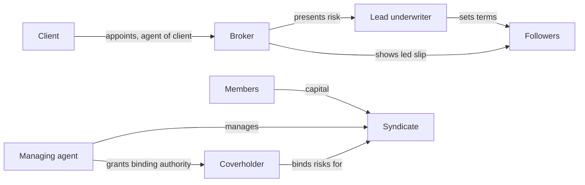

# Module 16 – CII LM2: London Market Insurance Principles and Practices – Study Notes

**Exam:** 55 MCQs + 4 case studies (5 MCQs each), 2 hours | **Syllabus:** published October 2026, examined 1 Jan – 31 Dec 2027 **[certain]**
**Focus:** LO8 (how business is conducted) carries about 14 questions, and the case studies test application across all outcomes. Confirm detail against the CII LM2 study text.

---

## LO1 – Business nature of the London Market (≈1 question)

**1.1 Principal parties and relationships**

Key relationships to know: client–broker (agency); broker–insurer (TOBA, premium and claims handling); lead–follower (subscription, GUA, claims lead arrangements); managing agent–members (agency agreements); insurer–coverholder (binding authority agreement). See [Module 02](02-Beginner-Actors-Entities-Players.md).

---

## LO2 – Main classes of insurance (≈3 questions)

| Sub-point | Key notes |
|---|---|
| 2.1 Why use London | Capacity, expertise, security, licences, innovation, claims reputation, subscription allows very large limits |
| 2.2 Classes and typical losses | Marine (collision, sinking, cargo damage, general average, war); aviation (crash, ground damage, passenger liability, war/confiscation); energy (blowout, fire/explosion, pollution, business interruption); property (fire, nat cat, terrorism, BI); liability (injury, damage, professional negligence, D&O claims, cyber breaches); specialty (expropriation, kidnap, event cancellation, credit default). See [Module 03](03-Beginner-Lines-of-Business.md) |
| 2.3 Diversification and portfolio management | Spread by class, territory, peril, size and channel; line size limits; aggregate limits by zone and peril; reinsurance; avoid correlation (e.g., cyber and property from one event); business plan targets |

---

## LO3 – Reinsurance (≈3 questions + calculations)

### 3.1 Methods

| Method | Description | Key features |
|---|---|---|
| **Facultative** | Individual risk, offered and accepted separately | Reinsurer free to accept or decline; good for unusual or large risks; admin-heavy |
| **Treaty** | Agreement covering a defined portfolio | Obligatory – cedant must cede, reinsurer must accept within terms; automatic cover |
| **Facultative-obligatory (fac/oblig)** | Cedant may choose to cede; reinsurer must accept | Risk of adverse selection for reinsurer |
| **Proportional** | Premium and losses shared in same proportion | Quota share, surplus; ceding commission paid to cedant |
| **Non-proportional** | Reinsurer pays losses above a retention up to a limit | Risk XoL, catastrophe XoL, stop loss; priced as rate on line |

### 3.2 Calculations – learn these patterns

**Quota share (40% ceded)**
- Gross premium £5m → ceded £2m, retained £3m.
- Loss £1.5m → recoverable £600k, retained £900k.
- Ceding commission at 25% on ceded premium → £500k paid by reinsurer to cedant.

**Surplus treaty**
- Retention (one "line") = £1m; treaty capacity = 9 lines (£9m). Total capacity = £10m.
- Risk with sum insured **£4m**: cedant retains £1m (25%), cedes £3m (**75%**). All premium and losses on that risk shared 25/75.
- Loss £800k → recoverable 75% = **£600k**.
- Risk with sum insured £12m: capacity is £10m, so cedant must find £2m extra (e.g., facultative); within the treaty, retained 1/12 and ceded 9/12.

**Excess of loss (XoL): £4m xs £1m**
| Loss | Retained by cedant | Recovered |
|---|---|---|
| £800k | £800k | £0 |
| £3m | £1m | **£2m** |
| £7m | £1m + £2m above layer = £3m | **£4m** (layer exhausted) |

**Reinstatement premium:** if the layer is used, a reinstatement restores the limit, usually for an extra premium **pro rata to the amount** (and sometimes the time) used. Example: annual premium £400k on a £4m layer, recovery £2m, one reinstatement at 100% → reinstatement premium = £400k × 2/4 = **£200k**.

**Rate on line (ROL)** = premium ÷ limit. £400k ÷ £4m = **10%**.

---

## LO4 – Market security (≈3 questions)

### 4.1 Basic accountancy and solvency

| Concept | Meaning |
|---|---|
| **Assets** | What the insurer owns (investments, cash, reinsurance recoverables, premiums receivable) |
| **Liabilities** | What it owes (claims reserves, unearned premium, debts) |
| **Own funds / capital** | Assets minus liabilities |
| **Solvency** | Ability to meet liabilities as they fall due; regulators require capital above a minimum |
| **Historic solvency margin (Solvency I)** | Minimum margin calculated on a premium basis and a claims basis (the higher applied) – background only |
| **Solvency II / Solvency UK** | **SCR** = capital to survive a 1-in-200 year loss over one year (99.5% VaR); **MCR** = lower floor (85% confidence, within 25–45% of SCR); **solvency ratio** = eligible own funds ÷ SCR (e.g., 150%) **[certain]** |

### 4.2 Lloyd's chain of security
Three links: (1) syndicate-level assets (premium trust funds); (2) members' **Funds at Lloyd's**; (3) **central assets** including the Central Fund. See [Module 07 §A3](07-Advanced-Capital-Finance-Regulation.md).

### 4.3 Rating agencies
- A.M. Best, S&P Global, Fitch, Moody's give **financial strength ratings** – an opinion of ability to pay claims.
- Brokers' **security committees** use ratings and their own analysis to approve insurers.
- Many clients and contracts require a minimum rating (e.g., "A-" or better).
- All Lloyd's syndicates share Lloyd's market ratings because of the Central Fund.

---

## LO5 – Regulatory and legal requirements (≈6 questions)

### 5.1 Compulsory insurance in the UK
Reason: protect **third parties/victims** so compensation is available even if the wrongdoer cannot pay.

| Insurance | Law |
|---|---|
| **Employers' liability** | Employers' Liability (Compulsory Insurance) Act 1969 – minimum £5m per occurrence **[certain]** |
| **Motor third party** | Road Traffic Act 1988 – unlimited for injury; minimum for property damage **[certain]** |
| Others | Nuclear installations; riding establishments; dangerous wild animals; oil pollution for certain ships; **professional indemnity** required by regulators for solicitors, accountants, insurance intermediaries and others |

### 5.2 Consumer Rights Act 2015
- Applies to **consumer** contracts, including consumer insurance.
- Unfair terms are **not binding** on the consumer.
- Terms must be **transparent and prominent**. The **core terms** (main subject matter and price) are not assessed for fairness **if** transparent and prominent.
- Ambiguous terms are interpreted in the way **most favourable to the consumer**.

### 5.3 Contracts (Rights of Third Parties) Act 1999
- A third party can enforce a contract term if the contract **expressly allows** it, or the term **purports to confer a benefit** on them (unless the parties did not intend it to be enforceable).
- London policies often include a clause **excluding** the Act, and then name specific third parties (e.g., lenders, additional insureds) where needed.

### 5.4 EU solvency requirements and PRA risk-based capital
- Solvency II (EU, 2016) – three pillars: (1) quantitative (SCR, MCR, technical provisions, own funds); (2) governance and supervision (ORSA, system of governance); (3) disclosure and reporting (SFCR, RSR, QRTs).
- UK: **Solvency UK** reforms from 31 December 2024 (reduced risk margin, reporting changes) **[likely]**. PRA approves internal models; Lloyd's uses a market internal model with ECA = uSCR × 135% for members **[certain]**.

### 5.5 Insurance Premium Tax (IPT)
- Tax on general insurance premiums for UK risks, paid by the insurer (usually passed to the client).
- **Standard rate 12%**; **higher rate 20%** for travel insurance and certain products sold with vehicles or electrical goods by suppliers **[certain]**.
- Exempt: reinsurance, long-term (life) insurance, certain commercial ships and aircraft, goods in international transit, risks outside the UK.
- **Calculation:** premium £10,000 at standard rate → IPT £1,200; total £11,200. If a total of £11,200 includes IPT, the premium = 11,200 ÷ 1.12 = £10,000.

---

## LO6 – Insurance intermediation (≈6 questions)

### 6.1–6.2 Types of intermediaries and brokers

| Type | Role |
|---|---|
| **Retail broker** | Client-facing; places locally or sends to wholesale |
| **Wholesale / London broker** | Places business from other intermediaries into London |
| **Lloyd's broker** | Accredited by Lloyd's to place at Lloyd's |
| **Reinsurance broker** | Places treaty and facultative reinsurance |
| **Producing broker** | Overseas broker who produces business for a London placing broker |
| **Placing broker** | Broker who presents and places the risk in London |
| **MGA / coverholder** | Binds on behalf of insurers (agent of insurer) |
| **Appointed representative** | Acts under the responsibility of an authorised principal firm |
| **Introducer** | Only introduces clients |
| **US surplus lines broker** | Licensed to place non-admitted business in a US state; pays surplus lines tax |

Services: advice, risk management, placement, documentation, premium and claims handling, market security analysis, claims advocacy.

### 6.3 Terms of Business Agreement (TOBA)
A TOBA between broker and insurer sets out: authority (usually **no** authority to bind unless stated), **premium handling** (risk transfer or not), settlement terms, documentation duties, claims handling, data protection, complaints, conflicts of interest, termination. The London market uses a generic market TOBA template **[likely]**.

### 6.4 Broker remuneration
- **Brokerage/commission** – percentage of premium paid by insurer (deducted from premium).
- **Fees** – agreed with and paid by client (sometimes in place of commission).
- **Profit commission / contingent commission** – based on profitability or volume.
- **Other income** – placement service agreements, facility fees, investment income on client money.
- Commercial clients can **ask** for disclosure of commission (ICOBS) **[certain]**; conflicts must be managed.

### 6.5 Law of agency

| Topic | Key points |
|---|---|
| **Creation** | By agreement (express or implied), by **ratification** (principal later adopts an unauthorised act), by **necessity**, by estoppel (**apparent/ostensible authority**) |
| **Types of authority** | Actual express; actual implied; apparent (ostensible) |
| **Agent's duties** | Obey instructions; exercise reasonable care and skill; act personally (no delegation without consent); act in good faith – no secret profits, avoid conflicts; account for money |
| **Principal's duties** | Pay agreed remuneration; indemnify agent for proper expenses |
| **Knowledge** | Knowledge of the agent can be imputed to the principal (relevant to fair presentation) |
| **Termination** | Agreement, completion, death, insolvency, revocation |
| **London application** | Broker is normally **agent of the insured**; coverholder binding a risk is agent of the insurer; broker may act for insurers in limited tasks (e.g., holding premium under risk transfer) – conflicts must be managed |

### 6.6 Legislation for intermediaries
FSMA 2000 (authorisation); FCA Handbook – **ICOBS** (conduct of business), **SYSC** (systems and controls, conflicts), **CASS 5** (client money), **PROD** (product governance), **SM&CR**, Consumer Duty (retail); the **Insurance Distribution Directive (IDD)** – EU rules implemented in UK rules before Brexit and still applying to EU intermediaries; FCA **PS25/21** (December 2025) narrows conduct rules for larger commercial customers **[certain]**.

---

## LO7 – Underwriting function (≈7 questions)

| Sub-point | Key notes |
|---|---|
| 7.1 London vs elsewhere | Face-to-face and platform negotiation with brokers; subscription (shared risks); judgement-based specialty underwriting; global risks; strong reliance on lead underwriters; less standardised products |
| 7.2 Broker–underwriter relationship | Long-term, trust-based; broker presents, underwriter questions and negotiates; relationship affects access to business; must not compromise duties (fair presentation, conflicts) |
| 7.3 Lead and follow | Lead sets terms, price, often agrees changes and claims; followers accept leader's terms for their share; follow markets may rely on leader's expertise; signed lines may be reduced on over-placement |
| 7.4 Market cycle | Hard and soft phases driven by capital, losses, competition, investment returns; see [Module 15 LO4](15-CII-LM1-Study-Notes.md) |
| 7.5 Modelling and managing exposures and losses | Cat models (probabilistic), Realistic Disaster Scenarios (deterministic), aggregate monitoring by zone, PML, reinsurance; see [Module 17 LO4.3](17-CII-LM3-Study-Notes.md) |
| 7.6 Reserving | Provisions for **outstanding claims** (known) and **IBNR** (unknown or under-reported), plus unearned premium reserve. Needed for accurate profit, solvency, pricing and regulatory compliance |
| 7.7 Open years and RITC | Lloyd's year of account normally closes at 36 months by **reinsurance to close**; if liabilities too uncertain the year remains **open** and must be managed (run-off) until it can be closed. See [Module 07 §A2](07-Advanced-Capital-Finance-Regulation.md) |

---

## LO8 – The way business is conducted in the London Market (≈14 questions – highest weight)

### 8.1 Documents used to present risks
Market Reform Contract (MRC) draft; broker's **presentation / submission** (risk information, schedules, statements of values, loss records, surveys, financials); proposal forms (less common in London commercial business); prior policy wording.

### 8.2 Legal significance of quotations and renewals
- A **quotation** is generally an **offer** that can be accepted while valid (subject to conditions/"subjectivities"); some quotes are only an invitation to negotiate – depends on wording.
- Material change before acceptance may allow the insurer to withdraw.
- Each **renewal is a new contract** – a **fresh duty of fair presentation** applies at every renewal.

### 8.3 Fair presentation and good faith – remedies for breach (Insurance Act 2015, Schedule 1) **[certain]**

| Breach type | Remedy |
|---|---|
| **Deliberate or reckless** | Insurer may **avoid** the contract and **keep the premium** |
| **Neither deliberate nor reckless** – insurer would **not** have entered the contract | Avoid the contract, **return premium** |
| – insurer would have entered on **different terms** (other than premium) | Contract treated **as if those terms applied** |
| – insurer would have charged a **higher premium** | Claim reduced **proportionately**: pay (premium charged ÷ premium that would have been charged) × claim |

**Example:** Premium charged £60,000; with fair presentation it would have been £80,000. Claim £100,000 → paid £100,000 × 60/80 = **£75,000**.

### 8.4 Legal principles of a valid contract
Offer and acceptance, consideration, capacity, legality, intention, certainty, plus **insurable interest**. See [Module 15 LO7.7](15-CII-LM1-Study-Notes.md).

### 8.5 Market Reform Contract (MRC)
Purpose: standard format for placing and recording the contract; supports contract certainty; one document for all subscribing insurers. Sections: **Risk Details; Information; Security Details; Subscription Agreement; Fiscal and Regulatory; Broker Remuneration and Deductions**. See [Module 04 §3](04-Intermediate-Placement-and-Underwriting.md).

### 8.6 Placing open MRCs and electronic MRCs
- **Open MRC** (paper/PDF): broker takes the slip to each underwriter, who **writes and stamps** a line.
- **Electronic MRC**: placed on a platform (e.g., PPL, Whitespace); lines, stamps and messages are recorded electronically, with an audit trail and structured data.

### 8.7 General Underwriters' Agreement (GUA)
- Market agreement setting out **which contract changes the slip leader can agree alone** and which need agreement of other **agreement parties** (e.g., second lead or all followers).
- Changes are categorised (e.g., minor administrative changes by leader; material changes needing more parties).
- Purpose: speed and certainty for mid-term changes in a subscription market.

### 8.8 How an underwriter knows they are on risk
- When the underwriter **writes (stamps and signs/initials) a line** on the MRC – each written line creates a binding contract with that insurer, even before the slip is fully subscribed (*General Reinsurance v Fennia Patria*, 1983) **[certain]**.
- Electronically: acceptance recorded on the platform.
- Subject to any **"subject to"** conditions or subjectivities being met, and the inception date.
- Line may later be **signed down**, but the insurer is on risk from writing the line.

### 8.9 Sections of an insurance policy
Schedule (insured, period, sums insured, premium); recital/preamble; **operative (insuring) clause**; exclusions; conditions (general and specific); definitions; endorsements; signature/attestation.

### 8.10 Warranties, conditions and exclusions

| Term | Effect (after Insurance Act 2015) |
|---|---|
| **Warranty** | A promise by the insured. Breach **suspends** cover until remedied (s.10); "basis of contract" clauses that convert proposal answers into warranties are **abolished** (s.9) for non-consumer insurance |
| **Terms not relevant to the loss** (s.11) | If a term aims to reduce the risk of a particular type of loss, the insurer cannot rely on its breach if the insured shows the breach could not have increased the risk of the loss that actually happened |
| **Condition precedent** | Must be complied with before liability attaches (e.g., notifying claims within a time) |
| **Condition** | Breach may give insurer a claim for damages but usually not a defence to the whole claim |
| **Exclusion** | Defines what is not covered; insurer must prove the exclusion applies |

### 8.11 Contract certainty
All terms **agreed before inception** and contract documentation provided **promptly** after. Introduced by the market after regulator pressure; MRC supports it. Failure leads to disputes, unpaid claims, regulatory criticism.

### 8.12 Collection and processing of premiums
Broker collects premium; premium payment terms in the MRC (e.g., premium payment clause with a settlement due date); submission to the bureau; signing number and date; central settlement; credit control and terms of trade. See [Module 06 Part A](06-Intermediate-Accounting-Settlement-Claims-Reinsurance.md).

### 8.13 Termination of insurance contracts
- **Expiry** at end of period.
- **Cancellation** under a cancellation clause (notice period; pro-rata or short-period return premium).
- **Mutual agreement**.
- **Avoidance** for breach of fair presentation (deliberate/reckless, or where insurer would not have written the risk).
- **Fraudulent claim** – insurer may terminate from the time of the fraudulent act and refuse the claim (Insurance Act 2015, s.12) **[certain]**.
- **Non-payment of premium** under a premium payment clause/warranty.
- **Exhaustion of aggregate limit**; frustration; operation of law.

### 8.14 Conflicts of interest
- Arise when a firm's interests (or one client's) conflict with another client's: e.g., broker paid by insurer while acting for client; broker acting as coverholder or claims handler for insurer; contingent commissions; placing into a broker's own facility; managing agent allocating risks between syndicates with different capital providers.
- FCA **SYSC 10**: identify, prevent or **manage** conflicts; disclose to the client as a last resort; keep records.

---

## LO9 – Delegated underwriting (≈4 questions)

| Sub-point | Key notes |
|---|---|
| 9.1 Purpose | Access local markets and small risks economically; use local expertise; scale distribution; efficient for high-volume business |
| 9.2 Lloyd's controls | Coverholder **approval** by Lloyd's; managing agent due diligence; **registration** of binding authority agreements before inception; standard wordings; limits on authority (classes, territories, premium income, line size); **bordereaux reporting** standards; audits; oversight and board reporting; restrictions on sub-delegation; Lloyd's monitoring of managing agents' DA controls. See [Module 05](05-Intermediate-Delegated-Authority.md) |
| 9.3 Lineslips and consortia | **Lineslip**: a pre-agreed facility where a lineslip leader (sometimes with a second lead) can accept declared risks on behalf of all participants. **Consortium**: a group of insurers that agree to write business together, with a consortium leader underwriting on behalf of all members; Lloyd's consortia must be registered **[likely]**. See [Module 04 §5](04-Intermediate-Placement-and-Underwriting.md) |

---

## LO10 – Claims handling in the London Market (≈4 questions)

| Sub-point | Key notes |
|---|---|
| 10.1 Insurer and broker roles | Broker: notify, gather information, present and advocate the claim, collect payment. Insurer: acknowledge, investigate coverage, appoint experts, set reserves, agree and pay; lead and agreement parties agree on behalf of followers under claims lead arrangements |
| 10.2 Claims personnel | Claims broker/technician; lead claims adjuster; follower claims handlers; **loss adjuster** (appointed by insurer); **loss assessor** (appointed by insured); TPA/DCA; lawyers; experts (forensic accountants, engineers) |
| 10.3 Principles in claims | Apply indemnity (and modifications such as average and excesses), subrogation, contribution, proximate cause and exclusions. See [Module 15 LO1](15-CII-LM1-Study-Notes.md) |

---

## LO11 – Resolving complaints (≈4 questions)

| Sub-point | Key notes |
|---|---|
| 11.1 Regulation of individuals | **SM&CR**: Senior Management Functions (pre-approved; e.g., CEO, CFO, CRO, Chair, Chief Underwriting Officer for insurers) with Statements of Responsibilities and a **Duty of Responsibility**; **Certification Regime** (firm certifies fitness and propriety annually); **Conduct Rules** for almost all staff; regulatory references |
| 11.2 Claims handling requirements | ICOBS 8: handle claims **promptly and fairly**; provide reasonable guidance; do not **unreasonably reject** a claim; settle promptly once agreed (scope for larger commercial customers narrowed by PS25/21 – check current scope **[likely]**). Enterprise Act 2016: implied term to pay sums due within a reasonable time; damages for late payment **[certain]** |
| 11.3 FOS | Free, independent; eligible complainants only; 8-week final response; 6 months to refer; binding on firm if accepted. See [Module 15 LO7.4](15-CII-LM1-Study-Notes.md) |
| 11.4 FSCS | Pays when an authorised firm fails; general insurance 90% (100% compulsory and certain claims); eligibility mainly individuals and small businesses **[likely]** |

---

## Case study practice (exam style)

**Case:** Atlas Logistics (UK, turnover £300m) instructs London broker Brookfield to place property cover with a £50m limit. Brookfield places it on an electronic MRC: Syndicate 1001 leads with 30%, followers write 90% in total (total written 120%). Atlas did not disclose two previous warehouse fires because its insurance manager forgot; the underwriter says it would have charged 25% more premium if told. During the year, the leader agrees an extension of cover to a new warehouse. A fire causes a £10m loss.

1. What is the leader's **signed** line? a) 30% b) 25% c) 36% d) 20%
2. Which agreement allows the leader to agree certain changes without all followers? a) TOBA b) GUA c) BAA d) MRC
3. Is the non-disclosure deliberate or reckless? a) Yes b) No – it is careless (neither deliberate nor reckless)
4. How much is payable on the £10m claim (if premium charged was P and correct premium 1.25P)? a) £10m b) £8m c) £7.5m d) nil
5. Is Atlas eligible to refer a complaint to FOS? a) Yes b) No – it is too large

**Answers:** 1-b (30 × 100/120 = 25%); 2-b; 3-b; 4-b (£10m × 1/1.25 = £8m); 5-b.

---

## Practice MCQs

1. A surplus treaty has a £500k retention and 10 lines. For a £3m risk, the ceded share is: a) 50% b) 83.3% c) 90% d) 16.7%
2. Under the Insurance Act 2015, breach of warranty: a) ends the contract b) suspends cover until remedied c) has no effect d) makes the contract void from inception
3. IPT standard rate on a £20,000 commercial property premium is: a) £1,200 b) £2,400 c) £4,000 d) £0
4. Which is created by ratification? a) a TOBA b) agency c) a binding authority d) a consortium
5. The Contracts (Rights of Third Parties) Act 1999 is often: a) mandatory b) excluded by express clause c) only for consumer contracts d) replaced by the Insurance Act
6. A cedant buys £10m xs £5m. A £12m loss produces a recovery of: a) £7m b) £10m c) £12m d) £5m
7. An insurer may terminate from the time of a fraudulent claim under: a) CIDRA s.2 b) Insurance Act 2015 s.12 c) CRA 2015 d) FSMA s.166

**Answers:** 1-b (retain £500k = 1/6; cede 5/6 = 83.3%); 2-b; 3-b; 4-b; 5-b; 6-a; 7-b.
