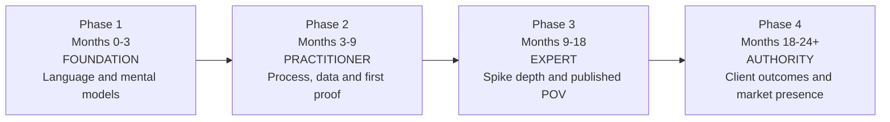

# Module 18 – The Path to World-Class London Market Consultant

**Purpose:** A 24-month development path to become a consultant whom London market and Lloyd's executives seek out, trust with their hardest problems, and pay a premium for. Exams are not the goal. Proof of judgement and results is.

**Read this first:** most of this path is **doing**, not reading. Modules 01–13 give you the knowledge. This module tells you how to turn it into capability, evidence and reputation. Modules 14–17 (CII syllabus notes) are now an optional reference library for law and market rules – use them when you need precise rules, not as a study track.

### Your starting point and the standard you are aiming at

You are already an insurance consultant, so you do not start from zero. Adjust the path as follows:

| Area | Adjustment |
|---|---|
| Phase 1 (Foundation) | Compress from 3 months to about 6 weeks; use it to fill London- and Lloyd's-specific gaps rather than general insurance basics |
| Pillar E (Consulting craft) | Your benchmark is the standard of top-tier strategy firms (McKinsey, Bain, BCG): answer-first communication, hypothesis-driven problem solving, value sizing in every recommendation. Each detailed chapter now ends with a **"Partner's lens"** section showing how a senior partner would use that chapter's knowledge with a client |
| Exposure | Use your current client work: volunteer for London market and Lloyd's engagements, and turn every engagement into one artefact and one case study |

*Note: the Partner's lens sections describe widely documented top-tier consulting methods. They are not insider material from any firm, and they do not replace feedback from senior people who have worked at those firms – seek that feedback directly when you can.*

---

## 1. What "world class" actually means here

A world-class London market consultant passes these six tests. Use them as your end goal and test yourself against them every quarter.

| # | Test | How you will know |
|---|---|---|
| 1 | **Domain fluency** | You can hold a 60-minute conversation with a Chief Underwriting Officer, CFO or Head of Delegated Authority without notes, using their language correctly (signed lines, year of account, RITC, bordereaux, SBF, ECA). |
| 2 | **Financial translation** | Within 30 minutes of hearing a client problem, you can say which line of the P&L or capital it hits and roughly how much. |
| 3 | **End-to-end view** | You can trace risk, money and data from client to broker to lead to follower to bureau to claim to reinsurance recovery – and point to where cost and leakage build up. |
| 4 | **Bridge between business and technology** | Business leaders trust your judgement on underwriting and operations; technology leaders trust your judgement on data, architecture and AI. Few people have both. |
| 5 | **Point of view** | You hold clear, published positions on the market's big questions (after Blueprint Two, soft-market discipline, AI in delegated authority) that clients quote back to you. |
| 6 | **Track record** | You can name outcomes you delivered, with numbers: cost removed, days of premium debt reduced, bordereaux processing time cut, use cases in production. |

**The honest gap [likely]:** knowledge gets you to tests 1–3 in about 6–9 months of focused effort. Tests 4–6 need real client exposure and take 18–36 months. No amount of reading replaces sitting with an operations team for a week and watching a bordereau being processed.

---

## 2. The capability model – six pillars, four levels

| Pillar | Level 1 – Foundation | Level 2 – Practitioner | Level 3 – Expert | Level 4 – Authority |
|---|---|---|---|---|
| **A. Market and domain** | Explains structure, actors, lifecycle correctly | Explains process detail and exceptions (signing down, claims lead arrangements, DA controls) | Diagnoses why a process fails at a specific client and what market rules constrain the fix | Shapes market thinking; consulted by market bodies |
| **B. Financial and capital acumen** | Reads combined ratio and its components | Builds a class-level P&L view from syndicate accounts; understands SBF and ECA | Links operational change to loss ratio, expense ratio and capital with credible numbers | CFO-level adviser on cycle management and capital efficiency |
| **C. Functional and operating model** | Maps an as-is process | Designs a target process and operating model for one function | Designs an end-to-end operating model across underwriting, DA, claims, finance | Known for operating models that delivered results |
| **D. Data, technology and AI** | Explains CDR, MRC data, systems landscape, basic AI concepts | Builds a data model; runs an AI prototype with measured accuracy | Designs data platform and AI programme with governance; leads vendor selection | Sets direction for a carrier's data and AI strategy |
| **E. Consulting craft** | Structures problems; writes clear slides | Runs workshops; produces client-ready deliverables; manages a workstream | Leads engagements; handles difficult stakeholders; storylines for executives | Sells and leads large programmes; trusted adviser to CEOs |
| **F. Market presence** | Follows market news | Has 20+ market contacts; posts informed comments | Publishes POVs; speaks at market events | Recognised name in the market |

**Target by month:**

| Month | A | B | C | D | E | F |
|---|---|---|---|---|---|---|
| 3 | 2 | 1 | 1 | 1 | your current level | 1 |
| 9 | 2 | 2 | 2 | 2 | 2 | 2 |
| 18 | 3 | 2–3 | 3 | 3 | 3 | 2–3 |
| 24+ | 3 | 3 | 3 | 3 | 3 | 3 |

Level 4 is a career outcome, not a 24-month target. Anyone promising you Level 4 in two years is selling something.

---

## 3. Choose your spike – do not try to be expert in everything

Clients do not hire generalists for hard problems. They hire the person known for one thing, who also understands everything around it. Pick **one primary spike** and **one secondary spike** by month 6.

| Spike | Demand outlook 2026–2028 | Why | Fit with you |
|---|---|---|---|
| **1. AI-enabled London market operations** (submission intake, bordereaux, claims, reconciliation) | **High [likely]** | Lloyd's 2026–2030 strategy targets efficiency and cost; soft market squeezes margins; LMA AI toolkit and PRA attention mean firms need governed AI, not pilots | Strong – combines your AI learning goal with functional and technical consulting |
| **2. Delegated authority and MGA oversight and data** | **High [likely]** | About 45% of Lloyd's premium; data quality and oversight are chronic problems; DA data standards being consulted on | Strong – process-heavy, data-heavy, measurable outcomes |
| 3. Post-Blueprint Two data standards and operating model | Medium–High [likely] | Firms need to re-plan after March 2026; CDR alignment, integration, cost-out | Good – technical and functional |
| 4. Claims transformation and leakage | Medium–High [likely] | Cat volatility, social inflation, DCA oversight | Good – needs claims experience to be credible |
| 5. Capital efficiency and cycle management | Medium [likely] | Core to Lloyd's strategy, but owned by actuaries and CFOs | Weaker unless you have actuarial or finance training |
| 6. Syndicate/MGA launches and M&A integration | Cyclical [guessing] | Rises when capital is plentiful | Needs strong network first |

**My recommendation [likely]:** Primary spike = **AI-enabled London market operations**. Secondary spike = **Delegated authority and data**. Reasons:
1. It uses both your functional and technical interests instead of forcing a choice.
2. Delegated authority is where AI has the clearest measurable value (bordereaux ingestion, validation, oversight analytics).
3. It aligns with what Lloyd's, the LMA and the PRA are all focused on in 2026, so clients have budget and urgency.
4. Few consultants combine real London market process knowledge with hands-on AI evaluation skill. That combination is your differentiation.

**Risk in this choice:** AI consulting is crowded with people who know AI but not insurance. If you neglect domain depth (pillar A and B), you become one of them. Keep 60% of your learning time on domain and finance, 40% on AI and data, until month 12.

---

## 4. The 24-month roadmap

### Phase 1 – Foundation (months 0–3)

**Goal:** speak the language correctly and hold the core mental models (risk flow, money flow, data flow).

| Activity | Detail | Hours/week |
|---|---|---|
| Study | Modules 01–07 of this guide, one module per week, with the "draw it from memory" method | 4 |
| Market reading | Lloyd's Market Bulletins, Lloyd's and LMA news, one trade publication daily (15 min) | 2 |
| Financial practice | One **syndicate teardown** every two weeks (method in [Module 19](19-Practice-Toolkit-and-Templates.md)) | 2 |
| AI practice | Module 09 exercises weeks 1–3 (extraction and evaluation on fictional documents) | 2 |
| Network | Identify 30 people in target roles; start following and engaging thoughtfully | 1 |

**Artefacts by end of month 3:**
1. One-page market map drawn from memory.
2. End-to-end process map: open market placement to claim payment, with risk, money and data flows.
3. Teardowns of 4 syndicates from public annual accounts.
4. Glossary self-test: 90% of [Module 12](12-Glossary.md) explained correctly out loud.

**Exit test:** explain Lloyd's to a CFO in 3 minutes; trace the £1m premium and £2m claim in [Module 06 Part D](06-Intermediate-Accounting-Settlement-Claims-Reinsurance.md) without notes; explain why the underlying combined ratio is rising while headline profits are strong.

### Phase 2 – Practitioner (months 3–9)

**Goal:** understand processes at operations level, build data and AI skills, and produce your first proof of value.

| Activity | Detail | Hours/week |
|---|---|---|
| Process depth | Modules 04–06 and 08 in detail; build detailed process maps for placement, DA (bordereaux), claims, premium accounting | 3 |
| Real exposure | Get inside real operations (see section 6) – shadow an operations, DA or claims team for at least 5 days in total | variable |
| Data skills | Build a CDR-aligned data model for contract, party, exposure, finance and claims; learn SQL basics and data quality measurement | 3 |
| AI build | Build a bordereaux mapping and validation prototype with an LLM; measure field-level accuracy on 20+ fictional bordereaux | 3 |
| Spike choice | Decide primary and secondary spike by month 6 | — |
| Consulting craft | Write one-page recommendations for 6 scenarios in [Module 10](10-Business-Scenarios-and-Case-Studies.md); get feedback from a practitioner | 2 |
| Network | 10 conversations with practitioners (underwriters, DA managers, ops leads, brokers) using the interview guide in Module 19 | 1–2 |

**Artefacts by end of month 9:**
5. London market data model (entity diagram plus field list mapped to MRC and CDR concepts).
6. Bordereaux AI prototype with an evaluation report (accuracy, failure patterns, controls needed).
7. DA oversight framework for a fictional managing agent (risk tiering, KPIs, audit triggers).
8. Cost-to-income diagnostic template (value chain cost split, benchmarks, levers).
9. First **point-of-view paper** (2–3 pages): "After Blueprint Two – five no-regret moves for managing agents."

**Exit test:** run a 90-minute mock workshop with a practitioner playing a Head of DA; they should say "you understand how this actually works."

### Phase 3 – Expert (months 9–18)

**Goal:** become known for your spike. Deliver or contribute to real work. Publish.

| Activity | Detail |
|---|---|
| Client work | Contribute to at least one real London market engagement in your spike (as team member, secondee, or internal change role) – see section 6 |
| Spike depth | Read everything published on your spike (LMA, Lloyd's, PRA, vendors, law firms); build a library with your notes |
| Advanced AI | Agentic workflow prototype with approval gates (e.g., submission → enrich → appetite check → draft quote note); AI governance pack aligned to the LMA toolkit principles |
| Business cases | Build two full value cases with baseline, assumptions, sensitivity and 90-day checkpoints |
| Publishing | One POV every 6–8 weeks; LinkedIn summaries of each; one talk at a meetup or internal forum |
| Finance depth | Learn how syndicate plans and capital interact (SBF, uSCR, ECA); ask an actuary to review your understanding |

**Artefacts by end of month 18:**
10. AI governance pack (policy, inventory template, risk tiering, evaluation standard, human-in-the-loop design).
11. Agentic workflow prototype with evaluation results and a control design.
12. Three more POVs, for example: "Soft-market playbook for London underwriters"; "Bordereaux are a data product, not a report"; "Silent AI: the exposure London has not priced."
13. A case study from real work (anonymised) with measured outcomes.

**Exit test:** a client or senior practitioner asks you for your view on your spike without you offering it.

### Phase 4 – Authority (months 18–24 and beyond)

**Goal:** own client relationships, shape engagements, be recognised in the market.

| Activity | Detail |
|---|---|
| Lead | Lead a workstream or engagement end to end |
| Sell | Write proposals, shape scope, price work, win follow-on work |
| Speak | Present at a recognised market forum (LMA, IUA, LIIBA events, Insurance Institute of London, Lloyd's Lab events, trade conferences) |
| Mentor | Teach the guide to juniors; teaching exposes your gaps |
| Refresh | Rebuild your POVs every 6 months – the market moves (Blueprint Two went from flagship to retired in six years) |

---

## 5. Deliberate practice – the weekly operating rhythm

World-class performance comes from regular, structured practice with feedback, not from occasional intense reading.

| Day | Practice (30–60 min) | Output |
|---|---|---|
| Mon | **Market scan**: Lloyd's Market Bulletins, regulator updates, trade news | 3 "so-what" notes (template in Module 19) |
| Tue | **Financial drill**: syndicate teardown or results analysis | Teardown sheet |
| Wed | **Process drill**: pick one process step; write what can go wrong, controls, data, KPIs | One-page note |
| Thu | **AI/data build**: extend a prototype; run evaluation; record failure modes | Evaluation log |
| Fri | **Consulting drill**: mock executive conversation with an AI sparring partner or colleague; or write part of a POV | Recording or draft |
| Monthly | Practitioner conversation; POV progress; capability self-score | Updated scorecard |
| Quarterly | Six-test review (section 1); adjust plan | Quarterly review note |

**Time commitment [guessing]:** 8–10 hours a week alongside a full-time job in months 0–9; then mostly through real work. Less than 5 hours a week will not get you there in 24 months.

---

## 6. Getting real exposure – the hardest and most important part

Reading builds knowledge; exposure builds judgement. Use every route available to you.

| Route | How | Value |
|---|---|---|
| **Join or move into a London market practice** | Consulting firms with insurance practices serving London (Big 4, technology consultancies, specialist insurance consultancies) | Fastest route to engagements |
| **Internal change roles** | Business analyst / product owner / change lead in a managing agent, broker or carrier transformation programme | Deep process exposure; credibility with clients later |
| **Offshore capability centres** | Many London carriers and brokers run operations, DA, claims and finance centres outside the UK **[likely]** – these handle the real processes daily | Excellent process and data exposure; strong entry point if you are outside London |
| **Insurtech / vendor roles** | Implementation consultant at an underwriting workbench, bordereaux or claims technology firm | Hands-on data and workflow; many client sites |
| **Secondments** | Request client-site secondments on engagements | Sit with the operations teams |
| **Shadowing** | Ask contacts for a day with a DA team, a claims team, a technical accounting team | Low-cost, high-value |
| **Market bodies and events** | Insurance Institute of London lectures, LMA/IUA/LIIBA events, Lloyd's Lab demo days, CII events **[likely]** | Network, current issues |

**If you cannot get client exposure for 6 months:** build artefacts with public data (syndicate accounts, Lloyd's guidance, fictional documents), publish them, and use them to open doors. Artefacts are proof that substitutes for experience in early conversations.

---

## 7. Network – who you need to know

| Role | What you learn from them | Target number by month 12 |
|---|---|---|
| Underwriters (lead and follow) | How decisions are really made; what slows them down | 5 |
| Heads of DA / DA managers | Bordereaux reality, coverholder behaviour, Lloyd's oversight | 5 |
| Operations / technical accounting | Bureau processing, reconciliation, aged debt | 5 |
| Claims managers | Claims schemes, DCA oversight, cat surge | 3 |
| Brokers (placing, technicians) | Broker side of data and placement | 5 |
| Actuaries / finance | SBF, capital, reserving | 3 |
| CIO / data / AI leads | Systems, data platform, AI programmes | 5 |
| Consultants and vendors in your spike | Competitive landscape, what clients buy | 5 |

**How to ask:** "I'm building expertise in [spike]. I've mapped how [process] works from public sources – could I spend 20 minutes checking it with you?" Bring the artefact. Practitioners respond to evidence of effort, not requests for favours.

---

## 8. Commercial understanding – how London market consulting is bought

| Trigger | Typical buyer | What they buy | Where to spot it |
|---|---|---|---|
| Lloyd's plan challenge or performance issue | CEO, CUO | Underwriting performance review, remediation | Syndicate results, Lloyd's commentary |
| Soft market margin pressure | CEO, CFO, COO | Cost-out, operating model, automation | Results announcements, rate change data |
| Regulatory change or PRA/FCA findings | CRO, CCO | Gap analysis, remediation, governance | PRA/FCA letters, policy statements |
| Market change (e.g., Blueprint Two decision) | COO, CIO | Roadmap re-plan, data standards | Lloyd's/LMG announcements |
| M&A | CEO, CFO | Integration, systems consolidation | Deal announcements |
| New syndicate / MGA | Founders, investors | Business plan, set-up | Lloyd's approvals news |
| Catastrophe or major loss | CCO (claims), CFO | Surge support, claims review | Event news |
| AI ambition with weak governance | CEO, CDO, CRO | AI strategy, governance, pilots to scale | Firm statements, LMA survey context |

**Proposal structure that wins:** (1) the client's problem in their numbers; (2) your hypothesis of root causes; (3) approach in phases with decision points; (4) outcomes and how they will be measured; (5) team and relevant proof (your artefacts and case studies); (6) commercials.

---

## 9. Measuring your progress

### Quarterly scorecard

| Measure | Q1 target | Q2 | Q3 | Q4 | Q6 | Q8 |
|---|---|---|---|---|---|---|
| Capability self-score (avg of 6 pillars, validated by a practitioner) | 1.3 | 1.7 | 2.0 | 2.2 | 2.6 | 3.0 |
| Artefacts completed (cumulative) | 4 | 7 | 9 | 10 | 12 | 13+ |
| POVs published (cumulative) | 0 | 1 | 2 | 3 | 4 | 6 |
| Practitioner conversations (cumulative) | 5 | 15 | 25 | 35 | 50 | 70 |
| Real engagement days in London market work | 0 | 5 | 20 | 50 | 120 | 200+ |
| Outcomes with numbers you can cite | 0 | 0 | 0 | 1 | 2 | 3+ |

### Self-validation rule
Do not score yourself without evidence. Every level claim needs either an artefact or a practitioner who will confirm it.

---

## 10. Mistakes that keep people average

| Mistake | Why it hurts | Instead |
|---|---|---|
| Collecting certificates instead of proof | Clients buy outcomes, not credentials | Build artefacts and case studies |
| Leading with technology | Executives tune out | Lead with their P&L and capital problem |
| Generic AI talk | Every competitor says the same | Bring measured accuracy, controls and a London-specific use case |
| Avoiding underwriting and finance | You stay an "IT person" in the client's eyes | Learn to read syndicate accounts and talk rate adequacy |
| Repeating outdated market facts | Instant loss of credibility (e.g., pitching Blueprint Two readiness in 2026) | Weekly market scan; date every fact |
| Never quantifying | Recommendations sound like opinions | Put a number and a range on every claim |
| Waiting for permission to publish | Reputation is built in public | Publish small, publish often, correct openly |

---

## 11. Your first 30 days – concrete actions

| Week | Actions |
|---|---|
| 1 | Read Modules 00–02. Draw the market map from memory. Set up a notes system with folders per pillar. List 30 target contacts. |
| 2 | Read Modules 03–04. Do your first syndicate teardown (Module 19 method). Start the daily market scan. |
| 3 | Read Modules 05–06. Do the money trace exercise. Build your first fictional MRC and run the AI extraction exercise (Module 09, week 2). |
| 4 | Read Module 07. Second syndicate teardown. Write your first "so-what" summary of Lloyd's H1 2026 results. Book your first two practitioner conversations. Score yourself on the capability model. |

Then continue with Phase 1 for months 2–3 and review against the Phase 1 exit test.

## Master Guide integration: the 24-week learning journey, gates and capstone

**How this fits the 24-month path above.** The source's 24-week plan is a **knowledge** plan at about 5–7 hours a week. The 24-month path in this module is a **reputation** plan (spike, proof artefacts, network). Run the 24 weeks as the first six months of Phase 1. If you already know general P&C, move faster on basics but do not skip London-specific mechanics: Lloyd's governance, subscription and delegated authority.

### 24-week journey

| Phase | Weeks | Focus | Evidence of mastery | Modules |
|---|---:|---|---|---|
| 1 Foundation | 1–2 | Ecosystem, Lloyd's structure, company market, capital, participants | One-page ecosystem map; 5-minute spoken explanation; glossary quiz | 01, 02, 21 |
| 2 Placement | 3–4 | Submission, appetite, quote, lead and follow, lines, MRC, contract certainty | Placement flow; worked subscription example; MRC field walk-through | 04 |
| 3 Policy and premium | 5–6 | Bind, policy, endorsement, renewal, technical accounting, settlement | Policy lifecycle map; premium-to-cash reconciliation exercise | 04, 06 |
| 4 Claims | 7–8 | FNOL, coverage, reserve, CLA, SCAP, delegated claims, payment and recovery | Claims swimlane; complex claim discussion (Case 17) | 06, 25 |
| 5 Delegated authority | 9–10 | Coverholder, MGA, binder, DCA, bordereaux, ATLAS and DCOM, audit | Binder control matrix; DA oversight dashboard design (Case 16) | 05 |
| 6 Reinsurance | 11–12 | Treaty and facultative, structures, recoveries, RITC, capital | Gross-to-net flow; treaty allocation exercise (Case 20) | 06, 07 |
| 7 Regulation and market change | 13–14 | PRA, FCA, Lloyd's, Solvency UK, licensing, resilience, strategy | Regulatory obligation map; 2026 change briefing | 07, 20 |
| 8 Technology | 15–16 | PPL, Velonetic, carrier cores, CDR and ACORD, integration, architecture | Capability architecture; system-of-record matrix | 08, 24, 25 |
| 9 Data and analytics | 17–18 | CDR, reference data, data quality, KPIs, exposure, reporting | CDR data dictionary sample; metric tree; lineage map | 08, 11 |
| 10 AI and automation | 19–20 | Use cases, agent orchestration, evaluation, risk controls | AI opportunity portfolio; architecture; evaluation plan (Case 19) | 09, 26 |
| 11 Consulting delivery | 21–22 | Discovery, problem solving, options, value case, change, controls | Discovery pack; maturity assessment; business case | 11, 27, 28 |
| 12 Capstone | 23–24 | Integrated client scenario and executive defence | 15-slide recommendation and 30-minute Q&A defence | All |

### Weekly rhythm (about 5–7 hours)

| Activity | Time | What you do |
|---|---|---|
| Read | 60–90 min | One concept area plus official market material |
| Draw | 45 min | One workflow, actor map, data lineage or system context diagram |
| Apply | 90 min | One scenario with realistic sample data and documents |
| Explain | 30 min | 5-minute teach-back without notes |
| Defend | 30 min | Answer "why?", "what could go wrong?", "who is accountable?", "how would we measure success?" |
| Reflect | 15 min | Log gaps, unclear terms and questions that need an authoritative answer |

### Six phase gates

| Gate | You are ready when you can… |
|---|---|
| 1 Foundation | Explain London vs Lloyd's vs company market; identify capital, legal risk carriers and governance; define 30 core terms; draw the participant ecosystem |
| 2 Lifecycle | Trace open-market placement and a claim end to end, naming systems, data and money at each hand-off; explain lead, follow and subscription |
| 3 Delegated and reinsurance | Design a binder control framework; explain coverholder vs MGA; diagnose bordereau failure; map a treaty recovery |
| 4 Technology and regulation | Separate standards from platforms; find systems of record; explain central services; map regulators; describe current modernisation accurately |
| 5 AI | Pick the right technique; design a bounded agent workflow; specify evaluation, controls and outcomes; defend where human accountability stays |
| 6 Consultant champion | Run a 60-minute discovery; synthesise a problem-led storyline; size options; recommend a roadmap; defend trade-offs with business, technology and risk leaders |

### Capstone: advise a specialty insurer or managing agent

**Brief.** A London insurer wants better specialty underwriting productivity, DA control and claims service. Submissions are document-heavy; policy data is fragmented; bordereaux are late; claims matching is inconsistent; technology leaders are considering an AI workbench.

**Eleven deliverables**
1. Market operating model and stakeholder map.
2. Current-state value-stream maps for open-market and delegated business.
3. Systems-of-record and integration architecture.
4. Data quality assessment mapped to CDR and ACORD fields.
5. Baseline KPI tree with definitions and denominators.
6. Root-cause analysis and a prioritised opportunity backlog.
7. Target operating model: roles, authority, control design.
8. Target architecture with a coexistence strategy.
9. AI opportunity matrix, governance tiers, evaluation and release plan.
10. 24-month roadmap: dependencies, costs, benefits, risks, benefit owners.
11. Executive decision paper: choices, recommendation, trade-offs, decisions needed.

**The defence must answer:** Why this sequence? Why not replace the core first? Which market standards matter? What changes for brokers and underwriters? How will DA oversight improve? How are claims and premium linked? How will benefits be evidenced? What risks remain? **What will the firm stop doing?**

Use the [value model and diagnostics workbooks](../consulting-assets/README.md) for deliverables 5, 6 and 10.

### First 30 days (for an experienced insurance consultant)

| Week | Focus | Output |
|---|---|---|
| 1 | Lloyd's introduction, company market, actor map, Chain of Security, member / syndicate / agent duties | One-page market map |
| 2 | Draw a subscription placement: slip and MRC, lines, signing down, contract certainty, CDR, PPL, Velonetic | Explain a £100m risk split across four participants |
| 3 | Trace premium settlement and a complex claim: CLA and SCAP, technical vs financial account, EBOT and ECOT, claim-to-policy matching | Money and claims trace |
| 4 | Delegated authority (coverholder, MGA, binder, DCA, bordereaux, ATLAS and DCOM) plus 2026 modernisation and AI themes | 10-minute client briefing defended against 10 questions |

At day 30 you should be credible in discovery and know your gaps. Champion-level skill needs repeated casework, time with market practitioners, and constant checking of current rules and contracts.

