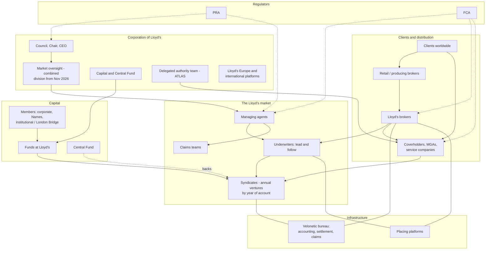
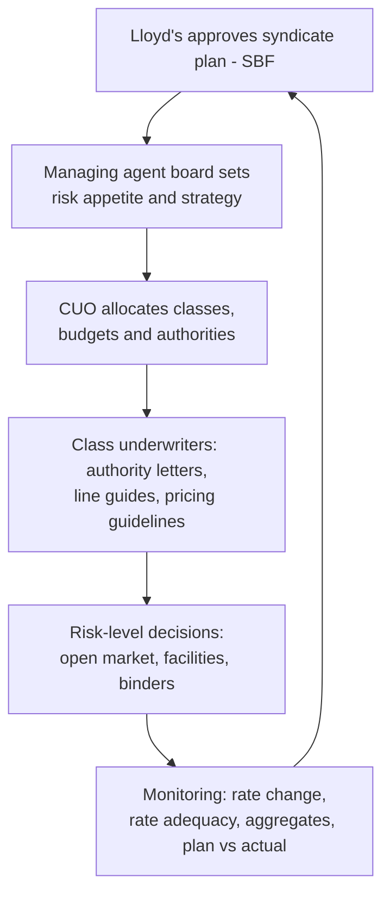
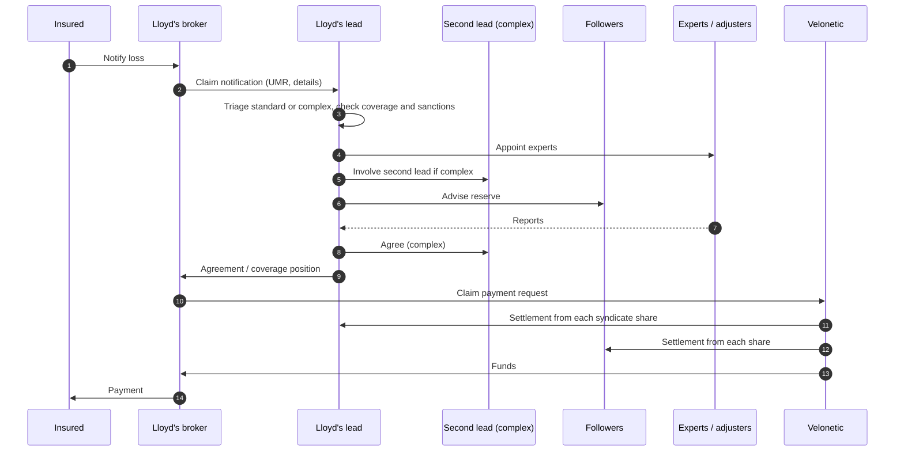
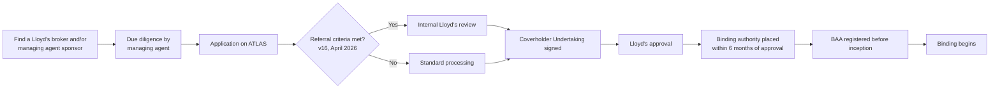
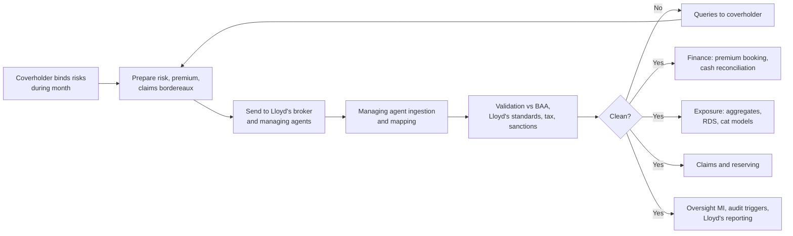
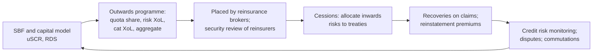

# Module 21 – Lloyd's End to End: How the Market Functions, Every Process, Every Stakeholder

| | |
|---|---|
| **Level** | Intermediate → Advanced (master reference) |
| **Path phase** | All phases – return to it whenever you work with a Lloyd's client ([Module 18](18-World-Class-Consultant-Path.md)) |
| **Time** | 6–8 hours reading; use as a reference afterwards |
| **Prerequisites** | Modules 01–02 helpful; this chapter is designed to be read on its own |
| **You will be able to** | Explain how Lloyd's works as a system: its stakeholders, annual cycle, syndicate life, underwriting, placement, accounting and settlement, claims, delegated authority (coverholders, bordereaux, DCAs), reinsurance, capital and oversight, systems and international platforms – and how they connect |

**How this chapter relates to the others:** it brings everything about Lloyd's into one place, adds Lloyd's-specific detail, and links to the deeper chapters (04–07) for worked examples. If you only have one chapter to read before meeting a Lloyd's client, read this one.

---

## 1. Lloyd's on one page

**In one sentence:** clients' risks reach Lloyd's through brokers and coverholders; underwriters employed by managing agents accept them on behalf of syndicates; members' capital (with the Central Fund behind it) backs the promises; the bureau moves the money and records; the Corporation supervises the market under the oversight of the PRA and FCA.

---

## 2. Stakeholder register – who does what

| Stakeholder | Role | Regulated / overseen by | Key documents | Key data and systems | Measures they care about |
|---|---|---|---|---|---|
| **Council of Lloyd's** | Governs the Society; makes byelaws | PRA/FCA (Society) | Lloyd's Acts, byelaws | Market returns | Market performance, rating, solvency |
| **Lloyd's executive (CEO and team)** | Runs the Corporation | Council | Strategy 2026–2030 | — | Cost of doing business, capital attractiveness |
| **Market oversight** | Plan approval, performance, principles, intervention; combined into one division in November 2026 under Rachel Turk **[likely]** | Council | SBF, principles, minimum standards, Market Bulletins | Plans, returns, RDS | Plan vs actual, risk ratings |
| **Capital team** | Member capital, Central Fund, Coming into Line | Council, PRA | LCR, member capital guidance | Capital models | ECA, solvency |
| **Delegated authority team** | Coverholder approvals, DA standards | Council | Coverholder Undertaking, referral criteria | **ATLAS** | Approvals, compliance returns |
| **Lloyd's Europe** | EEA insurer; reinsures to syndicates | Belgian NBB/FSMA | EEA policies | — | EEA compliance |
| **Managing agents** | Manage syndicates; employ underwriters, claims, finance, operations | PRA, FCA, Lloyd's | Managing agent's agreement, SBF, authorities | PAS, claims, finance, DA systems | Combined ratio, expense ratio, RoC, plan approval |
| **Syndicates** | Annual ventures that accept risk (not legal entities) | Through managing agent | MRCs, BAAs | — | Results by YOA |
| **Members (corporate, Names, institutional)** | Provide capital; take profit or loss | Lloyd's | Membership, FAL | Capital statements | Return on capital |
| **Members' agents** | Advise Names; manage participations and capacity auctions | Lloyd's, FCA | Agency agreements | — | Names' returns |
| **Lloyd's brokers** | Place business at Lloyd's for clients | FCA; Lloyd's accreditation | MRC, TOBA | Broker systems, platforms, bureau messages | Placement speed, revenue, client retention |
| **Coverholders / MGAs** | Bind risks under binding authorities | FCA (UK) / local regulators; Lloyd's approval | BAA, Coverholder Undertaking, certificates | Coverholder systems, bordereaux | Commission, growth, profit commission |
| **Service companies** | Group-owned coverholders of managing agents | Lloyd's, local regulators | BAA | Same as coverholders | Local platform results |
| **DCAs / TPAs** | Handle delegated claims | FCA / local; managing agent oversight | Claims agreements | Claims systems, claims bordereaux | Cycle time, leakage |
| **Velonetic** | Bureau services: premium and claims processing, central accounting and settlement | Contracted via LIMOSS | Service agreements | Bureau systems (e.g., CLASS, ECF, IMR) **[likely]** | Processing times, query rates |
| **LIMOSS** | Manages market service contracts; publishes the Market Business Glossary (owned by the LMA, IUA and Lloyd's) | Its owners | Service contracts | — | Cost and quality of market services |
| **LMA** | Represents managing agents; clauses; guidance | — | LMA clauses, toolkits | — | Market advocacy |
| **LIIBA** | Represents brokers | — | — | — | Broker interests |
| **Placing platforms (PPL, Whitespace)** | Electronic placement | Contracts | Electronic MRC | Platform data | Adoption, uptime |
| **PRA** | Prudential regulation | Bank of England | Supervisory statements, priorities letters | Regulatory returns | Safety and soundness |
| **FCA** | Conduct regulation | — | Handbook, policy statements | — | Customer outcomes, market integrity |
| **Rating agencies** | Market ratings (S&P AA-, Fitch AA-, KBRA AA-, AM Best A+) **[likely]** | — | Rating reports | — | Capital, performance |
| **Auditors and signing actuaries** | Audit accounts; Statement of Actuarial Opinion on reserves | Professional bodies | SAO, audit opinions | — | Reserve adequacy |
| **Clients** | Buy cover | — | Policy, certificates | — | Cover, price, claims service |

---

## 3. The Lloyd's annual cycle

| Timing **[likely]** – check Lloyd's business timetable | Activity |
|---|---|
| **1 January** | New year of account begins; underwriting under the approved plan |
| **January** | Reinsurance renewals (1/1); PRA priorities letter |
| **Monthly / quarterly** | Performance returns to Lloyd's; bordereaux cycles; Lloyd's market messages |
| **March** | Lloyd's full-year results; syndicate annual reports |
| **Q2** | Mid-year planning guidance; 1 June Florida renewals |
| **June–November** | North Atlantic hurricane season |
| **Q3** | Syndicate Business Forecasts (SBF) and capital returns submitted; Lloyd's half-year results; capacity auctions for Names |
| **Q3–Q4** | Lloyd's reviews and challenges plans; plan approvals |
| **Late November** | **Coming into Line** – members' FAL in place |
| **31 December** | Year of account three years old normally closes by RITC; accounts prepared |
| **Annually** | Coverholder annual compliance; Statement of Actuarial Opinion; ORSA; audits |

**Consulting point:** design engagements backwards from this calendar – a recommendation that misses the SBF window waits a year.

---

## 4. The life of a syndicate

| Stage | What happens | Key requirements |
|---|---|---|
| **1. Proposal** | Sponsor (group, investor, underwriting team) decides on a syndicate, SIAB, SPA or capital-backed structure | Strategy, underwriting edge, capital source |
| **2. Application** | Business plan, capital, people, governance, outsourcing submitted to Lloyd's | Lloyd's approval; managing agent authorised (or turnkey agent used) |
| **3. Capital** | uSCR, ECA, FAL provided by members | Coming into Line |
| **4. Operation** | Writes business each year of account within approved capacity | Plan monitoring; returns; principles |
| **5. Annual planning** | SBF and capital for the next year | Lloyd's approval |
| **6. Closing years** | Each YOA closed by RITC (usually at 36 months) | Fair RITC pricing; SAO |
| **7. Run-off or exit** | Stop writing; years run off or transfer to a run-off syndicate | Run-off plans; legacy transactions |

**Structures in 2026:** standard syndicates; Syndicates-in-a-Box; SPAs; capital-backed syndicates (e.g., investor-backed reinsurance syndicates); follow-only and AI-assisted syndicates. Thirteen new syndicates started on 1 January 2026 **[likely]**. See [Module 02 §3.4](02-Beginner-Actors-Entities-Players.md).

---

## 5. Underwriting at Lloyd's

### 5.1 The chain of underwriting authority

### 5.2 What a Lloyd's underwriter does every day

| Activity | Detail |
|---|---|
| Reviews submissions | From brokers, often at the "box" in the Lloyd's building or on platforms |
| Decides lead or follow | Sets terms as lead, or follows on the leader's terms |
| Prices | Technical price, rate adequacy, risk-adjusted rate change ([Module 04 §9](04-Intermediate-Placement-and-Underwriting.md)) |
| Checks permissions | Licensing and tax by territory (Lloyd's Crystal+), sanctions, authority limits |
| Manages aggregates | Cat exposure, Realistic Disaster Scenarios |
| Writes lines | Stamps and signs on the MRC or platform |
| Agrees changes | As slip leader under the GUA |
| Reviews binders | Approves and monitors coverholder business in their class |
| Handles referrals | From coverholders and junior underwriters |
| Reports | Plan vs actual to CUO and Lloyd's |

### 5.3 Lloyd's-specific underwriting controls

| Control | Lloyd's element |
|---|---|
| **Business plan (SBF)** | Approved by Lloyd's; writing materially outside plan triggers intervention |
| **Principles and minimum standards** | Lloyd's assesses managing agents' underwriting controls under principles-based oversight **[likely]** |
| **Realistic Disaster Scenarios** | Lloyd's-prescribed scenarios measure gross and net exposure to major events |
| **Risk codes** | Lloyd's classification for reporting and capital |
| **Licensing (Crystal+)** | Territory permissions and tax rules |
| **Capacity** | Stamp capacity limits premium for each YOA |

---

## 6. Placement at Lloyd's

| Step | Lloyd's detail |
|---|---|
| 1. Broker accreditation | Brokers placing at Lloyd's must be accredited by Lloyd's |
| 2. Submission | Broker prepares submission and MRC; UMR created |
| 3. Lead selection | Specialist Lloyd's lead; face-to-face in "the Room" or electronic |
| 4. Lines | Lead and followers write lines; total may exceed 100% |
| 5. Signing down | Lines reduced proportionally to 100% |
| 6. Contract certainty | All terms agreed before inception |
| 7. Processing | Premium submitted to Velonetic; signed with SND; settled centrally |
| 8. Changes | GUA governs who agrees endorsements |

Full detail: [Module 04](04-Intermediate-Placement-and-Underwriting.md).

---

## 7. Accounting and settlement at Lloyd's

| Element | Lloyd's detail |
|---|---|
| **Central accounting** | All Lloyd's premium and claims go through the bureau (Velonetic) **[certain]** |
| **Signing** | Each entry gets a Signing Number and Date; OSND links later entries |
| **Central settlement** | Net settlement between brokers and syndicates in main currencies **[likely]** |
| **Premium trust funds** | Syndicate premiums held in trust; US situs business in US trust funds (Lloyd's American Trust Fund); Canadian trust funds **[certain]** |
| **Taxes** | IPT for UK; US Federal Excise Tax (4% direct, 1% reinsurance); overseas taxes guided by Crystal+ **[certain]** |
| **Terms of trade** | Broker payment periods; settlement due dates |
| **Reconciliation** | Managing agents reconcile bureau, ledger and broker records |

Full detail: [Module 06 Part A](06-Intermediate-Accounting-Settlement-Claims-Reinsurance.md).

---

## 8. Claims at Lloyd's

### 8.1 The Lloyd's Claims Lead Arrangements (LCLA)

The LCLA replaced the Lloyd's Claims Scheme (Combined) **[likely]**.

| Element | Rule **[likely]** – verify against current LCLA text |
|---|---|
| **Standard claims** | Agreed by the Lloyd's lead managing agent alone; followers bound |
| **Complex claims** | Agreed jointly by the Lloyd's lead and the second Lloyd's lead |
| **Complex thresholds (per Lloyd's share)** | First-party £2m; third-party £1m; non-proportional treaty reinsurance £5m – or other complexity criteria |
| **Triage** | Lead triages and re-triages dynamically |
| **Second lead** | Must be identifiable in the contract |
| **Disputes** | Defined process if lead and second lead disagree or followers request it |
| **Co-lead binders** | Claims lead agreement required (model clause LMA9186) |

### 8.2 The Lloyd's claims process

### 8.3 Claims under delegated authority at Lloyd's

| Element | Detail |
|---|---|
| Claims authority | Granted to coverholders or approved DCAs within limits |
| DCA approval and oversight | Managing agents approve and audit DCAs; coordinated audits encouraged **[likely]** |
| Loss funds | Advanced for local payments; reconciled |
| Claims bordereaux | Monthly reporting |
| Co-lead binder claims | Claims lead agreement (LMA9186) required **[likely]** |

### 8.4 Catastrophe events at Lloyd's

Event coding; initial loss estimates and major loss reporting to Lloyd's **[likely]**; DCA surge; reinsurance notifications and reinstatements; liquidity planning; Lloyd's publishes market loss estimates. See [Module 06 Part B](06-Intermediate-Accounting-Settlement-Claims-Reinsurance.md).

---

## 9. Delegated authority at Lloyd's – end to end

### 9.1 Types of delegated arrangements at Lloyd's

| Type | Description |
|---|---|
| **Open market coverholder** | Independent firm (often an MGA or broker) with binding authorities from one or more managing agents |
| **Service company** | Coverholder owned by a managing agent's group |
| **Branches / additional locations** | Each trading location needs separate approval **[likely]** |
| **Lloyd's Europe coverholder** | Binds EEA risks for Lloyd's Europe |
| **DCA / TPA** | Delegated claims handling |
| **Full binding vs prior submit** | Full authority within limits, or approval needed before binding |

Scale: about 45% of Lloyd's premium; about 412 service companies **[likely]**.

### 9.2 Becoming a Lloyd's coverholder

| Requirement **[likely]** | Detail |
|---|---|
| **ATLAS** | Lloyd's system for coverholder applications and records |
| **Referral criteria** | Certain applications need internal Lloyd's review before submission – current version 16 (April 2026) |
| **Coverholder Undertaking** | Coverholder commits to Lloyd's standards |
| **Conditional approval** | Approval lapses unless a binding authority with a managing agent is entered within six months |
| **Locations** | Each additional trading location needs separate approval |
| **Data standards** | Lloyd's data standards are mandatory for new coverholders; bordereaux to Lloyd's reporting standards (v5.2 cited) |
| **Annual compliance** | Annual compliance returns; outdated ATLAS records can restrict new binding authorities |

### 9.3 The binding authority lifecycle at Lloyd's

| Stage | Owner | Lloyd's element |
|---|---|---|
| Strategy and partner selection | Managing agent | DA strategy within SBF |
| Due diligence | Managing agent | Lloyd's expectations on oversight |
| Approval | Lloyd's | ATLAS, referral criteria |
| BAA placement | Lloyd's broker, lead and followers | Standard LMA wordings; **registration before inception** |
| Binding | Coverholder | Within classes, territories, limits, GPI |
| Reporting | Coverholder → managing agents | Bordereaux to Lloyd's standards |
| Premium remittance | Coverholder → broker → bureau | Settlement terms |
| Claims | Coverholder / DCA | Authority levels; LCLA for co-leads |
| Oversight | Managing agents | Risk-based monitoring; audits; coordinated audits |
| Changes | Managing agent | Changes to permissions on ATLAS; retrospective endorsements may be reviewed |
| Renewal / exit | Managing agent | Performance review; run-off |

### 9.4 Oversight expectations **[likely]**

- Oversight designed so DA business stays within appetite and complies; regular board reporting.
- Key staff employed directly by the coverholder; no unapproved sub-delegation.
- Coordinated audits where several managing agents share a lead binder (guidance May 2026).
- Lloyd's Delegated Oversight Manager touchpoints may review practices such as retrospective endorsements.
- Annual compliance and up-to-date ATLAS records.

Detail and frameworks: [Module 05](05-Intermediate-Delegated-Authority.md).

---

## 10. Bordereaux at Lloyd's – the complete picture

### 10.1 The bordereaux cycle

### 10.2 What each bordereau feeds

| Bordereau | Feeds | If late or wrong |
|---|---|---|
| **Risk** | Exposure management, RDS, cat models, reinsurance purchase, tax and regulatory reporting, licensing checks | Cat exposure understated; wrong capital; tax errors |
| **Premium** | Premium booking, credit control, reconciliation | Aged debt; unreconciled cash |
| **Claims** | Reserving, claims oversight, reinsurance recoveries | Reserve surprises; missed recoveries |

### 10.3 Standards and timing

| Item | Position |
|---|---|
| Lloyd's reporting standards | Define fields for risk, premium and claims bordereaux; v5.2 cited **[likely]** |
| Delegated authority CDR | Market consultation on a DA data standard in 2026 **[likely]** |
| LMA binder wording and data model | Revision of 400+ wordings; data model planned 2026 **[likely]** |
| Typical timing | Monthly; due within an agreed number of days after month end (set in the BAA) |

### 10.4 Common errors and controls

| Error | Control |
|---|---|
| Missing or invalid addresses | Geocoding validation at ingestion |
| Risks outside territory or class | Automated BAA rule checks |
| Limits above maximum | Rule checks; referral flags |
| GPI exceeded | Cumulative tracking; alerts at 80/90/100% |
| Wrong tax rates | Tax rule engine by location |
| Duplicate certificates | Uniqueness checks |
| Premium not matching cash | Cash reconciliation by binder |
| Claims without policy match | Policy-claim linking rules |
| Late submission | Timeliness tracking; tier escalation |

---

## 11. Reinsurance at Lloyd's

Lloyd's syndicates are both **sellers** and **buyers** of reinsurance.

### 11.1 Syndicates as reinsurers (inwards)

| Element | Detail |
|---|---|
| **Scale** | Reinsurance is one of Lloyd's largest segments (property, casualty and specialty treaty) **[certain]** |
| **Placement** | Reinsurance brokers place treaties and facultative risks with Lloyd's leads and followers, usually on MRCs |
| **Renewal dates** | 1 January, 1 April, 1 June, 1 July |
| **Accounting** | Treaty business accounted quarterly through technical accounts; estimated premium income booked then adjusted |
| **Claims** | Non-proportional treaty claims are "complex" above £5m per Lloyd's share under LCLA **[likely]** |

### 11.2 Syndicates as buyers (outwards)

| Element | Detail |
|---|---|
| **Link to capital** | Reinsurance lowers uSCR and therefore ECA (× 1.35) – a key capital efficiency lever ([Module 07 §E2](07-Advanced-Capital-Finance-Regulation.md)) |
| **Related-party reinsurance** | Reinsurance between syndicates or with group companies creates conflicts and is subject to Lloyd's requirements and scrutiny **[likely]** |
| **Security** | Reinsurer ratings and collateral monitoring |
| **2026 market** | Reinsurance is cheaper as capital is plentiful – an opportunity to buy more protection **[likely]** |

### 11.3 Lloyd's-specific reinsurance structures

| Structure | What it is |
|---|---|
| **RITC** | Reinsurance to close – transfers a closing year's liabilities to a later year or another syndicate |
| **SPA** | A special purpose arrangement writes a quota share of a host syndicate – in effect a reinsurance relationship |
| **Capital-backed reinsurance syndicates** | Investor-backed syndicates reinsuring a group's portfolio **[likely]** |
| **London Bridge** | Lloyd's protected cell vehicle for ILS capital (cat bonds, collateralised reinsurance) **[certain]** |
| **Legacy** | LPTs and ADCs on older years |

---

## 12. Capital and oversight in brief

| Element | Summary | Detail |
|---|---|---|
| Annual venture and YOA | Each year separate; closed by RITC | [Module 07 §A1–A2](07-Advanced-Capital-Finance-Regulation.md) |
| Chain of security | Syndicate assets → FAL → central assets | [Module 07 §A3](07-Advanced-Capital-Finance-Regulation.md) |
| Capital setting | SBF → uSCR → ECA (× 1.35) → FAL → Coming into Line | [Module 07 §A4](07-Advanced-Capital-Finance-Regulation.md) |
| Ratings | S&P AA-, Fitch AA-, KBRA AA-, AM Best A+ **[likely]** | — |
| Oversight | Plan approval, principles-based oversight, minimum standards, Market Bulletins; oversight functions combined into one division (Nov 2026) to reduce friction and cost **[likely]** | [Module 07 Part F](07-Advanced-Capital-Finance-Regulation.md) |
| Strategy 2026–2030 | Underwriting performance; efficient marketplace (ambition of 1% incremental cost of operating at Lloyd's **[likely]**); capital advantage (RoC > 12% across the cycle); culture and talent | [Module 22](22-New-Strategies-London-Market.md) |

---

## 13. Systems and data landscape at Lloyd's

| System / tool | Owner | Purpose |
|---|---|---|
| **ATLAS** | Lloyd's | Coverholder applications and records |
| **Crystal+** | Lloyd's | Licensing, tax and regulatory information by territory |
| **Lloyd's returns** | Lloyd's | Plans, performance, capital, RDS submissions |
| **Bureau systems (e.g., CLASS, ECF, IMR)** | Velonetic | Claims processing, electronic claims files, document repository **[likely]** |
| **Placing platforms** | PPL, Whitespace | Electronic placement |
| **Managing agent systems** | Each firm | PAS, workbench, claims, finance, DA/bordereaux, exposure, data platform |
| **Coverholder systems** | Each coverholder | Binding, documents, bordereaux production |

Data standards: MRC, CDR, ACORD GRLC, Lloyd's reporting standards, risk codes, UMR/UCR/SND. See [Module 08](08-Advanced-Modernisation-Data-Technology.md).

---

## 14. Lloyd's international platforms

| Platform | Purpose |
|---|---|
| Lloyd's Europe (Brussels) | EEA business; Lloyd's Europe coverholders |
| United States | Surplus lines and reinsurance; US trust funds; some admitted licences **[likely]** |
| Canada | Licensed; Canadian trust funds |
| Lloyd's China, Lloyd's Asia (Singapore), Lloyd's Japan, Lloyd's Dubai (DIFC), Lloyd's India (incl. GIFT City) | Local platforms through service companies or branches **[likely]** |

---

## 15. End-to-end story: a US property binder through a hurricane

| Stage | What happens at Lloyd's |
|---|---|
| **Planning** | Syndicate X's SBF includes £200m of US property binder premium; Lloyd's approves; capital set |
| **Coverholder** | A Florida MGA is approved on ATLAS, signs the Coverholder Undertaking; Syndicate X leads a binder with two following syndicates; BAA registered before 1 June inception |
| **Binding** | MGA binds 4,000 homeowners and small commercial risks over six months within territory, limits and GPI |
| **Bordereaux** | Monthly risk, premium and claims bordereaux; Syndicate X validates and feeds exposure models and RDS |
| **Premium** | MGA remits net premium to the Lloyd's broker; bureau signs and settles to each syndicate's trust funds (US situs) |
| **Reinsurance** | Syndicate X's cat XoL protects net exposure |
| **Event** | A hurricane strikes in September; event code assigned; initial estimates to Lloyd's |
| **Claims** | Approved DCA handles volume claims with a loss fund; large commercial claims referred; co-lead binder claims follow the agreed claims lead arrangement |
| **Recoveries** | Cat XoL recoveries claimed; reinstatement premiums accrued |
| **Capital and plan** | Loss affects 2026 YOA; capital adequacy reviewed; 2027 plan re-priced |
| **Oversight** | Post-event review of exposure data quality and DCA performance; audit if needed |
| **Close** | 2026 YOA closes by RITC at end-2028 if reserves are reliable |

---

## 16. Common Lloyd's mistakes – and the correct position

| Mistake | Correct position |
|---|---|
| "Lloyd's underwrites the risk." | Syndicates do; Lloyd's oversees the market (Lloyd's Europe is the exception for EEA). |
| "A coverholder is approved once and for all." | Approval is conditional, location-specific, and maintained through annual compliance and ATLAS records. |
| "The binder can be registered after inception." | It must be registered before inception. |
| "Followers agree every claim." | Under LCLA, the lead agrees standard claims; lead and second lead agree complex ones. |
| "Bordereaux are an admin report." | They feed exposure, capital, reserving, finance and oversight. |
| "Reinsurance is a cost centre." | It is a capital and earnings-volatility lever, priced against ECA. |
| "Each syndicate has its own rating." | All share the Lloyd's market ratings. |
| "The year's result is known at year end." | YOA results are known only when the year closes, normally at 36 months. |

---

## 17. Partner's lens

1. **See Lloyd's as a system.** Most Lloyd's problems cross boundaries: a bordereaux problem is also an exposure, capital, finance and oversight problem. Map the flow across stakeholders before proposing a fix.
2. **Know the calendar and the gatekeepers.** SBF approval, Coming into Line, coverholder approvals and binder registration are hard gates. Recommendations that ignore them stall.
3. **Lloyd's is changing its own model.** The 2026 strategy and the November 2026 oversight restructuring aim to reduce friction and cost. Clients should prepare to benefit (simpler interactions) and to be held to higher performance standards.
4. **Use the stakeholder register in week one.** Identify every party touched by the client's problem and what each measures. It prevents recommendations that work for one stakeholder and fail for another.

---

## 18. Key takeaways

1. Lloyd's is a system: brokers and coverholders bring risk; managing agents underwrite for syndicates; members and the Central Fund provide security; the bureau moves money; the Corporation oversees.
2. The annual cycle (plan, capital, Coming into Line, YOA, RITC) drives decisions.
3. Delegated authority runs through ATLAS approvals, registered binders, bordereaux and oversight.
4. Claims are agreed under the Lloyd's Claims Lead Arrangements – lead for standard, lead and second lead for complex.
5. Syndicates sell and buy reinsurance; RITC, SPAs and London Bridge are Lloyd's-specific structures.
6. In late 2026 Lloyd's is simplifying its oversight and targeting a lower cost of doing business.

---

## 19. Check your understanding

| # | Question | Answer |
|---|---|---|
| 1 | Which system handles coverholder applications? | ATLAS. |
| 2 | Within what period must an approved coverholder enter a binding authority? | Six months (approval otherwise lapses) **[likely]**. |
| 3 | When must a binder be registered? | Before inception. |
| 4 | Who agrees a £3m first-party claim on a Lloyd's share? | Lead and second lead (complex; above £2m). |
| 5 | Name two Lloyd's-specific reinsurance structures. | RITC; SPA; London Bridge; capital-backed reinsurance syndicates. |
| 6 | What happens at Coming into Line? | Members must have FAL in place for the next year. |
| 7 | What did Lloyd's change in November 2026? | Combined its oversight functions into one division to reduce complexity and cost **[likely]**. |

---

## 20. Practice tasks

1. Draw the one-page Lloyd's system (section 1) from memory.
2. Build a stakeholder register for a real managing agent's DA programme.
3. Write a 12-month Lloyd's calendar for a client and mark decision windows.
4. Walk through the hurricane story (section 15) and list every data hand-off and control.

---

## Master Guide integration: structure terms, year bases and corrections

### Structure – precise definitions

- **Lloyd's Corporation** – governs and oversees the market; sets requirements, oversees performance, protects the franchise, runs central functions. It is not an insurer.
- **Members** – the capital providers (corporate or individual Names). They back one or more syndicates.
- **Managing agents** – authorised firms that run syndicates: underwriting and operations teams, portfolio and claims management, exposure oversight, business plan delivery, compliance.
- **Syndicates** – underwriting units through which members participate. A syndicate is **not** a legal entity or the insurer.
- **Members' agents** – advise and represent members on participation and capital.
- **Lloyd's brokers** – approved to place business at Lloyd's.
- **Coverholders and service companies** – delegated underwriting entities (Module 05). *Source cross-reference fix: the source says "Part VI"; the content is in its Part II, section 14.*

### Capacity terms – a sharper definition

- **Stamp capacity** – the maximum premium a syndicate may accept in a year of account, measured as **gross written premium net of acquisition costs (brokerage and commission)**, equal to the total of its members' allocated capacity **[certain]**. The source's wording ("capacity expressed in the context of the stamp") is too vague to use with a client.
- **Premium income** – always state written or earned and the accounting basis.
- **Business plan (SBF)** – premium, class and territory mix, appetite, limits, reinsurance, expenses, controls, expected profit and capital. A good plan is coherent, achievable, evidenced and governed by clear limits.

### RITC – a nuance the source leaves out

At the end of a year of account (normally after three years) liabilities are transferred by **Reinsurance to Close**. The receiving party can be the **same syndicate's next open year or a different syndicate** (third-party RITC, common in run-off deals) **[certain]**. Old claims do not disappear; they keep being handled.

### Four year bases – always ask which one a KPI uses

| Basis | Groups results by |
|---|---|
| Underwriting year | The year the risk incepted |
| Calendar year | The reporting period, regardless of inception |
| Accident year | The year the loss event happened |
| Year of account | Lloyd's three-year venture for business written in that year |

The same portfolio can look profitable on one basis and loss-making on another.

### Chain of Security figures

See the full 31 December 2025 breakdown in [Module 07](07-Advanced-Capital-Finance-Regulation.md): about £95.3bn first link, £31.1bn FAL, and a third link of about £6.9bn, of which the Central Fund is £3.2bn.

## 21. Sources

- [Lloyd's – new coverholder applications](https://www.lloyds.com/market-resources/delegated-authorities/coverholders/new-coverholder-applications)
- [Lloyd's – referral criteria v13 (historic version for structure)](https://assets.lloyds.com/media-651c0e64-c1d0-4f97-90f7-883c69fe2ef2/7fe5f5d4-1b15-47d0-ac7c-638679f7e414/Referral%20criteria%20-%20Website%20v13.pdf)
- [Lloyd's – annual compliance for coverholders](https://www.lloyds.com/market-resources/delegated-authorities/market-knowledge/annual-compliance)
- [Lloyd's – oversight and monitoring of delegated contracts](https://www.lloyds.com/market-resources/delegated-authorities/market-knowledge/oversight-and-monitoring-of-contracts)
- [Lloyd's – simplifies structure to increase competitiveness (Nov 2026)](https://www.lloyds.com/insights/media-centre/press-releases/lloyds-simplifies-structure-as-part-of-strategy-to-increase-competitiveness)
- [Reinsurance News – Lloyd's restructures operating model](https://www.reinsurancene.ws/lloyds-restructures-operating-model-to-cut-complexity-and-cost-of-doing-business/)
- [Keoghs – Lloyd's Claims Lead Arrangements](https://keoghs.co.uk/keoghs-insight/keoghs-guide-to-lloyds-claims-lead-arrangements)
- [Business Wire – AM Best affirms Lloyd's ratings (2026)](https://www.businesswire.com/news/home/20260806853276/en/AM-Best-Affirms-Credit-Ratings-of-Lloyds-Its-Rated-Subsidiaries-and-Society-of-Lloyds)
- [Lloyd's business timetable](https://www.lloyds.com/tools-and-systems/business-timetable)
- [CMS – Lloyd's 5-year strategy summary](https://cms.law/en/gbr/legal-updates/lloyd-s-publishes-5-year-strategy.-aims-to-reduce-operating-costs-and-generate-at-least-12-capital-returns)
