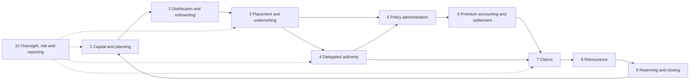
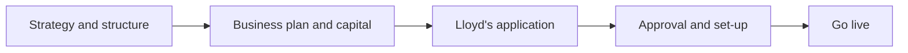
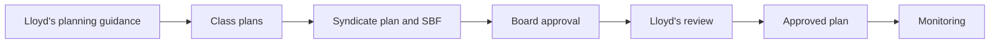
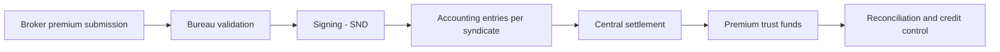
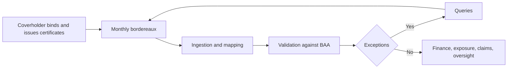

# Module 23 – Lloyd's Process Catalogue: Every Process, Stage, Step, Party and Entity

| | |
|---|---|
| **Level** | Advanced – working reference |
| **Use it for** | Current-state process mapping, requirements, gap analysis, RACI design, target operating models, audit and control reviews |
| **Prerequisites** | [Module 21](21-Lloyds-End-to-End.md) for the big picture |
| **Structure** | L0 value chain → L1 processes (20) → L2 stages → L3 steps, each with responsible party, other parties, documents and data, systems and key control |

**How to read the tags.** Process steps describe standard Lloyd's market practice and are **[certain]** unless tagged. Specific thresholds, deadlines, form names and system names are tagged **[likely]** where they come from secondary sources or may change – check current Lloyd's requirements and Market Bulletins before using them in a client deliverable.

---

## 1. Entity and party register (codes used in every table)

| Code | Party / entity | Type | What it is |
|---|---|---|---|
| **CL** | Client / insured / assured | External | Buys cover |
| **RB** | Retail or producing broker | Intermediary | Holds the client relationship locally |
| **LB** | Lloyd's (placing) broker | Intermediary | Lloyd's-accredited broker placing business at Lloyd's; acts for the client |
| **PLT** | Placing platform (PPL, Whitespace) | Market infrastructure | Electronic MRC, lines, stamps, audit trail |
| **MA** | Managing agent | Market participant | Manages syndicates; employs the teams below |
| MA-BRD | Managing agent board | MA function | Approves strategy, appetite, plan |
| MA-CUO | Chief Underwriting Officer | MA function | Owns underwriting strategy and authorities |
| **LUW** | Lead underwriter | MA function | Sets terms; slip leader |
| **FUW** | Follow underwriter | MA function (other MAs) | Takes a share on the leader's terms |
| MA-UWA | Underwriting assistant / operations | MA function | Data entry, documentation, checks |
| MA-EXP | Exposure management | MA function | Aggregates, cat models, RDS |
| MA-ACT | Actuarial | MA function | Pricing, reserving, capital model |
| MA-TA | Technical accounting / credit control | MA function | Premium, claims and RI accounting; reconciliation |
| MA-CLM | Claims | MA function | Claims handling and agreement |
| MA-DA | Delegated authority team | MA function | Coverholder management and oversight |
| MA-RI | Outwards reinsurance team | MA function | Buys and administers reinsurance |
| MA-FIN | Finance | MA function | Accounts, YOA results, capital returns |
| MA-RSK | Risk management | MA function | Risk appetite, ORSA, model validation |
| MA-CMP | Compliance / financial crime | MA function | Conduct, sanctions, regulatory compliance |
| **SYN** | Syndicate | Lloyd's entity (not a legal entity) | Annual venture that accepts risk |
| **MEM** | Members (corporate, Names, institutional) | Capital providers | Provide capital; take profit or loss |
| **MAA** | Members' agent | Adviser | Advises Names; capacity auctions |
| **CoL** | Corporation of Lloyd's | Market authority | Runs and supervises the market |
| CoL-OVS | Market oversight (combined division from Nov 2026 **[likely]**) | CoL function | Plans, performance, principles, intervention |
| CoL-CAP | Capital team | CoL function | Member capital, Central Fund, Coming into Line |
| CoL-DA | Delegated authority team | CoL function | Coverholder approvals (ATLAS) |
| **LEU** | Lloyd's Europe (Lloyd's Insurance Company S.A.) | Insurer (Belgium) | EEA policies, reinsured to syndicates |
| **VEL** | Velonetic (bureau) | Service provider | Premium and claims processing, central accounting and settlement |
| **CH** | Coverholder / MGA | Delegated party | Binds risks under a binding authority |
| **SC** | Service company | Delegated party | Coverholder owned by the MA's group |
| **DCA** | Delegated claims administrator / TPA | Delegated party | Handles claims under delegated authority |
| **LA** | Loss adjuster / surveyor | Expert | Investigates and quantifies losses |
| **LAW** | Lawyers / coverage counsel / experts | Expert | Coverage, disputes, specialist evidence |
| **RIB** | Reinsurance broker | Intermediary | Places reinsurance |
| **RIN** | Reinsurer / retrocessionaire | Counterparty | Accepts ceded risk |
| **CED** | Cedant | Counterparty | Insurer buying reinsurance from a syndicate (inwards) |
| **AUD** | Auditors (financial, coverholder audit firms) | Assurance | Audit accounts and coverholders |
| **SA** | Signing actuary | Assurance | Statement of Actuarial Opinion on reserves |
| **PRA** | Prudential Regulation Authority | Regulator | Prudential |
| **FCA** | Financial Conduct Authority | Regulator | Conduct |
| **OFSI** | Office of Financial Sanctions Implementation | Authority | UK sanctions |
| **TAX** | HMRC, US IRS, overseas tax authorities | Authority | IPT, FET, premium taxes |
| **RA** | Rating agencies | External | Market ratings |
| **LMA / LIIBA / IUA / LIMOSS** | Market bodies | Associations | Standards, clauses, market services |

---

## 2. L0 – the Lloyd's value chain

### L1 process list

| ID | L1 process | Value chain area | Main owner |
|---|---|---|---|
| P01 | Syndicate establishment and approval | Capital and planning | MA, CoL-OVS |
| P02 | Annual business planning (SBF) | Capital and planning | MA-BRD, MA-CUO, CoL-OVS |
| P03 | Capital setting and Coming into Line | Capital and planning | MA-ACT, MA-FIN, CoL-CAP, MEM |
| P04 | Broker accreditation, client onboarding and TOBAs | Distribution | LB, MA-CMP |
| P05 | Open market placement and binding | Placement | LB, LUW, FUW |
| P06 | Underwriting decision (inside the managing agent) | Underwriting | LUW, MA-CUO |
| P07 | Policy administration: documentation, endorsements, cancellations, renewals | Policy administration | LB, MA-UWA |
| P08 | Premium processing, accounting and central settlement | Accounting | LB, VEL, MA-TA |
| P09 | Coverholder approval and binding authority set-up | Delegated authority | MA-DA, CoL-DA, LB, CH |
| P10 | Delegated binding and bordereaux processing | Delegated authority | CH, MA-DA, MA-TA |
| P11 | Delegated authority oversight and audit | Delegated authority | MA-DA, AUD |
| P12 | Open market claims (notification to settlement) | Claims | LB, MA-CLM, VEL |
| P13 | Delegated claims (DCA/TPA, loss funds, claims bordereaux) | Claims | DCA, MA-CLM, MA-DA |
| P14 | Catastrophe event management | Claims | MA-CLM, MA-EXP, MA-RI, CoL |
| P15 | Outwards reinsurance: purchase, cessions, recoveries | Reinsurance | MA-RI, RIB, RIN |
| P16 | Inwards reinsurance: treaty acceptance and accounting | Reinsurance | LUW, RIB, CED, MA-TA |
| P17 | Reserving and Statement of Actuarial Opinion | Reserving | MA-ACT, SA |
| P18 | Year of account closure (RITC), distributions and cash calls | Closing | MA-FIN, MA-ACT, MEM |
| P19 | Regulatory, Lloyd's and financial reporting | Oversight | MA-FIN, MA-RSK, CoL, PRA, FCA |
| P20 | Run-off and legacy transactions | Closing | MA-BRD, MA-FIN, RIN |

---

## 3. Annual calendar – when each process runs

| Timing **[likely]** | Processes |
|---|---|
| 1 January | Year of account starts (P05–P10 under new plan); 1/1 reinsurance renewals (P15, P16) |
| Monthly | Bordereaux (P10, P13); credit control (P08); performance monitoring (P02, P19) |
| Quarterly | Lloyd's returns (P19); inwards treaty accounts (P16); reserving updates (P17) |
| Q1 | Syndicate annual accounts; SAO (P17, P19); Lloyd's full-year results |
| April / June / July | 1/4, 1/6, 1/7 reinsurance renewals (P15, P16) |
| June–November | Hurricane season (P14) |
| Q3 | SBF and capital submissions (P02, P03); capacity auctions for Names (P03) |
| Q4 | Plan approvals (P02); Coming into Line, usually late November (P03) |
| 31 December | Year of account at 36 months closes by RITC (P18) |
| Annually | Coverholder annual compliance (P11); ORSA (P19); audits |

---

## P01 – Syndicate establishment and approval

**Trigger:** a group, investor or underwriting team wants a Lloyd's platform. **Output:** an approved syndicate ready to write from 1 January.

| ID | Stage | Step | Who does it | Who else | Documents and data | Key control / timing |
|---|---|---|---|---|---|---|
| 01.1 | Strategy | Define why Lloyd's, classes, territories, underwriting edge | Sponsor | MA advisers | Strategy paper | Clear differentiation in a soft market |
| 01.2 | Strategy | Choose structure: own MA, turnkey MA, SIAB, SPA, corporate member | Sponsor | MA, CoL-OVS | Options analysis | Fit with capital and control needs |
| 01.3 | Plan | Build business plan: premium, loss ratios, expenses, reinsurance | MA-CUO | MA-ACT, MA-RI | Draft SBF | Realistic rate assumptions |
| 01.4 | Plan | Build capital model; estimate uSCR and ECA | MA-ACT | MA-RSK | Capital model output | Model validation |
| 01.5 | Plan | Arrange capital provider(s) and corporate member | Sponsor | MEM, CoL-CAP | Capital commitment | FAL available for Coming into Line |
| 01.6 | Application | Submit application: plan, capital, people, governance, outsourcing | MA | CoL-OVS | Application pack | Lloyd's requirements |
| 01.7 | Application | Approval of key individuals (fit and proper; SM&CR where relevant) | MA | CoL, PRA, FCA | Individual applications | Senior manager approvals |
| 01.8 | Approval | Lloyd's review, challenge and approval of syndicate and capacity | CoL-OVS | MA | Approval letter; stamp capacity | Conditions tracked |
| 01.9 | Set-up | Bureau connectivity, policy system, accounting, claims, reporting | MA (ops) | VEL, vendors | Operating readiness checklist | Readiness review before 1 January |
| 01.10 | Set-up | Outwards reinsurance programme placed | MA-RI | RIB, RIN | RI contracts | In force at inception |
| 01.11 | Go live | Start underwriting on 1 January | LUW | LB | First MRCs | Plan monitoring from day one |

**Failure points:** plans built on past pricing; underestimated reporting load; operations not ready for bureau processing.

---

## P02 – Annual business planning (SBF)

**Trigger:** annual planning cycle. **Output:** approved plan and capacity for the next year of account.

| ID | Stage | Step | Who does it | Who else | Documents and data | Key control / timing |
|---|---|---|---|---|---|---|
| 02.1 | Guidance | Issue market planning guidance and expectations | CoL-OVS | — | Planning guidance, market messages | Q2 **[likely]** |
| 02.2 | Class plans | Each class sets premium, rate change, loss ratio, mix | Class UW | MA-CUO, MA-ACT | Class plans | Rate adequacy evidence |
| 02.3 | Syndicate plan | Consolidate class plans; expenses; reinsurance; channel mix (open market, DA, facilities) | MA-CUO | MA-FIN, MA-RI, MA-DA | Draft SBF | Consistency with risk appetite |
| 02.4 | Syndicate plan | Exposure and RDS projections | MA-EXP | MA-ACT | RDS output | Within appetite |
| 02.5 | Approval | Board challenge and approval | MA-BRD | MA-RSK | Board paper | Independent risk view |
| 02.6 | Submission | Submit SBF to Lloyd's | MA-FIN | MA-CUO | SBF return | Q3 deadline **[likely]** |
| 02.7 | Review | Lloyd's reviews, challenges, may approve with conditions, cap growth or require remediation | CoL-OVS | MA | Feedback letters | Q3–Q4 |
| 02.8 | Approval | Final plan and stamp capacity agreed | CoL-OVS | MA, MEM | Approved capacity | Before Coming into Line |
| 02.9 | Cascade | Plan cascaded into underwriting authorities and team targets | MA-CUO | Class UW | Authority letters | Authorities match plan |
| 02.10 | Monitoring | Monthly/quarterly plan vs actual; returns to Lloyd's | MA-FIN | MA-CUO, CoL-OVS | MI; Lloyd's returns | Early action on variances |

---

## P03 – Capital setting and Coming into Line

**Output:** members' Funds at Lloyd's in place for the coming year.

| ID | Stage | Step | Who does it | Who else | Documents and data | Key control / timing |
|---|---|---|---|---|---|---|
| 03.1 | Model | Run syndicate internal model: one-year SCR and ultimate SCR | MA-ACT | MA-RSK | Model results | Validated model |
| 03.2 | Submit | Submit Lloyd's Capital Return | MA-FIN | MA-ACT | LCR | Q3 **[likely]** |
| 03.3 | Review | Lloyd's reviews capital; may apply loadings | CoL-CAP | MA | Capital feedback | Consistent with plan |
| 03.4 | Set | Economic Capital Assessment = uSCR × 135% | CoL-CAP | — | ECA | **[certain]** |
| 03.5 | Allocate | Member capital requirement (FAL) by participation, with diversification | CoL-CAP | MEM, MAA | Member capital statements | Accurate participations |
| 03.6 | Names | Capacity auctions and participation changes for Names | MAA | MEM, CoL | Auction results | Q3 **[likely]** |
| 03.7 | Fund | Members deposit FAL (cash, securities, letters of credit) | MEM | CoL-CAP | FAL deposits | Coming into Line, usually late November **[certain]** for timing pattern |
| 03.8 | Central | Central Fund contributions and subscriptions set | CoL | MEM | Contribution rates | Annual |
| 03.9 | Monitor | Solvency monitoring through the year | CoL-CAP | MA-FIN | Solvency returns | Triggers for additional capital |

---

## P04 – Broker accreditation, client onboarding and TOBAs

| ID | Stage | Step | Who does it | Who else | Documents and data | Key control / timing |
|---|---|---|---|---|---|---|
| 04.1 | Accreditation | Broker obtains Lloyd's broker accreditation | LB | CoL | Accreditation | Must be in place to place at Lloyd's |
| 04.2 | Agreements | TOBA agreed between broker and managing agent (authority, premium handling, risk transfer, claims, data) | LB | MA-CMP, MA-TA | TOBA | Risk transfer terms clear |
| 04.3 | Client | Client engagement and terms of business | LB | CL, RB | Client agreement | Remuneration disclosure |
| 04.4 | KYC | Know-your-customer and sanctions screening of client and beneficial owners | LB | OFSI lists | KYC file | Before quoting |
| 04.5 | Classification | Classify client under FCA rules (consumer, SME, larger commercial – PS25/21) | LB | MA-CMP | Classification record | Determines conduct rules |
| 04.6 | Security | Broker security committee approves syndicates as acceptable security | LB | RA | Security list | Lloyd's market ratings apply |

---

## P05 – Open market placement and binding

**Trigger:** client instruction or renewal. **Output:** bound contract with signed lines and contract certainty.

| ID | Stage | Step | Who does it | Who else | Documents and data | Key control / timing |
|---|---|---|---|---|---|---|
| 05.1 | Instruction | Receive instructions and risk information; renewal timetable | LB | CL, RB | Instructions; renewal info | Start 90–120 days before expiry |
| 05.2 | Submission | Build submission: schedules, loss history, surveys, financials | LB | CL, RB | Submission pack; SOV | Fair presentation (Insurance Act 2015) |
| 05.3 | Submission | Draft MRC; create UMR | LB | — | Draft MRC; UMR | UMR format B + broker code + ref |
| 05.4 | Strategy | Choose lead, followers, platform, facility, layering | LB | — | Market strategy | Conflicts of interest managed |
| 05.5 | Presentation | Present to lead (box or platform) | LB | LUW, PLT | Presentation | — |
| 05.6 | Assessment | Underwriting assessment – see P06 | LUW | MA functions | Underwriting file | Authority and appetite |
| 05.7 | Quote | Quote terms, rate, line, subjectivities | LUW | LB | Quote | Validity period |
| 05.8 | Negotiation | Negotiate; recommend to client | LB | CL, LUW | Revised terms | Version control |
| 05.9 | Firm order | Client gives firm order | CL | LB | Firm order | Written instruction |
| 05.10 | Binding | Lead writes and stamps line (paper or electronic) | LUW | LB, PLT | Stamped MRC | Line = binding contract for that share |
| 05.11 | Following | Followers write lines on leader's terms | FUW | LB, PLT | Follow lines | Follower conditions recorded |
| 05.12 | Signing down | If over 100%, sign down per basis of signed lines | LB | LUW, FUW | Signed lines | "To stand" lines respected |
| 05.13 | Certainty | Contract certainty check; subjectivities tracked | LB | LUW | Final MRC; checklist | Terms agreed before inception |
| 05.14 | Documentation | Evidence of cover and contract documentation to client | LB | CL | Policy documents | Issued promptly after inception |
| 05.15 | Booking | Each insurer records the risk in its policy system | MA-UWA | FUW teams | Policy record | Written vs signed line reconciled |
| 05.16 | Processing | Premium and contract data submitted – see P08 | LB | VEL | Premium submission | — |

---

## P06 – Underwriting decision (inside the managing agent)

| ID | Stage | Step | Who does it | Who else | Documents and data | Key control / timing |
|---|---|---|---|---|---|---|
| 06.1 | Intake | Receive and log submission; extract data | MA-UWA | LUW | Submission record | Prioritisation / triage |
| 06.2 | Appetite | Check class, territory and size against appetite and authority | LUW | — | Authority letter; line guide | Outside authority → referral |
| 06.3 | Compliance | Licensing and tax by territory | MA-UWA | MA-CMP | Lloyd's Crystal | Permission to write |
| 06.4 | Compliance | Sanctions screening of parties, vessels, territories | MA-UWA | MA-CMP, OFSI | Screening result | Hits escalated before quote |
| 06.5 | Exposure | Cat modelling and aggregate check | MA-EXP | LUW | Model output; aggregates | Within RDS/aggregate limits |
| 06.6 | Pricing | Technical price; rate adequacy; RARC for renewals | LUW | MA-ACT | Pricing model | Variance from technical price explained |
| 06.7 | Referral | Refer outside authority or unusual risks | LUW | MA-CUO, peer | Referral record | Approval before quote |
| 06.8 | Wording | Review wording and exclusions (sanctions, war, cyber, communicable disease) | LUW | LAW (if needed) | Wording review | Mandatory clauses present |
| 06.9 | Decision | Decline, quote or quote with conditions; record rationale | LUW | — | Underwriting file note | Audit trail |
| 06.10 | Review | Peer review and underwriting audit samples | Peer UW | MA-CUO | Review results | Feedback loop |
| 06.11 | Monitoring | Portfolio monitoring: rate, mix, aggregates vs plan | MA-CUO | MA-ACT, MA-EXP | Portfolio MI | Monthly |

---

## P07 – Policy administration: documentation, endorsements, cancellations, renewals

| ID | Stage | Step | Who does it | Who else | Documents and data | Key control / timing |
|---|---|---|---|---|---|---|
| 07.1 | Records | Maintain contract record: lines, terms, wording, subjectivities | MA-UWA | LB | Policy record | Single source of truth |
| 07.2 | Subjectivities | Track and clear subjectivities (e.g., surveys) | LUW | LB, CL | Subjectivity log | Deadlines enforced |
| 07.3 | Endorsement | Broker requests change; prepares MRC endorsement | LB | CL | Endorsement request | Clear change description |
| 07.4 | Endorsement | Leader agrees; other agreement parties agree where GUA requires | LUW | FUW | Agreed endorsement | GUA categories applied |
| 07.5 | Endorsement | Additional / return premium processed | LB | VEL, MA-TA | AP/RP | Linked by OSND |
| 07.6 | Cancellation | Notice of cancellation; return premium calculated | LB / LUW | CL, VEL | Cancellation notice | Per cancellation clause |
| 07.7 | Extension | Short extension if renewal delayed | LB | LUW, FUW | Extension endorsement | Repeated extensions flagged |
| 07.8 | Adjustment | Adjustable premium declarations at expiry | LB | CL, MA-TA | Declarations | Adjustments collected |
| 07.9 | Renewal | Renewal review; re-underwriting; new contract | LUW | LB | Renewal MRC | Fresh fair presentation |

---

## P08 – Premium processing, accounting and central settlement

| ID | Stage | Step | Who does it | Who else | Documents and data | Key control / timing |
|---|---|---|---|---|---|---|
| 08.1 | Collect | Collect gross premium from client (via RB) | LB | CL, RB | Debit note | Premium payment terms |
| 08.2 | Prepare | Prepare premium submission: gross, brokerage, tax, instalments, currency | LB | — | Premium advice (LPAN or electronic equivalent) | Data matches MRC |
| 08.3 | Submit | Submit to bureau with supporting documents | LB | VEL | Submission; documents | Before settlement due date |
| 08.4 | Validate | Bureau checks against MRC, lines, coding, tax | VEL | LB | Validation result | Queries returned |
| 08.5 | Query | Resolve queries | LB | VEL, MA-TA | Corrected submission | Query ageing tracked |
| 08.6 | Sign | Allocate Signing Number and Date to each syndicate share | VEL | — | SND | OSND links later entries |
| 08.7 | Account | Accounting entries to each syndicate | VEL | MA-TA | Bureau messages | Daily/periodic feeds |
| 08.8 | Settle | Central settlement: broker pays net; bureau distributes | VEL | LB, MA-TA | Settlement statements | Terms of trade |
| 08.9 | Trust funds | Premium credited to syndicate premium trust funds (US situs to US trust funds) | VEL / MA-FIN | — | Trust fund records | Correct situs |
| 08.10 | Tax | Pay IPT, US FET and overseas taxes | MA-FIN / LB | TAX, CoL | Tax returns | Correct rates by territory |
| 08.11 | Reconcile | Reconcile bureau, ledger, policy system and cash | MA-TA | LB | Reconciliation reports | Breaks investigated |
| 08.12 | Credit control | Chase overdue premium; broker scorecards; enforce premium payment clauses | MA-TA | LB, LUW | Aged debt report | > 90 days escalated |

---

## P09 – Coverholder approval and binding authority set-up

| ID | Stage | Step | Who does it | Who else | Documents and data | Key control / timing |
|---|---|---|---|---|---|---|
| 09.1 | Origination | Identify prospective coverholder; Lloyd's broker introduces | LB | MA-DA, CH | Proposal | Fits DA strategy |
| 09.2 | Due diligence | Financials, ownership, experience, systems, data capability, compliance, key staff, sanctions, conduct | MA-DA | MA-CMP, MA-UW | Due diligence file; risk rating | Documented approval by MA |
| 09.3 | Application | Prepare and submit application on ATLAS | MA-DA / LB | CH | ATLAS application | **[likely]** |
| 09.4 | Referral | Lloyd's internal review where referral criteria apply (version 16, April 2026) | CoL-DA | MA-DA | Referral review | **[likely]** |
| 09.5 | Undertaking | Coverholder signs Coverholder Undertaking | CH | CoL-DA | Undertaking | Commitment to Lloyd's standards |
| 09.6 | Approval | Lloyd's approves coverholder (each trading location separately) | CoL-DA | MA-DA | Approval record | Lapses if no binder within 6 months **[likely]** |
| 09.7 | EEA | Lloyd's Europe approval for EEA business where needed | LEU | MA-DA | LEU approval | — |
| 09.8 | Contract | Draft binding authority on MRC binding authority format with standard LMA wording | LB | MA-DA, LUW | BAA | Standard wording; structured terms |
| 09.9 | Contract | Lead and followers agree and write lines on the binder | LUW | FUW, LB | Stamped BAA | Co-lead claims arrangement if co-led |
| 09.10 | Register | Register binding authority on Lloyd's systems | MA-DA | CoL-DA | Registration | **Before inception** **[likely]** |
| 09.11 | Set-up | Load structured BAA terms into DA systems; bordereaux templates; reporting calendar | MA-DA | MA-TA, CH | Contract register | Enables automated checks |
| 09.12 | Claims | Approve DCA/claims authority if delegated | MA-CLM | DCA, MA-DA | Claims agreement | Authority levels set |
| 09.13 | Go live | Coverholder starts binding | CH | — | Certificates | Within authority |

---

## P10 – Delegated binding and bordereaux processing

| ID | Stage | Step | Who does it | Who else | Documents and data | Key control / timing |
|---|---|---|---|---|---|---|
| 10.1 | Binding | Quote and bind risks within classes, territories, limits, rates | CH | RB, CL | Certificates / policies | Coverholder system authority checks |
| 10.2 | Referral | Refer risks outside authority | CH | MA-DA, LUW | Referral | Approval before binding |
| 10.3 | Documents | Issue documents with approved wordings | CH | CL | Policy documents | Approved wording versions |
| 10.4 | Premium | Collect premium; hold per BAA/TOBA | CH | CL | Premium records | Client money / trust rules |
| 10.5 | Bordereaux | Produce risk and premium bordereaux to Lloyd's standards | CH | — | Bordereaux files | Monthly deadline in BAA |
| 10.6 | Send | Send to Lloyd's broker and managing agents | CH | LB, MA-DA | Files / API | Timeliness tracked |
| 10.7 | Ingest | Map each coverholder's layout to the standard model | MA-DA / MA-TA | — | Mapped data | Mapping confirmed once, reused |
| 10.8 | Validate | Check territory, class, limits, rates, dates, GPI, tax, sanctions, duplicates | MA-DA | MA-CMP | Validation report | Rules from structured BAA |
| 10.9 | Exceptions | Raise queries; track to resolution | MA-DA | CH | Query log | Service levels |
| 10.10 | Finance | Book premium; reconcile to remittances | MA-TA | LB | Ledger entries | Cash matched by binder |
| 10.11 | Remittance | Coverholder remits net premium to broker; broker pays via bureau | CH | LB, VEL | Remittance advice | Within agreed days |
| 10.12 | Exposure | Load validated risks to exposure and cat models | MA-EXP | MA-DA | Exposure data | Before RDS and RI renewals |
| 10.13 | Reporting | Feed regulatory, tax and Lloyd's reporting | MA-FIN | MA-DA | Returns | — |
| 10.14 | GPI | Track cumulative premium vs GPI limit | MA-DA | LUW | GPI tracker | Alerts at 80/90/100% |

---

## P11 – Delegated authority oversight and audit

| ID | Stage | Step | Who does it | Who else | Documents and data | Key control / timing |
|---|---|---|---|---|---|---|
| 11.1 | Tiering | Risk-rate each coverholder (size, class, performance, data, audits, conduct) | MA-DA | MA-RSK | Tiering model | Reviewed quarterly |
| 11.2 | Monitoring | Monthly KPIs: timeliness, data quality, GPI, loss ratio, aged debt, breaches, complaints | MA-DA | MA-UW, MA-TA | Oversight MI | Triggers defined |
| 11.3 | Breaches | Log, assess and remediate authority breaches | MA-DA | CH, MA-CMP | Breach log | Material breaches escalated |
| 11.4 | Audit plan | Risk-based audit plan; coordinate with other MAs on shared binders | MA-DA | AUD, other MAs | Audit plan | Coordinated audit guidance (2026) **[likely]** |
| 11.5 | Audit | Audit underwriting, claims, premium handling, compliance, IT, conduct | AUD | CH, MA-DA | Audit report | Findings rated |
| 11.6 | Remediation | Agree and track remediation | MA-DA | CH | Action plan | Deadlines enforced |
| 11.7 | Lloyd's | Annual coverholder compliance; keep ATLAS records current | CH / MA-DA | CoL-DA | Compliance return | Outdated records can restrict new binders **[likely]** |
| 11.8 | Changes | Changes to permissions on ATLAS; retrospective endorsements controlled | MA-DA | CoL-DA | Change requests | Retrospective changes may be reviewed **[likely]** |
| 11.9 | Board | Board and committee reporting on DA portfolio | MA-DA | MA-BRD | DA report | Regular |
| 11.10 | Renewal / exit | Performance review; renew, re-terms or terminate; run-off plan | MA-DA | LUW, LB, CH | Renewal decision | Exit plans maintained |

---

## P12 – Open market claims (notification to settlement)

| ID | Stage | Step | Who does it | Who else | Documents and data | Key control / timing |
|---|---|---|---|---|---|---|
| 12.1 | Notification | Insured notifies loss | CL | RB, LB | Notice | Policy notice conditions |
| 12.2 | Notification | Broker notifies lead via market claims systems, linked to UMR | LB | MA-CLM, VEL | Claim advice; UCR | Prompt notification |
| 12.3 | Triage | Lead triages standard vs complex under the Lloyd's Claims Lead Arrangements | MA-CLM (lead) | — | Triage record | Complex thresholds per Lloyd's share: £2m first party, £1m third party, £5m non-proportional treaty RI **[likely]** |
| 12.4 | Triage | Involve second Lloyd's lead for complex claims | MA-CLM (lead) | MA-CLM (second) | Agreement party record | Second lead identified in MRC |
| 12.5 | Coverage | Check cover, conditions, exclusions; sanctions screening of payees | MA-CLM | MA-CMP, LAW | Coverage note | Reservation of rights if needed |
| 12.6 | Investigation | Appoint loss adjuster, surveyor, lawyers, experts | MA-CLM | LA, LAW | Instructions; reports | Expert costs controlled |
| 12.7 | Reserve | Set and update case reserve; advise followers | MA-CLM | FUW, MA-ACT | Reserve record | Reserving guidelines |
| 12.8 | Agreement | Agree claim (lead for standard; lead and second lead for complex); followers bound | MA-CLM | FUW | Agreement in claims system | Dispute process available |
| 12.9 | Payment | Broker requests settlement; bureau processes each syndicate's share | LB | VEL, MA-TA | Claim payment entries | Payment controls; Enterprise Act timeliness |
| 12.10 | Payment | Broker pays insured | LB | CL | Payment | Client money rules |
| 12.11 | Recoveries | Notify reinsurers; pursue subrogation and salvage | MA-RI / MA-CLM | RIN, LAW | Recovery records | Recovery tracking |
| 12.12 | Closure | Close file; update data for reserving and MI | MA-CLM | MA-ACT | Closed claim | File review sample |
| 12.13 | Disputes | Coverage disputes, mediation, arbitration or litigation | MA-CLM | LAW, LB, CL | Legal file | Litigation management |

---

## P13 – Delegated claims (DCA/TPA, loss funds, claims bordereaux)

| ID | Stage | Step | Who does it | Who else | Documents and data | Key control / timing |
|---|---|---|---|---|---|---|
| 13.1 | Set-up | Approve DCA; agree authority levels and loss fund | MA-CLM | MA-DA, DCA | Claims agreement | Due diligence |
| 13.2 | FNOL | Receive and register claims locally | DCA | CL | Claim record | Acknowledgement standards |
| 13.3 | Handle | Investigate and settle within authority | DCA | LA | Claim files | Authority limits |
| 13.4 | Refer | Refer claims above authority or complex | DCA | MA-CLM | Referral | Response times |
| 13.5 | Pay | Pay from loss fund; request replenishment | DCA | MA-TA | Loss fund statements | Reconciled monthly |
| 13.6 | Report | Claims bordereaux: paid, outstanding, status, cat codes | DCA | MA-CLM, MA-DA | Claims bordereaux | Monthly deadline |
| 13.7 | Validate | Validate claims bordereaux; link to policies | MA-CLM / MA-DA | — | Validation report | Policy-claim matching |
| 13.8 | Reserve | Feed reserving and RI recoveries | MA-ACT / MA-RI | — | Reserve data | Cat event coding |
| 13.9 | Co-lead | Apply co-lead binder claims arrangement (LMA9186) | MA-CLM | Other MAs | Claims lead agreement | Required for co-lead binders **[likely]** |
| 13.10 | Audit | Claims audits; leakage reviews | AUD | MA-CLM, DCA | Audit report | Risk-based |

---

## P14 – Catastrophe event management

| ID | Stage | Step | Who does it | Who else | Documents and data | Key control / timing |
|---|---|---|---|---|---|---|
| 14.1 | Alert | Monitor event; activate cat plan | MA-CLM | MA-EXP | Event log | Pre-agreed triggers |
| 14.2 | Code | Assign event code across contracts | MA-CLM | VEL, market | Event code | Consistent coding |
| 14.3 | Estimate | Gross and net loss estimate from exposure data and early claims | MA-EXP | MA-ACT, MA-RI | Loss estimate | Daily updates early on |
| 14.4 | Report | Report major loss estimates to Lloyd's | MA-FIN | CoL-OVS | Major loss return **[likely]** | Lloyd's deadlines |
| 14.5 | Surge | Mobilise adjusters and DCA capacity; triage | MA-CLM | DCA, LA | Surge plan | Service levels |
| 14.6 | Reinsurance | Notify reinsurers; model recoveries; accrue reinstatement premiums | MA-RI | RIB, RIN | RI notifications | Event definitions (hours clauses) |
| 14.7 | Liquidity | Plan cash for large payments; cash calls if needed | MA-FIN | MEM, CoL | Liquidity plan | Trust fund adequacy |
| 14.8 | Communicate | Update board, capital providers, Lloyd's, brokers | MA-BRD / CEO | MEM, CoL, LB | Updates | Consistent messages |
| 14.9 | Learn | Post-event review: exposure data quality, wordings, DCA performance, pricing | MA-CUO | MA-EXP, MA-CLM | Lessons learned | Feeds next plan |

---

## P15 – Outwards reinsurance: purchase, cessions, recoveries

| ID | Stage | Step | Who does it | Who else | Documents and data | Key control / timing |
|---|---|---|---|---|---|---|
| 15.1 | Design | Design programme from plan, capital model and RDS | MA-RI | MA-ACT, MA-EXP, MA-CUO | RI strategy | Capital benefit vs cost |
| 15.2 | Approve | Board approves RI strategy and security standards | MA-BRD | MA-RSK | Board paper | Related-party RI conflicts managed **[likely]** |
| 15.3 | Market | Reinsurance broker markets programme | RIB | RIN | Submission | Renewal dates 1/1, 1/4, 1/6, 1/7 |
| 15.4 | Place | Agree terms; reinsurers write lines | RIB | MA-RI, RIN | RI MRCs | Security review of reinsurers |
| 15.5 | Contract | Contract certainty and wordings | RIB | MA-RI | RI contracts | Signed before inception |
| 15.6 | Cede | Allocate inwards risks to treaties (cessions) | MA-RI | MA-UWA | Cession records | Every risk mapped |
| 15.7 | Account | RI premium accounting and payments | MA-TA | RIB | RI accounts | Deposit and adjustment premiums |
| 15.8 | Recover | Identify recoverable claims; prepare collections | MA-RI | MA-CLM | Collection notes | Event and treaty matching |
| 15.9 | Collect | Collect recoveries; manage disputes | MA-RI | RIB, RIN | Cash receipts | Aged recoveries tracked |
| 15.10 | Credit | Monitor reinsurer ratings and collateral | MA-RSK | MA-RI | Credit reports | Concentration limits |
| 15.11 | Commute | Commutations of old treaties | MA-RI | RIN, MA-ACT | Commutation agreement | Valuation |

---

## P16 – Inwards reinsurance: treaty acceptance and accounting

| ID | Stage | Step | Who does it | Who else | Documents and data | Key control / timing |
|---|---|---|---|---|---|---|
| 16.1 | Submission | Reinsurance broker presents cedant's treaty | RIB | CED, LUW | Treaty submission; exposure data | Renewal season timing |
| 16.2 | Assess | Analyse cedant portfolio, experience, exposure; price | LUW | MA-ACT, MA-EXP | Pricing model | Within appetite and aggregates |
| 16.3 | Bind | Lead and followers write lines on treaty MRC | LUW | FUW, RIB | Treaty MRC | Contract certainty |
| 16.4 | Book | Record treaty and estimated premium income | MA-UWA | MA-TA | Treaty record; EPI | — |
| 16.5 | Account | Receive quarterly technical accounts; reconcile to estimates | MA-TA | RIB, CED | Technical accounts | Late statements chased |
| 16.6 | Claims | Receive cedant loss advices; agree claims (treaty claims complex above £5m per Lloyd's share) | MA-CLM | RIB, CED | Loss advices | LCLA **[likely]** |
| 16.7 | Exposure | Update aggregates and RDS from cedant exposure data | MA-EXP | — | Exposure data | Before next renewal |

---

## P17 – Reserving and Statement of Actuarial Opinion

| ID | Stage | Step | Who does it | Who else | Documents and data | Key control / timing |
|---|---|---|---|---|---|---|
| 17.1 | Data | Extract claims and premium data by class and YOA | MA-ACT | MA-CLM, MA-TA | Triangles | Data reconciled to ledger |
| 17.2 | Analyse | Chain ladder, Bornhuetter-Ferguson, expected loss methods | MA-ACT | — | Reserve analysis | Method rationale documented |
| 17.3 | Adjust | Allow for social inflation, cat events, large losses | MA-ACT | MA-CLM | Assumptions | Challenge by claims and UW |
| 17.4 | Committee | Reserving committee agrees booked reserves | MA-FIN | MA-ACT, MA-CUO, MA-CLM | Committee minutes | Independent challenge |
| 17.5 | Opinion | Signing actuary provides Statement of Actuarial Opinion | SA | MA-ACT | SAO | Required by Lloyd's **[certain]** |
| 17.6 | Audit | External audit of reserves | AUD | MA-FIN | Audit opinion | Annual |
| 17.7 | Use | Reserves feed accounts, capital, RITC pricing | MA-FIN | MA-ACT | Reports | Consistent bases |

---

## P18 – Year of account closure (RITC), distributions and cash calls

| ID | Stage | Step | Who does it | Who else | Documents and data | Key control / timing |
|---|---|---|---|---|---|---|
| 18.1 | Assess | At 36 months, assess whether the YOA can be reliably closed | MA-ACT | MA-FIN | Reserve review | Range of outcomes |
| 18.2 | Price | Price the RITC premium (best estimate plus margin) | MA-ACT | SA | RITC pricing | Fairness between YOAs |
| 18.3 | Decide | Board decides: close into next YOA, third-party RITC, or leave open | MA-BRD | MA-FIN, MEM | Board paper | Conflicts between member groups managed |
| 18.4 | Execute | RITC contract between closing and receiving years | MA-FIN | MEM | RITC agreement | Lloyd's requirements |
| 18.5 | Results | Final YOA result to members | MA-FIN | MAA, MEM | Member statements | Audited accounts |
| 18.6 | Distribute | Pay profits to members | MA-FIN | CoL, MEM | Distributions | — |
| 18.7 | Cash call | Fund losses from FAL or new cash | MA-FIN | MEM, CoL-CAP | Cash call notices | Timely funding |
| 18.8 | Open year | If left open, manage run-off and report to Lloyd's | MA-FIN | CoL-OVS | Run-off plan | Annual review of closure |

---

## P19 – Regulatory, Lloyd's and financial reporting

| ID | Stage | Step | Who does it | Who else | Documents and data | Key control / timing |
|---|---|---|---|---|---|---|
| 19.1 | Lloyd's | Performance and plan monitoring returns | MA-FIN | CoL-OVS | Lloyd's returns | Monthly/quarterly **[likely]** |
| 19.2 | Lloyd's | RDS and exposure returns | MA-EXP | CoL-OVS | RDS returns | Periodic |
| 19.3 | Lloyd's | Principles-based oversight assessments and evidence | MA-RSK | CoL-OVS | Evidence packs | Annual change cycles **[likely]** |
| 19.4 | Solvency | Solvency UK reporting (QRTs etc.) | MA-FIN | CoL, PRA | Returns | Quarterly/annual |
| 19.5 | ORSA | Own Risk and Solvency Assessment | MA-RSK | MA-BRD | ORSA report | Annual |
| 19.6 | Accounts | Syndicate annual report and accounts (UK GAAP) | MA-FIN | AUD | Accounts | Q1 |
| 19.7 | Group | IFRS 17 reporting for group-owned MAs | MA-FIN | Group | Group reporting | Group timetable |
| 19.8 | Conduct | Product governance, complaints, conduct MI | MA-CMP | FCA | Conduct reports | PS25/21 scope applied |
| 19.9 | Sanctions | Sanctions breach reporting | MA-CMP | OFSI | Reports | Prompt |
| 19.10 | Resilience | Operational resilience self-assessment | MA-RSK | PRA, FCA | Self-assessment | Annual |
| 19.11 | Climate | Climate risk integration and gap review (SS5/25) | MA-RSK | PRA | Gap review | By June 2026 **[likely]** |

---

## P20 – Run-off and legacy transactions

| ID | Stage | Step | Who does it | Who else | Documents and data | Key control / timing |
|---|---|---|---|---|---|---|
| 20.1 | Identify | Identify legacy books and open years | MA-FIN | MA-ACT | Legacy review | Capital tied up |
| 20.2 | Options | Assess third-party RITC, LPT, ADC, Part VII, commutation | MA-FIN | Advisers | Options paper | Value vs capital released |
| 20.3 | Market | Run a sale or reinsurance process with legacy buyers | MA-FIN | RIB, RIN | Data room | Data quality |
| 20.4 | Approve | Board, Lloyd's and regulator approvals | MA-BRD | CoL-OVS, PRA | Approvals | Policyholder protection |
| 20.5 | Transfer | Execute transaction; transfer data and claims handling | MA-FIN | RIN, MA-CLM | Transaction documents | Claims continuity |
| 20.6 | Oversee | Oversee run-off service provider | MA-CLM | RIN | Oversight MI | Service levels |

---

## 4. RACI summary – who does what across the main processes

R = responsible, A = accountable, C = consulted, I = informed.

| Process | LB | LUW | FUW | MA-UWA/TA | MA-DA | MA-CLM | MA-FIN/ACT | CH / DCA | VEL | CoL | MEM |
|---|---|---|---|---|---|---|---|---|---|---|---|
| P02 Business plan | I | C | — | — | C | C | R | — | — | A (approval) | I |
| P03 Capital | — | — | — | — | — | — | R | — | — | A | R (fund) |
| P05 Placement | R | A (lead terms) | R (own line) | C | — | — | — | — | I | — | — |
| P06 Underwriting decision | C | R/A | — | C | — | — | C | — | — | — | — |
| P08 Premium and settlement | R | I | I | R | — | — | A | — | R | I | — |
| P09 Coverholder set-up | R | C | C | — | R/A | C | — | C | — | A (approval) | — |
| P10 Bordereaux | I | I | I | R | A | — | C | R | I | — | — |
| P11 DA oversight | I | C | C | — | R/A | C | — | C | — | I | — |
| P12 Claims | R | A (lead) | I | R | — | R | C | — | R | — | — |
| P13 Delegated claims | — | — | — | C | C | A | C | R | I | — | — |
| P15 Outwards RI | — | C | — | R | — | C | A | — | I | — | — |
| P18 YOA closure | — | — | — | — | — | — | R/A | — | — | C | I |

---

## 5. Hand-offs where value is lost (consulting focus)

| Hand-off | From → To | Typical failure | Fix |
|---|---|---|---|
| Submission to underwriter | LB → MA | Unstructured data; re-keying | Ingestion; CDR-aligned data |
| Written to signed line | LB → MA-UWA | Line mismatches | Platform integration; reconciliation |
| Contract to bureau | LB → VEL | Queries from data errors | Pre-submission validation |
| Bureau to ledger | VEL → MA-TA | Three-way breaks | Reconciliation automation |
| Binder terms to systems | LB/MA-DA → DA systems | Terms only in PDF | Structured contract register |
| Bordereaux to exposure | CH → MA-EXP | Late, incomplete locations | Validation at ingestion; timeliness tiers |
| Claims to reinsurance | MA-CLM → MA-RI | Missed recoveries | Event and treaty matching |
| Reserves to capital | MA-ACT → MA-FIN | Inconsistent bases | Single data foundation |

---

## 6. Partner's lens

1. **Use the catalogue as a diagnostic grid.** In week one, walk each relevant L3 step with the client team and mark: manual or automated, volume, time, error rate, owner. The gaps appear by themselves.
2. **RACI disputes reveal cost.** Where two functions each believe the other is responsible (for example, bordereaux validation between DA and technical accounting), work is duplicated or dropped. Resolving RACI often saves more than technology.
3. **Hand-offs, not steps, are where money leaks.** Section 5 is where to look first.
4. **Tie every step to a control and a KPI.** This turns a process map into an operating model that auditors, Lloyd's and the board can rely on.

---

## 7. Practice tasks

1. Pick P10 and write current-state notes for a real or fictional managing agent: for each step, who does it today, how long it takes, and what system is used.
2. Build a RACI for P12 at a client with three DCAs and a co-lead binder.
3. Draw a swimlane (BPMN) for P05 using the entity codes as lanes.
4. Choose two hand-offs from section 5 and size the value of fixing them using [Module 11 §5](11-Consulting-Playbook.md).

---

## 8. Sources

- [Lloyd's – new coverholder applications](https://www.lloyds.com/market-resources/delegated-authorities/coverholders/new-coverholder-applications)
- [Lloyd's – annual compliance for coverholders](https://www.lloyds.com/market-resources/delegated-authorities/market-knowledge/annual-compliance)
- [Lloyd's – oversight and monitoring of delegated contracts](https://www.lloyds.com/market-resources/delegated-authorities/market-knowledge/oversight-and-monitoring-of-contracts)
- [Lloyd's – retrospective endorsement guidance](https://www.lloyds.com/market-resources/delegated-authorities/market-knowledge/retrospective-endorsement-guidance)
- [Keoghs – Lloyd's Claims Lead Arrangements](https://keoghs.co.uk/keoghs-insight/keoghs-guide-to-lloyds-claims-lead-arrangements)
- [Lloyd's business timetable](https://www.lloyds.com/tools-and-systems/business-timetable)
- [Lloyd's – simplifies structure (Nov 2026)](https://www.lloyds.com/insights/media-centre/press-releases/lloyds-simplifies-structure-as-part-of-strategy-to-increase-competitiveness)
- [Bank of England – SS5/25](https://www.bankofengland.co.uk/prudential-regulation/publication/2025/december/enhancing-banks-and-insurers-approaches-to-managing-climate-related-risks-ss)
