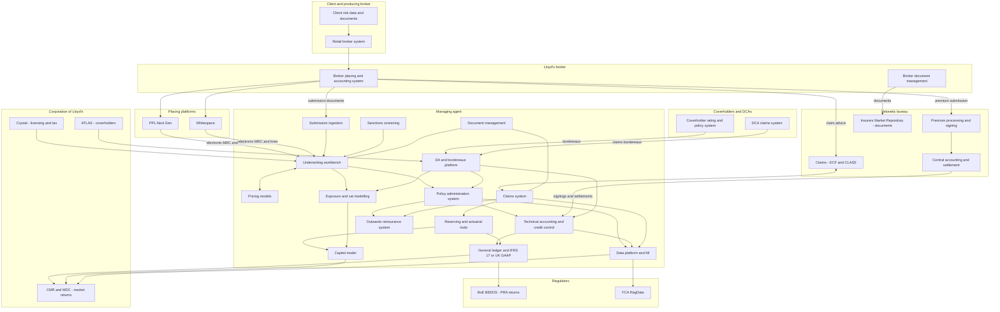
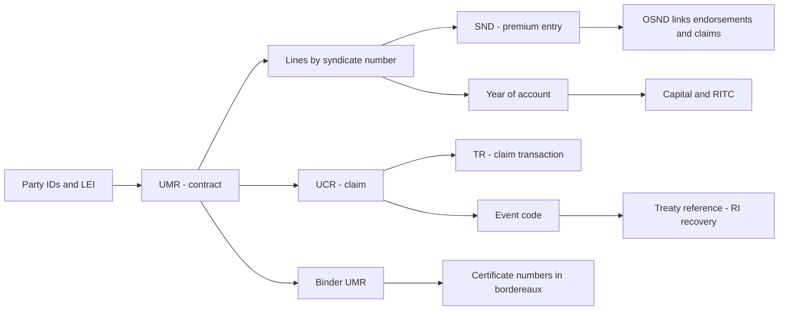
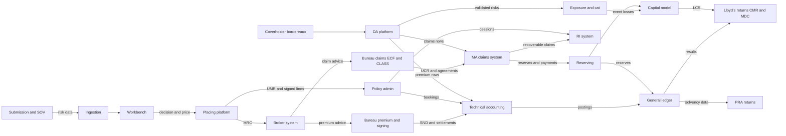

# Module 24 – Lloyd's Systems, Documents and Data: The Interlinked End-to-End View

| | |
|---|---|
| **Level** | Advanced – technical and functional reference |
| **Use it for** | Application landscape mapping, data lineage, integration design, requirements, vendor selection, data quality and AI use-case design |
| **Prerequisites** | [Module 23](23-Lloyds-Process-Catalogue.md) (process steps P01–P20) and [Module 08](08-Advanced-Modernisation-Data-Technology.md) |

**What this module adds.** Module 23 shows *who does what*. This module shows *which application, which document and which data* each step uses, and how they link from the first submission to the final regulatory return.

**Tags on system names.** Market and Lloyd's systems are named as publicly described by Lloyd's, Velonetic and market bodies. Lloyd's Core Market Returns (CMR), Market Data Collections (MDC) and ATLAS are confirmed on Lloyd's own pages **[certain]**. Bureau component names (IMR, ECF, CLASS) and some tools are tagged **[likely]** because names and services change – Velonetic is modernising incrementally after Blueprint Two. Vendor product names for firm-level systems are **examples of the type, not recommendations**, and are tagged **[likely]**; always confirm the client's own landscape.

---

## 1. The application landscape on one page

---

## 2. Application catalogue

### 2.1 Market and Lloyd's applications

| Application | Owner | What it does | Processes | Key data held | Documents | Interfaces |
|---|---|---|---|---|---|---|
| **PPL Next Gen** **[likely]** | Placing Platform Limited | Electronic placement: MRC, lines, stamps, messaging, audit trail | P05, P07, P16 | UMR, MRC sections, written lines, insurer references | Electronic MRC, endorsements | Broker systems; MA workbench/PAS (where integrated) |
| **Whitespace** **[likely]** | Whitespace | Electronic placement platform | P05, P07 | As above | Electronic MRC | As above |
| **Premium processing and signing** | Velonetic | Validates premium submissions; allocates SND | P08 | UMR, signed lines, premium, tax, SND/OSND, risk codes | Premium advice (LPAN or electronic equivalent) **[likely]** | Broker systems; MA accounting feeds |
| **Insurers' Market Repository (IMR)** **[likely]** | Velonetic | Shared repository for premium and claims documents | P08, P12 | Document metadata linked to UMR/UCR | MRC, endorsements, claim documents | Broker and MA document systems |
| **Central accounting and settlement** | Velonetic | Net settlement between brokers and syndicates | P08, P12 | Settlement amounts, currencies, due dates | Settlement statements | Broker and MA finance; trust fund banking |
| **ECF – Electronic Claims File** **[likely]** | Velonetic / market | Shares claims documents and agreements between broker and insurers | P12 | UCR, claim details, agreement status | Claim advices, adjuster reports | Broker claims systems; MA claims systems |
| **CLASS** **[likely]** | Velonetic | Bureau claims system recording claims movements and agreements | P12 | UCR, TR, movements, agreement parties | Claim transactions | ECF; MA claims and accounting |
| **ATLAS** | Lloyd's | Coverholder applications, approvals and records | P09, P11 | Coverholder details, permissions, locations, approvals | Applications, Coverholder Undertaking | MA DA teams (portal) |
| **Binding authority registration** | Lloyd's | Registers binders before inception **[likely]** | P09 | Binder UMR, parties, period | BAA | MA DA systems |
| **Crystal** **[likely]** | Lloyd's | Licensing, tax and regulatory information by territory | P06, P08, P10 | Territory rules | Guidance | Underwriting checks; tax processes |
| **Core Market Returns (CMR)** | Lloyd's | Web-based collection of syndicate data | P02, P19 | Syndicate returns | Returns | MA finance, actuarial |
| **Market Data Collections (MDC)** | Lloyd's | Web-based collection of syndicate data, including the Gross Quarterly Data return and Lloyd's Capital Return | P02, P03, P19 | Quarterly data, capital | GQD, LCR | MA finance, actuarial |
| **SecureShare** | Lloyd's | Secure file upload for data outside CMR/MDC | P19 | Ad hoc submissions | Files | MA |
| **BEEDS** **[likely]** | Bank of England | Regulatory data submission to the PRA | P19 | Solvency returns | QRTs | MA finance |
| **RegData** **[likely]** | FCA | Regulatory data submission to the FCA | P19 | Conduct and other returns | Returns | MA compliance |

### 2.2 Managing agent applications

| Application | What it does | Processes | Key data | Documents | Example products **[likely]** |
|---|---|---|---|---|---|
| **Submission ingestion** | Captures emails and attachments; extracts data | P05, P06 | Insured, class, limits, SOV rows, loss history | Submissions, SOVs, loss runs | AI document platforms, in-house |
| **Underwriting workbench** | Triage, enrichment, referrals, authority checks, decision record | P06 | Risk, authority, referral, decision | Underwriting file notes | Send, hx Renew, Federato, in-house |
| **Pricing models** | Technical price, rate adequacy, RARC | P06 | Rating factors, expected loss, technical price | Pricing sheets | Actuarial platforms, spreadsheets |
| **Exposure and cat modelling** | Aggregates, PML, RDS | P06, P10, P14, P15 | Geocoded locations, values, event losses | RDS outputs | Moody's RMS, Verisk |
| **Policy administration system (PAS)** | Contract record, lines, endorsements, premium, postings | P05, P07, P08 | UMR, written/signed lines, terms, premium | Policy record | Sequel Eclipse, DXC Genius/Assure, Guidewire, Duck Creek, Sapiens |
| **DA and bordereaux platform** | Contract register, bordereaux ingestion, validation, oversight MI | P09, P10, P11, P13 | Structured binder terms; risk, premium and claims rows | Bordereaux, BAAs, audit reports | Velonetic DA services such as DCOM **[likely]**, specialist DA platforms, in-house |
| **Technical accounting and credit control** | Booking, reconciliation, cash allocation, aged debt | P08, P10 | SND/OSND, settlements, cash, aged debt | Statements, reconciliations | PAS modules, finance systems, automation tools |
| **Claims system** | Handling, reserving, payments, recoveries | P12, P13, P14 | UCR, reserves, payments, event codes | Claim files | Vendor or in-house |
| **Outwards reinsurance system** | Programmes, cessions, recoveries, RI accounting | P15 | Treaties, cessions, recoveries | RI contracts, collection notes | Specialist RI systems (e.g., Sapiens reinsurance) |
| **Reserving tools** | Triangles, methods, IBNR | P17 | Paid/incurred by YOA and class | Reserve reports | ResQ, Arius, in-house |
| **Capital model** | SCR and uSCR | P03 | Risk distributions | Model outputs | Internal model platforms |
| **General ledger and reporting** | Accounts; UK GAAP; IFRS 17; Solvency UK | P18, P19 | Ledger, earned premium, reserves | Accounts, QRTs | SAP, Oracle, IFRS 17 engines |
| **Data platform and MI** | Single view; history; data quality; analytics; AI | All | Golden records across domains | Dashboards | Snowflake, Databricks, Microsoft Fabric |
| **Sanctions screening** | Screens parties, vessels, payees | P04, P06, P12 | Party names, IMO numbers, results | Screening records | Commercial screening services |
| **Document management** | Stores and links documents | All | Document metadata | All documents | Vendor DMS |

### 2.3 Coverholder and DCA applications

| Application | What it does | Data |
|---|---|---|
| **Coverholder rating and policy system** | Quote, bind, issue certificates within authority; produce bordereaux | Certificates, locations, premium, tax, coverholder references |
| **DCA claims system** | Local claims handling; loss fund accounting; claims bordereaux | Claim references, payments, reserves, status |

---

## 3. Document catalogue

| Document | Created by | Format | Held in | Key data inside | Used in |
|---|---|---|---|---|---|
| **Submission pack** | LB (from client) | PDF, email, spreadsheets | Broker DMS; MA ingestion | Insured, exposure, loss history | P05, P06 |
| **Statement of values (SOV)** | Client / LB | Spreadsheet | MA ingestion; exposure tools | Locations, construction, occupancy, values | P06, P14 |
| **Loss runs** | Client / previous insurer | PDF / spreadsheet | MA ingestion | Past claims by year | P06 |
| **Market Reform Contract (MRC)** | LB | Paper/PDF or electronic on platform | Platform; IMR **[likely]**; PAS | Six sections: risk details, information, security details, subscription agreement, fiscal and regulatory, broker remuneration | P05 |
| **Underwriting file note** | LUW | Workbench record | Workbench | Rationale, price, referrals | P06 |
| **Policy wording / certificate** | LB or CH | PDF | Broker DMS; CH system | Terms and clauses | P05, P10 |
| **MRC endorsement** | LB | Electronic or PDF | Platform; PAS | Change, AP/RP | P07 |
| **Premium advice** (LPAN or electronic equivalent) **[likely]** | LB | Electronic message | Bureau | Premium, brokerage, tax, instalments, signed lines | P08 |
| **Debit / credit note** | LB | PDF | Broker system | Amount due from client | P08 |
| **Settlement statement** | VEL | Electronic | Bureau; MA finance | Net amounts by syndicate | P08 |
| **TOBA** | LB / MA | PDF | Contract repository | Authority, premium handling, risk transfer | P04 |
| **Binding authority agreement (BAA)** | LB | MRC binding authority format | Lloyd's registration; DA platform | Classes, territories, limits, GPI, commission, reporting | P09 |
| **Coverholder Undertaking** | CH | Form | ATLAS | Commitment to Lloyd's standards | P09 |
| **Risk / premium bordereau** | CH | Spreadsheet / file / API | DA platform | Certificate-level risk and premium rows | P10 |
| **Claims bordereau** | CH / DCA | Spreadsheet / file | DA platform; claims | Claim rows | P13 |
| **Audit report** | AUD | PDF | DA platform | Findings, ratings | P11 |
| **Claim advice / notification** | LB | Electronic | ECF **[likely]** | UCR, date of loss, description | P12 |
| **Adjuster / expert report** | LA / LAW | PDF | ECF; MA claims | Cause, quantum | P12 |
| **Coverage position letter** | MA-CLM / LAW | PDF | MA claims | Policy response | P12 |
| **Reinsurance contract** | RIB | MRC | MA RI system | Treaty terms | P15, P16 |
| **Technical account** | CED / RIB | Electronic / spreadsheet | MA accounting | Quarterly premium, claims, balance | P16 |
| **Collection note** | MA-RI | Electronic | RI system | Recovery claimed | P15 |
| **Syndicate Business Forecast (SBF)** | MA-FIN | Return | Lloyd's systems | Plan by class | P02 |
| **Lloyd's Capital Return (LCR)** | MA-FIN / MA-ACT | Return | MDC | Capital | P03 |
| **Gross Quarterly Data (GQD)** | MA-FIN | Return | MDC | Quarterly performance | P19 |
| **Statement of Actuarial Opinion** | SA | Report | Lloyd's | Reserve opinion | P17 |
| **Annual report and accounts** | MA-FIN | Report | Published | Results | P19 |
| **Solvency returns (QRTs)** | MA-FIN | Returns | BEEDS **[likely]** | Solvency data | P19 |
| **RITC agreement** | MA-FIN | Contract | Finance | Closing year transfer | P18 |

---

## 4. Data entities and the identifiers that link everything

### 4.1 Core data entities

| Entity | Key identifier | Created in | Golden source (target state) | Flows to |
|---|---|---|---|---|
| **Party** (insured, broker, coverholder, reinsurer) | Internal party ID; LEI or company number; Lloyd's broker code; coverholder ID (ATLAS) | Broker system; ATLAS; MA | Data platform party master | All systems; sanctions |
| **Contract** | **UMR** | Broker system / platform | PAS | Bureau, finance, claims, RI |
| **Line** | UMR + syndicate number + insurer reference | Platform | PAS | Bureau signing; finance |
| **Premium transaction** | **SND** (and **OSND** link) | Bureau | Accounting | Ledger; credit control |
| **Exposure** | Location ID (geocode), IMO number, aircraft serial | Submission / bordereaux | Exposure data store | Cat models; RDS; capital |
| **Binder** | Binder UMR; coverholder ID | Broker / ATLAS | DA contract register | Bordereaux validation |
| **Certificate** | Coverholder certificate number | Coverholder system | DA data store | Exposure, finance, claims |
| **Claim** | **UCR**; transaction reference **TR** | Bureau / claims system | Claims system | Reserving; RI; finance |
| **Event** | Catastrophe event code | Market / MA | Claims system | RI recoveries; reporting |
| **Treaty** | Treaty reference / UMR | RI broker | RI system | Cessions; recoveries |
| **Year of account** | YOA (e.g., 2026) + syndicate | Assigned at inception | Finance | Results; RITC; capital |
| **Classification** | Lloyd's risk code; class of business | PAS | Reference data | Returns; capital |

### 4.2 The identifier chain

**Why this matters:** if the UMR or line is wrong at placement, every downstream link breaks – accounting, claims matching, reinsurance recoveries and reporting. Most reconciliation teams exist to repair broken links in this chain.

---

## 5. End-to-end interlinked journeys

### 5.1 Journey A – open market risk from submission to regulatory return

| # | Process | Actor | Application | Document | Data created or updated | Identifier | Passes to |
|---|---|---|---|---|---|---|---|
| A1 | P05 | CL, RB | Client files; retail broker system | Risk information | Exposure, loss history | Client ref | Lloyd's broker system |
| A2 | P05 | LB | Broker placing system | Submission; draft MRC | Contract draft | **UMR** created | Platform; MA ingestion |
| A3 | P06 | MA-UWA | Submission ingestion | Submission, SOV | Structured risk data | UMR | Workbench |
| A4 | P06 | MA-UWA | Sanctions screening; Crystal **[likely]** | Screening record | Sanctions and licensing results | Party IDs | Workbench |
| A5 | P06 | MA-EXP | Cat model | Model output | Modelled losses, aggregates | Location IDs | Workbench; exposure store |
| A6 | P06 | LUW | Workbench; pricing model | File note | Technical price, decision | UMR | Platform |
| A7 | P05 | LUW, FUW | PPL Next Gen / Whitespace **[likely]** | Electronic MRC | Written lines, stamps | UMR + syndicate | Broker; MA PAS |
| A8 | P05 | LB | Broker system / platform | Final MRC | Signed lines | UMR + syndicate | PAS; bureau |
| A9 | P05 | MA-UWA | PAS | Policy record | Contract, lines, premium | UMR | Accounting; RI; data platform |
| A10 | P08 | LB | Broker accounting → bureau | Premium advice | Premium, tax, brokerage | UMR | Velonetic premium processing |
| A11 | P08 | VEL | Premium processing | Signing record | Signed entries | **SND** | Central settlement; MA accounting |
| A12 | P08 | VEL, LB | Central settlement | Settlement statement | Cash movements | SND | MA accounting; trust funds |
| A13 | P08 | MA-TA | Technical accounting | Reconciliation | Matched or broken items | SND, UMR | General ledger |
| A14 | P15 | MA-RI | RI system | Cession record | Ceded share | UMR + treaty | RI accounting |
| A15 | P12 | LB | Broker claims system → ECF **[likely]** | Claim advice | Claim | **UCR** | MA claims; CLASS |
| A16 | P12 | MA-CLM | Claims system | Adjuster report; coverage letter | Reserve, agreement | UCR, TR | CLASS; reserving |
| A17 | P12 | VEL | CLASS **[likely]**; settlement | Claim transaction | Paid amounts | TR (linked to OSND) | MA accounting; broker |
| A18 | P15 | MA-RI | RI system | Collection note | Recovery | UCR + treaty | RI accounting; ledger |
| A19 | P17 | MA-ACT | Reserving tools | Reserve report | IBNR, ultimates | YOA + class | Ledger; capital model |
| A20 | P19 | MA-FIN | Ledger; data platform | GQD, accounts, QRTs | Returns | Syndicate + YOA | MDC/CMR; BEEDS **[likely]** |

### 5.2 Journey B – delegated authority from coverholder approval to exposure and claims

| # | Process | Actor | Application | Document | Data created or updated | Identifier | Passes to |
|---|---|---|---|---|---|---|---|
| B1 | P09 | MA-DA | DA platform | Due diligence file | Coverholder risk rating | Coverholder ID | ATLAS |
| B2 | P09 | MA-DA, CH | ATLAS | Application; Coverholder Undertaking | Approval, permissions, locations | Coverholder ID | DA platform |
| B3 | P09 | LB, LUW | Platform / broker system | BAA (MRC binding authority format) | Binder terms, lines | **Binder UMR** | Lloyd's registration; PAS |
| B4 | P09 | MA-DA | DA contract register | Structured BAA | Limits, territories, GPI, commission | Binder UMR | Validation rules |
| B5 | P10 | CH | Coverholder system | Certificates | Bound risks | Certificate numbers | Bordereaux |
| B6 | P10 | CH | Coverholder system | Risk and premium bordereaux | Monthly rows | Binder UMR + certificate | DA platform |
| B7 | P10 | MA-DA | DA platform | Validation report; queries | Validated rows, exceptions | Certificate | Exposure; finance; oversight |
| B8 | P10 | MA-EXP | Cat model | RDS outputs | Aggregates | Location IDs | Capital model; RI |
| B9 | P10 | CH, LB, VEL | Broker accounting; bureau | Remittance; premium advice | Net premium | Binder UMR; SND | MA accounting |
| B10 | P13 | DCA | DCA claims system | Claims bordereau; loss fund statement | Claims rows | Claim refs + certificate | DA platform; claims system |
| B11 | P13 | MA-CLM | Claims system | Referral files | Large claims, reserves | UCR | Reserving; RI |
| B12 | P11 | MA-DA, AUD | DA platform | Audit report | Findings, tier | Coverholder ID | Board MI; ATLAS updates |
| B13 | P19 | MA-FIN | Data platform | Lloyd's and regulatory returns | DA data in returns | Syndicate + YOA | CMR/MDC |

### 5.3 Journey C – planning, capital and closing

| # | Process | Actor | Application | Document | Data | Passes to |
|---|---|---|---|---|---|---|
| C1 | P02 | MA-CUO, MA-FIN | Planning models; data platform | SBF | Plan by class and channel | Lloyd's systems |
| C2 | P03 | MA-ACT | Capital model | LCR | uSCR | MDC |
| C3 | P03 | CoL-CAP | Lloyd's capital systems | Member capital statements | ECA, FAL | Members' agents; members |
| C4 | P17 | MA-ACT, SA | Reserving tools | SAO | Reserves | Lloyd's; ledger |
| C5 | P18 | MA-FIN | Ledger | RITC agreement; member statements | YOA result | Members; Lloyd's |

---

## 6. End-to-end data flow diagram

---

## 7. Integration and message types

| Interface | From → To | Pattern | Content |
|---|---|---|---|
| Submission intake | Broker email → MA ingestion | Email and documents | Unstructured documents |
| Platform → MA | PPL / Whitespace → workbench / PAS | API or platform exports **[likely]** | Structured MRC fields, lines |
| Broker → bureau | Broker accounting → Velonetic | Market messages (ACORD-based) **[likely]** | Premium and claims transactions |
| Bureau → MA | Velonetic → technical accounting | Daily/periodic files or messages | Signings, settlements, claims movements |
| Coverholder → MA | Coverholder system → DA platform | Files (spreadsheet/CSV), increasingly API | Bordereaux rows |
| MA → Lloyd's | Finance/actuarial → CMR, MDC, SecureShare | Web forms and uploads | Returns |
| MA → regulators | Finance → BEEDS; compliance → RegData **[likely]** | Web submission | Regulatory returns |
| Internal | PAS, claims, accounting → data platform | Batch and event-driven | All domains |

Standards: MRC, Core Data Record, ACORD GRLC, Lloyd's coverholder reporting standards, Lloyd's risk codes ([Module 08 §4](08-Advanced-Modernisation-Data-Technology.md)).

---

## 8. Where links break – and what to do

| Break | Where | Symptom | Fix |
|---|---|---|---|
| UMR keyed differently | Broker → platform → PAS | Records do not match | Take UMR from platform by integration |
| Written vs signed line | Platform → PAS → bureau | Premium differs by system | Update PAS from signed lines automatically |
| Missing OSND links | Bureau → accounting | Claims or endorsements not tied to premium | Reconciliation rules on OSND |
| Binder terms in PDF only | BAA → DA platform | No automated authority checks | Structured contract register |
| Unmapped bordereaux | Coverholder → DA platform | Manual mapping each month | Standard model; reusable mappings |
| Claims without event code | Claims → RI | Missed recoveries | Mandatory event coding |
| Multiple PAS after M&A | PAS → data platform | No single exposure view | Data platform first, then consolidation |
| Spreadsheet reserving | Claims → reserving | Weak lineage | Governed data pipelines |

---

## 9. Partner's lens

1. **Draw the landscape before the roadmap.** A one-page application map with data flows (section 1 and 6) is often the most valuable slide in an operations or technology diagnostic.
2. **Follow one UMR end to end.** Trace a real contract through every application in Journey A. Count how many times each field is entered and how many systems disagree. That count is your business case.
3. **Name golden sources.** For each data entity, agree one system of record. Most data quality problems come from two systems both believing they own the same data.
4. **Design for market change.** Bureau services and platforms will keep changing after Blueprint Two. Isolate them behind integration layers so internal systems do not need rebuilding each time.

---

## 10. Practice tasks

1. Redraw section 1 for a real or fictional managing agent, replacing generic boxes with the client's actual applications.
2. Build a CRUD matrix (create, read, update, delete) for the five core data entities against eight applications.
3. Trace Journey B for a fictional binder and list every point where a certificate number must match.
4. Write ten integration requirements for connecting a placing platform to a PAS.

---

## 11. Sources

- [Lloyd's – Core Market Returns](https://www.lloyds.com/market-resources/tools/core-market-returns)
- [Lloyd's – Market Data Collections](https://www.lloyds.com/market-resources/tools/market-data-collections)
- [Lloyd's – CMR Guidebook](https://assets.lloyds.com/assets/pdf-core-market-returns-cmr-cmr-guidebook/1/CMR-Guidebook.pdf)
- [Lloyd's – Non-CMR Guidebook](https://assets.lloyds.com/assets/pdf-core-market-returns-cmr-noncmrguidebook/1/NonCMRguidebook.pdf)
- [Lloyd's – new coverholder applications (ATLAS)](https://www.lloyds.com/market-resources/delegated-authorities/coverholders/new-coverholder-applications)
- [Crunchbase – Velonetic profile](https://crunchbase.com/organization/velonetic)
- [Velonetic – Digital Gateway](https://www.velonetic.co.uk/blueprint-two/progress/solutions/digital-gateway)
- [Insurance Insider – PPL Next Gen goes live](https://www.insuranceinsider.com/article/2bd65d4pn7amg8t7mmadc/london-market-section/ppl-next-gen-platform-goes-live-after-delays)
