# Module 25 – Lloyd's IT Landscape by Stage: Swimlane Process Views

| | |
|---|---|
| **Level** | Advanced – functional and technical |
| **Use it for** | Explaining the IT landscape to executives; current-state walkthroughs; requirements; integration design; target architecture |
| **Prerequisites** | [Module 23](23-Lloyds-Process-Catalogue.md) (process steps) and [Module 24](24-Lloyds-Systems-Documents-Data-Flow.md) (applications, documents, data) |

**How to read the swimlanes.** Each diagram is a swimlane: every vertical lane is **a party and the system it works in** (for example "Lloyd's broker – placing system"). Arrows are hand-offs, labelled with the document or data that moves. Notes show controls. Below each diagram, a table explains how each system is used at that stage, with its data in and data out.

**Tags.** Lloyd's systems CMR, MDC and ATLAS are confirmed on Lloyd's pages **[certain]**. Bureau component names (IMR, ECF, CLASS), Crystal, BEEDS and RegData are **[likely]**. Product names for firm-level systems are examples of the type only **[likely]**.

---

## 1. The landscape in seven layers

| Layer | Applications | Owner | Stages where used |
|---|---|---|---|
| **1. Client and distribution** | Client files; retail broker systems; Lloyd's broker placing and accounting systems; broker document management | Clients, brokers | 2, 4, 5, 8 |
| **2. Placement platforms** | PPL Next Gen, Whitespace **[likely]** | Market / vendors | 2, 4, 6, 10 |
| **3. Core insurance (managing agent)** | Submission ingestion; underwriting workbench; pricing; exposure and cat models; policy administration (PAS); claims; outwards reinsurance; sanctions screening; document management | Managing agent | 2–5, 8–10 |
| **4. Delegated authority** | Coverholder rating and policy systems; DCA claims systems; MA DA and bordereaux platform (e.g., Velonetic DA services such as DCOM **[likely]**) | Coverholders, DCAs, MA | 6, 7, 9 |
| **5. Market utilities** | Velonetic premium processing and signing; Insurers' Market Repository; central accounting and settlement; ECF and CLASS claims **[likely]** | Velonetic (via LIMOSS) | 5, 8, 9 |
| **6. Finance, risk and actuarial** | Technical accounting; general ledger; IFRS 17 / UK GAAP; reserving tools; capital model | Managing agent | 1, 5, 11 |
| **7. Data, AI and reporting** | Data platform; MI; AI services; Lloyd's CMR, MDC, SecureShare; ATLAS; Crystal; BoE BEEDS; FCA RegData | MA, Lloyd's, regulators | All |

### Lloyd's insurance stages used in this module

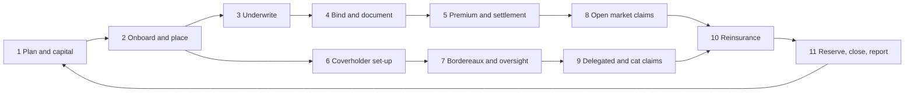

---

## Stage 1 – Plan and capital

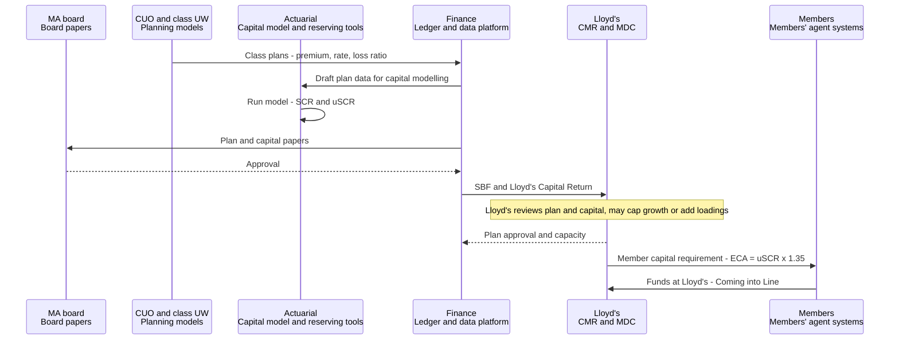

| Lane | System | How it is used | Data in | Data out |
|---|---|---|---|---|
| CUO / class UW | Planning models (spreadsheets or planning tools) | Build class plans | Prior results, rate trends, market guidance | Class plans |
| Actuarial | Capital model; reserving tools | Calculate SCR/uSCR | Plan, exposures, reserves, RI | Capital results |
| Finance | Ledger; data platform | Consolidate plan; prepare returns | Actuals, plans | SBF, LCR |
| Lloyd's | CMR, MDC | Collect plans, capital, quarterly data | Returns | Approvals, feedback |
| Members | Members' agent systems | Track participations and FAL | Capital statements | FAL deposits |

**Watch points:** plan data built in spreadsheets with weak lineage; plan and capital data inconsistent; late Lloyd's challenges.

---

## Stage 2 – Onboard client and place the risk

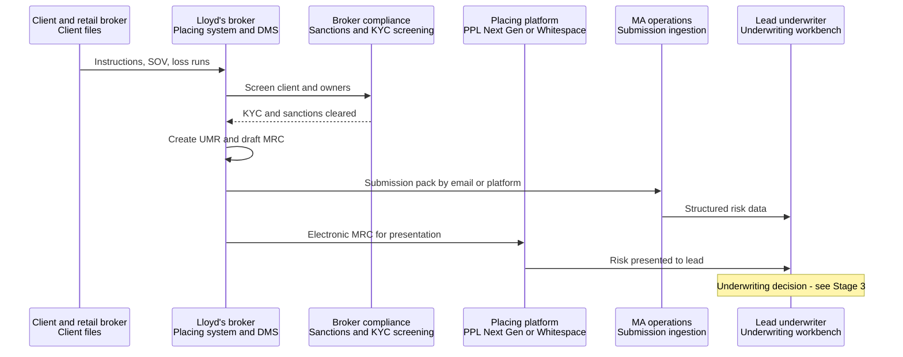

| Lane | System | How it is used | Data in | Data out |
|---|---|---|---|---|
| Client / retail broker | Client files; retail broker system | Provide risk information | Client data | Instructions, SOV, loss runs |
| Lloyd's broker | Placing system; document management | Build submission and MRC; create UMR | Client documents | UMR, draft MRC, submission |
| Broker compliance | Screening service | KYC and sanctions | Party names, owners | Clearance record |
| Placing platform | PPL Next Gen / Whitespace | Share the MRC with underwriters | Draft MRC | Platform record |
| MA operations | Submission ingestion (AI-assisted) | Turn documents into data | Emails, PDFs, spreadsheets | Structured submission |
| Lead underwriter | Workbench | Receive and prioritise | Structured data | Work queue |

**Watch points:** the same risk data is keyed by broker and by each insurer; SOV quality decides cat model quality.

---

## Stage 3 – Underwrite

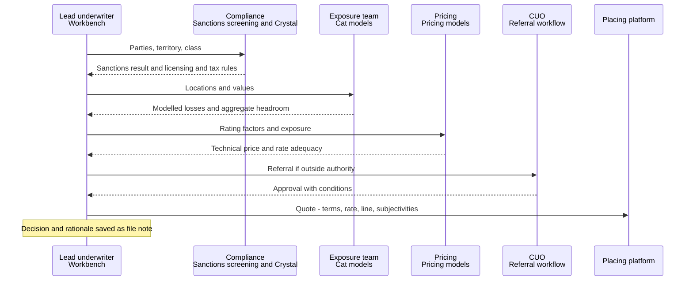

| Lane | System | How it is used | Data in | Data out |
|---|---|---|---|---|
| Lead underwriter | Workbench | Orchestrates checks; records decision | Submission data | Quote; file note |
| Compliance | Sanctions screening; Crystal **[likely]** | Screen parties; check licences and tax | Party, territory, class | Clear / refer; rules |
| Exposure | Cat models (e.g., Moody's RMS, Verisk) **[likely]** | Model event losses and aggregates | Geocoded locations, values | AAL, PML, aggregate use |
| Pricing | Pricing models | Technical price; RARC | Exposure, experience | Technical price; adequacy |
| CUO | Referral workflow | Approve outside-authority risks | Referral | Decision |
| Platform | PPL / Whitespace | Communicate quote | Terms | Quote record |

**Watch points:** checks done in separate tools without a single decision record; exposure checks monthly rather than at bind.

---

## Stage 4 – Bind, document and change

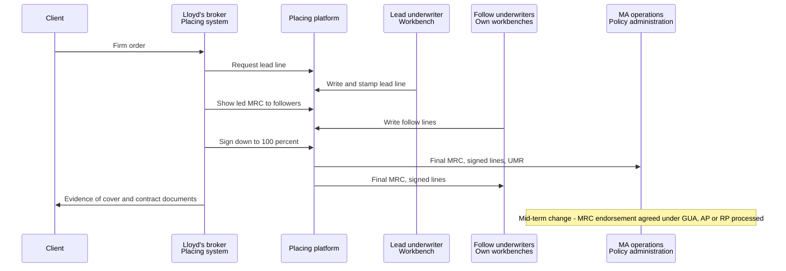

| Lane | System | How it is used | Data in | Data out |
|---|---|---|---|---|
| Lloyd's broker | Placing system | Firm order; signing down; documentation | Lines | Final MRC; policy documents |
| Platform | PPL / Whitespace | Record lines, stamps and audit trail | Quotes, lines | Final electronic MRC |
| Lead / follow underwriters | Workbenches | Accept lines | Final terms | Written lines |
| MA operations | PAS (e.g., Sequel Eclipse, DXC Genius/Assure, Guidewire) **[likely]** | Book contract, lines, endorsements | Final MRC | Policy record; postings |

**Watch points:** PAS updated by re-keying rather than from the platform; written line booked and never corrected to signed line.

---

## Stage 5 – Premium accounting and central settlement

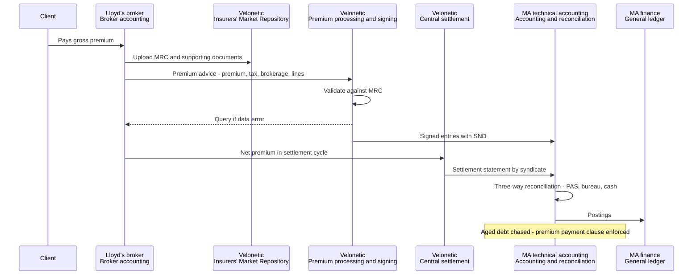

| Lane | System | How it is used | Data in | Data out |
|---|---|---|---|---|
| Lloyd's broker | Broker accounting | Collect premium; submit to bureau; settle | Debit notes, MRC | Premium advice; payments |
| Velonetic IMR **[likely]** | Document repository | Store MRC and supporting documents | Documents | Linked documents |
| Velonetic premium processing | Bureau processing | Validate and sign | Premium advice | SND, signed entries |
| Velonetic settlement | Central settlement | Net cash between brokers and syndicates | Signed entries | Settlement statements |
| MA technical accounting | Accounting and reconciliation tools | Match bureau, PAS and cash | Signings, settlements, cash | Reconciled items; aged debt |
| MA finance | General ledger | Post premium | Reconciled entries | Accounts |

**Watch points:** bureau queries from data errors; written vs signed line breaks; FX differences; non-bureau insurers on the same contract processed separately.

---

## Stage 6 – Coverholder approval and binding authority set-up

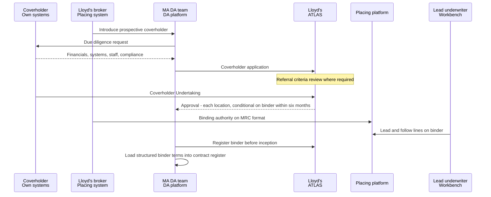

| Lane | System | How it is used | Data in | Data out |
|---|---|---|---|---|
| Coverholder | Own systems | Provide due diligence data; sign undertaking | Requests | Evidence, undertaking |
| Lloyd's broker | Placing system | Introduce; place binder | Proposal | Binder MRC |
| MA DA team | DA platform | Due diligence; contract register | Evidence, BAA | Structured binder terms |
| Lloyd's | ATLAS | Applications, approvals, records | Applications | Approval, permissions |
| Platform / lead UW | PPL / Whitespace; workbench | Agree binder terms and lines | Binder MRC | Bound binder |

**Watch points:** binder terms left in PDF; registration after inception; ATLAS records not maintained.

---

## Stage 7 – Delegated binding, bordereaux and oversight

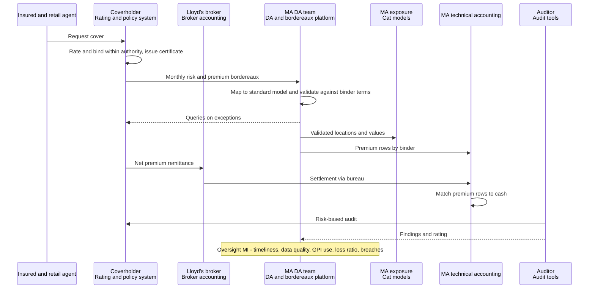

| Lane | System | How it is used | Data in | Data out |
|---|---|---|---|---|
| Coverholder | Rating and policy system | Bind within authority; produce bordereaux | Customer data | Certificates; bordereaux |
| MA DA team | DA platform (e.g., DCOM-type services or specialist platforms) **[likely]** | Ingest, map, validate; oversight MI | Bordereaux; binder terms | Validated rows; exceptions; MI |
| MA exposure | Cat models | Update aggregates and RDS | Validated locations | Aggregates |
| MA technical accounting | Accounting tools | Book and reconcile DA premium | Premium rows; cash | Reconciled premium |
| Auditor | Audit tools | Audit coverholder | Files, systems | Audit report |

**Watch points:** each coverholder layout different; each carrier on the binder processes the same file; exposure weeks out of date.

---

## Stage 8 – Open market claims

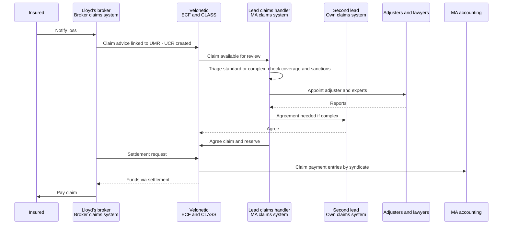

| Lane | System | How it is used | Data in | Data out |
|---|---|---|---|---|
| Lloyd's broker | Broker claims system | Notify; present; request settlement | Client notice | Claim advice |
| Velonetic | ECF, CLASS **[likely]** | Share documents; record agreements and movements | Advices, agreements | UCR, TR, movements |
| Lead / second lead | MA claims systems | Triage, coverage, reserve, agree | Claim file | Agreement, reserve |
| Experts | Own tools | Investigate | Instructions | Reports |
| MA accounting | Accounting tools | Book payments | Claim entries | Postings |

**Watch points:** follower claims systems updated manually; complex/standard triage not recorded; sanctions check missed at payment.

---

## Stage 9 – Delegated and catastrophe claims

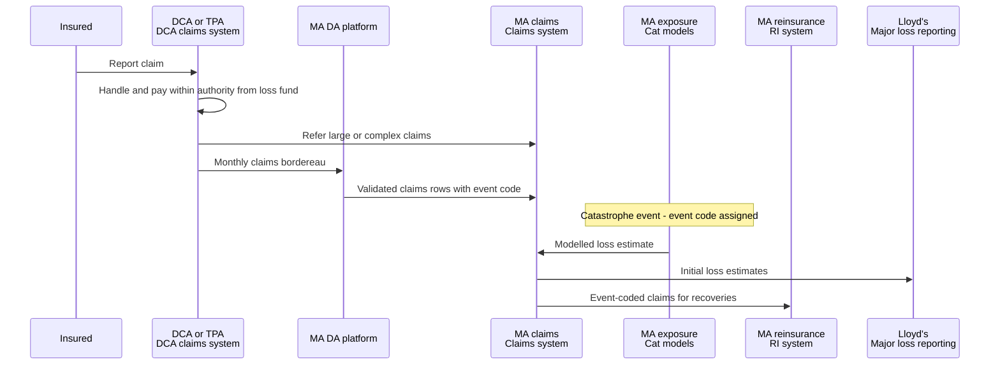

| Lane | System | How it is used | Data in | Data out |
|---|---|---|---|---|
| DCA / TPA | DCA claims system | Handle claims; loss fund accounting | Claims | Payments; claims bordereaux |
| MA DA platform | Bordereaux platform | Validate claims rows | Claims bordereaux | Validated claims |
| MA claims | Claims system | Referred claims; reserves; event coding | Referrals, rows | Reserves; event-coded claims |
| MA exposure | Cat models | Event loss estimates | Exposure, event footprint | Loss estimates |
| Lloyd's | Market reporting | Major loss estimates **[likely]** | Estimates | Market view |
| MA reinsurance | RI system | Recoveries | Event-coded claims | Collections |

---

## Stage 10 – Reinsurance

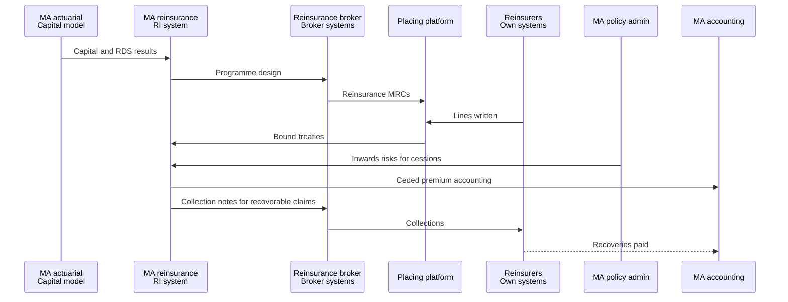

| Lane | System | How it is used | Data in | Data out |
|---|---|---|---|---|
| Actuarial | Capital model | Value capital benefit of cover | Exposures | uSCR change |
| MA reinsurance | RI system (e.g., specialist reinsurance administration systems) **[likely]** | Programme, cessions, recoveries | Treaties, risks, claims | Cessions, collections |
| Reinsurance broker | Broker systems; platforms | Place programme | Programme | Bound treaties |
| Reinsurers | Own systems | Accept and pay | Submissions, collections | Lines, payments |
| PAS / accounting | PAS; accounting | Feed risks; account for RI | Policy data | RI postings |

---

## Stage 11 – Reserve, close the year and report

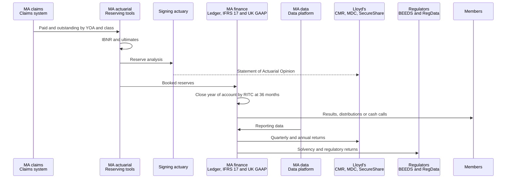

| Lane | System | How it is used | Data in | Data out |
|---|---|---|---|---|
| MA claims | Claims system | Provide claims data | Claims | Triangles input |
| Actuarial | Reserving tools (e.g., ResQ, Arius) **[likely]** | Reserve analysis | Triangles | Reserves, RITC pricing |
| Signing actuary | Own tools | Independent opinion | Reserve analysis | SAO |
| Finance | Ledger; IFRS 17 / UK GAAP | Accounts; YOA closure | Reserves, premium | Accounts, RITC, member results |
| Data platform | Data platform | Single reporting data | All domains | Reporting datasets |
| Lloyd's | CMR, MDC, SecureShare | Collect returns | Returns | Market oversight |
| Regulators | BEEDS, RegData **[likely]** | Collect returns | Returns | Supervision |

---

## 2. Application × stage matrix

● = main use; ○ = supporting use.

| Application | 1 Plan | 2 Place | 3 UW | 4 Bind | 5 Premium | 6 CH set-up | 7 BDX | 8 Claims | 9 DA/cat claims | 10 RI | 11 Report |
|---|---|---|---|---|---|---|---|---|---|---|---|
| Broker placing and accounting | — | ● | ○ | ● | ● | ○ | ○ | ● | — | ○ | — |
| PPL / Whitespace | — | ● | ○ | ● | — | ● | — | — | — | ● | — |
| Submission ingestion | — | ● | ○ | — | — | — | — | — | — | — | — |
| Underwriting workbench | ○ | ○ | ● | ● | — | ○ | — | — | — | — | — |
| Pricing models | ● | — | ● | — | — | — | — | — | — | ○ | — |
| Exposure and cat models | ● | — | ● | — | — | — | ● | — | ● | ● | ○ |
| Policy administration | ○ | — | — | ● | ● | — | ○ | ○ | — | ● | ○ |
| DA and bordereaux platform | ○ | — | — | — | ○ | ● | ● | — | ● | — | ○ |
| Coverholder systems | — | — | — | — | — | ○ | ● | — | ○ | — | — |
| Velonetic premium, IMR, settlement | — | — | — | — | ● | — | ○ | ○ | — | ○ | — |
| ECF and CLASS | — | — | — | — | — | — | — | ● | ○ | ○ | — |
| MA claims system | — | — | — | — | — | — | — | ● | ● | ○ | ○ |
| DCA claims systems | — | — | — | — | — | — | — | — | ● | — | — |
| Outwards RI system | ○ | — | — | — | — | — | — | ○ | ○ | ● | ○ |
| Technical accounting | — | — | — | — | ● | — | ● | ○ | ○ | ● | ○ |
| Reserving tools | ○ | — | — | — | — | — | — | — | — | — | ● |
| Capital model | ● | — | — | — | — | — | — | — | — | ● | ○ |
| General ledger / IFRS 17 | ○ | — | — | — | ● | — | — | — | — | ○ | ● |
| Data platform and MI | ● | ○ | ○ | ○ | ○ | ○ | ● | ○ | ○ | ○ | ● |
| Sanctions screening | — | ● | ● | — | — | ○ | ○ | ● | ○ | — | — |
| ATLAS | — | — | — | — | — | ● | ● | — | — | — | — |
| Crystal | — | — | ● | — | ○ | — | ○ | — | — | — | — |
| CMR / MDC / SecureShare | ● | — | — | — | — | — | — | — | ○ | — | ● |
| BEEDS / RegData | — | — | — | — | — | — | — | — | — | — | ● |

---

## 3. How to use these views with a client

| Situation | How to use the swimlanes |
|---|---|
| Executive briefing | Show the seven layers and one stage swimlane; point to the hand-offs where cost and errors build up |
| Current-state workshop | Replace generic lanes with the client's real systems; mark each arrow as automated, manual or re-keyed |
| Target architecture | Redraw each stage with integrations replacing manual arrows; name golden sources |
| Vendor selection | Script demos from the swimlanes (e.g., Stage 4 signing down; Stage 7 bordereaux validation) |
| AI use cases | Look for arrows carrying unstructured documents (submissions, bordereaux, claims reports) – these are the best AI candidates |

---

## 4. Partner's lens

1. **One stage, one slide.** Executives absorb one swimlane at a time. Lead with the stage that hurts most (often Stage 5 or Stage 7) and show the cost of its manual arrows.
2. **Colour the arrows.** In workshops, colour each hand-off green (integrated), amber (file transfer) or red (re-keyed). The red arrows are the business case.
3. **Separate market from firm.** Lanes owned by Velonetic, platforms and Lloyd's change on the market's timetable; lanes owned by the client change on theirs. Prioritise what the client controls.
4. **Keep it current.** Bureau services and platforms are changing after Blueprint Two. Date every landscape diagram and refresh it at least once a year.

---

## 5. Practice tasks

1. Redraw Stage 5 and Stage 7 with a real client's applications and colour every arrow.
2. Pick one stage and write the target-state version with integrations and golden sources.
3. Identify five red arrows across all stages and size the value of automating each (method in [Module 11 §5](11-Consulting-Playbook.md)).

---

## 6. Sources

- [Lloyd's – Core Market Returns](https://www.lloyds.com/market-resources/tools/core-market-returns)
- [Lloyd's – Market Data Collections](https://www.lloyds.com/market-resources/tools/market-data-collections)
- [Lloyd's – new coverholder applications (ATLAS)](https://www.lloyds.com/market-resources/delegated-authorities/coverholders/new-coverholder-applications)
- [Keoghs – Lloyd's Claims Lead Arrangements](https://keoghs.co.uk/keoghs-insight/keoghs-guide-to-lloyds-claims-lead-arrangements)
- [Crunchbase – Velonetic profile](https://crunchbase.com/organization/velonetic)
- [Insurance Insider – PPL Next Gen goes live](https://www.insuranceinsider.com/article/2bd65d4pn7amg8t7mmadc/london-market-section/ppl-next-gen-platform-goes-live-after-delays)
