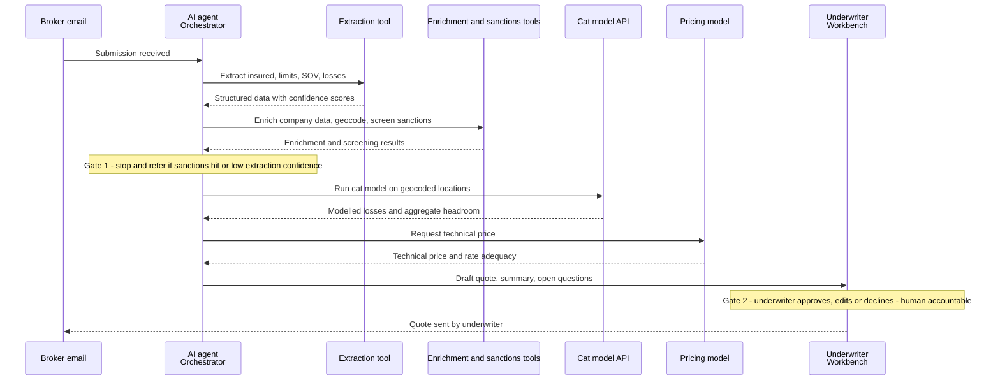

# Module 26 – AI in the London Market: Use-Case Library, Capabilities and Live Examples

| | |
|---|---|
| **Level** | Advanced – your recommended primary spike ([Module 18 §3](18-World-Class-Consultant-Path.md)) |
| **Builds on** | [Module 09](09-Advanced-AI-in-London-Market.md) (strategy, governance, evaluation), [Module 23](23-Lloyds-Process-Catalogue.md) (process steps), [Module 25](25-Lloyds-IT-Landscape-Swimlanes.md) (systems by stage) |
| **Time** | 4 hours reading; then use as a reference in client work |
| **You will be able to** | Name the AI capabilities that matter in London and what each can and cannot do; map 40+ use cases to Lloyd's processes; describe real deployments with their evidence quality; design an agentic workflow with controls; run an AI use-case discovery for a client |

**Evidence rule for this chapter.** Every live example states who reported it. Results such as "three days to three minutes" are **company or vendor claims** unless stated otherwise, and are tagged accordingly. Treat vendor numbers as hypotheses to test, not facts to repeat to a client.

---

## 1. The state of play in late 2026

| Indicator | Figure | Source and tag |
|---|---|---|
| AI adoption in the Lloyd's market | Adoption more than doubled in 12 months; 93% of surveyed firms have AI governance in place or in development; most use is generative AI for internal productivity (summarisation, reporting, data processing) | LMA survey, April 2026 **[likely]** |
| Most valuable AI use case (brokers' view) | 42% say submission intake and data extraction; 38% exposure management | Guidewire London Market Tech Barometer 2026, 250+ brokers – vendor survey **[likely]** |
| Insurer technology and placement | 78% of brokers say insurer technology plays a decisive or highly significant role in where they place risk | Guidewire 2026 – vendor survey **[likely]** |
| Trust | 55% of brokers concerned about algorithmic bias and lack of transparency in risk selection | Guidewire 2026 **[likely]** |
| Smart follow scale | Smart follow syndicates wrote more than $1.8bn GWP in 2024, up about 17% | Trade press **[likely]** |
| Lloyd's stance | AI should strengthen human decision-making, not replace it | Lloyd's 2026–2030 strategy **[likely]** |
| Claims talent | Fewer highly experienced claims professionals; AI taking more routine work widens an expertise gap | LMA Claims Talent Survey (July 2026) and conference commentary **[likely]** |

**What this tells a consultant [likely]:** AI in London has moved from experiments to the first production uses, concentrated in **intake, extraction, summarisation and follow underwriting**. Brokers now judge carriers partly on their technology. The constraint is no longer model quality – it is data, workflow integration, trust and governance.

---

## 2. AI capability catalogue – what each capability can and cannot do

| # | Capability | What it does | London tasks | Can do well | Cannot do (yet) reliably | Maturity |
|---|---|---|---|---|---|---|
| C1 | **Document extraction** | Turns PDFs, emails and spreadsheets into structured fields | Submissions, SOVs, loss runs, MRCs, bordereaux, claim advices | High-volume, repeatable fields; varied layouts | Perfect accuracy on poor scans or complex nested schedules without validation | Production |
| C2 | **Classification and triage** | Assigns a category, priority or route | Appetite fit; standard vs complex claim; query type | Consistent sorting; fast declines | Judging novel risks | Production |
| C3 | **Summarisation** | Condenses long documents | Claims files, expert reports, submissions, regulation | Saves reading time; consistent structure | Guaranteeing no important detail is missed | Production |
| C4 | **Comparison** | Finds differences between documents | Wording vs standard; renewal vs expiring; layer vs layer | Spotting changed or missing clauses | Legal interpretation of the difference | Early production |
| C5 | **Retrieval Q&A (RAG)** | Answers questions from an approved document set with citations | Underwriting guidelines, wordings library, market bulletins, binder terms | Grounded answers with sources | Answering beyond its sources | Early production |
| C6 | **Prediction (machine learning)** | Scores likelihood or size from structured history | Bind propensity, claim severity, fraud, late payment, lapse | Data-rich, repeatable segments | Rare, unique specialty risks with little history | Production in data-rich classes |
| C7 | **Anomaly detection** | Flags unusual records or patterns | Bordereaux, payments, reconciliation breaks, sanctions behaviour | Finding needles in large data sets | Explaining cause without human review | Production |
| C8 | **Geospatial and vision** | Reads imagery, maps, vessel tracks | Property attributes, post-cat damage, AIS vessel monitoring | Enriching exposure; rapid event assessment | Replacing on-site surveys for complex risks | Production / early |
| C9 | **Generation (drafting)** | Writes text from data and instructions | Broker emails, referral notes, query letters, reserve rationale, board papers | First drafts at speed | Final decisions or legal advice | Production |
| C10 | **Agentic orchestration** | Plans and runs multi-step tasks with tools and approval gates | Submission-to-quote; bordereaux exceptions; claims FNOL | Chaining steps with checkpoints | Unsupervised binding or settlement | Early (pilots to first production) |
| C11 | **Algorithmic decisioning** | Rule-plus-model decisions at portfolio level | Smart follow lines; portfolio steering | Consistent, cheap capacity deployment | Avoiding adverse selection without strong lead and data rules | Production at a few syndicates |

---

## 3. Use-case library mapped to Lloyd's processes

Process IDs refer to [Module 23](23-Lloyds-Process-Catalogue.md); capability codes to section 2. Risk tier follows [Module 09 §8.3](09-Advanced-AI-in-London-Market.md). Maturity: **P** = in production at several firms; **E** = early production or pilots; **F** = future or rare.

### 3.1 Distribution, placement and underwriting

| ID | Process | Use case | Capability | Data in → out | Users | Value lever | Maturity | Risk tier |
|---|---|---|---|---|---|---|---|---|
| U01 | P05 | Submission pack assembly for brokers | C1, C9 | Client documents → structured submission and draft MRC | Broker | Broker productivity; data quality at source | E | Low |
| U02 | P05 | Market selection support | C6, C5 | Risk profile, market appetite data → suggested leads/followers | Broker | Placement speed; hit rate | E | Medium |
| U03 | P06 | Submission intake and extraction | C1 | Email, SOV, loss runs → workbench fields | MA operations | Removes keying; faster quotes | P | Low |
| U04 | P06 | Appetite triage and prioritisation | C2, C6 | Extracted risk → priority score, fast decline | Underwriters | Selection; underwriter capacity | P/E | Medium |
| U05 | P06 | Risk summary and referral note drafting | C3, C9 | Submission → one-page summary; referral draft | Underwriters | Underwriter time | E | Medium |
| U06 | P06 | Guideline Q&A | C5 | Question → cited answer from underwriting guidelines | Underwriters | Consistency; training | E | Low |
| U07 | P06 | Data enrichment | C6, C8 | Insured name, locations → company data, geocodes, hazard scores | Underwriters, exposure | Pricing and exposure accuracy | P | Low |
| U08 | P06 | Pricing support | C6 | Exposure and experience → factor suggestions; rate adequacy alerts | Pricing, underwriters | Rate adequacy | P (data-rich classes) | High |
| U09 | P06 | Lead quote generation | C1, C6, C9, C10 | Submission → priced quote email for underwriter approval | Lead underwriters | Quote speed | E (live at Hiscox for one class – see §4.1) | High |
| U10 | P05 | Smart follow / algorithmic follow | C11, C6 | Lead, class, risk data → follow line decision | Follow syndicates | Low-cost capacity | P at a few syndicates (§4.3) | High |
| U11 | P05/P06 | Wording comparison and contract certainty check | C4, C5 | MRC and wording vs standards → flagged differences | Underwriters, brokers | Contract certainty; disputes avoided | E | Medium |
| U12 | P06 | Sanctions and vessel monitoring | C7, C8 | Parties, IMO numbers, AIS tracks → alerts | Compliance, marine UW | Avoid breaches | P | Medium–High |
| U13 | P06 | Portfolio steering | C6, C11 | Portfolio data → mix and capital allocation signals | CUO | Capital efficiency | E (Lloyd's Lab Cohort 17 theme **[likely]**) | Medium |
| U14 | P07 | Renewal change detection | C4 | Renewal vs expiring submission → material changes | Underwriters | Fair presentation; pricing | E | Medium |

### 3.2 Accounting and settlement

| ID | Process | Use case | Capability | Data in → out | Users | Value lever | Maturity | Risk tier |
|---|---|---|---|---|---|---|---|---|
| U15 | P08 | Pre-submission validation of premium data | C1, C7 | Premium advice vs MRC → errors before bureau | Broker, MA ops | Fewer bureau queries | E | Low |
| U16 | P08 | Cash matching | C6, C7 | Cash, statements → matched premium entries | Technical accounting | Aged debt; effort | E | Low |
| U17 | P08 | Reconciliation break classification | C2, C7 | Breaks → root cause category and suggested fix | Technical accounting | Effort; faster close | E | Low |
| U18 | P08 | Late payment prediction | C6 | Broker, class, history → risk of late premium | Credit control | Cash; credit risk | E | Low |

### 3.3 Delegated authority

| ID | Process | Use case | Capability | Data in → out | Users | Value lever | Maturity | Risk tier |
|---|---|---|---|---|---|---|---|---|
| U19 | P09 | Binder contract digitisation | C1 | BAA PDF → structured contract register | DA team | Enables automated checks | E | Low–Medium |
| U20 | P09 | Coverholder due diligence summarisation | C3, C5 | Financials, policies, audit reports → risk summary | DA team | Faster approvals | E | Medium |
| U21 | P10 | Bordereaux mapping and cleansing | C1, C2 | Coverholder files → standard model | DA operations | Major effort reduction | E (vendor tools in general release – §4.5) | Low |
| U22 | P10 | Bordereaux validation against binder terms | C7 + rules | Rows + structured BAA → exceptions | DA operations | Authority control; data quality | E | Low–Medium |
| U23 | P10 | Exception query drafting | C9, C10 | Exceptions → drafted queries; tracking | DA operations | Turnaround | E | Low |
| U24 | P11 | Coverholder performance analytics | C6, C7 | Bordereaux, claims, audits → risk tier, early warnings | DA team, CUO | Partner selection – biggest DA value | E | Medium |
| U25 | P11 | Audit preparation and findings analysis | C3, C5 | Files, past findings → audit scope, summaries | DA team, auditors | Audit cost | E | Low |

### 3.4 Claims

| ID | Process | Use case | Capability | Data in → out | Users | Value lever | Maturity | Risk tier |
|---|---|---|---|---|---|---|---|---|
| U26 | P12 | FNOL extraction and registration | C1 | Claim advice → structured claim | Claims ops | Speed | P | Low |
| U27 | P12 | Complexity triage (standard vs complex under LCLA) | C2 | Claim data → triage recommendation | Lead claims handler | Right expertise early | E | Medium |
| U28 | P12 | Claims file summarisation | C3 | Adjuster reports, correspondence → structured summary | Claims handlers, followers | Handler time; follower review | P (e.g., TPA tools – §4.6) | Medium |
| U29 | P12 | Coverage checklist | C5, C4 | Policy wording + facts → coverage issues to review | Claims handlers | Leakage; consistency | E | High |
| U30 | P12 | Reserve rationale drafting | C9 | File data → reserve note for approval | Claims handlers | Reserve consistency | E | Medium |
| U31 | P12 | Leakage and fraud detection | C6, C7 | Payments, documents → anomalies, duplicate payments, suspicious documents | Claims, SIU | Loss ratio | E | Medium–High |
| U32 | P13 | Claims bordereaux validation | C1, C7 | DCA claims rows → validated claims, policy matches | Claims, DA | Reserving data | E | Low |
| U33 | P14 | Catastrophe event loss estimation | C8, C6 | Event footprint, exposures, imagery → early loss estimate | Exposure, claims | Speed of estimates | P/E | Medium |
| U34 | P15 | Reinsurance recovery matching | C6, C7 | Event-coded claims, treaties → recoverable list | RI team | Missed recoveries found | E | Low–Medium |

### 3.5 Finance, actuarial, risk and reporting

| ID | Process | Use case | Capability | Data in → out | Users | Value lever | Maturity | Risk tier |
|---|---|---|---|---|---|---|---|---|
| U35 | P02 | Plan narrative and variance commentary | C9, C3 | Plan vs actual → commentary drafts | Finance, CUO | Reporting effort | E | Medium |
| U36 | P17 | Reserving data preparation and anomaly checks | C7 | Triangles → data issues flagged | Actuarial | Quality; speed | E | Medium |
| U37 | P19 | Regulatory and Lloyd's return narrative drafting | C9 | Data → narrative drafts | Finance, risk | Reporting effort | E/F | Medium |
| U38 | P19 | Regulatory change monitoring | C5, C3 | Market Bulletins, PRA/FCA papers → impact summaries | Compliance | Awareness; effort | E | Low |
| U39 | P19 | AI exposure in insured portfolios (silent AI) | C5, C4 | Wordings, insured profiles → exposure map | CUO, CRO | Underwriting risk | E | Medium |
| U40 | All | Employee assistant (approved general AI) | C3, C9 | Internal documents → drafts, summaries | All staff | Productivity | P | Low |

---

## 4. Live examples – what the market has actually deployed

Each case shows: **what**, **how**, **where in the process**, **results claimed**, **evidence quality**, and **lessons**.

### 4.1 Hiscox and Google Cloud – generative AI in lead underwriting

| | |
|---|---|
| **What** | A generative AI-enhanced lead underwriting model for the London market |
| **How** | Uses Google Cloud's Gemini model to assess in-scope risks and draft an email to the broker with pricing and data; combined with Hiscox's in-house pricing and analysis (Hailo); **an underwriter reviews before anything goes out** |
| **Process** | P06 underwriting decision; U03, U05, U09 |
| **Timeline** | Proof of concept December 2023; live August 2024 for **sabotage and terrorism** – initially renewals of existing US and Canadian risks, excluding New York and Chicago metro areas; first risk written with WTW; later reported as rolled out to all Hiscox London market brokers |
| **Results claimed** | Lead quotes cut from three days to as little as three minutes (company claim) |
| **Evidence quality** | **[likely]** – consistent trade press reporting; speed is the company's own claim |
| **Lessons** | Start with a narrow, well-understood class and renewals; keep the human approval gate; combine the firm's own pricing IP with a general model |

### 4.2 AIG, Amwins, Blackstone and Palantir – Syndicate 2479

| | |
|---|---|
| **What** | A special purpose vehicle at Lloyd's (Syndicate 2479) managed by Talbot Underwriting, providing capacity for portfolio solutions with Amwins programme business, backed by Blackstone funds |
| **How** | Palantir Foundry platform and multiple large language model agents to retrieve data and evaluate risk characteristics of the Amwins programme portfolio; AIG reports an ontology giving LLMs access to over four million industry data points |
| **Process** | P01 syndicate set-up; P06 and U10/U13 portfolio-level underwriting |
| **Timeline** | Announced 18 December 2025; underwriting from 1 January 2026 with about $300m of premium managed by AIG |
| **Evidence quality** | **[likely]** – AIG press release and specialist press |
| **Lessons** | AI at **portfolio** level (assessing programmes) rather than single risks; data ontology is the foundation; combines institutional capital, distribution and AI in one structure – a template for Module 22 strategies S3, S8, S9 |

### 4.3 Smart follow and algorithmic underwriting

| Example | What | Evidence |
|---|---|---|
| **Ki** | Algorithmic follow platform using models to price and follow open-market risks; announced a multi-year partnership with Beazley | Trade press **[likely]** |
| **Beazley Smart Tracker** | Follows specific leads in particular lines systematically on a portfolio basis; converted from SPA 5623 to a full syndicate from January 2023; reported expense ratio about 25% in 2020–21, around 10 points better than the market | Trade press **[likely]** |
| **Apollo and Artificial Labs** | Smart follow pilot on Apollo's Syndicate 1969 combining algorithmic underwriting with human oversight; 12-month pilot including marine hull and aviation | Insurance Insider **[likely]** |
| **Market size** | Smart follow syndicates wrote more than $1.8bn GWP in 2024, up about 17% | Trade press **[likely]** |

**Lessons:** smart follow wins on expense ratio; its risk is adverse selection in a soft market ([Module 22 S8](22-New-Strategies-London-Market.md)). The quality of the leads followed and the data received decide performance.

### 4.4 Brokers – AI in placement

| Example | What | Evidence |
|---|---|---|
| **Marsh Broker WorkBench** (launched 22 September 2026) | AI-assisted placement platform for London brokers: matching and sending placement requests, negotiating terms, binding; Marsh claims specialty placement in days or hours instead of the typical two to four weeks | Marsh announcement and trade press – company claim **[likely]** |
| **Aon Broker Copilot** (June 2025) | Proprietary placement platform using LLMs and predictive analytics; first deployed in US National Property and the London Global Broking Centre property teams | Trade press **[likely]** |
| **Aon DPX** (2026) | Digital placement exchange for the London market, expected to connect to Broker Copilot | Trade press **[likely]** |
| **McGill and Partners** | First London broker reported to implement agentic AI through Salesforce Agentforce; adopted Artificial Labs Smart Placement | Trade press and vendor **[likely]** |
| **PPL and Artificial Labs** | Long-term partnership on placement technology | Vendor announcement **[likely]** |

**Lessons for carriers:** brokers are building AI-driven placement and facilities. Carriers that cannot receive structured data and respond quickly risk losing flow – consistent with the Guidewire finding that 78% of brokers weigh insurer technology in placement decisions.

### 4.5 Delegated authority – AI bordereaux tools

| Example | What | Evidence |
|---|---|---|
| **Charles Taylor InsureTech – Bordereaux Sync** | Generative and agentic AI to clean, validate and transform bordereaux before downstream systems; moved from beta with selected London market clients to general release | Vendor announcements **[likely]**; no independent performance data found |
| **VIPR Solutions and WCL** | AI workflow for non-bureau delegated authority underwriting: validation, exception handling, bordereaux ingestion, audit trail | Vendor-reported **[likely]** |

**Lessons:** tools are available; the binding constraint is **structured binder terms** and **agreed data standards** ([Module 05 §12](05-Intermediate-Delegated-Authority.md)). No named managing agent case study with measured results was found – a gap a consultant can fill with a well-measured pilot.

**Note on DA share:** sources cite between about 39% and 45% of Lloyd's premium through delegated arrangements **[likely]** – check the latest Lloyd's figure before quoting.

### 4.6 Claims – summarisation at scale

| Example | What | Evidence |
|---|---|---|
| **Sedgwick Sidekick** (global claims administrator with London presence) | Internal tool built on OpenAI GPT-4 via Microsoft services for claims document summarisation, classification and analysis; Sidekick+ pilot reported processing 50,000 documents with greater than 98% summary accuracy | Company releases, 2023–2024 – company claim **[likely]** |

**Lessons:** claims summarisation is one of the most proven generative AI uses; London-specific challenges are long, multi-party files and coverage complexity. Keep coverage and reserve decisions human.

### 4.7 AI as an insured risk

| Example | What | Evidence |
|---|---|---|
| **Armilla AI** | Affirmative AI liability cover backed by Lloyd's capacity | Trade press **[likely]** |
| **Testudo** | Generative AI liability product launched January 2026 | Trade press **[likely]** |
| **LMA survey on AI loss scenarios** | Maps underwriters' views of AI loss scenarios across key lines | LMA **[likely]** |

### 4.8 Market enablers

| Example | Role |
|---|---|
| **LMA AI Adoption Toolkit** (April 2026, with Barnett Waddingham) | Governance-led adoption guidance for managing agents **[likely]** |
| **Lloyd's Lab** | Cohort 16 themes included AI risk; Cohort 17 included portfolio steering and capital allocation **[likely]** |

---

## 5. Capability × Lloyd's stage heatmap

Stages from [Module 25](25-Lloyds-IT-Landscape-Swimlanes.md). ● strong fit; ○ some fit.

| Capability | 1 Plan | 2 Place | 3 UW | 4 Bind | 5 Premium | 6 CH set-up | 7 BDX | 8 Claims | 9 DA/cat claims | 10 RI | 11 Report |
|---|---|---|---|---|---|---|---|---|---|---|---|
| C1 Extraction | — | ● | ● | ○ | ● | ● | ● | ● | ● | ○ | ○ |
| C2 Triage | — | ○ | ● | — | ○ | — | ○ | ● | ● | — | — |
| C3 Summarisation | ○ | ○ | ● | — | — | ● | ○ | ● | ● | — | ○ |
| C4 Comparison | — | ○ | ● | ● | — | ○ | — | ● | — | ○ | — |
| C5 Retrieval Q&A | ○ | — | ● | ○ | — | ○ | ○ | ● | ○ | ○ | ● |
| C6 Prediction | ● | ○ | ● | — | ● | — | ● | ● | ● | ○ | ○ |
| C7 Anomaly detection | — | — | ○ | — | ● | — | ● | ● | ● | ● | ● |
| C8 Geospatial / vision | ○ | — | ● | — | — | — | ● | — | ● | ○ | — |
| C9 Drafting | ● | ● | ● | ○ | ○ | ○ | ● | ● | ○ | ○ | ● |
| C10 Agents | — | ● | ● | — | ○ | — | ● | ● | ● | ○ | — |
| C11 Algorithmic decisions | ○ | — | ● | — | — | — | — | — | — | — | — |

---

## 6. Designing an agentic workflow – worked example

### 6.1 Submission-to-quote agent for a property class

### 6.2 Controls designed in

| Control | Design |
|---|---|
| Scope | One class, renewals first, size limits |
| Approval gates | Sanctions hits and low-confidence extraction stop the flow; underwriter approves every quote |
| Logging | Every tool call, input, output and human decision recorded |
| Evaluation | Test set of past submissions; field accuracy and quote quality measured before go-live |
| Monitoring | Override rates, accuracy drift, turnaround, loss ratio of AI-assisted business |
| Fallback | Manual process if the AI service fails (operational resilience) |
| Accountability | Named senior manager under SM&CR; risk tier "High" if quotes are auto-sent, "Medium" with human approval |

### 6.3 Other agent patterns

| Agent | Steps | Human gate |
|---|---|---|
| **Bordereaux exception agent** | Detect exception → classify cause → draft coverholder query → track response → re-validate | DA analyst approves queries above a threshold |
| **Claims FNOL agent** | Extract notice → register → triage standard/complex → open file → request missing documents | Claims handler confirms triage and coverage |
| **Reinsurance recovery agent** | Read event-coded claims → match treaties → draft collection notes | RI analyst approves collections |

---

## 7. Build, buy or partner

| Option | When it fits | Examples of the type **[likely]** |
|---|---|---|
| **Buy a specialist tool** | Common problems with mature London products (intake, bordereaux, placement) | Submission ingestion platforms; bordereaux tools; underwriting workbenches |
| **Build on a platform** | Differentiating use cases using the firm's own data and pricing IP | Cloud AI platforms with foundation models; data platforms |
| **Partner** | New business models (smart follow, capital-backed AI syndicates) | Insurer–technology partnerships such as those in §4.1–4.3 |

**Vendor claim test (use every time):** (1) What exactly was measured? (2) On how many cases, in which classes? (3) Who measured it? (4) What was the human review rate? (5) Can we test it on 200 of our own documents before signing?

---

## 8. Running an AI use-case discovery for a client (6 weeks)

| Week | Activity | Output |
|---|---|---|
| 1 | Interviews and process walk-throughs using [Module 23](23-Lloyds-Process-Catalogue.md); map current systems with [Module 25](25-Lloyds-IT-Landscape-Swimlanes.md) | Pain-point list; red hand-offs |
| 2 | Long list of use cases from section 3; baseline volumes and effort | Use-case long list with baselines |
| 3 | Data readiness checks (samples of submissions, bordereaux, claims files) | Data readiness rating per use case |
| 4 | Prioritise: value × feasibility × risk; check governance readiness | Top 5 use cases; risk tiers |
| 5 | Quick proof: test 1–2 use cases on a sample (e.g., 200 SOVs) with accuracy measures | Evidence of feasibility |
| 6 | Business case, roadmap, governance actions | Board-ready AI plan |

**Questions to ask in week 1:**
1. Where do people spend most time reading or retyping documents?
2. Which decisions wait for data rather than for judgement?
3. Where do brokers or coverholders complain about our speed?
4. What AI is already used informally (approved or not)?
5. Who would be the accountable senior manager for an AI use case?

---

## 9. Risks and controls by capability

| Capability | Main risk | Control |
|---|---|---|
| Extraction | Wrong field values flow downstream | Confidence scores; validation rules; sampling |
| Triage / prediction | Bias from past decisions; silent drift | Train on profitability; monitor overrides and drift |
| Summarisation | Omits a key fact | Source links; structured templates; human review for decisions |
| Comparison | Misses subtle legal change | Lawyer-reviewed test sets; show clause text |
| Retrieval Q&A | Out-of-date or wrong source | Controlled library with versioning; citations |
| Drafting | Inaccurate statements sent externally | Human approval before sending |
| Agents | Errors chained across steps | Approval gates; logging; limited tool permissions |
| Algorithmic decisions | Correlated errors; adverse selection | Exposure caps; lead-quality rules; frequent review |
| All | Confidential broker or client data leakage | Approved tools; data residency; contract terms |

---

## 10. Partner's lens

1. **Lead with the workflow, cite the live examples.** Executives are reassured by peers. Use §4 to show that respected firms are already in production – then show what it would mean in the client's own process.
2. **Separate claims from evidence.** Say "Hiscox reports three minutes", never "AI cuts quotes to three minutes". Precision about evidence is a mark of a trusted adviser.
3. **The broker is the hidden driver.** With brokers deploying AI placement tools, carrier AI is partly about staying placeable. Frame intake and response speed as revenue protection.
4. **Portfolio AI is the next frontier.** Syndicate 2479 and smart follow show AI moving from single risks to portfolio decisions. Advise clients on governance for that shift now.
5. **Measure your own pilot properly.** The market lacks independent, measured case studies. A client pilot with a proper baseline and test set becomes a credential for you and a differentiator for them.

---

## 11. Key takeaways

1. London AI is in early production: intake, extraction, summarisation, smart follow and broker placement tools lead.
2. Eleven capabilities cover almost all use cases; each has clear limits and controls.
3. Forty use cases map to Lloyd's processes; the highest near-term value is in intake, bordereaux, claims summarisation, recoveries and coverholder analytics.
4. Live examples (Hiscox, AIG Syndicate 2479, Ki, Beazley Smart Tracker, Apollo/Artificial, Marsh, Aon, McGill, Charles Taylor, Sedgwick) show what works – most results are company-reported.
5. Agentic workflows need approval gates, logging, evaluation and an accountable senior manager.

---

## 12. Check your understanding

| # | Question | Answer |
|---|---|---|
| 1 | Which AI use case do brokers rate most valuable today (Guidewire 2026)? | Automating submission intake and data extraction (42%). |
| 2 | What did Hiscox put live in August 2024, and in which class? | A generative AI-enhanced lead underwriting model with Google Cloud, for sabotage and terrorism. |
| 3 | What is Syndicate 2479 and what AI does it use? | An AIG-led SPV at Lloyd's managed by Talbot with Amwins and Blackstone, using Palantir Foundry and multiple LLM agents to evaluate programme portfolios. |
| 4 | What is the main risk of smart follow? | Adverse selection – following under-priced risks, especially in a soft market. |
| 5 | Name two approval gates in a submission-to-quote agent. | Stop on sanctions hits or low extraction confidence; underwriter approval of every quote. |
| 6 | What is the binding constraint for AI bordereaux tools? | Structured binder terms and agreed data standards, not the AI itself. |
| 7 | How should a consultant quote a vendor's speed claim? | Attribute it ("Vendor X reports…") and test it on the client's own data before relying on it. |

---

## 13. Practice tasks

1. Pick five use cases from section 3 for a fictional managing agent and score value, feasibility and risk.
2. Write a one-page case card (format of §4) for an AI deployment you find in the news this month.
3. Design an agent for bordereaux exceptions with gates, logs and metrics.
4. Run the vendor claim test (§7) on one vendor website.

---

## Master Guide integration: 2026 reality check, value map, techniques and an agentic design

### 2026 reality check – keep the statistics in the right box

| Source | Scope | Key facts | Confidence |
|---|---|---|---|
| LMA AI adoption survey 2026 | **Lloyd's market**: 39 firms, over 60% of stamp capacity | Adoption more than doubled in 12 months; 93% have or are building AI governance frameworks; use is mainly productivity and workflow, with limited, controlled use in core underwriting, pricing and claims decisions | **[likely]** – LMA release as quoted in source |
| Bank of England / FCA AI survey (26 Oct 2026) | **All UK financial services** (196 firms) – **not Lloyd's** | 86% use AI (75% in 2024); 80% have deployed AI agents but only 2% use agents with broad autonomy | **[certain]** |
| FCA "AI in financial services: good practice and areas for improvement" (19 Oct 2026) | All FCA firms | No new rules: existing requirements apply. Good practice includes proportionate governance across the AI lifecycle, mapping AI dependencies in operational resilience, and testing before deployment. Poor practice includes building tools without a defined need, overstating capability, and launching automated customer journeys without enough testing | **[certain]** |

**Client-room rule:** never present the BoE/FCA numbers as Lloyd's adoption figures. Use them to make the point about third-party dependency, data security, governance and controlled autonomy.

### Where AI creates value across the lifecycle

| Stage | High-value use | Human / control boundary | Value measures |
|---|---|---|---|
| Broker and submission | Classify emails and attachments; extract insured, exposure, locations, limits, losses; flag missing fields; summarise | Underwriter or broker checks critical fields against source | Intake time, extraction accuracy, completeness, time to triage |
| Appetite and triage | Appetite match, similar-risk search, referral routing, explain mismatches | AI ranks; an authorised person owns accept, decline and exceptions | Triage time, referral quality, quote rate, avoidable declines |
| Underwriting workbench | Risk summary, exposure comparison, survey insights, wording comparison, market intelligence | Human authority and recorded rationale stay clear | Minutes per submission, submissions per underwriter, quote turnaround |
| Pricing | Data preparation, features, model monitoring, scenarios | Actuarial governance, judgement, fairness, validation | Rate adequacy, loss ratio, calibration, profit by segment |
| Contract certainty | Compare quote, order, slip, MRC and wording; find gaps; draft summaries | Contract specialists approve legal terms | Contract issue time, discrepancy rate, late amendments |
| Policy servicing | Read endorsement requests, assess impact, draft change, route authority | Underwriting approval, version integrity | Endorsement turnaround, rekeying, rework |
| Premium and accounting | Read bordereaux, map fields, explain exceptions, match references | **Deterministic validation** and finance approval for posting and cash | First-pass acceptance, exception cycle time, breaks |
| Delegated authority | Detect mix shifts, limit breaches, drift, poor data, late bordereaux | Capacity provider stays accountable for oversight and action | Breach detection lead time, audit findings, loss ratio |
| Claims | FNOL extraction, wording retrieval, summaries, severity triage, fraud signals, reserve support, letters | Coverage, liability, reserve, settlement and adverse decisions need governed authority | FNOL-to-triage, handling time, leakage, reserve accuracy |
| Catastrophe and exposure | Geocode enrichment, accumulation insight, event footprints, scenario narratives | Cat model and exposure sign-off; uncertainty disclosed | Exposure completeness, aggregation speed, PML insight |
| Reinsurance | Treaty matching, loss-to-layer allocation, recovery packs, bordereau checks | Ceded decisions stay controlled and auditable | Recovery cycle time, missed recoveries |
| Compliance and operations | Policy search, regulatory change summaries, evidence collection, control testing | Compliance and legal validate interpretation | Evidence retrieval time, test coverage, issue closure |

### Match the technique to the problem

| Technique | Best for | Example | Main risk |
|---|---|---|---|
| Rules and deterministic workflow | Hard contract or authority conditions | Binder limits, referral thresholds, required fields, tax checks | Stale or conflicting rules; weak version control |
| Predictive ML | Estimates and rankings from history | Frequency, severity, fraud priority, triage | Bias, drift, poor labels, explainability |
| NLP and document intelligence | Unstructured text | Submission extraction, claims documents, wording comparison | Facts without provenance; OCR errors |
| GenAI / LLM | Language-heavy help | Summaries, coverage research, drafting, knowledge search | Hallucination, privacy, IP, prompt injection, stale knowledge |
| Optimisation | Allocation under constraints | Capacity allocation, claims workload, RI structure options | Wrong objective or constraints; false precision |
| Agents and orchestration | Multi-step work across tools with bounded authority | Intake → enrich → validate → route → draft decision pack → log | Cascading errors, excess permissions, unclear accountability |

**Design rule.** Rules for hard contract limits; predictive models for calibrated estimates; LLMs for language and retrieval; agents to coordinate bounded steps. Never let an LLM invent policy terms, bypass authority or make a final adverse decision without governance and a named accountable human.

### A governed agentic underwriting assistant – 11 components

1. **Submission intake agent** – classifies the email or portal payload and opens a case.
2. **Document intelligence** – extracts from application, loss runs, schedules, surveys, correspondence, keeping citations and confidence.
3. **Entity and location enrichment** – resolves insureds, geocodes sites, adds approved external data.
4. **Data validation** – checks CDR-aligned mandatory data, consistency, duplicates, missing evidence.
5. **Appetite and rules service** – applies versioned product, territory, class, limit and authority rules.
6. **Exposure service** – accumulation, catastrophe and systemic context from approved models.
7. **Pricing services** – calls approved rating models with version tracking.
8. **Underwriting copilot** – builds a decision pack: summary, evidence, uncertainties, terms points, referrals, similar risks.
9. **Workflow orchestrator** – tasks, approvals, deadlines, events, exception queues.
10. **Human decision and bind controls** – the underwriter records the decision and rationale; bind checks authority and approvals.
11. **Audit and observability** – inputs, outputs, model versions, prompts, tool calls, approvals, overrides and outcomes.

It must **not** be one unconstrained agent with access to every system. Build a controlled workflow with least-privilege tools, typed interfaces, state transitions, idempotency, approval gates and auditable actions.

### Prioritising AI opportunities

Score each use case 1–5 on **business value, feasibility, data readiness, controllability and time to value**. A weighted score ranks the pipeline; it does not replace risk review. (The AI use-case priority sheet in the [diagnostics workbook](../consulting-assets/README.md) does this.)

Typical sequence for a London firm:
1. Document and submission intelligence with source traceability.
2. Search and knowledge assistants over approved underwriting and claims content.
3. Contract comparison and data quality exception management.
4. Bordereaux ingestion and DA portfolio monitoring.
5. Claims triage and summaries, with human coverage decisions.
6. Underwriting decision support and pricing analytics.
7. Bounded agents coordinating steps with approval gates.
8. Higher-impact decision automation only after strong validation, regulatory review and evidence of safe outcomes.

**A value case must include:** baseline time; volumes; error and rework; labour cost; cycle time; quality; leakage; broker and customer outcomes; technology cost; model oversight cost; change cost; and a named benefit owner.

## 14. Sources

- [Insurance Journal – Hiscox launches GenAI-powered lead underwriting platform](https://www.insurancejournal.com/news/international/2024/08/13/788125.htm)
- [Global Reinsurance – Hiscox and Google Cloud AI collaboration](https://www.globalreinsurance.com/home/hiscox-google-cloud-launch-ai-collaboration-on-london-market-lead-underwriting-from-submission-to-quote/1447353.article)
- [Insurance Times – Hiscox goes live with AI proposition for brokers](https://www.insurancetimes.co.uk/news/hiscox-goes-live-with-ai-proposition-for-brokers/1452713.article)
- [Business Wire – AIG, Amwins, Blackstone SPV and Palantir collaboration](https://www.businesswire.com/news/home/20251218723190/en/AIG-to-Form-Special-Purpose-Vehicle-through-a-Strategic-Partnership-with-Amwins-and-Blackstone-and-Launches-Collaboration-with-Palantir-on-GenAI-Capabilities)
- [Artemis – AIG sets up another sidecar-style syndicate at Lloyd's](https://www.artemis.bm/news/aig-sets-up-another-sidecar-style-syndicate-at-lloyds-with-blackstone-amwins-ai-in-the-mix)
- [Insurance Journal – Beazley Smart Tracker syndicate approval](https://amp.insurancejournal.com/news/international/2022/08/17/680804.htm)
- [Insurance Business – Ki and Beazley partnership](https://insurancebusinessmag.com/uk/news/technology/ki-forms-multiyear-partnership-with-beazley-483374.aspx)
- [Insurance Insider – Apollo and Artificial Labs smart follow collaboration](https://www.insuranceinsider.com/article/2c3n63quzbidlfnhfyebk/london-market-section/apollo-and-artificial-labs-launch-algorithmic-underwriting-collaboration)
- [Tiger – smart follow syndicates wrote more than $1.8bn GWP in 2024](https://www.itiger.com/hans/news/2525831716)
- [Marsh – Broker WorkBench launch](https://www.marsh.com/en/corp/about/news/marsh-launches-broker-workbench.html)
- [Insurance Business – Marsh promises specialty placement in hours](https://www.insurancebusinessmag.com/uk/news/technology/marsh-promises-specialty-placement-in-hours-not-weeks-590639.aspx)
- [CIR Magazine – Aon unveils AI-powered broking platform](https://www.cirmagazine.com/cir/c2025062301.php)
- [Insurance Business – Aon launches digital placement exchange](https://www.insurancebusinessmag.com/uk/news/breaking-news/aon-launches-digital-placement-exchange-for-london-market-575589.aspx)
- [Insurance Business – McGill and Partners AI agent](https://insurancebusinessmag.com/uk/news/reinsurance/mcgill-and-partners-launches-ai-agent-to-mark-london-market-first-525163.aspx)
- [Artificial Labs – PPL partnership](https://artificial.io/company/blog/ppl-and-artificial-labs-sign-long-term-partnership-to-redefine-the-landscape)
- [Charles Taylor – Bordereaux Sync general release](https://www.charlestaylor.com/en/news/news-post/bordereaux-sync-officially-launches-for-general-release/)
- [Sedgwick – Sidekick launch](https://www.sedgwick.com/press-release/sedgwick-launches-sidekick-first-of-its-kind-application-using-openai-gpt-4-tool)
- [Sedgwick – next phase of AI development](https://www.sedgwick.com/press-release/sedgwick-enters-next-phase-of-ai-technology-development-to-transform-the-claims-industry/)
- [Guidewire – London Market Tech Barometer 2026](https://www.guidewire.com/about/press-center/london-market-tech-barometer-2026)
- [Actuarial Post – AI adoption doubles across the Lloyd's market](https://www.actuarialpost.co.uk/article/ai-adoption-doubles-across-the-lloyds-market-in-12-months-26536.htm)
- [LMA – survey of underwriters' views on AI loss scenarios](https://lmalloyds.com/lma-survey-maps-underwriters-views-of-ai-loss-scenarios-across-key-lines/)
- [Insurance Times – AI and the claims expertise gap](https://www.insurancetimes.co.uk/analysis/ai-risks-widening-london-market-claims-expertise-gap-as-veterans-retire/1460115.article)
