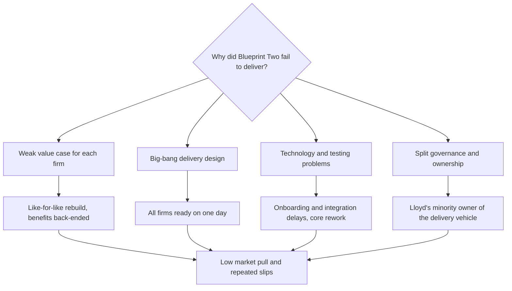

# Module 32 – Lloyd's Digital Transformation: What Failed, Why, and What Fixed It

| | |
|---|---|
| **Level** | Advanced – consulting case study |
| **Time** | 2 hours reading, 2 hours exercises |
| **Prerequisites** | Modules 06, 08, 24 |
| **You will be able to** | Tell the 25-year story of London market modernisation with dates and evidence; explain the root causes of Kinnect and Blueprint Two in a structured way; explain why contract certainty and the e-placing mandate worked; apply the lessons to any client transformation; answer "will this programme go the same way?" with a defensible view |

**Confidence tags.** **[certain]** = stated in a Lloyd's, LMG or Velonetic source or in several independent trade reports. **[likely]** = one strong trade source or a clear inference. **[guessing]** = my interpretation. Root-cause analysis is mostly interpretation, so it is tagged **[likely]** or **[guessing]**. Lloyd's has never published a formal post-mortem or a total cost for Blueprint Two **[certain]**.

---

## 1. Why a consultant must know this story

Every London market client has lived through at least one failed market programme. Most have spent money preparing for a cutover that never came. If you pitch transformation without knowing this history, you will hear "we have seen this before" and lose the room.

The lessons also go beyond Lloyd's. The same failure patterns (big-bang cutover, like-for-like rebuild, weak value case for each participant, split ownership) appear in carrier core-system replacements, broker platform rollouts and AI programmes.

---

## 2. Timeline: 25 years in one table

| Period | Initiative | Result | Tag |
|---|---|---|---|
| 2000–2006 | **Kinnect** – Lloyd's market-wide electronic trading and document platform | Closed in early 2006 after about **£70m** spent over about five years; low use | [certain] |
| Dec 2004–2006 | **Contract certainty** – FSA challenge to end "deal now, detail later"; deadline end-2006 | **Success.** Led to the MRC and a market Code of Practice (reissued 2018) | [certain] |
| 2000s onward | **ACORD Ruschlikon** messaging (EBOT, ECOT) | Partial adoption, mainly by large reinsurers and brokers | [likely] |
| 2016–2019 | **London Market Target Operating Model (LM TOM)** under the LMG | Delivered PPL and simpler DA processes; wound down "in its current form" in September 2019 and folded into Future at Lloyd's | [certain] |
| 2018–2019 | **E-placing mandate** – syndicates must place 40% (Q1 2019) then 50% (Q2) of in-scope risks electronically; brokers connected by 1 June 2019 | **Volume success.** Targets met, but critics said PPL "just supports the paper process" | [certain] |
| 2019 | **Future at Lloyd's** – Blueprint One (vision) | Set the ambition for a digital market | [certain] |
| 2020 | **Blueprint Two** launched – the delivery plan: CDR, Digital Gateway, new digital processing services | Started | [certain] |
| Dec 2023 | Phase two (incl. Digital Gateway) moved from Oct 2024 to Apr 2025 **at the LMA board's request**, to keep focus on phase one | First public slip | [certain] |
| 2024 | Phase one cutover moved July 2024 → October 2024 (market feedback), then postponed again: **market testing eight weeks behind** because of onboarding and integration problems | Repeated slips | [certain] |
| 2024 | New programme leadership appointed after delays | Leadership reset | [likely] |
| Mar 2025 | Lloyd's confirms phase one cutover **will not happen in 2025**; no new date | Credibility loss | [certain] |
| Feb 2026 | Two Lloyd's Blueprint Two teams cut as **Velonetic reworks the core platform** | Design rework | [likely] |
| 19 Mar 2026 | Lloyd's Council approves **sunsetting the name and original vision** of Blueprint Two; CEO says it did not deliver the benefits originally expected | Programme ended | [certain] |
| 2026 | New approach: keep heritage systems resilient (to at least 2030), incremental market-led modernisation, clearer governance, CDR kept and expanded | Correction | [certain] |
| Apr 2027 | New Velonetic central services contract (Central Processing Subscription Agreement) due to take effect 1 April 2027 | Commercial reset | [likely] |

---

## 3. Case A – Kinnect (2000–2006): a platform nobody chose to use

### What it was
A Lloyd's-funded electronic platform intended to let brokers and underwriters exchange risk documents and trade electronically across the market **[certain]**.

### What happened
About £70m (about $125m) was spent over about five years. In January 2006 the Franchise Board withdrew funding and the platform closed that quarter **[certain]**. Lloyd's said attention had shifted to other electronic trading systems that had been built in the meantime **[certain]**.

### What went wrong – root causes

| Root cause | Evidence | Tag |
|---|---|---|
| **No pull from users** | Commentators said "no one really wanted to use it" | [certain] (reported view) |
| **Too ambitious for its time** | Tried to be the whole electronic market at once | [likely] |
| **Missing basic features users wanted** | Users complained underwriters could not send quotes electronically through it | [certain] (reported) |
| **No mandate** | A Lloyd's underwriter argued use would have grown if the CEO had mandated it | [likely] |
| **Over-reported progress** | Trade press described PR that overstated uptake; Kinnect's chairman and CEO left before the end | [likely] |
| **Culture** | Brokers preferred face-to-face negotiation in the Room | [likely] |
| **Competing private solutions** | Other platforms (e.g., RI3K) emerged and took attention | [certain] |

### What corrected it
1. Lloyd's **stopped building and let the market supply platforms** (later PPL, Whitespace and others) **[certain]**.
2. The industry then fixed the **document problem first** through contract certainty (Case B), not the platform problem **[certain]**.
3. When e-placing returned, it came with a **mandate and measured targets** (Case C) **[certain]**.

**Lesson:** a central platform fails if each firm does not gain from using it on day one, and if nobody is required to use it.

---

## 4. Case B – Contract certainty (2004–2006): the success to copy

### What happened
In December 2004 the FSA challenged the market to end "deal now, detail later". It set the end of 2006 as the deadline for contracts to be verifiably certain at inception **[certain]**. The market responded with the Market Reform Contract (MRC), contract certainty guidelines and a Code of Practice **[certain]**.

### Why it worked

| Success factor | Explanation |
|---|---|
| **External forcing event** | A regulator deadline removed the "wait for others" problem **[certain]** |
| **Simple, narrow standard** | A document format (the MRC), not a new system **[certain]** |
| **Measurable outcome** | "Certain at inception" can be checked contract by contract **[likely]** |
| **Each firm could comply alone** | No dependency on a market-wide cutover **[likely]** |
| **Cheap to adopt** | Process and template change; no heavy IT **[likely]** |

**Lesson:** in a market of hundreds of firms, a narrow standard with a deadline beats a big shared platform.

---

## 5. Case C – LM TOM and the e-placing mandate (2016–2019): volume without transformation

### What happened
LM TOM was set up in 2016 under the LMG. It rolled out PPL and simplified delegated authority processes, and was wound down in September 2019 "having delivered the majority of proposed solutions" **[certain]**. Lloyd's then mandated e-placing: 40% of in-scope risks in Q1 2019, 50% in Q2, brokers connected by 1 June 2019. The market beat the targets and most in-scope risks were placed electronically by Q4 2019 **[certain]**.

### What went wrong
- **Digitised paper, not data.** A critic said PPL "just supports the paper process": the slip moved onto a screen, but structured data was not captured for downstream use **[certain]** (reported view).
- **Compliance, not value.** Firms met the percentage target; behaviour and downstream processing changed little **[likely]**.
- **Usability and performance problems** later led PPL to a "Next Gen" rebuild that also ran late **[likely]**.

### What corrected it
The data gap became the purpose of the **Core Data Record**: capture structured contract data once at placement and reuse it in accounting, settlement, tax and claims **[certain]**. The CDR survived Blueprint Two and in October 2026 was extended across the full lifecycle (Module 08) **[certain]**.

**Lesson:** mandates drive adoption, but if you mandate the wrong unit (documents, not data) you get compliance without benefit.

---

## 6. Case D – Blueprint Two (2020–2026): the big-bang that never came

### 6.1 The vision
Blueprint Two was the delivery plan of Future at Lloyd's. It had two phases **[certain]**:

| Phase | Content |
|---|---|
| **Phase one** | New digital processing services for premium and claims (built by Velonetic), using the **Core Data Record** captured at placement; a single market-wide cutover from legacy bureau systems |
| **Phase two** | Further digital services including the **Digital Gateway** to validate placement data for Lloyd's and company-market business |

A Lloyd's FAQ (August 2023) said phase one services were a **recreation of existing legacy services** **[certain]**.

### 6.2 What went wrong – an issue tree

**Question:** Why did Blueprint Two not deliver the benefits originally expected?

| Branch | Root cause | Evidence | Tag |
|---|---|---|---|
| **1. Value case** | Phase one rebuilt legacy services like-for-like, so most firms saw cost and risk but little direct benefit until much later | Lloyd's FAQ: phase one is a "recreation" of legacy services | [likely] |
| | Costs fell on brokers and carriers (integration, testing, data capture); benefits were mainly central and back-ended | Market commentary on uneven costs and benefits | [likely] |
| **2. Delivery design** | A single **big-bang cutover** across hundreds of firms, with no gradual migration route | Trade press: cutover planned all at once | [certain] |
| | Every firm had to be ready on the same day, so the slowest participant set the pace | Repeated slips on market readiness | [likely] |
| **3. Technology** | Market testing ran eight weeks behind because of onboarding and integration problems | Lloyd's postponement notice | [certain] |
| | Core products needed redesign; Velonetic reworked the core platform | The Insurer, Feb 2026 | [likely] |
| **4. Governance** | Accountability was split: Lloyd's set direction, Velonetic delivered, and Velonetic is jointly owned by DXC, the IUA and Lloyd's (Lloyd's a minority shareholder) | Lloyd's statement on revised plan | [certain] |
| | The market associations could change the plan (the LMA requested the 2023 phase-two delay) | Lloyd's / trade press | [certain] |
| **5. Credibility** | Repeated public dates that were missed reduced market engagement; sources said "no progress happening" | City AM, Insurance Business | [likely] |
| **6. Economics** | Lloyd's was cutting its own costs and pushing responsibility to the Velonetic team | City AM source | [likely] |

### 6.3 What was done to correct it

**During the programme (partial fixes)** **[certain unless tagged]**
1. **Resequencing:** phase two pushed back so the market could focus on phase one (Dec 2023).
2. **Date resets** based on testing evidence rather than a fixed public date (2024–2025).
3. **Leadership change** at programme and Velonetic level; Lloyd's COO Bob James also became Velonetic CEO, joining up accountability **[likely]**.
4. **Reduced central teams** and a core platform rework (Feb 2026) **[likely]**.

**After the March 2026 review (the real correction)** **[certain]**
1. **Stop the big-bang.** The name and original vision were sunset; no single cutover.
2. **Keep the lights on first.** Heritage systems kept operationally resilient on a rolling five-year view (to at least 2030).
3. **Incremental, market-led modernisation.** Gradual, carefully sequenced steps instead of one switch.
4. **Clearer governance.** A revised plan with Velonetic, DXC and the IUA.
5. **Keep what works.** Common data standards, especially the CDR, continue and are being extended.
6. **Commercial reset.** A new central services agreement with Velonetic, due to take effect 1 April 2027 **[likely]**.
7. **Cost discipline.** The 2026–2030 strategy targets lower cost of doing business at Lloyd's, and oversight was simplified in November 2026 (Module 20) **[likely]**.

### 6.4 What firms that came out well did differently **[likely]**
- Built **their own data capability** (clean contract data, master data, integration layer) that paid back regardless of the cutover date.
- Treated Blueprint readiness as a **by-product** of their own target architecture, not the goal.
- Kept **legacy integrations stable** and avoided decommissioning anything that depended on the cutover.
- Tracked the programme through the **LMA, IUA and LIIBA** working groups rather than relying on public timelines.

---

## 7. Ten lessons – and how to use each one with a client

| # | Lesson | Evidence from cases | Client question to ask |
|---|---|---|---|
| 1 | **Every participant must gain early.** | Kinnect, Blueprint Two phase one | "Which user gains in the first 90 days, and how will we know?" |
| 2 | **Avoid big-bang cutovers across many parties.** | Blueprint Two | "Can we migrate one product, class or team at a time, with a way back?" |
| 3 | **Standards beat platforms in a fragmented market.** | Contract certainty, CDR | "What is the smallest common standard that unlocks the most value?" |
| 4 | **Mandates work, but mandate data, not documents.** | E-placing, CDR | "Are we measuring adoption, or the data quality that adoption should create?" |
| 5 | **A like-for-like rebuild carries all the risk and little of the benefit.** | Blueprint Two phase one | "What will be better on day one, not just different?" |
| 6 | **One accountable owner.** | Split Lloyd's / Velonetic / associations | "Who can stop, change or fund this alone?" |
| 7 | **Test with real participants early.** | Eight-week testing slip from onboarding problems | "When does the first real external partner transact end to end?" |
| 8 | **Do not publish dates you cannot evidence.** | Repeated missed cutovers | "What evidence gate must be passed before we announce a date?" |
| 9 | **Keep the old system resilient while you change.** | 2026 rolling five-year resilience plan | "If the new build slips two years, is the current service safe?" |
| 10 | **No-regret moves first.** | Firms that built their own data capability | "Which investments pay back even if the wider programme stops?" |

---

## 8. Pre-mortem checklist for any London transformation

Use before a client commits funding. Score each item red, amber or green.

| Area | Check |
|---|---|
| Value | A benefit case for **each** participant group, with early benefits inside 6–12 months |
| Scope | First release does something better, not just the same thing on new technology |
| Migration | Phased by product, class, team or region; rollback plan exists |
| Dependencies | External participants named; their readiness measured, not assumed |
| Testing | End-to-end tests with real external partners scheduled early |
| Governance | One accountable executive with budget and the power to stop |
| Standards | Uses CDR, ACORD and MRC rather than inventing new formats |
| Data | Measures data quality outcomes, not only usage |
| Resilience | Current systems funded and supported for the full transition plus a buffer |
| Communication | Public dates only after an evidence gate |
| No-regret | At least half the spend pays back even if later phases stop |

---

## 9. How to talk about this in a client meeting

| Client says | Your answer |
|---|---|
| "Market programmes always fail, so why bother?" | "Contract certainty and the CDR worked. They were narrow standards that each firm could adopt alone. That is the model to follow." |
| "We spent millions on Blueprint Two readiness." | "The part spent on your own data, integration and master data is still valuable. The part tied only to the cutover date is not. Let us separate the two and keep the first." |
| "Should we wait for the next market platform?" | "No. Plan for heritage bureau systems until at least 2030 and modernise your own estate in steps that pay back within 18–24 months." |
| "Our own core replacement looks like Blueprint Two." | "Then let us run the pre-mortem now: is it big-bang, like-for-like, or owned by several people? If yes, re-plan it before you fund it." |

---

## 10. Partner's lens

The Blueprint Two story is not mainly about technology. It is a **collective-action and economics problem**: costs landed on individual firms, benefits landed centrally and late, and nobody had the authority to force the market or the means to pay everyone to move. Technology slips only made that visible.

The firms that will win the next phase treat market modernisation as **optional upside** and build their own advantage in data, workflow and AI on top of stable market standards. Your value as an adviser is to help a client separate the no-regret spend from the bets. Put the two in different budget lines and give each its own business case.

Use this case to build trust early. A first meeting that opens with "here is what the market learned from Blueprint Two and what it means for your plan" shows you know their world. That earns more credibility than any capability slide.

---

## 11. Practice tasks

1. Draw the Blueprint Two issue tree from memory and add one root cause the table does not list.
2. A managing agent has a £12m programme: £5m CDR-aligned data and integration, £4m readiness for a market cutover, £3m legacy decommissioning. Classify each as no-regret, conditional or stop, and justify in three sentences.
3. Run the section 8 pre-mortem on Case 19 (AI workbench) in Module 10.
4. Write a one-page "so what" note for a CUO: "What Blueprint Two's end means for our 2027 plan."

---

## 12. Sources

- [Insurance Times – Lloyd's "sunsets" name and original vision of Blueprint Two](https://www.insurancetimes.co.uk/news/lloyds-sunsets-name-and-original-vision-of-blueprint-two-after-review/1458048.article)
- [Insurance Times – "Market does not need another moonshot": industry reaction](https://www.insurancetimes.co.uk/news/market-does-not-need-another-moonshot-industry-reacts-as-lloyds-sunsets-blueprint-two/1458061.article)
- [Global Reinsurance – Blueprint Two shelved: what next?](https://www.globalreinsurance.com/home/blueprint-two-shelved-what-next-for-digital-transformation-at-lloyds/1457715.article)
- [City AM – Lloyd's quietly shelves Blueprint Two](https://www.cityam.com/exclusive-lloyds-of-london-quietly-shelves-blueprint-two-to-rethink-strategy/)
- [The Insurer – Lloyd's cuts two Blueprint Two teams as Velonetic reworks core platform](https://www.theinsurer.com/ti/news/lloyds-cuts-two-blueprint-two-teams-as-velonetic-reworks-core-platform-2026-02-12/)
- [The Insurer – Lloyd's commits to re-platforming but Blueprint Two brand dropped](https://www.theinsurer.com/ti/news/lloyds-commits-to-re-platforming-but-sources-say-blueprint-two-brand-is-dropped-2026-02-06/)
- [Lloyd's – Blueprint Two phase one digital services postponed](https://www.lloyds.com/news-and-insights/news/blueprint-two-phase-one-digital-services-postponed)
- [The Insurer – phase one cutover will not occur in 2025](https://www.theinsurer.com/ti/news/lloyds-blueprint-two-phase-one-cutover-will-not-occur-in-2025-2025-03-25/)
- [Global Reinsurance – Blueprint Two delayed after LMA request](https://www.globalreinsurance.com/home/blueprint-two-delayed-after-lma-request/1447323.article)
- [Reinsurance News – phase one cutover pushed back three months](https://www.reinsurancene.ws/blueprint-two-phase-one-digital-services-cutover-pushed-back-three-months/)
- [Lloyd's – Blueprint Two FAQs (Aug 2023)](https://assets.lloyds.com/media/4b9d3bf7-e4d2-4de0-aef1-eb7e86b6d829/FAQ's%20Aug%202023%20.pdf)
- [Insurance Business – Blueprint Two delay a "credibility issue"?](https://www.insurancebusinessmag.com/uk/news/technology/lloyds-blueprint-two-delay-becoming-a-credibility-issue-507606.aspx)
- [Insurance Times – new Blueprint Two boss appointed after delays](https://www.insurancetimes.co.uk/news/new-blueprint-two-boss-appointed-after-delays/1452794.article)
- [Clyde & Co – new Velonetic central services agreement](https://www.clydeco.com/en/insights/2026/09/new-velonetic-central-services-agreement)
- [LMA – Operations update Q1 2026](https://lmalloyds.com/wp-content/uploads/2026/04/Operations-Q1-2026-Update.pdf)
- [Insurance Journal – Lloyd's disconnects troubled Kinnect technology](https://www.insurancejournal.com/magazines/mag-features/2006/02/06/67888.htm)
- [Business Insurance – Lloyd's to pull plug on Kinnect](https://www.businessinsurance.com/lloyds-to-pull-plug-on-kinnect-data-platform/)
- [Insurance Times – technology that went dot-wrong (Kinnect)](https://insurancetimes.co.uk/technology-that-went-dotwrong/1330070.article)
- [Lloyd's – contract certainty](https://www.lloyds.com/market-resources/requirements-and-standards/lloyds-requirements-of-the-council/operating-at-lloyds/performance-management/mr-contracts-certainty)
- [PropertyCasualty360 – London contracts signed, sealed, delivered at inception](https://www.propertycasualty360.com/2005/07/24/london-contracts-signed-sealed-delivered-at-inception)
- [Lloyd's – 2019 electronic placement mandate targets](https://www.lloyds.com/insights/media-centre/press-releases/lloyds-confirms-2019-targets-for-electronic-placement-mandate)
- [Intelligent Insurer – carriers surpass e-placement targets Q4 2019](https://www.intelligentinsurer.com/insurance/lloyd-s-ceo-neal-delighted-as-carriers-surpass-e-placement-targets-in-fourth-quarter-2019-21219)
- [Intelligent Insurer – LMG shuts down LM TOM](https://www.intelligentinsurer.com/news/london-market-group-shuts-down-market-modernisation-programme-lm-tom-19527)
