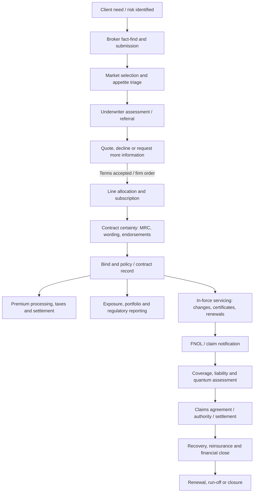
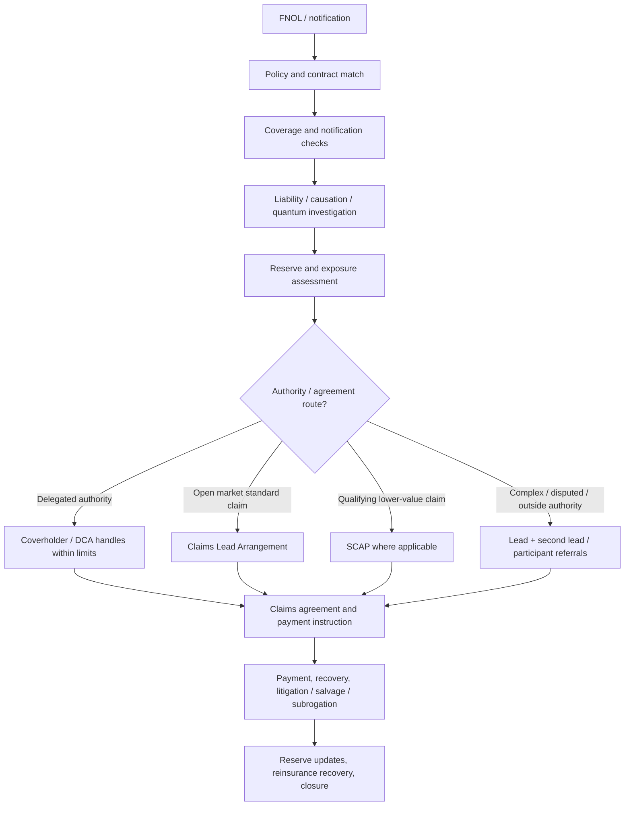
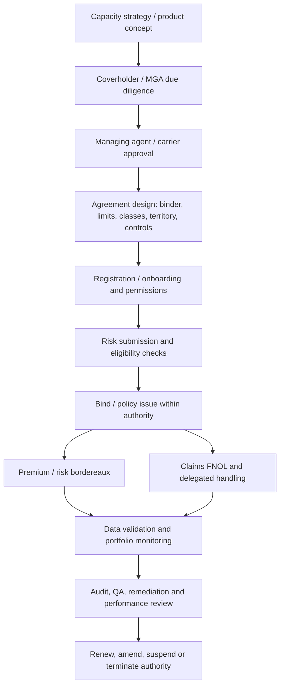
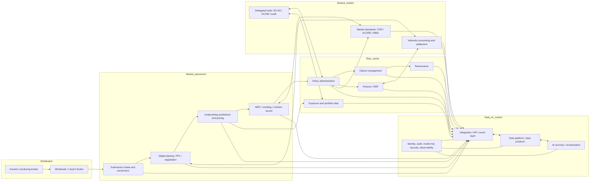

# The London Insurance Market & Lloyd’s
## Master Learning Guide and Consultant Capability Roadmap

**Audience:** Insurance professionals, business analysts, product owners, architects, transformation leaders and consultants seeking practitioner-level mastery of the London company market and Lloyd’s market.

**Learning ambition:** Progress from beginner to intermediate to advanced capability; understand the end-to-end insurance lifecycle; confidently explain who does what, how risk and money move, where processes break, which systems enable them, and how to advise clients on modernisation, data and AI.

**Research cut-off:** 19 November 2026. Market practices, platform capabilities and regulatory expectations evolve. Treat contractual documents, current Lloyd’s requirements, regulator rules and client-specific operating procedures as authoritative for a live engagement.

---

## Executive orientation: what mastery looks like

A London-market champion is not someone who memorises acronyms. They can connect five views of the same risk:

1. **Risk and contract:** What is insured, where, for how much, for which period, under which terms and exclusions?
2. **Market and capital:** Which legal entity or Lloyd’s member bears each share? Who leads, follows, delegates or reinsures?
3. **Process and control:** How does a risk move from broker submission to quote, firm order, bind, premium processing, claims and closure?
4. **Data and technology:** Which record is authoritative at each stage? How do placing, policy, accounting, claims, exposure, regulatory and market platforms exchange data?
5. **Economics and outcomes:** How are premium, brokerage, expenses, capital, reinsurance, loss, reserve and profitability measured—and where can transformation improve them?

The central mental model is:

> **London is a specialist, broker-led, subscription and delegated insurance ecosystem—not one insurer operating one policy administration system.** Lloyd’s is a marketplace within that ecosystem. The company market sits alongside it. Shared market infrastructure, brokers, carriers, managing agents, coverholders, service companies, claims specialists and reinsurers connect the lifecycle.

A consultant must be able to move fluidly between the market-level view and the individual risk/transaction view.

## How to use this guide

- **Beginner (Weeks 1–4):** Learn the ecosystem, Lloyd’s structure, core language and basic open-market placement. Aim to explain the market on one page.
- **Intermediate (Weeks 5–12):** Trace a risk through placement, underwriting, contract certainty, premium, claims, delegated authority and reinsurance. Work through the scenarios and data flows.
- **Advanced (Weeks 13–24):** Diagnose operating models, control gaps, platform architecture, data quality, performance and AI opportunities. Defend options and trade-offs in a client room.
- **Ongoing:** Read current Lloyd’s requirements and market notices. Validate terminology and process against the client’s class, territory, broker/carrier model, contract and platform configuration.

Use the knowledge checks at the end of each stage. Do not progress because you have read a section; progress when you can explain it without notes, draw the flow and answer “what could go wrong?”

## Contents

- **Part I — Market foundations:** company market vs Lloyd’s, Lloyd’s structure and capital, actors, market associations and insurance/reinsurance terminology.
- **Part II — End-to-end lifecycle:** submission, underwriting, subscription placement, MRC/CDR, bind, premium and settlement, claims, delegated authority and reinsurance.
- **Part III — Regulation and current state:** PRA/FCA/Lloyd’s roles, Solvency UK, resilience, international licensing, 2026 strategy and market modernisation.
- **Part IV — Technology:** market tools and shared services, carrier/broker stack, reference architecture, systems of record and integration principles.
- **Part V — AI:** current adoption, lifecycle use cases, agentic underwriting, governance, model evaluation and prioritisation.
- **Part VI — Consulting mastery:** diagnostics, stakeholder discovery, KPIs, executive storylines and client Q&A.
- **Part VII — Applied scenarios:** commercial property, MGA/cyber, claims, premium reconciliation, AI workbench and catastrophe event.
- **Part VIII — 24-week roadmap:** weekly learning journey, phase gates and capstone.
- **Parts IX–X — Glossary and pitfalls:** working terminology, common misconceptions and practical rules of thumb.
- **Part XI — Primary references:** official Lloyd’s, LMG, LIMOSS, Velonetic, ACORD, regulator and AI resources.

---

# PART I — Understand the market before learning the process

## 1. London insurance market: the 60-second explanation

The London insurance market is a global centre for complex, specialty, commercial and large risks. It is an ecosystem of insurance and reinsurance capacity, specialist brokers, underwriting businesses, service providers, market associations and shared processing infrastructure. A placement may be written by one insurer or subscribed to by multiple carriers, including Lloyd’s syndicates and company-market insurers.

The market is often selected when a risk needs specialist underwriting expertise, capacity aggregation, international distribution, bespoke wordings, complex claims expertise or access to global reinsurance. Typical classes include property, energy, marine, aviation, construction, cyber, political violence, professional indemnity, financial lines, specialty casualty, reinsurance and emerging risks.

**Do not equate “London market” with “Lloyd’s”.** Lloyd’s is a distinct marketplace with its own governance, capital structure, market participants and oversight. The company market consists of corporate insurance and reinsurance carriers operating in London outside Lloyd’s. The two markets share brokers, customers, talent, infrastructure and conventions, and often participate on the same subscription placement.

## 2. Company market versus Lloyd’s market

| Dimension | Lloyd’s market | Company market |
|---|---|---|
| Fundamental model | Marketplace in which syndicates underwrite on behalf of members | Corporate insurers/reinsurers underwrite through their own legal entities |
| Risk-bearing capital | Lloyd’s members support syndicate underwriting; members’ liability for a syndicate share is several, not joint | The insurer’s corporate capital and reinsurance support its obligations |
| Underwriting unit | Syndicate, managed by a managing agent | Carrier / insurance legal entity and its business units |
| Governance | Lloyd’s Corporation oversight plus PRA/FCA regulation; managing agents and members have defined responsibilities | Carrier board, management, control functions and applicable regulators |
| Distribution | Lloyd’s brokers, coverholders, service companies, open-market and delegated channels | Brokers, MGAs, delegated partners, direct and other channels |
| Market infrastructure | Lloyd’s-specific oversight and reporting systems plus shared London market infrastructure | Shared London market infrastructure where relevant, plus carrier platforms |
| What is common | Broker-led placement, subscription, specialist underwriting, common market standards and shared services | Same |

**Important:** The company market is not a single company or single technology estate. It consists of many corporate carriers with different appetites, operating models, platforms and participation in central services.

### Example: one subscription placement

A broker places a £100m commercial property risk. A Lloyd’s syndicate writes 30%, a second Lloyd’s syndicate writes 20%, and two company-market insurers write 25% each. The 100% placement is subscribed across four participants. Each participant is responsible for its own contractual share, subject to the contract and applicable market arrangements. A lead may set terms and coordinate agreement, but does not automatically bear every participant’s risk or remove each participant’s obligations.

## 3. Lloyd’s: the marketplace, not the insurer

Lloyd’s is a regulated insurance and reinsurance marketplace. It brings together capital providers (members), managing agents, syndicates, brokers, coverholders, service companies and other market participants under a common governance and operating framework.

### 3.1 The Lloyd’s structure

- **Lloyd’s Corporation:** The market’s governing and oversight body. It sets market requirements, manages the market framework, oversees performance, protects the market’s franchise and operates central functions.
- **Members:** The capital providers underwriting at Lloyd’s. Members can be corporate or individual names, subject to current eligibility and capital rules. They support one or more syndicates.
- **Managing agents:** Firms authorised to manage syndicates. They employ or contract the underwriting and operational teams, manage portfolios and claims, oversee exposures, execute business plans and meet Lloyd’s and regulatory requirements.
- **Syndicates:** Underwriting vehicles/business units through which members participate in insurance and reinsurance business. A syndicate is not itself the insurer/legal entity; it is supported by one or more members. Syndicates have defined appetites, business plans, classes, territories and capital.
- **Members’ agents:** Represent and advise members, including on participation and capital matters, within their regulatory permissions.
- **Lloyd’s brokers:** Brokers approved to access and place business in the Lloyd’s market. They bring risks to underwriters and manage client placement relationships.
- **Coverholders and service companies:** Delegated underwriting distribution/operating entities (explained in Part VI).

### 3.2 Who carries the risk?

The risk is carried by the Lloyd’s member(s) supporting the syndicate for their respective share, not by “Lloyd’s Corporation” as if it were one insurance company. Members’ liability is several: each member is responsible for its own share, not the entire syndicate’s obligations. This distinction matters in capital, insolvency, contract, claims, accounting and financial reporting conversations.

### 3.3 The Chain of Security

Lloyd’s describes a three-link structure designed to support policyholder security:

1. **First link — syndicate-level assets and members’ working capital:** Assets held to meet syndicate liabilities.
2. **Second link — Funds at Lloyd’s (FAL):** Capital provided by members to support their underwriting obligations, subject to Lloyd’s capital framework.
3. **Third link — Central Fund:** A central mutual resource available to support policyholder obligations in accordance with Lloyd’s rules and discretion.

As at 31 December 2025, published figures included approximately £95.3bn in the first link, £31.1bn in the second link and £3.2bn in the Central Fund. These are point-in-time published figures, not permanent capital assumptions. Always use the latest Lloyd’s capital disclosures in an investment or solvency analysis.

### 3.4 Syndicate business planning and performance

A syndicate’s business plan defines its intended premium, class/territory mix, risk appetite, limits, reinsurance, expenses, underwriting controls, expected profitability and capital requirements. Lloyd’s reviews plans and monitors performance. A strong plan is coherent, achievable, supported by underwriting evidence and governed by clear risk limits.

Key concepts:
- **Syndicate capacity:** Maximum premium/underwriting capacity approved for the year, subject to Lloyd’s rules and capital.
- **Stamp capacity:** The approved capacity expressed in the context of a syndicate’s underwriting stamp.
- **Premium income:** Premium written/earned under relevant accounting definitions; do not use these interchangeably.
- **Business plan:** Forward-looking underwriting, exposure, capital and performance submission.
- **Performance management:** Monitoring underwriting quality, business-plan delivery, reserving, capital and conduct/control outcomes.

### 3.5 Lloyd’s year of account and reinsurance to close (RITC)

Traditionally, Lloyd’s operates a three-year accounting framework for syndicate years of account. At the end of the third year, a year may be closed by transferring its outstanding liabilities to a later year through a **Reinsurance to Close (RITC)** transaction, subject to actuarial assessment and governance. RITC is a reinsurance arrangement between years of account; it does not mean old claims disappear or that policyholder obligations cease. Claims arising from older underwriting years can continue to be handled after closure through the relevant arrangements.

Understand the distinction between:
- **Underwriting year:** The year in which the risk incepted (for the relevant contract basis).
- **Calendar year:** Reporting period based on the calendar, regardless of underwriting inception.
- **Accident year:** Year in which loss events occurred.
- **Accounting year/year of account:** Lloyd’s reporting and capital framework for the syndicate business written in that year.

These bases can produce materially different views of premium, claims, reserving and profitability. Always establish which basis a KPI or report uses.

## 4. Market participants and what each one does

| Participant | Role in the lifecycle | Typical decisions / accountability |
|---|---|---|
| Insured / policyholder | Purchases insurance and provides risk information | Disclosure, risk management, premium payment, notification and cooperation on claims |
| Retail / wholesale / specialist broker | Advises, structures and places risk; manages market engagement | Submission quality, market selection, negotiation, client advice and placement records |
| Lloyd’s broker | Approved broker with access to Lloyd’s market | Presents business to syndicates; manages Lloyd’s placement and broker obligations |
| Company-market broker | Places with corporate carriers; may also handle cross-market subscription | Placement strategy and carrier coordination |
| Producing / retail broker | Originates relationship with insured or local intermediary | Client data, local advice, compliance and placement instructions |
| Underwriter | Assesses risk and determines terms/capacity | Accept, decline, refer, price, set limits, exclusions, conditions and line size |
| Lead underwriter | Leads terms and often coordinates placement / claims agreement under contract | Terms, wording, negotiation and agreed lead responsibilities; exact authority is contract-specific |
| Follow underwriter | Accepts a share, often following lead terms | Follow/adjust terms, set own line, seek referrals and maintain own controls |
| Managing agent | Manages Lloyd’s syndicate | Business plan, underwriting, delegated authority oversight, claims, capital and governance |
| Syndicate | Underwriting unit supported by member capital | Portfolio, underwriting appetite, capacity and performance |
| Lloyd’s member | Supplies capital and bears its share of syndicate liabilities | Capital support and member obligations |
| Company-market carrier | Corporate risk carrier | Underwriting, policy issuance, reserves, claims and financial obligations |
| MGA | Delegated underwriting business with defined authority from carrier(s) | Product/distribution and underwriting within delegated authority; legal role depends on contract and jurisdiction |
| Coverholder | Entity authorised to enter into contracts of insurance on behalf of Lloyd’s underwriters under a binding authority | Underwriting/issuance within binder authority and Lloyd’s coverholder requirements |
| Service company | Lloyd’s managing-agent-owned or connected entity providing delegated underwriting services, subject to applicable rules | Underwriting, distribution and local service under delegated arrangements |
| DCA | Delegated Claims Administrator authorised for defined claims activities | Claims handling within authority, service levels, referrals and reporting requirements |
| TPA | Third-party administrator; broader market term | Claims or policy administration services under outsourcing/delegation contract |
| Reinsurer | Accepts risk from an insurer/reinsurer | Treaty/facultative capacity, pricing, terms, recoveries and collateral |
| Loss adjuster / surveyor | Investigates damage, causation, quantum and mitigation | Evidence and recommendations; does not automatically make coverage decision |
| Lawyer / coverage counsel | Advises on contract, liability, disputes and litigation | Legal interpretation, defence strategy and settlement advice |
| Expert / forensic specialist | Provides technical expertise (engineering, cyber, marine, accounting, etc.) | Cause, damage, quantum and expert evidence |
| Velonetic | Shared London-market service provider | Market processing services, including premium accounting, claims processing/agreement support and settlement services |
| Lloyd’s Corporation | Market governance and oversight | Rules, performance oversight, market access, capital and central functions |

**Client-room test:** For any transaction, ask: Who owns the client relationship? Who has authority to bind? Which legal entity carries the risk? Who is the lead? Who holds the authoritative contract? Who processes premium and claims cash? Who owns the data and control evidence?

## 5. Market bodies, associations and infrastructure organisations

| Organisation | What it is | Why a consultant should know it |
|---|---|---|
| Lloyd’s | Marketplace and governance corporation | Lloyd’s rules, market access, capital, oversight, delegated authority and claims arrangements |
| IUA — International Underwriting Association | Association representing London company-market insurers and reinsurers | Company-market perspectives, technical committees, market practice and modernisation input; not a regulator |
| LMA — Lloyd’s Market Association | Association representing managing agents and Lloyd’s underwriting businesses | Underwriting, claims, delegated authority, legal, data, AI and operational guidance |
| LIIBA — London & International Insurance Brokers’ Association | Association representing London insurance and reinsurance brokers | Broker operating model, market reform, placing and data perspectives |
| LMG — London Market Group | Cross-market market-modernisation body | Coordinates London-market change, digital standards and industry initiatives across major market associations |
| LIMOSS | London Insurance Market Operations and Strategic Sourcing | Supports market operations and common data standards, including the Market Business Glossary and Core Data Record artefacts |
| ACORD | Global insurance standards organisation | Data models, standards and messaging, including ACORD Global Reinsurance and Large Commercial (GRLC) and Ruschlikon transactions |
| Velonetic | London-market services business (formerly Xchanging / XIS / Ins-sure Services lineage) | Shared processing capabilities for placing-related accounting, claims and settlement; distinguish it from carrier core systems |
| PPL — Placing Platform Limited | Digital placing platform | Electronic placement, market access, collaboration and placement workflow |
| Lloyd’s Academy / Learning at Lloyd’s | Learning resources | Foundational market education and selected market training |

### Other market players you may encounter

Examples of global brokers with London-market operations include Aon, Marsh, WTW, Gallagher and Howden, alongside specialist and independent brokers. Examples of London-market company insurers and groups include Beazley, Hiscox, QBE, AXA XL, Chubb, MS Amlin, Liberty Specialty Markets and other global and specialist carriers. The Lloyd’s market contains many managing agents and syndicates, including businesses owned by global insurance groups and specialist underwriting organisations. These examples are illustrative, not an exhaustive or ranked list; ownership, structures and market participation change.

## 6. Core insurance and reinsurance concepts

### 6.1 Risk, contract and premium

- **Insured:** Person or entity whose interests are protected by the policy.
- **Risk:** Potential for loss; includes hazard, exposure, vulnerability and uncertainty.
- **Insurable interest:** Financial or legal interest recognised by the applicable law/contract.
- **Period of insurance / inception / expiry:** Contract start and end dates, including exact times and time zones where relevant.
- **Limit of liability:** Maximum insurer payment, subject to wording and aggregate structure.
- **Deductible / excess:** Amount borne by insured before insurer payment; terminology can vary by class and market.
- **Retention:** Amount retained by insured or cedant before insurance/reinsurance responds; often used in reinsurance.
- **Sub-limit:** Lower limit for a particular coverage, peril, location or cost.
- **Aggregate:** Maximum amount for a defined period or coverage.
- **Premium:** Consideration for insurance. Distinguish gross written, net written, earned, collected and ceded premium.
- **Rate:** Premium relative to an exposure base, sum insured or other rating unit.
- **Brokerage:** Compensation paid to broker, typically a percentage of premium; structure varies.
- **Commission:** Compensation payable under distribution arrangements; distinguish from brokerage and fees.
- **Taxes and levies:** Premium taxes, parafiscal charges, stamp duties and local charges according to risk location and applicable law.

### 6.2 Placement and subscription language

- **Submission:** Broker's presentation of the risk and requested terms.
- **Slip:** Market placement document summarising risk, terms, participants and written lines; increasingly handled through digital/data-first processes.
- **MRC:** Market Reform Contract, the London-market contract documentation framework used to support contract certainty and standardised data. It is not synonymous with the full policy wording or the entire insurance policy.
- **Quote:** Terms and price offered, usually subject to validity and conditions.
- **Firm order:** Broker instruction to proceed with the placement on specified terms/lines.
- **Written line:** Percentage/share an insurer is prepared to write at placement.
- **Signed line:** Final proportion allocated to an insurer after signing down, where the total written lines exceed 100% or are otherwise adjusted.
- **Lead:** Participant responsible for leading terms or specified market functions under the placement arrangements.
- **Follow:** Participant subscribing behind agreed terms, potentially with their own adjustments or referrals.
- **Order hereon:** Placement instruction for the remaining share after prior capacity has been secured, as used in some market practices.
- **Subscription placement:** One risk shared among multiple insurers/reinsurers.
- **Line slip:** Facility for multiple risks to be written under pre-agreed terms and authority, usually by a lead and followers.
- **Bureau placement:** Placement involving Lloyd’s and/or company market participants using relevant shared market processes; exact use of “bureau” depends on transaction context.
- **Open market:** Individual risk placed through broker-to-underwriter negotiation rather than a pre-agreed delegated portfolio facility.

### 6.3 Reinsurance terminology

- **Cedant:** Insurer transferring part of its risk to reinsurer.
- **Ceding commission:** Commission paid by reinsurer to cedant under reinsurance terms, often to recognise acquisition/administration costs.
- **Facultative reinsurance:** Reinsurance negotiated for an individual risk or defined exposure.
- **Treaty reinsurance:** Agreement covering a defined portfolio or class of business.
- **Proportional reinsurance:** Reinsurer takes a stated share of premium and losses (for example quota share or surplus).
- **Non-proportional reinsurance:** Reinsurer pays when loss exceeds a defined attachment/retention, subject to limit (for example excess of loss).
- **Occurrence / event limit:** Maximum response for one event or occurrence under the treaty.
- **Reinstatement:** Restoration of some or all reinsurance limit after a loss, usually for an additional premium and under specified terms.
- **Retrocession:** Reinsurance purchased by a reinsurer.
- **RITC:** Reinsurance to Close in Lloyd’s year-of-account context; see Section 3.5.

### Beginner checkpoint

You should now be able to explain, without notes:
1. Why the London market is not synonymous with Lloyd’s.
2. Why a Lloyd’s syndicate is not itself the insurer.
3. Who owns capital and who carries a subscribed share.
4. The difference between managing agent, syndicate, member and Lloyd’s Corporation.
5. What a broker, lead, follower, coverholder, MGA, DCA and reinsurer do.
6. The difference between written line and signed line, and between MRC and policy wording.

# PART II — The end-to-end insurance lifecycle

## 7. The lifecycle at a glance

A London-market placement is best understood as a sequence of linked decisions and records. The exact steps, sequence, platform and service-provider responsibilities vary by class, broker, carrier, territory and whether the business is open-market or delegated.



### Three parallel flows run through the lifecycle

- **Risk/decision flow:** submission → appetite → pricing → underwriting decision → binding authority → claims decision.
- **Contract/data flow:** broker evidence → placement record → MRC/wording → policy/contract record → endorsements → bordereaux/claims records → regulatory and management reporting.
- **Money flow:** insured premium → broker/market accounting → insurer cash settlement; later insurer claim payment → insured/beneficiary/provider; separately, reinsurance recoveries and commissions/fees.

A transformation often fails when one flow is redesigned without the other two. For example, a digital quote journey may be fast but still create manual contract certainty, poor exposure data or delayed premium settlement.

## 8. Open-market placement: from submission to bind

### 8.1 Broker fact-find and submission construction

The broker obtains information from the insured and assembles a submission that enables underwriters to understand the business, exposure, controls, prior loss experience and requested coverage.

Common submission components (vary by class):
- Insured legal entity names, domiciles, group structure, ownership and insured interests.
- Business description, operations, revenue, payroll, turnover, assets and other exposure bases.
- Locations, geocodes, construction, occupancy, protection, values and business interruption detail (property).
- Fleet, vessel, aircraft, route, cargo or accumulation information (marine/aviation/transport).
- Limits, deductibles, sub-limits, aggregates, retentions, territory and jurisdiction.
- Loss runs, claims narratives, reserves, large losses and remediation actions.
- Engineering reports, surveys, inspections, risk-management controls and certificates.
- Historical policy terms, expiring premium, coverage changes and broker's market strategy.
- Requested wording, endorsements, warranties, subjectivities and target inception.
- Exposure and security data, including cyber controls, business continuity, catastrophe exposure or supply-chain concentration.

**Consulting issue:** Submission data often arrives as mixed-format PDFs, spreadsheets, emails, portals, broker systems and data feeds. The problem is not simply document extraction; it is creating a traceable, validated risk view with provenance, confidence and missing-information management.

### 8.2 Market selection and appetite triage

The broker develops a placement strategy based on the risk, capacity required, market relationships, target pricing, appetite and time to inception. Underwriters triage submissions based on class, geography, business activity, limit, loss history, catastrophe accumulation, quality of information and portfolio conditions.

Typical early triage outcomes:
- Decline outside appetite or prohibited territory/class.
- Request additional information (RFI) or an engineering survey.
- Refer to senior underwriter, product head, exposure management, legal, compliance or actuarial/pricing.
- Quote subject to defined terms and conditions.
- Offer a partial line or capacity subject to lead terms.

**Common failure modes:** Incomplete locations or sums insured; inconsistent entity names; stale loss runs; unclear values; submission duplicated across broker channels; untracked RFI; misaligned risk codes; and quote turnaround measured without distinguishing time waiting for broker information from time in underwriting.

### 8.3 Underwriting assessment: what the underwriter actually evaluates

Think of underwriting as a stack of linked questions:

1. **Eligibility:** Is the risk within the carrier's class, territory, product and licence permissions?
2. **Hazard and exposure:** What can happen, how severe can it be, how frequently, and what is the maximum plausible loss?
3. **Controls and vulnerability:** What reduces likelihood or severity? What is the residual risk?
4. **Accumulation:** What other insured risks could be impacted by the same event, peril, supplier, geography or systemic cause?
5. **Coverage fit:** Can the risk be covered with suitable definitions, limits, exclusions, sub-limits, warranties and conditions?
6. **Technical price:** What premium is indicated by expected loss, expenses, reinsurance, capital cost, uncertainty and target return?
7. **Portfolio fit:** Does this improve or worsen portfolio mix, volatility, concentration, aggregate limits and risk-adjusted return?
8. **Execution:** Can the broker supply required data and can the carrier administer, service and settle the contract compliantly?

Underwriting is not simply a price decision. Terms, capacity, attachment, deductibles, exclusions, warranties, subjectivities, referral and reinsurance can be as important as premium.

### 8.4 Pricing concepts

A simplified technical premium bridge:

```text
Expected ultimate loss
+ Loss adjustment / claims handling expense
+ Acquisition expense / brokerage / commission (depending model)
+ Operating expense allocation
+ Reinsurance cost
+ Cost of capital / risk margin
+ Profit / uncertainty margin
= Indicated technical premium

Market price = technical view adjusted for competition, capacity, broker relationship,
portfolio strategy, terms, market cycle and underwriting judgement.
```

Do not present one pricing formula as universal. Pricing approaches vary by class and maturity of data. Possible techniques include exposure rating, experience rating, burning cost, frequency-severity modelling, catastrophe models, scenario analysis, credibility, GLM, gradient boosting, expert judgement and structured referral.

### 8.5 Property example: underwriting the same building

A warehouse is submitted with £80m total insured values, including stock and business interruption. A basic submission says “modern warehouse, sprinklered”. An experienced underwriter asks:
- Exact geocoded location and flood / wind / earthquake / wildfire exposure?
- Construction, roof, cladding, age and maintenance?
- Occupancy and combustible stock profile? Storage height and rack layout?
- Sprinkler type, water supply, impairment controls and maintenance evidence?
- Fire detection, compartmentation, security, access and fire-service response?
- Business interruption indemnity period, key suppliers, alternate sites and utility dependencies?
- Values by building, stock, contents and BI; replacement cost and inflation assumptions?
- Prior losses and evidence that recommendations were implemented?

The data determines modelled loss and terms. A technology workflow that extracts “sprinklered” but not sprinkler standard, impairment procedure or inspection evidence has not solved the underwriting problem.

## 9. Subscription placement mechanics

### 9.1 Written line, signed line and signing down

In subscription business, a broker may collect written lines from multiple participants. Their total can exceed 100% of the risk if the broker has sought more capacity than needed. The final allocated shares are signed down to the required 100% (or other contractual total) in accordance with broker instructions and market practice.

**Illustration:**

| Participant | Written line | Final signed line |
|---|---:|---:|
| Syndicate A (lead) | 40% | 30% |
| Syndicate B | 30% | 25% |
| Company carrier C | 25% | 25% |
| Company carrier D | 25% | 20% |
| **Total** | **120%** | **100%** |

The example illustrates signing down only. Actual signing order and rules are placement-specific. The lead's 30% share does not make it responsible for the other participants' 70%.

### 9.2 Lead and follow: what is and is not implied

The lead typically negotiates or establishes terms and may perform defined functions for the placement, such as lead wording discussions or claims agreement. Followers decide whether to follow and on what share/terms. A lead can be a different carrier for different layers or sections. Some follow markets may impose line size, subjectivities or terms changes.

Do not assume:
- The lead carries all the risk.
- Every follower has no independent underwriting responsibility.
- Every class follows one identical claims agreement route.
- “Follow the leader” removes contract, conduct or regulatory accountability.

### 9.3 Layered placements

Large risks may be structured into primary and excess layers, each with different attachment points, limits, pricing and carriers. A property programme might combine a primary layer, several excess layers, catastrophe sub-limits and facultative reinsurance. The placement record must preserve the relationships between programme, sections, layers, participants and contract wording.

### 9.4 Slip, MRC and wording

The slip/MRC provides a standardised market record of critical placement information and contract terms. It typically captures risk details, insureds, period, limits, premium, participants/lines, conditions, clauses, subjectivities, taxes and other required fields. The policy wording and endorsements provide the detailed legal contract. Some placements have bespoke documents or complex multi-section structures.

**MRC is not the policy wording.** A slip can contain or point to core contractual terms, but the complete contractual set may also include wording, schedules, endorsements, certificates and other attachments. Contract certainty requires the full agreement to be clear and timely, not merely a completed data form.

### 9.5 Contract certainty and subjectivities

Contract certainty means the terms and conditions are clear, agreed and documented in a timely manner. Subjectivities are matters that must be satisfied before or after inception according to the contract (e.g., survey report, updated values, security warranties). Track each subjectivity with owner, due date, evidence, status, escalation and consequence if unmet.

Common issues:
- Ambiguous insured entity, location or risk description.
- Inconsistent limits or deductibles across slip and wording.
- Unclear clause version or conflicting endorsements.
- Incorrect period or time zone.
- Missing signed lines or participant agreement.
- Untracked subjectivity and overdue evidence.
- Manual rekeying into carrier policy systems creates divergence.

## 10. Core Data Record and market data standards

### 10.1 What is the Core Data Record (CDR)?

The Core Data Record is a defined set of critical data elements needed to support London-market processing, validation and reporting. It aligns with ACORD data structures and aims to reduce repeated capture, improve matching and provide reusable data across the transaction lifecycle. It is not a core policy administration platform and not a complete enterprise data model.

For years the market emphasis included placement/premium/settlement data. By 2026, the scope had broadened significantly:
- CDR v3.3 for Treaty was published in May 2026.
- CDR v3.4 Claims and v3.5 Agreements of Delegation were published in September 2026.
- The London Market Group's 1 October 2026 update described a lifecycle-expanding CDR covering pre-bind tagging, contract placement, FNOL claims data and delegated-authority agreement data (including binders, lineslips and digital platforms).
- The market is working to embody the expanded CDR in the next MRC. Exact adoption timing and implementation obligations should be validated against the latest market standards and client roadmap.

### 10.2 Why CDR matters to transformation

It gives programmes a common reference for “what data should exist and when”. It can support:
- Higher-quality risk and contract data capture at source.
- Reduced duplicate and manual data entry.
- Automated premium validation and settlement.
- Matching claims to policies and market participants.
- Tax, regulatory and management reporting.
- Improved delegated authority reporting and portfolio oversight.
- Reusable data across broker, carrier and central-market processes.

### 10.3 ACORD, MBG, PRR and implementation standards

- **ACORD:** Global insurance standards organisation; GRLC (Global Reinsurance and Large Commercial) is relevant to large commercial and reinsurance data structures.
- **Market Business Glossary (MBG):** LIMOSS reference portal for market terminology, data standards, reference datasets and associated implementation artefacts.
- **CDR:** Core Data Record data elements and versioned artefacts.
- **MRC:** Market contract documentation/data structure.
- **PRR / roles and responsibilities:** Market material used to clarify process roles and responsibility across the placing/processing ecosystem; use current approved editions.
- **ACORD Ruschlikon:** Messaging standards for electronic insurance/reinsurance back-office transactions. EBOT supports electronic back-office accounting transactions; ECOT supports electronic claims-office transaction movement. They are messaging standards, not insurer core systems.

### 10.4 Data quality rules to operationalise

For each critical data element define: business meaning; mandatory/conditional status; data type; allowed values; source; owner; evidence/provenance; validation rule; timing; downstream consumers; correction workflow; audit history; and version. Build quality controls around entity resolution, address/geocode, dates, currency, limit/attachment, class/territory, tax, participant share, policy matching and claims references.

## 11. Bind, policy administration and in-force servicing

After the broker confirms the firm order and all required approvals/conditions for binding have been satisfied, the risk is bound. Policy/contract administration may be performed by the carrier, managing agent, service company or coverholder depending on the operating model.

### 11.1 Bind and issuance tasks

- Confirm final terms, limit, deductible, premium, period, insureds and participating shares.
- Confirm authority and underwriting referrals have been resolved.
- Complete required contract documentation and capture the authoritative version.
- Generate policy, certificate, schedule or evidence of cover as required.
- Create policy/contract and exposure records in relevant systems.
- Validate tax, regulatory and reporting data.
- Trigger premium processing and downstream broker/client communications.

### 11.2 Endorsements and mid-term adjustments

An endorsement changes the contract after inception. Examples include adding a location, changing values, adding an insured, altering limits, changing activity, correcting details or changing coverage. The change may require underwriting approval, premium adjustment, additional/reduced tax, updated certificates, revised exposure aggregation and reinsurance notification.

**Endorsement control questions:** Is the request permitted by authority? Does it materially change hazard or accumulation? Do all required participants agree? Does the change alter the rate/premium? Are downstream records and tax updated? Is the contract version and effective date unambiguous?

### 11.3 Renewal

Renewal is a new underwriting decision, not an automatic copy-forward. Refresh exposure, claims, risk controls, catastrophe view, pricing, terms, capacity, reinsurance, sanctions/licensing and client needs. Compare expiring and renewal data; flag material changes and stale assumptions. Renewal operations are a major source of avoidable manual effort when data and document histories are fragmented.

## 12. Premium, technical accounting and cash settlement

### 12.1 Follow the premium through the ecosystem

The broker obtains the premium from the insured, deducts or accounts for brokerage/commission and other permitted items, and the market participant receives its share through relevant accounting and settlement processes. The actual route depends on broker arrangements, premium trust rules, local law, carrier and market processing model.

Distinguish:
- **Technical account:** Record describing premium, commissions, taxes, deductions and allocated shares.
- **Financial account:** Settlement/cash movement and reconciliation.
- **Written premium:** Premium contracted/written in the period under the applicable definition.
- **Earned premium:** Portion recognised over the coverage period under accounting rules.
- **Unearned premium reserve / liability:** Amount associated with unexpired coverage, as applicable under accounting basis.
- **Bordereau:** Periodic statement/list of risks, premiums or claims, typically for delegated business or treaty reporting.
- **Settlement:** Movement of cash between relevant parties.

### 12.2 London-market processing and Velonetic

Velonetic provides shared London-market services supporting both Lloyd’s and company-market business. Its service landscape includes premium/underwriting processing, claims processing/agreement support and settlement-related capabilities. It is not the policy administration system for every insurer and it does not replace each carrier's finance, claims or underwriting systems.

A typical technical accounting and settlement chain may include broker submission of accounting data, validation and matching, allocation to market participants, exception handling and cash settlement/reconciliation. The exact process, cut-offs, messages and service levels vary; map the client’s specific route.

### 12.3 EBOT and ECOT

- **EBOT (Electronic Back Office Transactions):** ACORD Ruschlikon messages for electronic technical-account and financial-account transactions.
- **ECOT (Electronic Claims Office Transactions):** Messages to support claims transaction movement; claims-related payments can connect with EBOT accounting processes.

In architecture discussions, distinguish the business event, the canonical data structure, the message/transport, the central processing service and the insurer's system of record.

### 12.4 Premium exceptions worth diagnosing

Missing/incorrect CDR fields; wrong signed line; duplicate accounting; participant mismatch; incorrect currency or exchange rate; tax jurisdiction error; invalid broker reference; late bordereau; reconciliation mismatch; unallocated cash; premium debt; sanctions/payment block; cancellation and return premium not reflected downstream.

A useful diagnostic KPI set: time from bind to technical account submission; first-pass acceptance; exception rate by reason; time to resolve exception; cash settlement time; unallocated cash; aged debt; and premium reconciliation breaks.

## 13. Claims lifecycle in the London market

Claims is where contract certainty, data lineage, delegated authority, lead/follow agreements and operational control meet. Claims handling is not one uniform process: class, contract, claim complexity, lead arrangement, claims agreement party, delegation and litigation posture determine the route.

### 13.1 Claims flow



### 13.2 FNOL and initial triage

FNOL (First Notification of Loss) captures the first notice of a loss or event. Typical data includes policy/contract reference, insured, claimant, date/time/location, cause/peril, description, amount claimed, injured parties, third parties, emergency action, broker, adjuster, attachments and potential catastrophe/cyber event identifiers.

Immediate controls:
- Match the claim to the correct contract, insured interest, period, location and section.
- Identify potential coverage, limits, deductibles, exclusions, conditions and notification requirements.
- Screen sanctions/fraud indicators and conflicts as required.
- Identify catastrophe/cyber aggregation, severity and notification triggers.
- Assign handler, adjuster, expert and legal support based on complexity and authority.
- Set initial reserve with rationale and confidence; define review triggers.

### 13.3 Coverage, liability, causation and quantum

- **Coverage:** Does the policy respond to the reported event and claimed interest, under the applicable terms?
- **Causation:** What caused the loss? Are there concurrent causes or excluded causes?
- **Liability:** Is the insured legally responsible, and to what extent? More relevant in liability lines.
- **Quantum:** What is the value of the loss/damage/claim, mitigation and additional costs?
- **Reservation of rights:** Communication that insurer reserves its position while investigation continues; precise use is jurisdiction- and contract-dependent.
- **Declinature:** Decision not to indemnify, subject to contractual/legal requirements.
- **Without prejudice:** A legal/negotiation concept; do not use casually as a generic label.

### 13.4 Claims Lead Arrangements (CLA)

Lloyd’s Claims Lead Arrangements replaced the previous Lloyd’s Claims Scheme and became effective on 1 June 2023. For standard claims, a single claims agreement party (the lead) agrees the claim on behalf of participating syndicates within the relevant scheme and contract requirements. For complex claims, a lead and second lead may be involved. The scope and route depend on the claim and applicable arrangements; do not assume one lead arrangement governs every company-market participant or every contract.

### 13.5 Single Claims Agreement Party (SCAP)

SCAP is a contractual arrangement used for qualifying lower-value, non-complex claims, with published material describing a threshold up to £250,000. It can allow the slip leader to agree a qualifying claim on behalf of participating insurers, subject to the contract, eligibility and adoption by participants. Verify current thresholds and policy applicability before advising a client.

### 13.6 Claims reserving and settlement

Reserve should reflect the best estimate of expected ultimate cost, informed by coverage, severity, development, legal costs, inflation, currency, adjuster input and uncertainty. Reserve changes should be traceable. Settlement authority should be defined by role, amount, complexity, litigation status and contract terms.

Claim payment may go to insured, claimant, repairer, hospital, solicitor or another beneficiary. Payment control includes payee validation, bank details, sanctions, duplicate-payment prevention, approvals, currency, tax treatment where relevant, reconciliation and audit evidence.

### 13.7 Recovery and post-settlement activities

Potential recoveries include subrogation against responsible third parties, contribution from other insurers, salvage, deductibles, reinsurance, collateral and recoveries under contractual indemnities. Claim closure should not erase continuing recovery or legal obligations; monitor reopening, litigation, commutation or run-off as appropriate.

### 13.8 Claims KPIs

- FNOL-to-triage and FNOL-to-first-contact.
- Time to coverage decision and time to liability decision.
- Time to first reserve and reserve adequacy/development.
- Claims cycle time by complexity and segment.
- Average handling expense and external expert/legal cost.
- Leakage, reopened claims, complaints and litigation rates.
- Settlement speed and payment exception rate.
- Recovery identified, pursued and realised.
- Claims data completeness and policy-match rate.

Do not optimise claim speed at the expense of indemnity accuracy, fairness, fraud controls, customer outcomes or regulatory obligations.

## 14. Delegated authority: the essential London-market operating model

Delegated authority is central to the Lloyd’s and London specialty market. It allows an insurer/managing agent to delegate defined underwriting, policy administration or claims activities to another organisation under an agreement, while retaining oversight and accountability under the relevant rules and contract.

### 14.1 Key entities

- **Coverholder:** An entity authorised to enter into contracts of insurance on behalf of Lloyd’s underwriters within a binding authority. Coverholders are approved through Lloyd’s processes and appear in ATLAS.
- **Binding authority / binder:** Contractual agreement granting a coverholder defined authority to bind risks and/or perform specified activities for a defined period, class, territory, limits and terms.
- **MGA:** Managing General Agent. Common global term for a delegated underwriting business. It may function as a coverholder in Lloyd’s business, but the terms are not interchangeable in every legal/market context.
- **Service company:** An entity associated with a Lloyd’s managing agent that writes/serves business under delegated arrangements and applicable Lloyd’s requirements.
- **DCA:** Delegated Claims Administrator. Handles claims activities within specific delegated authority.
- **TPA:** Third-party administrator; broader outsourcing term, not necessarily a Lloyd’s delegated claims authority.
- **Line slip:** Facility under which a lead has authority to bind defined risks on behalf of participating followers, subject to the agreement.
- **Consortium:** Arrangement where multiple insurers participate in a facility or delegated scheme; exact structure/authority varies.
- **Bordereau:** Periodic reporting of risks, premium, adjustments, claims and other required portfolio data.

### 14.2 Delegated authority lifecycle



### 14.3 What must be defined in a binder

- Parties, roles, legal entities and authorised signatories.
- Class of business, product, territory, distribution channel and insured segment.
- Effective dates, termination, run-off and renewal process.
- Underwriting authority: eligibility, limits, line size, pricing, rating rules, exclusions, referrals and prohibited risks.
- Policy documentation, wording, endorsements and contract certainty.
- Premium, commission, brokerage, fees, tax, accounting and cash handling.
- Claims authority, reserves, settlement limits, litigation, complaints and referrals.
- Reinsurance, accumulation, catastrophe exposures and reporting.
- Data requirements, bordereau schema, frequency, quality and reconciliation.
- Audit rights, file reviews, service levels, KPIs, remediation and breach notification.
- Sanctions, financial crime, data protection, outsourcing, cyber and business continuity controls.

### 14.4 Delegated authority oversight

The capacity provider cannot simply outsource the risk and stop overseeing it. Oversight should include pre-bind due diligence, ongoing portfolio monitoring, audits/file reviews, data quality controls, exception/referral monitoring, claims oversight, financial reconciliation, compliance, complaints, sanctions and remediation. Risk-based oversight should consider portfolio size, class severity, territory, maturity, growth, loss performance, control history, data quality and third-party dependencies.

### 14.5 Delegated authority platforms and data

Lloyd’s tools include:
- **ATLAS:** Online registration/application and ongoing filing for coverholders and service companies, including permissions and compliance information. It is not a repository for every individual risk or policy contract.
- **DCOM:** Delegated Contract and Oversight Manager capabilities supporting coverholder onboarding, facility placement and binder registration/workflows.
- **Delegated Audit Manager:** Supports audit planning/management for coverholders and delegated claims entities.
- **Crystal+:** Lloyd’s market access and territory/regulatory reference information.
- **Lloyd’s reporting standards:** Define risk, premium, tax and claims data reporting requirements for relevant delegated business.

The carrier/managing agent will also have its own delegated authority platform, data lake, policy/claims system and finance controls. Determine where ATLAS/DCOM ends and internal systems begin.

### 14.6 Delegated authority KPIs

Binder profitability and loss ratio; GWP and premium growth; rate change; quote/bind ratio; hit ratio; referral and decline rates; capacity utilisation; risk concentration; large-loss frequency; bordereau timeliness and first-pass acceptance; missing-field rate; claims leakage; audit findings; overdue remediation; authority breaches; complaint trends; and time-to-onboard new coverholders.

### 14.7 Example: a UK MGA scaling an SME cyber book

The MGA has a digital quote-and-bind journey, a panel of Lloyd’s syndicates and company capacity, and authority to bind risks below agreed limits. A strong operating model needs more than a portal:
- Eligibility and rating rules need approved version control and evidence.
- High-risk submissions must route to underwriter referrals.
- Policy documents and endorsements must match the agreed binder wording.
- Aggregation data must support cyber systemic event monitoring (cloud provider, software dependency, geography, industry).
- Premium and claims bordereaux must reconcile with source policies and cash.
- Claims authority and escalation limits must be explicit.
- Capacity providers need portfolio visibility, audit trails and authority-breach alerts.
- Renewal/termination and run-off need controlled execution.

## 15. Reinsurance lifecycle and London-market relevance

Reinsurance can be purchased by an insurer, managing agent/syndicate or reinsurer to manage volatility, protect capital, support growth and transfer accumulation. It is both a product and a balance-sheet/risk management mechanism.

### 15.1 Placement and operations

1. Cedant defines portfolio, exposures, loss history, reinsurance objectives and requested structure.
2. Broker prepares treaty submission, exposure data, catastrophe modelling, historical losses and pricing assumptions.
3. Reinsurers review portfolio quality, aggregation, attachment, limit, exclusions, reinstatements, hours clauses, experience and capital.
4. Treaty terms are negotiated and subscribed, often through a lead and followers.
5. Contract is finalised; premiums, deposits, adjustments and bordereaux are administered.
6. Losses are notified and allocated to treaty layers; recoveries are calculated and collected.
7. Experience is analysed for renewal, commutation, run-off or restructuring.

### 15.2 Treaty structures to know

| Structure | Core concept | Typical strategic purpose |
|---|---|---|
| Quota share | Cedant cedes fixed percentage of premium and losses | Capital relief, growth support, earnings sharing |
| Surplus | Cession based on sums insured above cedant retention | Manage severity and capacity by risk size |
| Per-risk excess of loss | Reinsurer pays above retention for individual risk loss | Protect large single-risk losses |
| Catastrophe excess of loss | Responds above retention for aggregate losses from an event | Protect catastrophe accumulation |
| Stop loss | Responds when aggregate loss ratio/loss exceeds threshold | Protect portfolio-year result |
| Facultative | Individually negotiated risk reinsurance | Large/special exposures or treaty exclusions |

### 15.3 Reinsurance operational pain points

Poor exposure granularity; inconsistent location/geocoding; ceded treaty mapping not aligned to policy/claim; missing hours clause/event coding; slow recovery submission; unclear allocation across layers; collateral management; currency mismatch; disputes over coverage/aggregation; and fragmented data between underwriting, exposure management, actuarial and finance.

### Intermediate checkpoint

Select one complex commercial risk and draw the full sequence from broker submission through binding, premium settlement, endorsement, FNOL, claim agreement, payment and reinsurance recovery. At every stage state the owner, decision, source record, system, data control, money movement and most likely exception.

# PART III — Regulation, governance and the 2026 market context

## 16. Regulatory map: who regulates what?

The regulatory perimeter depends on the legal entity, regulated activity, product, customer, location and distribution chain. A London-market programme may involve several regulated entities and multiple jurisdictions. Never infer that because a risk is placed in London, only UK rules apply.

| Body / framework | Primary role | Practical relevance |
|---|---|---|
| PRA — Prudential Regulation Authority | Prudential supervision of insurers and other relevant firms | Solvency, capital, governance, risk management, reserving and reporting |
| FCA — Financial Conduct Authority | Conduct regulation of firms and relevant activities | Customer outcomes, distribution, product governance, conduct, complaints and operational resilience |
| Lloyd’s Corporation | Marketplace oversight and market requirements | Syndicate business plans, capital, performance, delegated authority, conduct and operational standards |
| Bank of England | UK central bank; hosts PRA and financial stability responsibilities | Prudential policy, supervisory reporting and systemic resilience |
| EIOPA / EU national regulators | EU insurance regulatory coordination and supervision by national competent authorities | Solvency II / local regimes, cross-border distribution and EU market access where relevant |
| Local regulators | Supervise local insurance, distribution and tax requirements | Admitted/non-admitted rules, local policy issuance, taxes, licensing, data and claims practices |

### 16.1 PRA and Solvency UK

Solvency UK is the UK's prudential framework for insurers following post-Brexit reforms. It applies for relevant reporting reference dates from 31 December 2024 onward. It covers capital, valuation, governance, risk management, reporting and disclosure requirements, with transitional and implementation detail that changes by firm type and reporting basis. The Bank of England's insurance regulatory reporting materials are updated regularly; the 2026 materials include refreshed Q&A and a newer insurance taxonomy. For engagements, map reporting obligations to entity, reporting date, taxonomy version, solo/group scope and internal data lineage rather than relying on a high-level summary.

### 16.2 FCA conduct and product governance

FCA conduct requirements can affect carriers, brokers, intermediaries and distribution chains depending on activity and customer. Relevant areas include:
- **ICOBS:** FCA Insurance Conduct of Business Sourcebook, covering applicable insurance conduct obligations.
- **Product governance / PROD:** Product design, target market, distribution strategy, oversight and fair value expectations where applicable.
- **Consumer Duty:** Applies to relevant products/services offered to retail customers within its scope; do not automatically apply it to all wholesale commercial insurance or treat every commercial insured as a retail customer.
- **Complaints and claims handling:** Customer communications, fair treatment and handling standards where applicable.
- **Financial crime and sanctions:** Risk-based screening, controls and recordkeeping according to applicable requirements.

### 16.3 Operational resilience and third parties

For in-scope firms, UK operational resilience expectations require identifying important business services, setting impact tolerances, mapping people/processes/technology/data/facilities/third parties, and testing vulnerabilities and recovery capability. A market participant may depend on brokers, cloud providers, claims TPAs, shared processing, data vendors, payment providers and delegated partners. Map the service end-to-end, not just the insurer's internal infrastructure.

The UK's Critical Third Parties regime became operational in July 2026 for designated third parties, with regulators able to oversee certain services provided to financial services firms. Initial designated providers included major cloud service entities. This does not transfer the regulated firm's accountability to the provider: firms still need to manage their own operational risks, exit plans, concentration and resilience.

### 16.4 International licensing, tax and multinational programmes

London-market carriers can write risks across many territories, but distribution, local policy issuance, admitted insurance, reinsurance, tax and claims rules are jurisdiction-specific. Lloyd's publishes licence and multinational/tax support material, but a licence map is not a substitute for local legal/tax advice.

For a multinational programme, verify:
- Risk location and where insurance activity is deemed to occur.
- Admitted/non-admitted permissions and local fronting requirements.
- Master policy and local policy structure; difference-in-conditions / difference-in-limits where appropriate.
- Local policyholder, insured entity and certificate requirements.
- Premium allocation, local taxes, stamp duties, parafiscal charges and withholding taxes.
- Local claims payment, currency controls, sanctions and data-residency requirements.
- Reinsurance and fronting arrangements, collateral and local credit-for-reinsurance rules.

### 16.5 Regulatory diagnostic questions

1. Which legal entities are parties to the contract and which are regulated?
2. Which regulator supervises each entity and for which activity?
3. Where is the risk located and what licence / admitted basis applies?
4. Which customer regime applies (retail, commercial, wholesale, professional, etc.)?
5. Who is the manufacturer, distributor, intermediary, administrator and claims handler?
6. What product governance, fair value, disclosure and complaint controls apply?
7. What is the important business service and its impact tolerance?
8. Which critical and material third parties support the service? What is the exit / continuity plan?
9. What regulatory data must be reported, with which definition, taxonomy and lineage?
10. How do sanctions, privacy, outsourcing, cyber and AI controls operate across the chain?

## 17. Lloyd’s and London market: current strategic direction (as at 19 November 2026)

### 17.1 Lloyd’s 2026 five-year strategy

Lloyd’s 2026 strategy is organised around four strategic drivers:
1. Leading underwriting performance.
2. An efficient and flexible marketplace.
3. Maximising capital advantage.
4. A Lloyd’s to be proud of.

For consultants, translate these drivers into practical questions: Is underwriting quality improving? Can participants transact more easily and faster? Is capital deployed efficiently with transparent risk and return? Are conduct, culture, talent, trust and market purpose reinforced?

### 17.2 Blueprint Two: do not use the old target-state narrative uncritically

In March 2026, Lloyd’s announced a transition away from the Blueprint Two programme and a refocus on incremental modernisation of Velonetic, operational resilience and continued collaboration on process simplification, common data standards and market choice/open architecture. This is an important current-state correction for anyone using older London-market transformation materials.

What remains strategically relevant:
- Simplify market processes and reduce avoidable friction.
- Use common data standards to improve quality and reuse.
- Modernise market services incrementally and improve resilience.
- Support open architecture and participant choice.
- Avoid assuming that one monolithic platform will replace all participant systems.

**Consulting implication:** Start with the target business outcomes and current-state service map, then align to the latest Velonetic/Lloyd’s/LMG roadmap. Do not propose a Blueprint Two deployment as though the original programme remains the active end-state plan.

### 17.3 Core Data Record is moving beyond premium placement

The October 2026 LMG update signals a move from treating standardised data primarily as placement/premium processing input toward a lifecycle-spanning record that also covers pre-bind tagging, claims FNOL and delegated authority agreement data. This opens a stronger foundation for end-to-end analytics, policy matching, automation and portfolio oversight—but only if source capture, data ownership, validation and adoption are consistent.

### 17.4 Lloyd’s oversight operating model

In November 2026, Lloyd’s announced an organisational change bringing oversight components such as governance, performance, reserving and syndicate-level capital setting into a single Oversight and Performance function. The stated intent is to simplify structure while preserving oversight. For market participants, monitor how this translates into supervisory engagement, information requests and performance governance; do not assume the announcement itself changes each managing agent's obligations.

### 17.5 Recent market scale and performance context

Published Lloyd’s results reported for FY2025 included £57.9bn gross written premium, an 87.6% combined ratio and £10.6bn profit before tax. H1 2026 results reported £34.7bn gross written premium and a 90.8% combined ratio. These headline figures indicate scale and market performance but are not a substitute for segment, year-of-account, prior-year development, catastrophe, reserve and capital analysis. Quote the period and source whenever used in a client deck.

## 18. How the market is changing: strategic themes to track

| Theme | Why it matters | Questions for a consultant |
|---|---|---|
| Underwriting performance and portfolio discipline | Market capacity is valuable only if risk-adjusted returns are sustainable | Can underwriters see exposure, rate adequacy, accumulation and claims experience at decision time? |
| Faster and more certain placement | Broker and client experience depends on response, clarity and transaction friction | Where is time spent: broker data collection, referral, quote, line negotiation, wording, data validation or settlement? |
| Delegated authority scale | MGAs and coverholders provide access to specialist distribution and niche segments | Can the carrier monitor portfolio, authority, claims, data quality and capacity in near real time? |
| Common data and interoperability | Re-keying and semantic inconsistency create operational cost and poor analytics | Is the market standard captured once at source and reused across parties? |
| Exposure and accumulation management | Climate, cyber, supply chain and systemic events can generate correlated losses | Is exposure data granular, current and linked to modelled scenarios? |
| Claims outcomes | Claims service is a core product promise and major source of volatility | Can the market match contracts quickly, decide fairly, settle accurately and recover efficiently? |
| Operational resilience | Shared services and cloud/vendor concentration create systemic dependencies | Can important services operate through provider, cyber or data outage? |
| AI and automation | Productivity and decision support are becoming real, but control is essential | Is AI augmenting a governed workflow or creating an unowned shadow decision? |
| Specialty product innovation | Emerging risks and new distribution require fast product design | Can product, wording, rating, authority, reporting and claims be changed safely? |

---

# PART IV — Technology landscape and target architecture

## 19. The London market technology stack: capability view

There is no single end-to-end Lloyd’s or London-market platform. Each managing agent, broker and company-market carrier has its own technology estate. Shared market infrastructure and standards connect parts of the chain. A good architecture assessment maps systems by capability, record authority and integration—not just by vendor name.

| Capability layer | What it supports | Typical system types / examples | Key design question |
|---|---|---|---|
| Broker engagement and CRM | Client, prospect, broker and relationship management | Broker CRM, carrier CRM, portals, submission intake tools | Where is the authoritative client/risk relationship and consent/evidence? |
| Digital placement | Submission, quote exchange, negotiation, firm order, line allocation | PPL and other e-placement solutions; broker/carrier portals | Does placement data flow into underwriting and contract records without re-keying? |
| Submission ingestion | Email, portal, API, document ingestion and classification | Workflow tools, IDP/OCR, document repositories | Can the platform identify risk, entity, location, section and source provenance? |
| Underwriting workbench | Appetite, triage, referral, pricing, terms and decision | Carrier underwriting platforms, workbenches, rating engines | Can human underwriters understand model inputs, rules, referrals and evidence? |
| Product and rating | Product configuration, rules, rating factors, forms and endorsements | Product engines, rules engines, actuarial/pricing models | Are rules versioned, tested, governed and traceable to policy issuance? |
| Contract / policy administration | Bind, policy record, documents, endorsements, renewals | PAS, policy lifecycle platforms, document generation | What is the system of record for policy terms and version history? |
| Delegated authority | Binder/coverholder onboarding, authority, bordereaux, audits | DCOM, ATLAS, carrier DA platforms, bordereaux tools | Can authority, risk, premium, claims and audit evidence be reconciled? |
| Claims management | FNOL, coverage, reserves, adjusters, legal, settlement and recovery | Claims platforms, TPAs, DCA tools, workflow | Can a claim be matched to contract, participant, authority and reinsurance? |
| Exposure and catastrophe | Geocoding, accumulation, model execution and scenario analysis | Cat modelling tools, exposure data stores, GIS | Is data sufficiently granular, current and consistent across underwriting/claims? |
| Reinsurance | Treaty/facultative placement, cessions, recoveries and collateral | Reinsurance administration, actuarial and treaty systems | Can gross-to-net and claim-to-treaty mapping be explained and audited? |
| Premium / finance | Technical accounts, cash, commissions, taxes, debt, reconciliation | ERP, finance ledgers, market accounting interfaces | Where is the trusted premium, cash and participant-share record? |
| Shared market services | Market processing, validation, accounting, claims and settlement | Velonetic services; related market messaging | Which services are central versus carrier-owned, and what happens in outage? |
| Data and analytics | Canonical model, warehouse/lakehouse, BI, regulatory reporting | Enterprise data platform, data products, semantic layer | Are metrics consistent by underwriting year, calendar year and legal entity? |
| Identity, security and control | Access, entitlements, audit, privacy, cyber, resilience | IAM, SIEM, GRC, privacy and third-party risk tools | Can access and decision evidence be traced across participants and vendors? |
| AI / decision intelligence | Predictive models, GenAI copilots, workflow agents and monitoring | Model platforms, LLM gateways, AI orchestration, vector search | What decisions can AI influence, who approves and how is output monitored? |

### 19.1 Named market tools and what they are for

- **PPL:** Digital market placing platform used to connect brokers and underwriters in London-market placement workflows. It supports placement collaboration; it is not the whole policy, premium, claims or finance architecture.
- **Velonetic:** Shared market services provider supporting market processing across Lloyd’s and company market. Understand its current service catalogue and incremental modernisation path.
- **ATLAS:** Coverholder and service company application/registration/filing platform at Lloyd’s. Do not treat it as an individual policy system.
- **DCOM:** Delegated contract and oversight workflows, including coverholder onboarding, facility placement and binder registration.
- **Crystal+:** Lloyd’s market access, licensing and territory reference information.
- **Delegated Audit Manager:** Delegated authority audit planning and oversight support.
- **Lloyd’s Core Market Returns (CMR):** Market reporting capability; check current reporting scope and channels.
- **Lloyd’s Insights Hub and other market tools:** Market information and analytics; capabilities and access are subject to Lloyd’s current service catalogue.
- **LIMOSS Market Business Glossary:** Market standards and reference data hub, including CDR and related artefacts.
- **ACORD GRLC / Ruschlikon:** Standards and messages, not software platforms.
- **MRC / CDR:** Contract/data standards, not applications.

### 19.2 Carrier and broker core platforms

Carrier/managing agent estates may include policy administration, underwriting, rating, claims, reinsurance, finance/ERP, document management, actuarial, catastrophe modelling, data warehouse/lakehouse and workflow. Brokers may use broking management systems, CRM, placement workbenches, document repositories, accounting and client portals. Many are vendor products; others are bespoke or heavily configured platforms. Do not assume one vendor is universally deployed in London or that a market standard dictates the carrier's core platform.

For each client, build an application inventory with: capability; business owner; platform/vendor; version; deployment model; system of record; integration; data classification; control owner; support model; end-of-life status; resilience tier; and strategic role.

## 20. Reference architecture: risk to cash and claims



This is a logical reference model, not a claim that every carrier uses these exact components or integrations. It deliberately separates standards, shared services, carrier systems and enterprise data/AI capabilities.

## 21. Architecture principles for London-market programmes

1. **Design around the lifecycle and service outcomes.** Avoid technology-first decomposition that ignores placement-to-cash and FNOL-to-settlement.
2. **Preserve participant autonomy.** Brokers, carriers, managing agents and service providers will not all move to one common core platform.
3. **Adopt common data without assuming one physical database.** Use CDR/ACORD-aligned models, APIs, events and data contracts; preserve ownership and legal entity boundaries.
4. **Capture data as close to source as possible.** Reuse data downstream and avoid repeated document-to-screen re-keying.
5. **Separate contract truth from workflow state.** The authoritative contract, policy version, negotiated terms and transaction status must be clear.
6. **Build explicit controls into workflows.** Authority, referral, approval, audit, segregation of duties and exceptions must be first-class design elements.
7. **Make shared-service dependencies visible.** Design for service failure, fallback, reconciliation, replay and business continuity.
8. **Keep financial reconciliation deterministic.** AI may assist extraction and investigation; accounting, cash, premium allocation and financial posting need controlled validation.
9. **Provide traceability end-to-end.** Correlate broker reference, quote, order, contract, policy, participant, premium, claim, payment and recovery.
10. **Do not hide data quality in AI.** Poor source data should trigger repair and exception workflows, not silently feed a confident model.

## 22. Systems of record: the essential discovery exercise

For every data object, establish which application is authoritative and who may amend it.

| Data object | Questions to settle |
|---|---|
| Client / insured / legal entity | Is there a mastered entity ID? How are subsidiaries, insureds and brokers reconciled? |
| Submission | Where is the full evidence pack and its version history? Can the same submission be recognised across email/portal/PPL? |
| Quote and underwriting decision | Is the decision, rating, referral and rationale captured with model/rule versions? |
| Placement | Where are written/signed lines, order, leader/follower and participant shares authoritative? |
| Contract / wording | What constitutes the full contract? Where are endorsements and document hierarchy/version? |
| Policy | Which PAS or service platform owns period, insured interest, premium, exposure and status? |
| Premium and cash | Which system owns technical account, financial account, cash receipt, debt and reconciliation? |
| Claim | Which claim platform owns FNOL, coverage position, reserve, payment, recovery and closure? |
| Delegated agreement | Where is the approved authority, current version, limits and reporting obligation recorded? |
| Reinsurance | How are policies/claims mapped to treaties, layers, recoveries and collateral? |
| Regulatory reporting | Is there lineage from source transaction to submitted return, validation and correction? |

## 23. Integration and data design patterns

- **API-led integration:** Use for synchronous interactions such as quote, policy enquiry, authority check and payment status where a real-time response is needed.
- **Event-driven integration:** Use for lifecycle events such as submission received, quote issued, order confirmed, policy bound, endorsement processed, FNOL received, claim reserved, claim paid and bordereau accepted.
- **Batch/file integration:** Still common for bordereaux, bulk reports and some market processing. Add file control totals, schema/version validation, duplicate detection and reconciliation.
- **Document intelligence:** Extract structured data from submission, slip, wording, engineering report, loss run and claims evidence, with provenance and confidence.
- **Canonical data model / data contracts:** Align business concepts across sources while retaining source-specific extensions and mapping logic.
- **Reference data services:** Govern classes, territories, currencies, tax codes, peril codes, legal entities, brokers, participants, policy/claim statuses and risk classifications.
- **Master data / entity resolution:** Match insureds, brokers, coverholders, locations and counterparties across systems using deterministic keys plus controlled probabilistic matching.

### 23.1 Non-functional requirements

Availability, throughput, recovery time objective (RTO), recovery point objective (RPO), data residency, latency, encryption, access segregation, retention, audit, non-repudiation, observability, version compatibility, reconciliation, model performance, explainability, disaster recovery and exit portability. For shared market and cloud dependencies, include tested manual fallback and reconciliation to prevent duplicate or missing transactions after restoration.

### 23.2 Build-versus-buy decision framework

Evaluate market fit, configurability, London-market standards support, reference clients, capability depth, integration APIs, upgrade path, data ownership, cloud/security posture, third-party concentration, regulatory evidence, total cost of ownership, implementation ecosystem and exit options. A vendor product can accelerate time-to-value but may impose process constraints. A bespoke workbench can differentiate underwriting experience but creates support, model governance and long-term maintenance obligations.

---

# PART V — AI, automation and decision intelligence

## 24. AI in the London market: 2026 reality check

AI use is accelerating, but adoption should not be confused with full autonomy. The 2026 Lloyd’s Market Association AI adoption survey covered 39 firms representing more than 60% of Lloyd’s market stamp capacity. It reported that adoption had more than doubled over the prior 12 months and that 93% of respondents had or were developing AI governance frameworks. Reported use remains weighted toward productivity and workflow assistance, while deployment into core underwriting, pricing and claims decisions is more limited and controlled.

Separately, the Bank of England/FCA 2026 AI survey across UK financial services (not Lloyd’s-only) reported broad use of AI and growing interest in GenAI and agents. Those system-wide numbers should not be presented as Lloyd’s-market adoption statistics. They do, however, reinforce the importance of third-party dependencies, data security, governance and controlled autonomy.

The FCA's October 2026 AI good-practice material reinforces a practical point: existing regulatory requirements continue to apply when firms use AI. Key themes include safety/security/robustness, fairness, transparency/explainability, accountability/governance and contestability/redress.

## 25. Where AI can create value across the lifecycle

| Lifecycle stage | High-value AI opportunities | Human/control boundary | Illustrative value measures |
|---|---|---|---|
| Broker / submission | Classify emails and attachments; extract insured, exposure, locations, limits and loss data; identify missing fields; summarise risk | Underwriter/broker validates critical extracted fields and source evidence | Intake time, extraction accuracy, completeness, time to triage |
| Appetite and triage | Match risk to appetite; similarity search; route referrals; explain mismatch | AI recommends/ranks; authorised person owns accept/decline and exceptions | Triage time, referral quality, quote rate, avoidable declines |
| Underwriting workbench | Risk summarisation, exposure comparison, engineering report insights, wording comparison, market intelligence | Human underwriting authority and documented rationale remain clear | Underwriter minutes per submission, submissions per underwriter, quote turnaround |
| Pricing | Data preparation, feature engineering, model monitoring, scenario exploration | Actuarial/model governance, underwriting judgement, fairness and validation | Rate adequacy, loss ratio, calibration, profitability by segment |
| Contract certainty | Compare quote/order/slip/MRC/wording; identify discrepancies and missing clauses; produce draft summaries | Contract specialists/authorised users approve legal terms and final documentation | Contract issue time, discrepancy rate, late amendments |
| Policy servicing | Extract endorsement request; assess likely impact; draft change; route authority | Policy/underwriting approval, customer communication and version integrity | Endorsement turnaround, rekeying, rework |
| Premium and accounting | Read bordereaux; map fields; explain exceptions; reconcile reference mismatches | Deterministic validation and finance approval for posting/cash | First-pass acceptance, exception cycle time, reconciliation breaks |
| Delegated authority | Detect abnormal mix, limit breaches, performance drift, poor data and late bordereaux | Managing agent / capacity provider remains accountable for oversight and action | Breach detection lead time, audit findings, data quality, loss ratio |
| Claims | FNOL extraction, coverage document retrieval, claim summarisation, severity triage, fraud signals, reserve support, correspondence drafting | Coverage, liability, reserve, settlement and adverse decisions require governed authority | FNOL-to-triage, handling time, leakage, reserve accuracy, customer outcomes |
| Catastrophe / exposure | Geocode enrichment, accumulation insights, event-footprint analysis, scenario narratives | Catastrophe models and exposure management sign-off; uncertainty disclosed | Exposure completeness, aggregation latency, probable maximum loss insight |
| Reinsurance | Treaty matching, loss-to-layer allocation, recovery document preparation, bordereaux checks | Ceded coverage/financial decisions remain controlled and auditable | Recovery cycle time, missed recoveries, reconciliation accuracy |
| Compliance / operations | Policy search, regulatory change summarisation, evidence collection, control testing support | Compliance/legal validates interpretation and obligations | Evidence retrieval time, control test coverage, issue closure |

## 26. Match the technique to the problem

| Technique | Best suited to | Examples | Main risk to manage |
|---|---|---|---|
| Rules / deterministic workflow | Explicit contractual or authority conditions | Binder limits, referral thresholds, required fields, tax validations | Stale or conflicting rules; poor version control |
| Predictive ML | Estimation/ranking from historical data | Frequency/severity, fraud prioritisation, lapse, severity, triage | Bias, drift, poor labels, explainability and validation |
| NLP / document intelligence | Unstructured text and documents | Submission extraction, claims document classification, wording comparison | Hallucinated/extracted facts without provenance; OCR errors |
| GenAI / LLM | Language-intensive assistance and synthesis | Underwriting summaries, coverage research, drafting, knowledge retrieval | Hallucinations, privacy, IP, prompt injection and stale knowledge |
| Optimisation | Constrained allocation and scheduling | Capacity allocation, claims workload, reinsurance structure exploration | Incorrect objective/constraints and false precision |
| Agents / orchestration | Multi-step workflows across tools with bounded authority | Intake → enrich → validate → route → draft decision pack → log | Cascading errors, excessive permissions, poor recovery and unclear accountability |

**Design rule:** Use deterministic rules for hard contractual boundaries; use predictive models for calibrated estimates; use LLMs for language and retrieval tasks; use agents to coordinate bounded steps. Do not use an LLM to invent policy terms, bypass authority or make a final adverse decision without appropriate governance and human accountability.

## 27. Agentic AI in specialty underwriting: an example operating model

A governed underwriting assistant for complex commercial and specialty lines might contain these components:

1. **Submission intake agent:** Classifies email/portal payload, identifies attachments and creates a submission case.
2. **Document intelligence service:** Extracts structured data from application, loss runs, schedules, engineering reports and broker correspondence; retains source citations and confidence.
3. **Entity/location enrichment:** Resolves insureds and locations, geocodes sites and obtains approved external data.
4. **Data validation service:** Checks mandatory CDR-aligned data, consistency, duplicates and missing evidence.
5. **Appetite/rules service:** Applies versioned product, territory, class, limit and authority rules.
6. **Exposure service:** Presents accumulation, catastrophe and systemic-risk context from approved models/data.
7. **Pricing services:** Invokes approved rating models and scenario tools with model/version tracking.
8. **Underwriting copilot:** Creates a decision pack with risk summary, evidence, uncertainties, terms considerations, referrals and comparison to similar risks.
9. **Workflow orchestrator:** Coordinates tasks, approvals, deadlines, events and exception queues.
10. **Human decision and bind controls:** Underwriter records accept/decline/quote/terms and rationale; binding checks authority and required approvals.
11. **Audit/observability layer:** Captures inputs, outputs, model/version, prompts/templates, tool calls, approvals, override reasons and outcome measures.

The system should not be one unconstrained agent with access to every application. It should be a controlled workflow with least-privilege tools, typed interfaces, state transitions, idempotency, approval gates and auditable actions.

## 28. AI governance and controls: what a client will expect you to defend

### 28.1 Governance model

- Board/senior management accountability and clear executive ownership.
- AI inventory covering models, vendors, use cases, business owners, data, tier, decision impact and lifecycle status.
- Risk-tiering based on customer impact, materiality, autonomy, data sensitivity, legal/regulatory exposure and ability to reverse an outcome.
- Model/AI risk management aligned to existing risk, conduct, outsourcing, privacy, cyber, operational resilience and product governance.
- Approved development, validation, deployment, change, monitoring, incident and retirement lifecycle.
- Human oversight with clear authority, competence, override and escalation.
- Third-party and foundation-model due diligence, exit strategy and concentration assessment.
- Training and acceptable-use rules for underwriters, claims handlers, brokers and operations teams.

### 28.2 Data and model controls

Data lineage, lawful basis, minimisation, access controls, retention, cross-border transfer, quality, representative sampling, label validation, bias testing, drift monitoring, robustness, uncertainty, explainability, benchmark comparison and reproducibility. For LLMs: retrieval freshness, citation coverage, prompt-injection defence, output constraints, source allowlists, hallucination tests, leakage tests and safe failure behaviour.

### 28.3 Human-in-the-loop is not a control by itself

A control is meaningful only if the person has competence, time, information, authority and ability to challenge the AI output. A reviewer who simply clicks “approve” under throughput pressure is not effective oversight. Measure override rates, review time, defect escape, approval quality, reviewer training and post-decision outcomes.

### 28.4 Agent controls

- Tool allowlists and least-privilege identity.
- Separation of read, draft and commit capabilities.
- No direct payment, bind, decline or policy change without appropriate approval gates.
- Explicit workflow state machine and transition validation.
- Idempotency keys, transaction logs, retries and compensating actions.
- Rate limits, budget controls, timeouts and circuit breakers.
- Sandboxed document/code handling and untrusted-content treatment.
- Prompt/tool invocation logs with sensitive-data controls.
- Kill switch, rollback, incident response and deterministic fallback.
- End-to-end evaluation and continuous monitoring by workflow segment.

### 28.5 Evaluation scorecard

| Dimension | What to measure | Example test |
|---|---|---|
| Extraction | Field-level precision/recall, exact-match for critical fields | Extract policy period, limits, location, named insured and premium from test submissions |
| Grounding | Claim support, citation correctness and source freshness | Every coverage summary statement traces to clause/document and page/section |
| Reasoning support | Completeness and usefulness of risk assessment, not abstract “reasoning score” | Underwriter compares AI decision pack with expert-reviewed pack |
| Workflow | Task completion, correct routing, safe stop and idempotency | Simulate missing loss run, out-of-authority limit and duplicate submission |
| Decision quality | Human acceptance, override, error and downstream loss outcomes | Compare triage suggestions with underwriter adjudication and subsequent quote/bind/claims |
| Fairness | Segment outcomes and proxy-variable testing where lawful/appropriate | Compare errors and adverse outcomes across relevant segments |
| Robustness | Performance under ambiguous, corrupted, adversarial and out-of-distribution inputs | Prompt injection in attached PDF; inconsistent values across schedules |
| Security/privacy | Leakage, access and vendor controls | Verify data isolation, retention, external model access and access logs |
| Productivity | Cycle time and minutes saved after quality adjustment | Net underwriting minutes saved per submission, including review/rework |
| Business outcome | Risk-adjusted economics and customer outcomes | Submission-to-quote, quote quality, loss performance, retention, claims service |

### 28.6 EU AI Act and cross-border risk

The EU AI Act includes high-risk treatment for certain AI uses in life and health insurance risk assessment and pricing. Do not overgeneralise this category to every insurance product or to all property and casualty underwriting. For a cross-border insurer/MGA, map the AI use case, provider/deployer role, product, customer, territory and applicable effective dates with legal/compliance. Regulatory classification is a legal determination, not an AI team's assumption.

## 29. Prioritising AI opportunities: a consulting method

Score each use case 1–5 for business value, feasibility, data readiness, controlability and time-to-value. A simple weighted score can prioritise a pipeline, but it should not replace risk review.

Suggested sequence for many London-market firms:
1. Document and submission intelligence with source traceability.
2. Search and knowledge assistants over approved underwriting/claims content.
3. Contract comparison and data quality/exception management.
4. Bordereaux ingestion and delegated portfolio monitoring.
5. Claims triage and summarisation with human coverage decisions.
6. Underwriting decision support and pricing analytics.
7. Bounded agents coordinating workflow steps with approval gates.
8. Higher-impact decision automation only after robust validation, regulatory review and evidence of safe outcomes.

**Value case must include:** baseline process time; volumes; error/rework; labour cost; cycle time; quality; leakage; customer/broker outcomes; technology cost; model oversight; implementation/change; and benefit realisation owner.

# PART VI — Becoming a consultant who can diagnose and defend

## 30. The consulting lens: from process knowledge to problem solving

A strong consultant does not start with “replace the PAS” or “deploy GenAI”. They clarify the business problem, understand market mechanics, establish evidence, isolate root causes, quantify value, design a target operating model and sequence change around risk and adoption.

### 30.1 The seven-step diagnostic

1. **Frame the business outcome:** Faster quote? Better underwriting margin? Lower claims expense? Reduced control risk? Higher delegated portfolio transparency? Better broker experience?
2. **Define scope and unit of analysis:** Lloyd’s managing agent, syndicate, company carrier, broker, MGA, coverholder, class, territory, product, transaction or shared service?
3. **Map the actual value stream:** Trigger → work → decision → data → system → control → hand-off → outcome. Quantify wait time, touch time, queue time and rework.
4. **Establish the source of truth:** For each contract, policy, participant, premium and claim field, document owner and authoritative record.
5. **Identify failure demand:** Incomplete submissions, repeated referrals, manual re-keying, bad bordereaux, wording mismatch, policy match failures, authority breaches and payment exceptions.
6. **Quantify value and risk:** Baseline volumes, cycle time, quality, labour, leakage, capital, service and control loss. Identify counterfactual and attribution.
7. **Design and sequence interventions:** Process simplification, data standardisation, role/authority redesign, platform integration, analytics/AI, change and control assurance.

### 30.2 Interview guide by stakeholder

| Stakeholder | Questions that reveal how the market actually works |
|---|---|
| Chief Underwriting Officer / Active Underwriter | Which classes and segments create underwriting profit? Where does appetite drift? How are referrals, pricing exceptions and line sizes controlled? What limits growth? |
| Head of Specialty / Class Underwriter | What makes a submission quoteable? What information drives terms and capacity? How much time is spent collecting data versus making underwriting decisions? |
| Managing Agent COO | Which services are centralised versus syndicate-specific? Where are operational bottlenecks and control failures? How do you evidence oversight? |
| Chief Claims Officer | What is the claims agreement model? How do FNOL, coverage, reserve, adjusters, lead/follow and payment work? Where does delay or leakage arise? |
| Head of Delegated Authority | How are coverholders/MGAs approved, onboarded, monitored and audited? What is the bordereau quality? How are breaches identified and remediated? |
| CFO / Finance Director | How do technical accounts, cash, debt, tax, settlement and reinsurance recoveries reconcile? Which breaks are material? |
| Chief Data Officer | What is the canonical model? How are CDR/ACORD mappings managed? Who owns data quality and lineage? |
| CIO / CTO / Enterprise Architect | What is the current system-of-record map? Which platforms are strategic, legacy or duplicated? What are integration and resilience constraints? |
| Chief Risk Officer / Compliance | What are the most material conduct, prudential, operational, outsourcing, data, sanctions and AI risks? How is control evidence retained? |
| Broker leadership | Which steps create friction? Where are duplicate data requests, unclear terms and delayed responses? Which platform changes would improve broker service? |
| Coverholder / MGA | Are binder rules understandable and operationalised? Can the team quote/bind within authority? Are bordereaux and claims submissions reliable? |

### 30.3 Metrics that matter by business outcome

| Outcome | Primary measures | Diagnostic cuts |
|---|---|---|
| Underwriting productivity | Submissions per underwriter; underwriting minutes/submission; time to triage; time to quote | Class, complexity, broker, submission channel, referral and information completeness |
| Broker/client experience | Submission-to-quote; quote turnaround; time to bind; NIGO rate; broker satisfaction | Wait time versus touch time; new business versus renewal; class and broker |
| Growth and conversion | Quote rate, quote-to-bind, hit ratio, premium growth, capacity utilisation | Segment, channel, price movement, coverage terms and market appetite |
| Portfolio profitability | Loss ratio, combined ratio, rate adequacy, attritional/cat loss, expense ratio, reserve development | Underwriting year, accident year, class, territory, broker, risk cohort and layer |
| Claims effectiveness | FNOL-to-triage, decision time, cycle time, leakage, reserve accuracy, expense, complaints | Severity, complexity, claim type, lead/follow route, delegated/open market |
| Delegated authority | Bordereau timeliness, first-pass acceptance, authority breach, audit finding, loss ratio | Coverholder, binder, product, territory, claims administrator and data field |
| Premium and settlement | Technical-account acceptance, settlement time, unallocated cash, aged debt, reconciliation breaks | Broker, carrier, currency, tax jurisdiction, class and exception reason |
| Data quality | Completeness, accuracy, timeliness, consistency, uniqueness, validity and lineage coverage | CDR element, source, application, team, bordereau and downstream consumer |
| Technology operations | Availability, incident duration, change failure, integration latency, RTO/RPO test result | Service, vendor, application, business process and important business service |
| AI performance | Grounded accuracy, override, error escape, latency, cost, productivity and customer outcomes | Model/version, task, segment, document type, use case and user cohort |

**Important KPI distinctions:** Submission-to-quote is different from submission-to-bind. Bind is influenced by broker negotiation, insured decisions, capacity and price and should not be used as a pure underwriting productivity measure. For complex specialty submissions, pair headline turnaround with completeness, risk quality and referral outcomes.

### 30.4 How to build an executive storyline

Use a problem-led pyramid:

- **Answer first:** “The largest opportunity is to improve time-to-quote and underwriting capacity by fixing submission quality and fragmented work orchestration—not by replacing every core platform.”
- **Reason 1 — Process:** Incomplete data and fragmented hand-offs create avoidable wait and rework.
- **Reason 2 — Data:** Risk/contract data is re-keyed and does not consistently match across placement, policy, premium and claims.
- **Reason 3 — Technology:** Existing systems can support core control, but integration and workflow visibility are weak.
- **Reason 4 — Governance:** Authority, decision evidence and exceptions are not consistently embedded in workflow.
- **Recommendation:** Simplify intake, implement CDR-aligned data capture, orchestrate work across existing systems, automate low-risk tasks and preserve human underwriting authority.
- **Value proof:** Baseline, target, cost, adoption, control metrics, owners and delivery milestones.

### 30.5 Defending common client questions

**“Why not automate underwriting end-to-end?”**
Because underwriting includes judgement about uncertainty, coverage, aggregation and capital. Automate extraction, enrichment, workflow and controlled recommendations first. Increase decision automation only for well-bounded products with high-quality data, validated models, clear authority and measurable outcomes.

**“Why do we need CDR if we already have a data warehouse?”**
A warehouse consolidates data for analytics; CDR defines market-relevant transactional data elements at points where data is created and exchanged. One is not a replacement for the other. CDR-aligned source capture and validation reduce the cost of cleansing downstream.

**“Can the lead handle all claims?”**
Not automatically. The applicable claims agreement arrangement, class, contract, claim complexity and participant adoption define the route. Lloyd’s CLA and SCAP have specific scopes and conditions; company-market and bespoke contract arrangements may differ.

**“Why not use one global PAS?”**
A common PAS may be viable for a defined legal entity or product portfolio, but the London market includes multiple participants with distinct systems and shared services. A realistic strategy is often interoperable architecture, standard data and orchestration across existing systems, with core replacement targeted where economics and operating control justify it.

**“What is the business case for GenAI?”**
Start with bounded work such as document extraction, risk summaries, contract comparison and claims correspondence. Baseline time and quality, include review/rework and control cost, and validate that the model improves a business outcome without weakening decision accountability.

---

# PART VII — Business scenarios and applied exercises

## 31. Scenario 1: Large commercial property risk placed across Lloyd’s and company market

**Situation:** A multinational manufacturer seeks £250m property damage and business interruption cover across several locations. Broker approaches a panel of Lloyd’s syndicates and company carriers; risk includes flood and wind exposure, complex supply chain and significant BI values.

**Your tasks:**
1. Identify broker, insured entities, lead, followers, managing agents, syndicates, members and company carriers.
2. Create a submission data checklist and identify high-risk missing information.
3. Explain the underwriting assessment: geospatial exposure, construction/occupancy, catastrophe model, BI dependencies, values and risk controls.
4. Draw primary and excess layers and the subscription lines.
5. Explain written versus signed line with an example.
6. Identify the MRC/wording/endorsement records required for contract certainty.
7. Map premium accounting, tax, cash settlement and participant allocation.
8. For a flood claim, map FNOL, policy match, coverage, loss adjuster, lead agreement, follower participation, reserve, payment and reinsurance.

**Consulting opportunity:** Submission intake and data quality, property schedule enrichment, modelled exposure integration, quote workflow and contract comparison. Measure submission-to-quote, underwriting minutes, quality of risk information and contract discrepancy rate.

## 32. Scenario 2: UK MGA / coverholder writes SME cyber under a Lloyd’s binder

**Situation:** An MGA has digital distribution and a panel of Lloyd’s capacity. It binds SME cyber risks within a binder. The book grows rapidly; cloud-provider concentration rises and loss bordereaux are delayed.

**Your tasks:**
1. Distinguish MGA, coverholder, service company, DCA and TPA.
2. Map sponsor, managing agent, Lloyd’s approval, ATLAS, DCOM and binder governance.
3. Define underwriting authority, prohibited risks, referral thresholds, pricing rules and aggregation controls.
4. Define premium and claims bordereaux including CDR-aligned elements.
5. Design oversight dashboards for capacity provider: premium, claims, concentration, data quality, authority breaches and audit.
6. Propose a remediation plan for delayed bordereaux and missing cloud dependency data.

**Consulting opportunity:** Delegated authority data hub, bordereau ingestion, rules-based breach detection, cyber accumulation analytics and AI-assisted audit. Keep actual authority enforcement deterministic and auditable.

## 33. Scenario 3: Multi-carrier liability claim with coverage dispute

**Situation:** A large liability claim is notified across several subscription participants. Liability is disputed, legal costs are increasing and a coverage question depends on an exclusion and a notification condition.

**Your tasks:**
1. Match claim to contract period, insured, wording, endorsements and participants.
2. Separate coverage, liability and quantum workstreams.
3. Identify the applicable lead and second-lead / claims agreement route, if relevant.
4. Establish reserve rationale and authority limits.
5. Define referral, legal privilege and evidence controls.
6. Map claim payment, contribution, subrogation and reinsurance recovery.

**Consulting opportunity:** Contract-to-claim matching, policy wording retrieval, coverage research assistant, reserve governance, claim status orchestration and payment control. AI can assemble evidence; authorised claims/legal personnel own coverage and settlement decisions.

## 34. Scenario 4: Carrier has poor premium settlement and reconciliation

**Situation:** Underwriters report policies bound, but finance receives inconsistent technical accounts. Broker references, participant shares, premium taxes and cash allocations do not reconcile. Unallocated cash and debt age are increasing.

**Your tasks:**
1. Draw transaction flow from bind through technical account and cash settlement.
2. Identify authoritative records for signed line, premium, tax, commission, currency and cash.
3. Map broker, Velonetic and carrier finance responsibilities for this route.
4. Define reconciliation control totals, duplicate checks and exception reason codes.
5. Quantify cost of rework and trapped cash.

**Consulting opportunity:** CDR data validation, automated technical-account checks, API/event integration, exception workbench, cash allocation and finance dashboard.

## 35. Scenario 5: Global carrier wants a London-market AI underwriting workbench

**Situation:** The client handles specialty submissions through email and spreadsheets. Underwriters search documents manually; data is re-keyed into policy and exposure systems. The CIO proposes a single agent that reads, prices and binds.

**Your tasks:**
1. Challenge the “one agent” proposal with a risk-tiered architecture.
2. Design workflow orchestration with distinct intake, extraction, validation, appetite, pricing, exposure and decision support capabilities.
3. Define source provenance, confidence, human approval and immutable audit.
4. Identify systems of record and integration methods.
5. Define evaluation dataset and KPI baseline.
6. Propose phased release: copilot → controlled workflow → bounded automation.

**Consulting opportunity:** Build a measurable submission-to-quote improvement programme with human authority preserved; integrate existing core systems rather than creating an isolated demo.

## 36. Scenario 6: Catastrophe event across a multi-layer programme

**Situation:** A severe windstorm impacts thousands of insured locations in several countries. Carriers and syndicates need to understand gross loss, net loss, aggregate exposure, claims surge and reinsurance recoveries.

**Your tasks:**
1. Establish event identity, footprint and affected exposure data.
2. Match policies/locations to claims and participants.
3. Aggregate gross loss by insured, location, class, carrier, syndicate, underwriting year and treaty.
4. Allocate claims across per-risk and catastrophe layers, considering event definitions and hours clauses.
5. Track reinstatements, recoveries, collateral and cash timing.
6. Explain uncertainty and avoid double counting.

**Consulting opportunity:** Event-driven exposure/claims data product, geospatial enrichment, catastrophe response workbench, reinsurance allocation and scenario analytics.

---

# PART VIII — Structured mastery roadmap

## 37. Recommended 24-week learning journey

The roadmap assumes approximately 5–7 hours per week of focused study, practice and reflection. A person with insurance domain experience may move faster through basic P&C concepts but should not skip London-specific mechanics, Lloyd’s governance, subscription and delegated authority.

| Phase | Weeks | Focus | Outputs / evidence of mastery |
|---|---:|---|---|
| 1. Foundation | 1–2 | London market ecosystem, Lloyd’s structure, company market, capital, participants | One-page ecosystem map; 5-minute spoken explanation; glossary quiz |
| 2. Placement | 3–4 | Submission, appetite, quote, lead/follow, lines, MRC, contract certainty | Placement flow; worked subscription example; MRC field walkthrough |
| 3. Policy and premium | 5–6 | Bind, policy, endorsement, renewal, technical accounting, settlement | Policy lifecycle map; premium-to-cash reconciliation exercise |
| 4. Claims | 7–8 | FNOL, coverage, reserve, CLA, SCAP, delegated claims, payment/recovery | Claims swimlane; sample complex claim discussion |
| 5. Delegated authority | 9–10 | Coverholder, MGA, binder, DCA, bordereau, ATLAS/DCOM, audit | Binder control matrix; DA oversight dashboard design |
| 6. Reinsurance | 11–12 | Treaty/facultative, structures, recoveries, RITC and capital | Gross-to-net flow; treaty allocation exercise |
| 7. Regulation and market change | 13–14 | PRA/FCA/Lloyd’s, Solvency UK, licensing, resilience, current strategy | Regulatory obligation map; 2026 change briefing |
| 8. Technology | 15–16 | PPL, Velonetic, carrier cores, CDR/ACORD, integration, architecture | Capability architecture; system-of-record matrix |
| 9. Data and analytics | 17–18 | CDR, reference data, data quality, KPIs, exposure and reporting | CDR data dictionary sample; metric tree; lineage map |
| 10. AI and automation | 19–20 | AI use cases, agent orchestration, model evaluation, risk controls | AI opportunity portfolio; architecture; evaluation plan |
| 11. Consulting delivery | 21–22 | Discovery, problem solving, options, value case, change and controls | Client discovery pack; maturity assessment; business case |
| 12. Capstone | 23–24 | Integrated client scenario and executive defence | 15-slide client-ready recommendation and 30-minute Q&A defence |

## 38. Weekly study rhythm

- **Read (60–90 min):** One concept area plus official market reference material.
- **Draw (45 min):** One workflow, actor map, data lineage or system context diagram.
- **Apply (90 min):** Work through a scenario using realistic sample data and documents.
- **Explain (30 min):** Deliver a 5-minute verbal teach-back without notes.
- **Defend (30 min):** Answer “why?”, “what could go wrong?”, “who is accountable?” and “how would you measure success?”
- **Reflect (15 min):** Record gaps, ambiguous terminology and questions requiring authoritative validation.

## 39. Phase gates: what “ready” looks like

### Gate 1 — Foundation
You can explain London vs Lloyd’s vs company market; identify capital, legal risk carriers and governance; define 30 core terms; and draw the participant ecosystem.

### Gate 2 — Lifecycle
You can trace open-market placement and a claims lifecycle end-to-end, identify systems/data/money at each hand-off and explain lead/follow and subscription mechanics.

### Gate 3 — Delegated and reinsurance
You can design a binder control framework, explain coverholder/MGA differences, diagnose bordereau failure and map treaty recovery.

### Gate 4 — Technology and regulation
You can distinguish standards from platforms, identify systems of record, explain central market services, map regulators and articulate current market modernisation accurately.

### Gate 5 — AI
You can select fit-for-purpose techniques, design a bounded agentic workflow, specify evaluation, risk controls and business outcomes, and defend where human accountability remains.

### Gate 6 — Consultant champion
You can run a 60-minute discovery meeting, synthesise findings into a problem-led storyline, quantify options, recommend a roadmap and defend trade-offs with business, technology and risk leaders.

## 40. Capstone assignment: advise a specialty insurer / managing agent

**Brief:** A London-market insurer wants to improve specialty underwriting productivity, delegated authority control and claims service. Submissions are document-heavy; policy data is fragmented; bordereaux arrive late; claims matching is inconsistent; technology leadership is considering an AI workbench.

**Prepare these deliverables:**
1. Market operating model and stakeholder map.
2. Current-state value-stream maps for open-market and delegated business.
3. Systems-of-record and integration architecture.
4. Data quality assessment mapped to CDR/ACORD-relevant fields.
5. Baseline KPI tree, with definitions and denominators.
6. Root-cause analysis and prioritised opportunity backlog.
7. Target operating model, roles, authority and control design.
8. Target technology architecture with coexistence strategy.
9. AI opportunity matrix, governance tiering, evaluation and release approach.
10. 24-month roadmap with dependencies, costs, benefits, risks and benefits owners.
11. Executive decision paper: choices, recommendation, trade-offs and required decisions.

**The final defence must answer:** Why this sequence? Why not replace the core first? Which market standards matter? What changes for brokers and underwriters? How will delegated oversight improve? How are claims and premium linked? How will benefits be evidenced? What risks remain? What will the firm stop doing?

---

# PART IX — Glossary for working conversations

## 41. Market and Lloyd’s terminology

| Term | Meaning / practical interpretation |
|---|---|
| Active Underwriter | The individual responsible for leading a syndicate's underwriting business, subject to the managing agent's governance and Lloyd's requirements |
| Annual venture / year of account | A syndicate's underwriting/accounting year in the Lloyd's framework |
| Broker | Intermediary arranging insurance/reinsurance for client or cedant |
| Bureau | In London-market context, often relates to shared processing/market services; clarify specific usage |
| Capacity | Ability/authority to write a defined amount of risk/premium, subject to approval and capital |
| Central Fund | Third link of Lloyd's Chain of Security |
| Coverholder | Entity approved to bind risks on behalf of Lloyd's underwriters within a binding authority |
| DCA | Delegated Claims Administrator |
| FAL | Funds at Lloyd's; capital supporting member underwriting obligations |
| Follow market | Insurer subscribing behind agreed lead terms, subject to its own line/conditions |
| Lead market | Market participant leading terms and/or defined placement/claims responsibilities |
| Line | Participant's percentage/share of a risk |
| Managing agent | Entity managing a Lloyd's syndicate |
| Member | Capital provider underwriting through a Lloyd's syndicate |
| MRC | Market Reform Contract; standardised London-market contract data/document framework |
| RITC | Reinsurance to Close; transfer of outstanding liabilities at year-of-account close |
| Service company | Entity associated with a managing agent providing delegated underwriting/services |
| Signed line | Final allocated percentage/share after signing down where relevant |
| Syndicate | Underwriting vehicle/business unit supported by Lloyd's members |
| Stamp capacity | Approved syndicate capacity as reflected in its underwriting stamp |
| Written line | Percentage/share initially written by a market participant |

## 42. Placement, contract and data

| Term | Meaning / practical interpretation |
|---|---|
| Bordereau | Periodic risk/premium/claims listing, often used in delegated business and reinsurance |
| CDR | Core Data Record; defined market data elements across transaction stages |
| Contract certainty | Clarity and timely documentation of the complete contract terms |
| Endorsement | Contractual amendment after inception |
| Firm order | Broker instruction to proceed on specified placement terms |
| FNOL | First Notification of Loss |
| MRC | Market Reform Contract |
| NIGO | “Not in good order”; submission/transaction with missing or invalid information |
| PML | Probable Maximum Loss; modelled or assessed severe loss measure, definition depends on context |
| RFI | Request for Information |
| Subjectivity | Condition/evidence required under the contract, with timing and consequence defined by wording |
| Technical account | Accounting record for premium, tax, commission, deductions and allocation |
| Financial account | Settlement/cash accounting record |
| EBOT | Electronic Back Office Transactions message standards |
| ECOT | Electronic Claims Office Transactions message standards |
| GRLC | ACORD Global Reinsurance and Large Commercial data standard family |
| MBG | Market Business Glossary, maintained by LIMOSS |

## 43. Claims and reinsurance

| Term | Meaning / practical interpretation |
|---|---|
| Adjuster | Specialist investigating claim cause, damage and quantum |
| Aggregate limit | Maximum payable over a defined period/coverage aggregate |
| Attachment point | Loss level above which a layer/reinsurance cover responds |
| Claims agreement party | Party authorised/defined to agree claims under applicable arrangement |
| CLA | Lloyd’s Claims Lead Arrangements |
| Deductible / excess | Amount borne by insured before insurer response |
| Excess of loss (XoL) | Reinsurance responding above an attachment/retention up to a limit |
| Facultative | Individually negotiated reinsurance for a risk/exposure |
| IBNR | Incurred But Not Reported claims reserve estimate |
| LAE | Loss Adjustment Expense |
| Occurrence / event | Loss event grouping under policy or treaty terms |
| Quota share | Proportional reinsurance of premium and losses |
| Reinstatement | Restoration of reinsurance limit after loss subject to treaty terms |
| Reserve | Estimate of expected claim cost or liability |
| SCAP | Single Claims Agreement Party arrangement for qualifying claims |
| Subrogation | Insurer's right to pursue recovery from responsible third party after indemnifying insured, subject to law/contract |
| Treaty | Reinsurance agreement covering defined portfolio/business |
| ULAE / ALAE | Unallocated / allocated loss adjustment expenses |

## 44. Technology, data and AI

| Term | Meaning / practical interpretation |
|---|---|
| API | Application Programming Interface |
| Canonical model | Common representation used to map data across systems |
| Data lineage | Trace from source through transformations to reports/decisions |
| Data product | Governed, reusable data asset with owner, quality and service expectations |
| DQ | Data quality |
| Event-driven architecture | Systems communicate lifecycle events asynchronously |
| GenAI | Generative AI models that produce text, images, code or other outputs |
| Human-in-the-loop | Human review/decision embedded in a workflow; effective only with authority and competence |
| IDP | Intelligent Document Processing |
| LLM | Large Language Model |
| MDM | Master Data Management |
| ML | Machine Learning |
| Model drift | Model performance/relationship changes over time |
| RAG | Retrieval-Augmented Generation; grounds LLM responses in retrieved sources |
| RPO / RTO | Recovery Point Objective / Recovery Time Objective |
| SIEM | Security Information and Event Management |
| System of record | Authoritative application/source for a business object |
| TPA | Third-Party Administrator |
| Workflow orchestration | Coordination of tasks, state, rules, tools, approvals and exceptions |

---

# PART X — Common misunderstandings and practical rules of thumb

## 45. Ten mistakes to avoid in a client conversation

1. **“Lloyd’s is an insurer.”** Better: Lloyd’s is a marketplace; member-backed syndicates underwrite through managing agents.
2. **“The syndicate is the legal risk carrier.”** Better: members supporting the syndicate bear their several shares; confirm the contract and entity structure.
3. **“The London market is Lloyd’s.”** Better: Lloyd’s and company market coexist and can share a subscription placement.
4. **“The lead carries the entire risk.”** Better: lead is a placement/terms role; each participant's liability follows its share and contractual arrangements.
5. **“The MRC is the whole policy.”** Better: MRC is a standardised contract framework; full contract may include wording, schedules, endorsements and attachments.
6. **“CDR is a database or PAS.”** Better: CDR is a market data record/standard; it can be implemented across multiple applications and messages.
7. **“ATLAS contains all coverholder policies.”** Better: ATLAS supports coverholder/service company applications and filing; it is not the individual policy data repository.
8. **“The lead automatically agrees every claim.”** Better: apply the relevant CLA, SCAP, contract and participant agreement route.
9. **“One global core will solve the London market.”** Better: design for heterogeneous participant systems, interoperability, standards and clear record authority.
10. **“AI adoption means autonomous underwriting.”** Better: much current adoption is productivity/workflow-oriented; decision impact, governance and accountability must be explicit.

## 46. Rules of thumb for practical problem solving

- When someone says “placement is slow”, separate broker wait time, underwriter touch time, referral time, capacity negotiation, contract documentation and market processing.
- When someone says “data quality is poor”, identify which data element, source, owner, definition, validation point and downstream consequence.
- When someone says “claims are delayed”, identify whether delay is coverage, adjuster, lead agreement, follower referral, documentation, settlement or payment exception.
- When someone says “delegated authority is uncontrolled”, inspect binder rules, authority evidence, bordereaux, data quality, audit cadence and remediation—not just dashboards.
- When someone says “we need AI”, ask whether the task is extraction, prediction, search, drafting, optimisation or orchestration; then select the technique.
- When someone says “we need one platform”, ask which capability is common, which must remain participant-specific and what needs to interoperate.
- When someone cites a KPI, ask for the definition, denominator, period basis, cohort, exclusions and source system.
- When someone cites a London-market requirement, ask for document/version/date and whether it applies to Lloyd’s, company market, a particular class, delegated arrangement or all participants.

## 47. Suggested first 30 days for an experienced insurance consultant

**Week 1:** Study Lloyd’s introduction, company-market distinction, actor map, Chain of Security, syndicate/member/agent responsibilities. Create a one-page market map.

**Week 2:** Draw an open-market subscription placement. Learn slip/MRC, lines, signing down, contract certainty, CDR, PPL and Velonetic. Explain a £100m risk split across four participants.

**Week 3:** Trace premium settlement and a complex claims path. Learn CLA/SCAP, technical vs financial account, EBOT/ECOT and how claims match to placement/policy records.

**Week 4:** Learn delegated authority, coverholder/MGA, binder, DCA, bordereau, ATLAS/DCOM, and current 2026 modernisation/AI themes. Prepare a 10-minute client briefing and defend it with 10 questions.

At day 30, you should be credible in discovery and able to identify knowledge gaps. Full champion-level expertise requires repeated casework, market participant exposure and current regulatory/contract validation.

---

# PART XI — Primary reference library

The sources below are intended as a maintained reading list. Prefer current official requirements and market standards over secondary summaries. Access and document versions may change; verify the latest publication date before using a requirement in a client deliverable.

## Lloyd’s: market structure, capital, performance and requirements

1. [Lloyd’s — Introduction to Lloyd’s and the London Market](https://www.lloyds.com/market-resources/learning-at-lloyds/introduction-to-lloyds-and-the-london-market) — foundational market explanation.
2. [Lloyd’s — Syndicates](https://www.lloyds.com/about-lloyds/join-lloyds-market/underwriter/syndicate) — syndicate purpose and structure.
3. [Lloyd’s — Capital Structure / Chain of Security](https://www.lloyds.com/about-lloyds/investor-relations/capital-structure/) — three-link capital framework and published data.
4. [Lloyd’s — Regulation of Lloyd’s](https://www.lloyds.com/regulation-of-lloyds) — regulatory framework and relevant entities.
5. [Lloyd’s — Our Strategy](https://www.lloyds.com/about-lloyds/our-purpose/our-strategy) — 2026 strategy drivers.
6. [Lloyd’s — Blueprint Two update](https://www.lloyds.com/about-lloyds/blueprint-two) — 2026 transition away from Blueprint Two and current modernisation direction.
7. [Lloyd’s — 2025 Full-Year Results](https://www.lloyds.com/insights/media-centre/press-releases/lloyds-announces-full-year-results-2025) — performance context.
8. [Lloyd’s — 2026 Half-Year Results](https://www.lloyds.com/insights/media-centre/press-releases/lloyds-announces-half-year-results-2026) — current year performance context.
9. [Lloyd’s — Market Requirements and Standards](https://www.lloyds.com/market-resources/requirements-and-standards) — current formal requirements.
10. [Lloyd’s — Core Data Record](https://www.lloyds.com/market-resources/requirements-and-standards/core-data-record) — CDR purpose, usage and versions.

## Placement, delegated authority and claims

11. [Lloyd’s — Delegated Authorities](https://www.lloyds.com/market-resources/delegated-authorities) — DA model, statistics and guidance.
12. [Lloyd’s — Coverholders](https://www.lloyds.com/market-resources/delegated-authorities/coverholders) — coverholder approval and operating model.
13. [Lloyd’s — ATLAS](https://www.lloyds.com/atlas) — coverholder/service company filing platform.
14. [Lloyd’s — Delegated Authority Systems and Tools](https://www.lloyds.com/market-resources/delegated-authorities/systems-and-tools) — DCOM, audit and related tools.
15. [Lloyd’s — Delegated Authority Reporting Standards](https://www.lloyds.com/market-resources/delegated-authorities/market-knowledge/reporting-standards) — risk, premium, tax and claims reporting.
16. [Lloyd’s — Claims Lead Arrangements](https://www.lloyds.com/market-resources/claims-for-market-participants/lloyds-claims-lead-arrangements) — CLA process.
17. [Lloyd’s — Single Claims Agreement Party](https://www.lloyds.com/market-resources/claims-for-market-participants/single-claims-agreement-party) — SCAP scope and requirements.
18. [Lloyd’s — MRC Contract Certainty](https://www.lloyds.com/market-resources/requirements-and-standards/lloyds-requirements-of-the-council/operating-at-lloyds/performance-management/mr-contracts-certainty) — contract certainty/MRC requirements.
19. [Lloyd’s — Licences](https://www.lloyds.com/market-resources/multinational/our-licences) — territories and licensing information.
20. [Lloyd’s — Tax Support](https://www.lloyds.com/market-resources/multinational/our-tax-support) — multinational premium-tax support.

## London market bodies, standards and infrastructure

21. [International Underwriting Association — FAQ](https://www.iua.co.uk/IUA_Member/IUANew/About_the_IUA/FAQ.aspx) — company market and IUA role.
22. [London Market Group — Digital Market](https://lmg.london/digital-market/) — digital market, MRC, CDR and standards.
23. [LMG — October 2026 CDR lifecycle update](https://lmg.london/news/core-data-record-now-spans-the-full-insurance-lifecycle-from-pre-bind-through-to-claims/) — expanded CDR scope across lifecycle.
24. [LIMOSS — CDR Updates](https://limoss.london/cdr-updates) — versioned CDR releases.
25. [LIMOSS — Market Business Glossary](https://limoss.london/mbg) — definitions, standards and reference datasets.
26. [Velonetic — Services](https://www.velonetic.co.uk/services) — central market services overview.
27. [Velonetic — Services and Solutions](https://www.velonetic.co.uk/services-solutions) — operational service context.
28. [PPL — Placing Platform](https://www.ppl-london.com/) — digital placing platform.
29. [ACORD — Ruschlikon FAQ](https://www.acord.org/standards-architecture/ruschlikon/faq) — EBOT/ECOT transaction standards.

## Regulation, resilience and AI

30. [Bank of England — Insurance Regulatory Reporting](https://www.bankofengland.co.uk/prudential-regulation/regulatory-reporting/regulatory-reporting-insurance-sector) — Solvency UK reporting and taxonomy updates.
31. [FCA — Insurance Conduct of Business Sourcebook (ICOBS)](https://www.fca.org.uk/firms/insurance-conduct-business-sourcebook-icobs) — conduct requirements.
32. [FCA — Operational Resilience: Insurance Firms](https://www.fca.org.uk/firms/operational-resilience/insights-insurance-firms) — operational resilience guidance.
33. [FCA — Critical Third Parties](https://www.fca.org.uk/firms/critical-third-parties-strengthening-uk-financial-services) — CTP regime context.
34. [Lloyd’s — Operational Resilience Principle](https://www.lloyds.com/market-resources/market-oversight/principles-for-doing-business-at-lloyds/operational-resilience) — Lloyd’s market expectations.
35. [LMA — AI Adoption Toolkit](https://lmalloyds.com/ai-adoption-toolkit/) — market AI governance and adoption toolkit (2026).
36. [LMA — AI Adoption More Than Doubles](https://lmalloyds.com/ai-adoption-more-than-doubles-across-the-lloyds-market-in-12-months-with-93-of-survey-respondents-building-governance-frameworks/) — 2026 survey findings.
37. [LMA — AI and ML in Actuarial and Risk](https://lmalloyds.com/ai-and-ml-in-actuarial-and-risk/) — actuarial/risk perspective.
38. [Bank of England — Artificial Intelligence in UK Financial Services 2026](https://www.bankofengland.co.uk/report/2026/artificial-intelligence-in-uk-financial-services-2026) — cross-industry financial-services survey; not Lloyd’s-specific.
39. [FCA — AI in Financial Services: Good and Poor Practice](https://www.fca.org.uk/publications/good-poor-practice/ai-financial-services) — FCA's 2026 AI good-practice publication.
40. [European Commission — Navigating the AI Act](https://digital-strategy.ec.europa.eu/en/faqs/navigating-ai-act) — EU AI Act overview and high-risk categories.

## Recommended reading order

1. Lloyd’s introduction and syndicate structure.
2. Chain of Security and regulation of Lloyd’s.
3. London Market Group digital market, MRC and CDR.
4. Delegated authority and claims lead arrangements.
5. Velonetic services, PPL and ACORD Ruschlikon.
6. PRA/FCA regulatory material and operational resilience.
7. LMA AI Adoption Toolkit and FCA AI good-practice material.
8. Current Lloyd’s strategy, results and market updates.

---

## Final note: what makes someone a London-market champion?

A champion can explain the market in plain language, draw the risk and money flows, distinguish legal risk carriers from market infrastructure, navigate open-market and delegated authority models, understand the claims and reinsurance consequences of contract structure, map the systems and data standards, and identify where change creates measurable value without weakening underwriting discipline or governance.

The real test is not how many acronyms you know. It is whether you can sit with a CUO, COO, Claims Director, broker, CTO or Chief Risk Officer, understand their problem in market context, challenge assumptions, recommend a practical path and defend the consequences.
